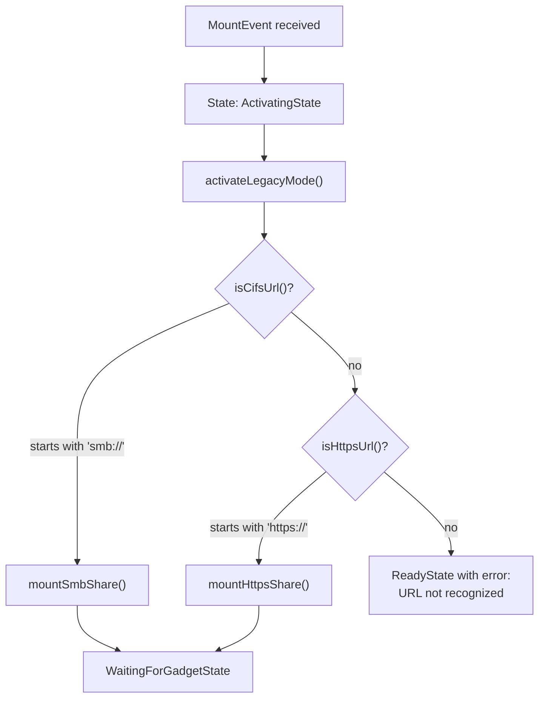
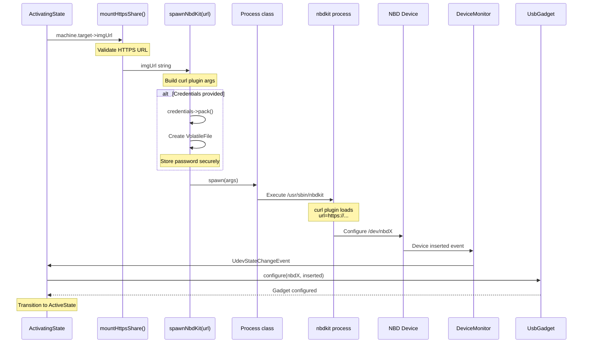
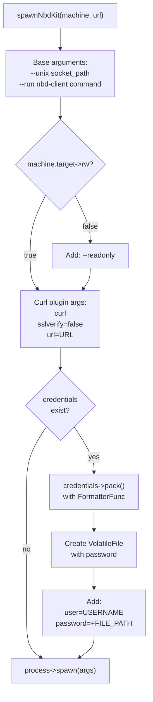
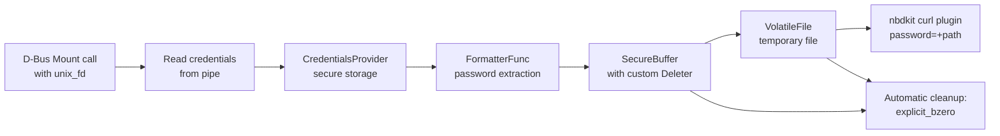

<!-- source: DeepWiki mcp.deepwiki.com · repo NVIDIA/remote-media · extra page HTTPS Image Support · fetched 2026-10-26 -->

# HTTPS Image Support

<details>
<summary>Relevant source files</summary>

The following files were used as context for generating this wiki page:

- [src/state_machine.hpp](src/state_machine.hpp)
- [src/system.hpp](src/system.hpp)

</details>


## Purpose and Scope

This page documents how the virtual media service handles HTTPS image URLs in Legacy Mode (Mode 1). When a client mounts an image from an HTTPS URL, the system uses nbdkit's curl plugin to fetch and serve the remote image as a local NBD device, which is then presented as a USB mass storage gadget to the host system.

For information about CIFS/SMB share mounting, see [SMB/CIFS Share Mounting](#3.3.1). For the overall mount operation workflow, see [MountPointStateMachine](#3.1). For authentication and credential handling details, see [Credential Management](#5.1).

## Overview

HTTPS image support enables the virtual media service to mount disk images hosted on web servers without requiring a local copy. The system streams data directly from the HTTPS endpoint through nbdkit's curl plugin, providing on-demand access to remote images. This contrasts with CIFS mounting, which requires mounting a network share to the local filesystem before serving the image file.

**Key characteristics:**
- No intermediate mount point required
- Direct streaming from HTTPS endpoint
- Optional HTTP Basic authentication support
- SSL/TLS support with certificate verification disabled by default
- Automatic cleanup of credential files

Sources: [src/state_machine.hpp:645-720]()

## HTTPS URL Detection and Routing

When the `MountPointStateMachine` receives a mount request in Legacy Mode, it examines the provided URL to determine the protocol handler.



**URL validation functions:**

| Function | Location | Purpose |
|----------|----------|---------|
| `isHttpsUrl()` | [src/state_machine.hpp:868-871]() | Checks if URL starts with `"https://"` |
| `checkUrl()` | [src/state_machine.hpp:838-842]() | Helper for scheme comparison |
| `getImagePathFromHttpsUrl()` | [src/state_machine.hpp:873-877]() | Extracts path component from HTTPS URL |

The routing logic is implemented in `ActivationStartedEvent::activateLegacyMode()`:

```
[src/state_machine.hpp:645-663]()
```

Sources: [src/state_machine.hpp:645-663](), [src/state_machine.hpp:838-877]()

## HTTPS Mount Operation Flow

The complete sequence from HTTPS URL to active virtual media device follows this flow:



The implementation is divided into two `spawnNbdKit()` overloads:

1. **For local files** (used by CIFS): `spawnNbdKit(machine, fs::path)` at [src/state_machine.hpp:796-804]()
2. **For URLs** (used by HTTPS): `spawnNbdKit(machine, std::string)` at [src/state_machine.hpp:806-836]()

Sources: [src/state_machine.hpp:706-720](), [src/state_machine.hpp:806-836]()

## nbdkit curl Plugin Configuration

The `spawnNbdKit()` function constructs command-line arguments for nbdkit to use the curl plugin. The resulting command structure is:

```
/usr/sbin/nbdkit 
  --unix /tmp/nbd0.sock
  --run "nbd-client -unix /tmp/nbd0.sock /dev/nbd0"
  [--readonly]
  curl
  sslverify=false
  url=https://example.com/image.iso
  [user=USERNAME]
  [password=+/tmp/volatile_XXXXX]
```

### Command-Line Argument Construction



**Key parameters:**

| Parameter | Value | Purpose | Source Line |
|-----------|-------|---------|-------------|
| `--unix` | `machine.config.unixSocket` | Unix domain socket for IPC | [src/state_machine.hpp:760-761]() |
| `--run` | `nbd-client ...` command | Auto-connect client after ready | [src/state_machine.hpp:764-765]() |
| `--readonly` | (flag) | Mount as read-only if `!rw` | [src/state_machine.hpp:772-775]() |
| `curl` | (plugin name) | Use curl plugin | [src/state_machine.hpp:811]() |
| `sslverify=false` | (option) | Disable SSL certificate verification | [src/state_machine.hpp:812]() |
| `url=` | HTTPS URL | Source image location | [src/state_machine.hpp:814]() |
| `user=` | Username | HTTP Basic auth username | [src/state_machine.hpp:831]() |
| `password=+` | File path | Read password from file | [src/state_machine.hpp:832]() |

Sources: [src/state_machine.hpp:758-778](), [src/state_machine.hpp:810-835]()

## Authentication Support

HTTPS URLs can include HTTP Basic authentication credentials. When provided, the credentials are securely handled through a multi-layer approach.

### Credential Flow



### Implementation Details

When credentials are present in `machine.target->credentials`, the password is extracted and written to a temporary file:

**Step 1: Pack credentials into SecureBuffer**
```
[src/state_machine.hpp:820-826]()
```

The `FormatterFunc` lambda copies only the password into the buffer, as nbdkit's curl plugin handles username separately.

**Step 2: Create VolatileFile**
```
[src/state_machine.hpp:829]()
```

`VolatileFile` creates a temporary file with restrictive permissions and writes the password to it. The file path is then used with nbdkit's `password=+` syntax.

**Step 3: Pass to nbdkit**
```
[src/state_machine.hpp:831-832]()
```

The `+` prefix in `password=+` tells nbdkit to read the password from the specified file path.

**Step 4: Automatic cleanup**

The `VolatileFile` is captured by the process exit callback and automatically cleaned when the process ends:

```
[src/state_machine.hpp:781-786]()
```

The `SecureBuffer` uses a custom deleter that calls `secureCleanup()` with `explicit_bzero()` to prevent password recovery from memory dumps. See [Memory Protection](#5.3) for details.

Sources: [src/state_machine.hpp:817-833](), [src/state_machine.hpp:781-786]()

## Comparison: HTTPS vs CIFS

The table below highlights the key differences between the two mounting methods in Legacy Mode:

| Aspect | HTTPS Mounting | CIFS Mounting |
|--------|----------------|---------------|
| **Mount point** | None required | Created via `SmbShare::createMountDir()` |
| **File system mounting** | No | Yes, via `mount.cifs` |
| **nbdkit plugin** | `curl` | `file` |
| **nbdkit argument** | `url=https://...` | `file=/tmp/mount_XXX/image.iso` |
| **Intermediate storage** | None | Mounted network share |
| **URL format** | `https://server/path/image.iso` | `smb://server/share/path/image.iso` |
| **Path extraction** | Not needed | `getImagePath()` extracts file path |
| **Function entry point** | `mountHttpsShare()` [line 706]() | `mountSmbShare()` [line 665]() |
| **Cleanup requirements** | Close nbdkit only | Unmount share + close nbdkit |
| **State on success** | `WaitingForGadgetState` | `WaitingForGadgetState` |

Both methods converge at the `WaitingForGadgetState`, where the system waits for the NBD device to be detected by udev before configuring the USB gadget. The fundamental difference is that HTTPS streams data directly through nbdkit's curl plugin, while CIFS requires mounting the remote share to access the image file locally.

Sources: [src/state_machine.hpp:665-704](), [src/state_machine.hpp:706-720]()

## Process Lifecycle

Once nbdkit is spawned with the curl plugin, the `Process` class manages its lifecycle:

```mermaid
stateDiagram-v2
    [*] --> Spawning: spawn(args, onExit)
    Spawning --> Running: boost::process::child created
    Running --> OutputReading: async_read_until('\n')
    OutputReading --> OutputReading: Log output lines
    OutputReading --> Terminating: Exit detected
    Terminating --> GracefulWait: Wait 20 x 100ms
    GracefulWait --> Terminated: Process exits
    GracefulWait --> ForceTerminate: Timeout
    ForceTerminate --> Terminated: child.terminate()
    Terminated --> Callback: onExit(exitCode, isReady)
    Callback --> [*]
    
    Running --> StopRequested: stop() called
    StopRequested --> Disconnect: dev.disconnect()
    Disconnect --> GracefulWait
```

The `Process` class provides:

- **Asynchronous output reading**: Lines from stdout/stderr are logged in real-time [src/system.hpp:382-414]()
- **Graceful termination**: 2-second grace period before forced kill [src/system.hpp:419-431]()
- **Exit code capture**: Exit status reported via callback [src/system.hpp:436-438]()
- **NBD disconnect on stop**: Ensures clean shutdown [src/system.hpp:448]()

When nbdkit exits (either normally or due to errors), the exit callback invokes `machine.emitSubprocessStoppedEvent()`, triggering the state machine to clean up and return to `ReadyState`.

Sources: [src/system.hpp:356-481](), [src/state_machine.hpp:781-786]()

## Error Handling

HTTPS mounting can fail at several points:

| Failure Point | Error Code | Error Message | Handling |
|---------------|------------|---------------|----------|
| URL not recognized | `std::errc::invalid_argument` | "URL not recognized" | Return to `ReadyState` [line 661]() |
| nbdkit spawn failure | `std::errc::operation_canceled` | "Failed to mount HTTPS share" | Return to `ReadyState` [line 713]() |
| Process creation failure | `std::errc::operation_canceled` | "Failed to allocate process" | Return to `ReadyState` [line 626-628]() |
| nbdkit exits prematurely | `std::errc::io_error` | "Process ended prematurely" | `SubprocessStoppedEvent` [line 586-590]() |
| Gadget config failure | `std::errc::device_or_resource_busy` | "Unable to configure gadget" | Return to `ReadyState` [line 931-932]() |

All error states transition back to `ReadyState` with an `error` field populated, which is exposed to D-Bus clients via the mount operation's return value. The mount D-Bus method waits for either `ActiveState` (success) or `ReadyState` with error (failure) before returning to the caller.

Sources: [src/state_machine.hpp:645-663](), [src/state_machine.hpp:706-720](), [src/state_machine.hpp:395-431]()

## Socket and NBD Device Management

The nbdkit process uses Unix domain sockets for IPC with nbd-client:

1. **Socket cleanup**: Before spawning nbdkit, any pre-existing socket is removed [src/state_machine.hpp:738-751]()
2. **Socket path**: Configured in `machine.config.unixSocket`, typically `/tmp/nbdX.sock`
3. **NBD device assignment**: Specified in `machine.config.nbdDevice` (e.g., `/dev/nbd0`)
4. **Auto-connection**: The `--run` parameter causes nbdkit to automatically invoke nbd-client once ready

This architecture keeps network communication local to the BMC, as the socket is not exposed externally. The nbd-client connects to nbdkit via the socket, which then communicates with the kernel NBD module to configure `/dev/nbdX`.

Sources: [src/state_machine.hpp:738-765](), [src/state_machine.hpp:753-756]()

## Verbose Logging

The build option `VM_VERBOSE_NBDKIT_LOGS` adds the `--verbose` flag to nbdkit invocations:

```
[src/state_machine.hpp:767-769]()
```

When enabled, nbdkit produces extensive debug output covering curl operations, HTTP transactions, and NBD protocol details. This is useful for diagnosing connection issues but generates substantial log volume.

Sources: [src/state_machine.hpp:767-769]()

---

