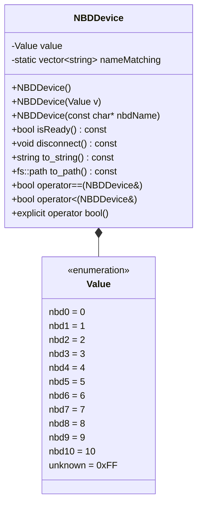
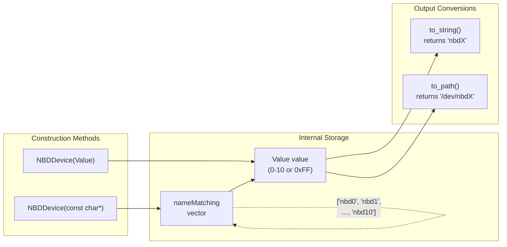
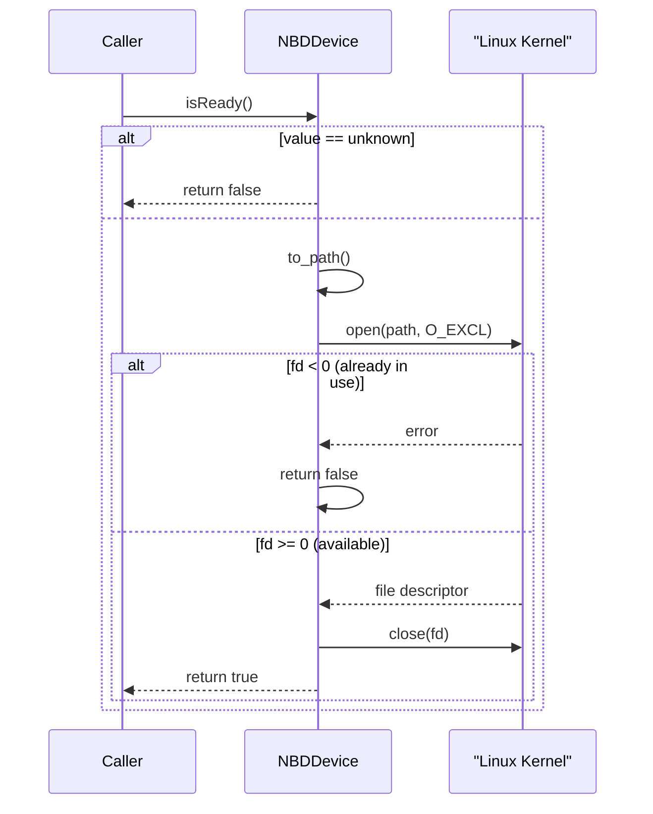
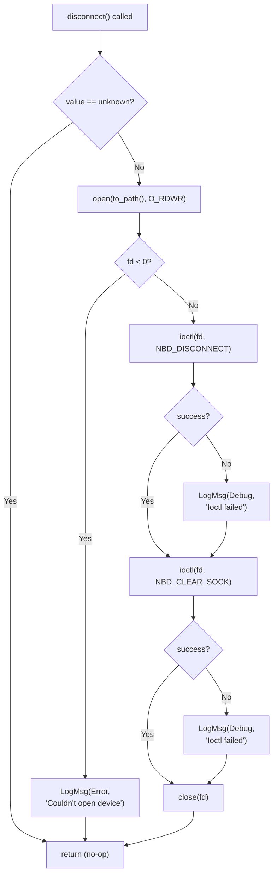
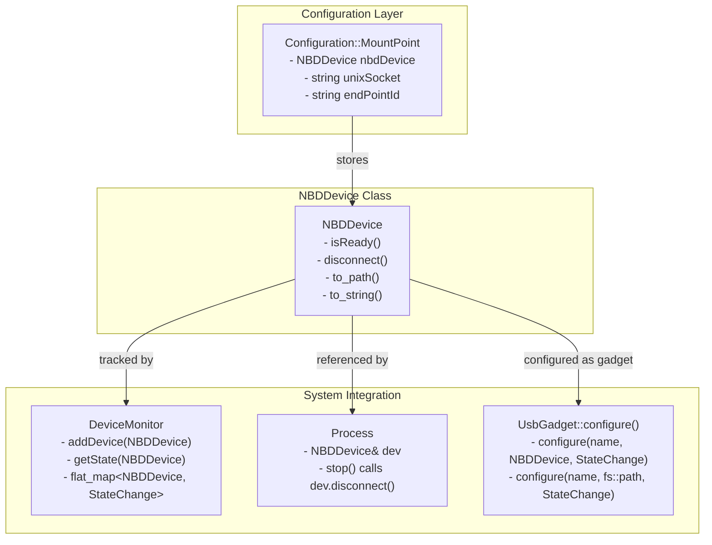
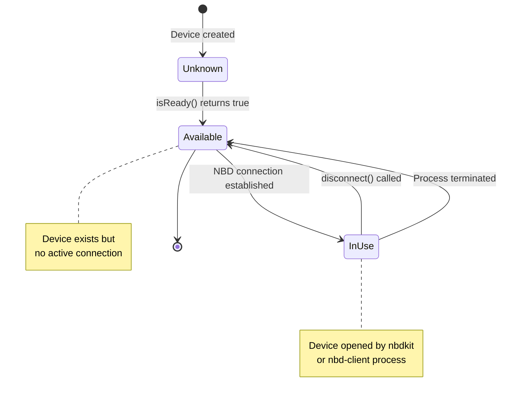

<!-- source: DeepWiki mcp.deepwiki.com · repo NVIDIA/remote-media · extra page NBDDevice Management · fetched 2026-10-26 -->

# NBDDevice Management

<details>
<summary>Relevant source files</summary>

The following files were used as context for generating this wiki page:

- [src/configuration.hpp](src/configuration.hpp)
- [src/system.hpp](src/system.hpp)

</details>


## Purpose and Scope

This document covers the `NBDDevice` class, which provides an abstraction layer for managing Linux Network Block Device (NBD) kernel modules (`/dev/nbd0` through `/dev/nbd10`). The `NBDDevice` class handles device enumeration, state checking, disconnection operations via ioctl commands, and path conversions.

For information about monitoring NBD device insertion and removal events, see [DeviceMonitor](#3.2.2). For details on how NBD devices are configured as USB mass storage gadgets, see [UsbGadget Configuration](#3.2.4).

**Sources:** [src/system.hpp:58-181]()

## Overview

The `NBDDevice` class serves as a type-safe wrapper around Linux NBD device identifiers, providing methods to interact with the kernel's NBD subsystem. It is a fundamental component used throughout the system integration layer for device management, process control, and USB gadget configuration.

### Class Design



The class uses an internal `Value` enumeration to represent NBD device indices (0-10) plus an `unknown` state. The enumeration is intentionally not a `enum class` to avoid verbose naming like `NBDDevice::Device::nbd0`.

**Sources:** [src/system.hpp:58-181]()

## Device Enumeration

The `NBDDevice` class supports devices `nbd0` through `nbd10`, providing a fixed pool of 11 NBD devices for the virtual media service.

### Device Naming and Conversion



The `nameMatching` static vector maps integer indices to device name strings. Construction from a C-string (`const char* nbdName`) searches this vector to find the corresponding `Value` enumeration.

**Sources:** [src/system.hpp:78-92](), [src/system.hpp:178-180]()

### Construction Examples

| Constructor | Input | Resulting Value |
|-------------|-------|-----------------|
| `NBDDevice()` | None | `unknown` |
| `NBDDevice(NBDDevice::nbd0)` | Enum value | `nbd0` |
| `NBDDevice("nbd5")` | String literal | `nbd5` |
| `NBDDevice("invalid")` | Invalid string | `unknown` |
| `NBDDevice(nullptr)` | Null pointer | `unknown` |

**Sources:** [src/system.hpp:78-92]()

## Device State Checking

The `isReady()` method determines if an NBD device is available for use by attempting to open it with the `O_EXCL` flag.

### isReady() Implementation



The `O_EXCL` flag ensures that the device is not currently in use. If the open succeeds, the device is available; if it fails, the device is either in use or inaccessible.

**Sources:** [src/system.hpp:116-129]()

### Usage Pattern

The `isReady()` method is called in two primary scenarios:

1. **Process Exit Handling**: After a child process (nbdkit or nbd-client) terminates, the system checks if the NBD device is still ready to determine the health of the termination. [src/system.hpp:438]()

2. **Pre-activation Validation**: Before starting mount operations, the system verifies that the assigned NBD device is available.

**Sources:** [src/system.hpp:116-129](), [src/system.hpp:438]()

## Device Disconnect Operations

The `disconnect()` method forcibly disconnects an NBD device using kernel ioctl commands, terminating any active NBD connection.

### Disconnect Implementation Flow



### ioctl Commands

The disconnect operation uses two kernel ioctl commands defined at the top of [src/system.hpp:55-56]():

| Command | Value | Purpose |
|---------|-------|---------|
| `NBD_DISCONNECT` | `_IO(0xab, 8)` | Terminates the NBD connection and clears the block device |
| `NBD_CLEAR_SOCK` | `_IO(0xab, 4)` | Clears the socket associated with the NBD device |

These are standard Linux NBD kernel API commands. The `_IO()` macro constructs ioctl request codes following Linux conventions.

**Sources:** [src/system.hpp:55-56](), [src/system.hpp:131-154]()

### Error Handling

The `disconnect()` method uses debug-level logging for ioctl failures rather than error-level, because disconnect operations are often called during cleanup when the device may already be disconnected. The method prioritizes best-effort cleanup over strict error enforcement.

**Sources:** [src/system.hpp:145-152]()

## Path Conversion Methods

The `NBDDevice` class provides two methods for converting device identifiers to usable formats:

### to_string() Method

Returns the device name as a string (e.g., `"nbd0"`, `"nbd5"`). Returns empty string if `value == unknown`.

```cpp
std::string deviceName = nbdDevice.to_string();  // "nbd3"
```

**Sources:** [src/system.hpp:156-163]()

### to_path() Method

Returns the full device path as a `std::filesystem::path` (e.g., `/dev/nbd0`). Returns empty path if `value == unknown`.

```cpp
fs::path devicePath = nbdDevice.to_path();  // "/dev/nbd3"
```

The implementation constructs the path by joining `"/dev"` with the device name from `nameMatching`:

```
/dev/nbd0
/dev/nbd1
...
/dev/nbd10
```

**Sources:** [src/system.hpp:165-173]()

## Integration with System Components

The `NBDDevice` class integrates with multiple components across the system integration layer:



### Configuration Binding

Each mount point in the configuration is bound to a specific `NBDDevice`:

```json
{
  "MountPoints": {
    "Slot_0": {
      "NBDDevice": "nbd0",
      "UnixSocket": "/tmp/nbd0.sock",
      ...
    }
  }
}
```

The configuration parser constructs `NBDDevice` instances from string names. [src/configuration.hpp:105-127]()

**Sources:** [src/configuration.hpp:105-127](), [src/system.hpp:58-181]()

### DeviceMonitor Integration

The `DeviceMonitor` class uses `NBDDevice` as keys in its internal `flat_map` to track device states:

```cpp
boost::container::flat_map<NBDDevice, StateChange> devices;
```

The class provides:
- `addDevice(const NBDDevice&)`: Registers a device for monitoring [src/system.hpp:329-334]()
- `getState(const NBDDevice&)`: Queries current device state [src/system.hpp:336-344]()

The comparison operators (`operator==`, `operator<`) make `NBDDevice` usable as a map key.

**Sources:** [src/system.hpp:329-344](), [src/system.hpp:353]()

### Process Management Integration

The `Process` class holds a const reference to an `NBDDevice`:

```cpp
Process(boost::asio::io_context& ioc, const std::string& name,
        const std::string& app, const NBDDevice& dev)
```

When stopping a process, it calls `dev.disconnect()` to forcibly terminate the NBD connection before attempting graceful process termination. [src/system.hpp:443-467]()

**Sources:** [src/system.hpp:356-481]()

### UsbGadget Integration

The `UsbGadget::configure()` method has two overloads:

1. `configure(name, NBDDevice, StateChange, rw)`: Accepts an `NBDDevice` and converts it to a path [src/system.hpp:501-505]()
2. `configure(name, fs::path, StateChange, rw)`: Accepts a path directly [src/system.hpp:507-625]()

The NBD device path is written to the USB gadget's LUN file descriptor:
```cpp
echoToFile(funcMassStorageDir / "lun.0/file", path);
```

**Sources:** [src/system.hpp:501-550]()

## Device State Lifecycle



The `NBDDevice` class itself does not maintain state; it provides methods for querying and manipulating kernel-level NBD device state. The actual device lifecycle is managed by:

1. **Kernel NBD module**: Maintains connection state
2. **DeviceMonitor**: Tracks insertion/removal events via udev
3. **MountPointStateMachine**: Orchestrates overall lifecycle

**Sources:** [src/system.hpp:58-181]()

## Operator Overloads

The `NBDDevice` class provides several operator overloads to support comparison and boolean conversion:

| Operator | Purpose | Use Case |
|----------|---------|----------|
| `operator==` | Equality comparison | Map lookups, validation |
| `operator!=` | Inequality comparison | Conditional logic |
| `operator<` | Less-than comparison | Sorting, ordered containers |
| `explicit operator bool` | Boolean conversion | Validity checking |

The boolean operator returns `true` if `value != unknown`, enabling idiomatic checks:

```cpp
NBDDevice dev("nbd0");
if (dev) {
    // Device is valid
}
```

**Sources:** [src/system.hpp:99-114]()

---

