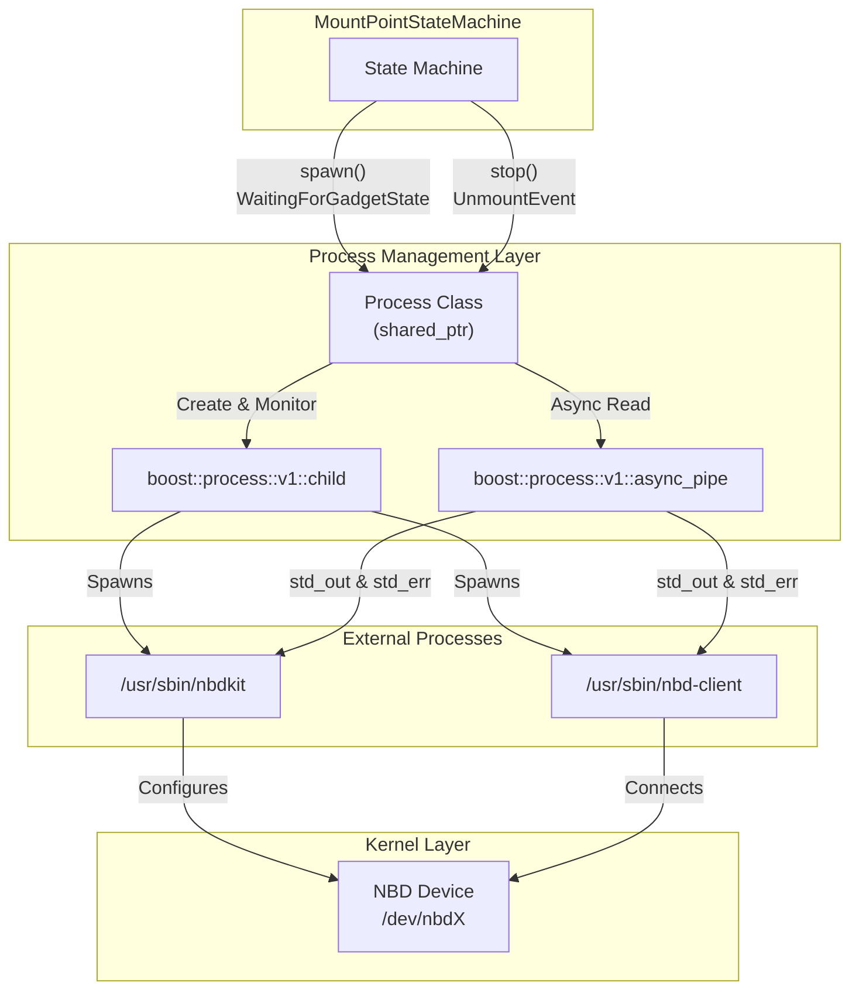
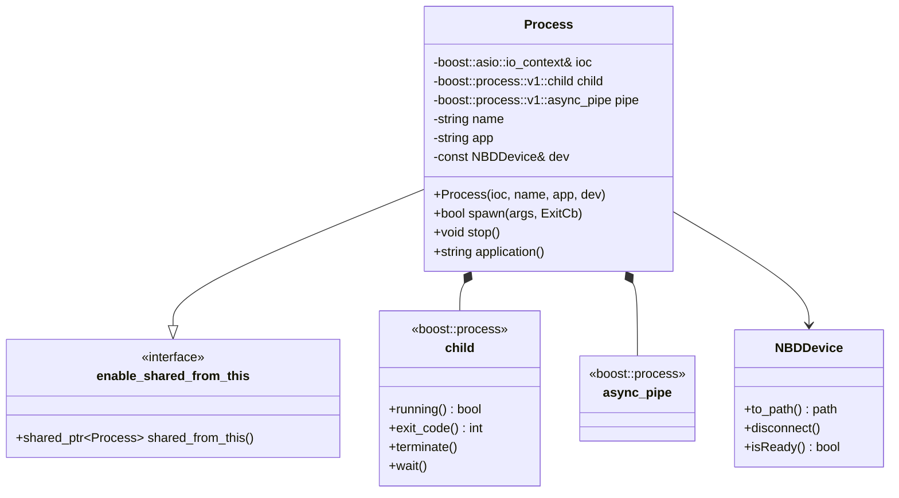
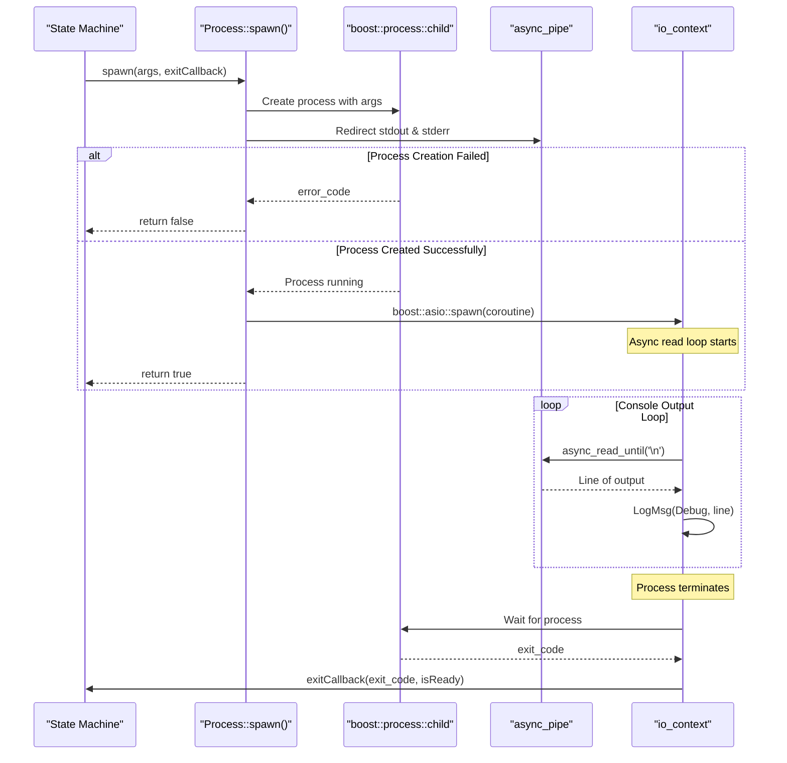
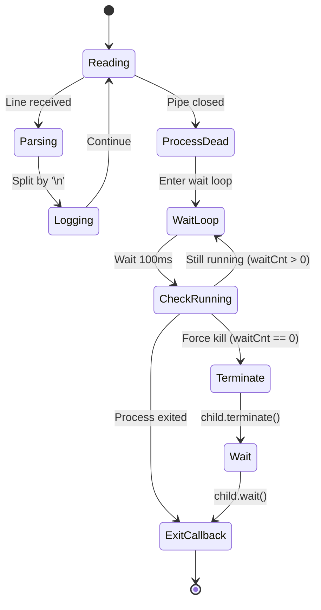
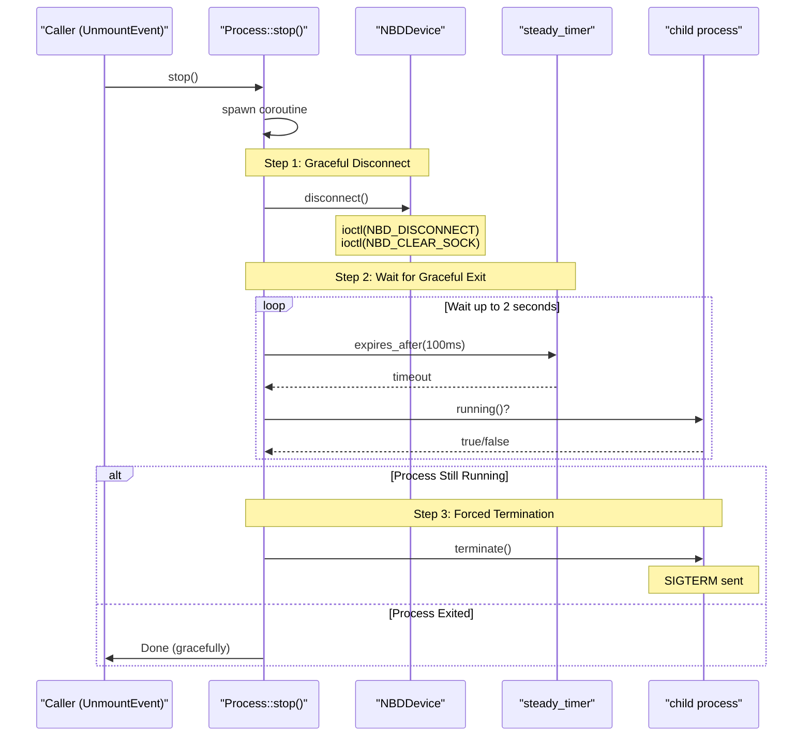
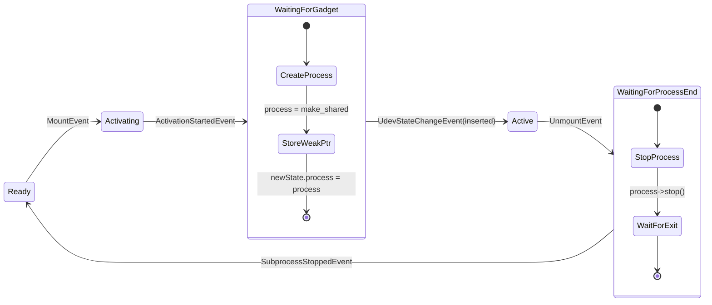
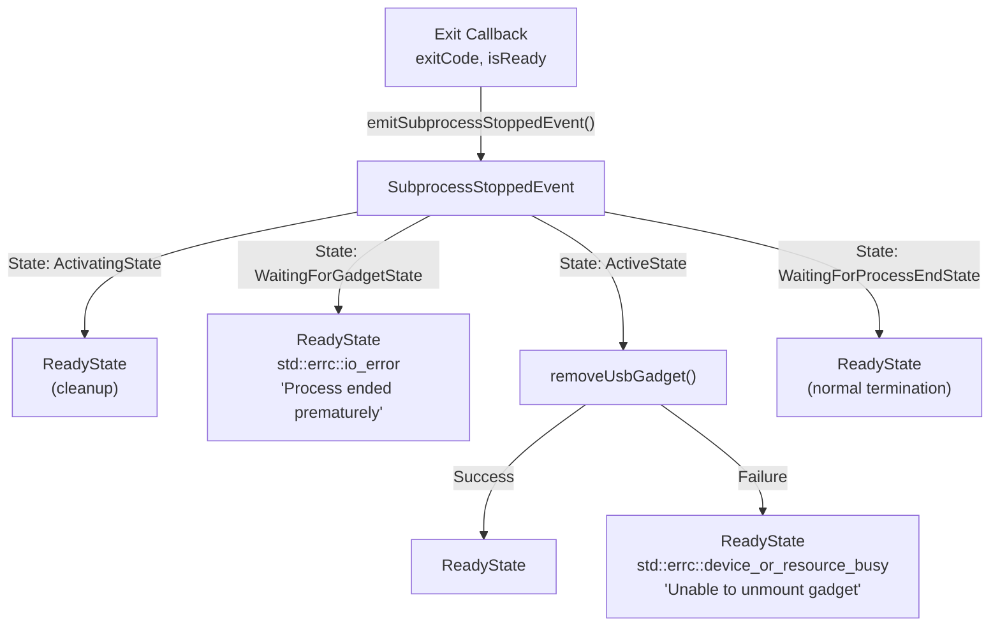
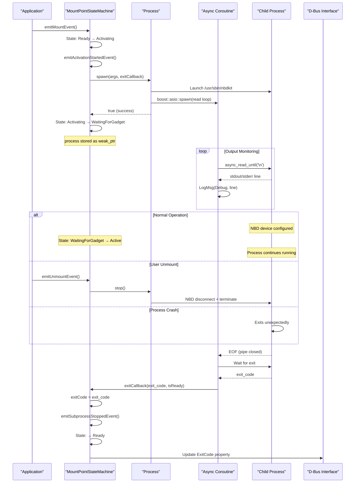

<!-- source: DeepWiki mcp.deepwiki.com · repo NVIDIA/remote-media · extra page Process Management · fetched 2026-10-26 -->

# Process Management

<details>
<summary>Relevant source files</summary>

The following files were used as context for generating this wiki page:

- [src/state_machine.hpp](src/state_machine.hpp)
- [src/system.hpp](src/system.hpp)

</details>


## Purpose and Scope

This document describes the process management subsystem within the remote-media virtual media service. It covers the `Process` class, which is responsible for spawning and managing external child processes (`nbdkit` and `nbd-client`), monitoring their output, and handling graceful and forced termination. This component provides the runtime execution infrastructure that enables virtual media operations.

For information about how processes are integrated into the overall virtual media lifecycle, see [MountPointStateMachine](#3.1). For details on device monitoring that complements process management, see [DeviceMonitor](#3.2.2).

**Sources:** [src/system.hpp:356-481]()

---

## Overview

The virtual media service relies on two external processes to implement its functionality:

| Process | Mode | Purpose | Managed By |
|---------|------|---------|------------|
| `nbdkit` | Legacy | Serves image files or HTTPS URLs as NBD block devices | `Process` class |
| `nbd-client` | Proxy | Connects to external NBD server via Unix socket | `Process` class |

The `Process` class provides a unified interface for spawning, monitoring, and terminating these processes asynchronously using Boost.Asio and Boost.Process. Each process is associated with an `NBDDevice` and operates within the application's `io_context` event loop.



**Sources:** [src/system.hpp:356-481](), [src/state_machine.hpp:620-643](), [src/state_machine.hpp:665-720]()

---

## Process Class Architecture

### Class Structure

The `Process` class is defined in [src/system.hpp:356-481]() and uses `std::enable_shared_from_this` to manage its lifetime safely in asynchronous operations.



**Key Members:**

| Member | Type | Purpose |
|--------|------|---------|
| `ioc` | `boost::asio::io_context&` | Event loop for asynchronous operations |
| `child` | `boost::process::v1::child` | Boost.Process child process handle |
| `pipe` | `boost::process::v1::async_pipe` | Asynchronous pipe for stdout/stderr |
| `name` | `std::string` | Mount point name for logging |
| `app` | `std::string` | Path to executable (`/usr/sbin/nbdkit` or `/usr/sbin/nbd-client`) |
| `dev` | `const NBDDevice&` | Associated NBD device |

**Sources:** [src/system.hpp:356-363]()

---

## Process Spawning

### spawn() Method

The `spawn()` method is a template function that accepts command-line arguments and an exit callback. It is defined in [src/system.hpp:365-441]().



**Arguments Construction:**

For `nbdkit` (legacy mode):
```
Arguments: [
    "--unix", "/tmp/nbd-socket",
    "--run", "/usr/sbin/nbd-client ...",
    "file", "file=/path/to/image.iso"  // or "curl", "url=https://..."
]
```

For `nbd-client` (proxy mode):
```
Arguments: [
    "unix:path=/tmp/nbd-socket",
    "/dev/nbdX",
    "-name", "mount_point_name"
]
```

**Sources:** [src/system.hpp:365-441](), [src/state_machine.hpp:722-836]()

### Output Monitoring

The spawned coroutine continuously reads from the pipe using `async_read_until()` in [src/system.hpp:382-414]():

1. **Async Read Loop**: Reads lines terminated by `\n`
2. **Line Parsing**: Splits multi-line output and logs each line separately
3. **Termination Detection**: Loop breaks when pipe closes (process exits)
4. **Graceful Wait**: Waits up to 2 seconds (20 × 100ms) for process to exit naturally



**Sources:** [src/system.hpp:382-439]()

---

## Process Termination

### stop() Method

The `stop()` method provides graceful termination with fallback to forced termination. It is defined in [src/system.hpp:443-467]().

**Termination Sequence:**



**Key Operations:**

1. **NBD Disconnect**: Calls `dev.disconnect()` which issues `ioctl(NBD_DISCONNECT)` and `ioctl(NBD_CLEAR_SOCK)` [src/system.hpp:131-154]()
2. **Graceful Wait**: Polls `child.running()` with 100ms intervals for up to 2 seconds (waitCnt = 20)
3. **Forced Termination**: If still running after timeout, calls `child.terminate()` to send SIGTERM

**Sources:** [src/system.hpp:443-467](), [src/system.hpp:131-154]()

---

## Process Types and Usage

### nbdkit Process (Legacy Mode)

Created in `spawnNbdKit()` helper functions in [src/state_machine.hpp:722-836]().

**File Plugin** (for CIFS shares):
```
/usr/sbin/nbdkit --unix /tmp/nbdSocket --run "/usr/sbin/nbd-client ..." file file=/tmp/mount_dir/image.iso
```

**Curl Plugin** (for HTTPS URLs):
```
/usr/sbin/nbdkit --unix /tmp/nbdSocket --run "/usr/sbin/nbd-client ..." curl sslverify=false url=https://server/image.iso user=username password=+/tmp/secret.txt
```

**Key Features:**
- Uses Unix domain sockets for IPC
- Supports `--readonly` flag based on write protection setting
- Optional `--verbose` flag when `VM_VERBOSE_NBDKIT_LOGS` is enabled
- Credential file cleanup via `VolatileFile` captured in exit callback lambda

**Sources:** [src/state_machine.hpp:722-836]()

### nbd-client Process (Proxy Mode)

Created in `activateProxyMode()` in [src/state_machine.hpp:619-643]().

**Command Line:**
```
/usr/sbin/nbd-client unix:path=/tmp/nbdSocket /dev/nbdX -name mount_point_name
```

Arguments are constructed by `Configuration::MountPoint::toArgs()` which includes:
- Unix socket path
- NBD device path
- Mount point name
- Additional configuration parameters (timeout, block size)

**Sources:** [src/state_machine.hpp:619-643]()

---

## Integration with State Machine

### Process Creation Points

Processes are created at specific state transitions:



**State-Specific Process Handling:**

| State | Process Field | Purpose |
|-------|---------------|---------|
| `WaitingForGadgetState` | `std::weak_ptr<Process> process` | Holds process during device configuration |
| `ActiveState` | `std::weak_ptr<Process> process` | Holds process during active operation |
| `WaitingForProcessEndState` | `std::weak_ptr<Process> process` | Holds process during termination |

**Sources:** [src/state_machine.hpp:128-160]()

### Process Lifecycle in State Machine

**Creation:**
```cpp
auto process = std::make_shared<Process>(
    state.machine.ioc.get(), state.machine.name,
    "/usr/sbin/nbdkit", state.machine.config.nbdDevice);

if (!process->spawn(args, [&machine](int exitCode, bool isReady) {
    machine.exitCode = exitCode;
    machine.emitSubprocessStoppedEvent();
})) {
    return ReadyState(state, std::errc::operation_canceled,
                      "Failed to spawn process");
}

auto newState = WaitingForGadgetState(state);
newState.process = process;  // Store weak_ptr
return newState;
```

**Termination:**
```cpp
void stopProcess(std::weak_ptr<Process> process) {
    if (auto ptr = process.lock()) {
        ptr->stop();
        return;
    }
    LogMsg(Logger::Info, name, " No process to stop");
}
```

**Sources:** [src/state_machine.hpp:620-643](), [src/state_machine.hpp:977-985]()

---

## Exit Code Handling

### Exit Callback Mechanism

The exit callback is invoked when the process terminates, either naturally or forcefully. It receives two parameters:

| Parameter | Type | Description |
|-----------|------|-------------|
| `exitCode` | `int` | Process exit code from `child.exit_code()` |
| `isReady` | `bool` | Result of `dev.isReady()` check |

**Exit Code Storage:**

The exit code is stored in `MountPointStateMachine::exitCode` and exposed via the D-Bus `VirtualMedia.Process` interface:

```cpp
processIface->register_property(
    "ExitCode", int32_t(0),
    [](const int32_t& req, int32_t& property) { return 0; },
    [&machine = state.machine](const int32_t& property) {
        return machine.exitCode;
    });
```

**Sources:** [src/state_machine.hpp:275-280](), [src/state_machine.hpp:781-786](), [src/system.hpp:438]()

### SubprocessStoppedEvent Processing

When the exit callback is invoked, it emits a `SubprocessStoppedEvent` which triggers state transitions:



**Sources:** [src/state_machine.hpp:577-604]()

---

## Error Handling and Edge Cases

### Process Creation Failures

If `boost::process::child` creation fails:
1. `spawn()` logs error and returns `false`
2. State machine transitions to `ReadyState` with `std::errc::operation_canceled`
3. Error message stored: "Failed to spawn process" or "Failed to allocate process"

**Sources:** [src/state_machine.hpp:625-638](), [src/state_machine.hpp:691-697]()

### Premature Process Termination

If the process exits while in `WaitingForGadgetState`:
1. `SubprocessStoppedEvent` is received
2. Cleanup: `stopProcess()` called (no-op if already stopped)
3. Transition to `ReadyState` with `std::errc::io_error` and message "Process ended prematurely"

**Sources:** [src/state_machine.hpp:585-590]()

### Timeout During Termination

If the process doesn't terminate within 2 seconds during `stop()`:
1. `child.terminate()` is called to send SIGTERM
2. `child.wait()` blocks until process exits
3. Exit code is still collected and reported

**Sources:** [src/system.hpp:428-431](), [src/system.hpp:460-465]()

---

## Process Monitoring Flow



**Sources:** [src/system.hpp:365-441](), [src/state_machine.hpp:577-604](), [src/state_machine.hpp:275-280]()

---

## Summary

The `Process` class provides robust, asynchronous process management with the following key characteristics:

| Feature | Implementation |
|---------|----------------|
| **Async I/O** | Boost.Asio coroutines with `async_read_until` |
| **Output Capture** | All stdout/stderr logged in real-time |
| **Graceful Termination** | NBD disconnect + 2-second wait before SIGTERM |
| **Lifetime Management** | `shared_ptr` with `weak_ptr` references in states |
| **Exit Code Reporting** | Exposed via D-Bus `VirtualMedia.Process.ExitCode` |
| **Error Recovery** | State machine handles premature termination |

The process management subsystem integrates tightly with the state machine to ensure reliable spawning, monitoring, and cleanup of external processes that implement the virtual media functionality.

**Sources:** [src/system.hpp:356-481](), [src/state_machine.hpp:113-160](), [src/state_machine.hpp:577-604]()

---

