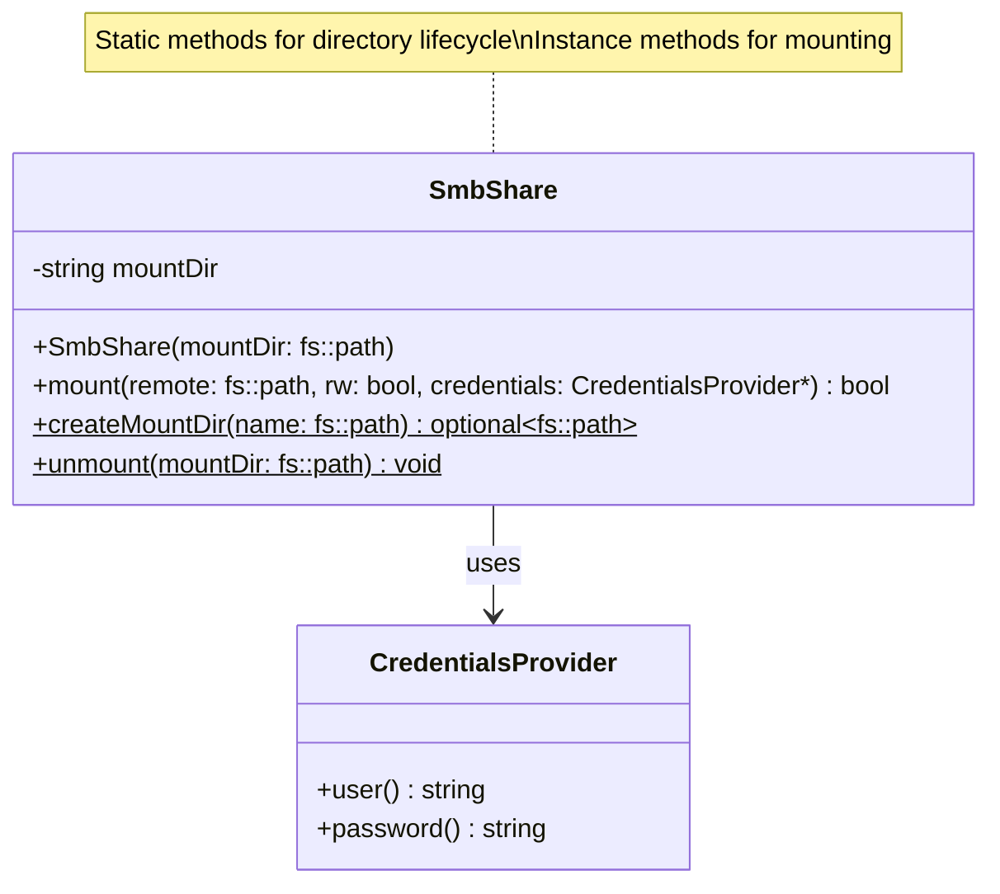
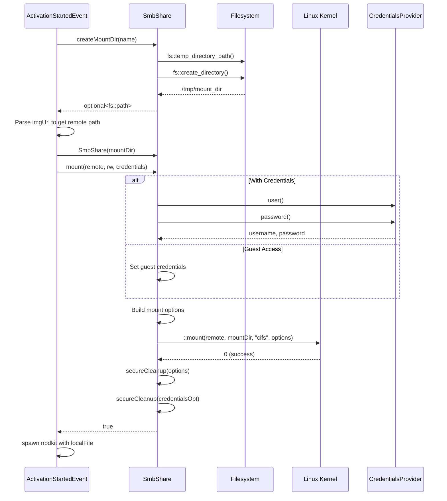
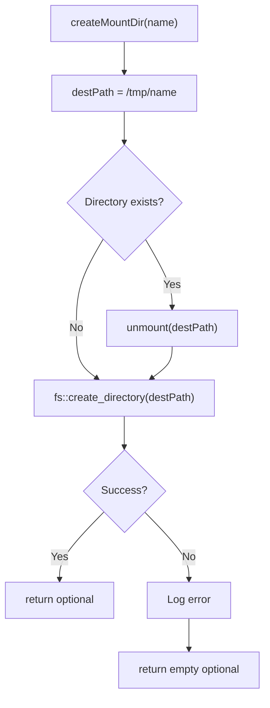
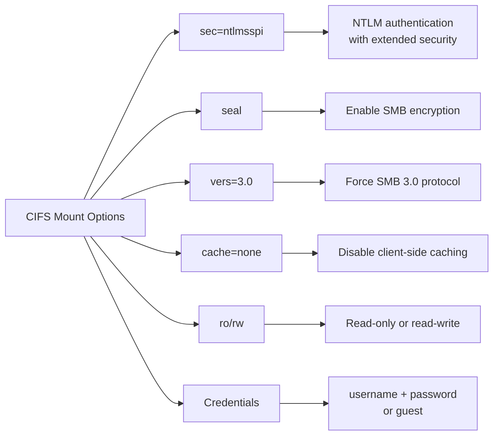
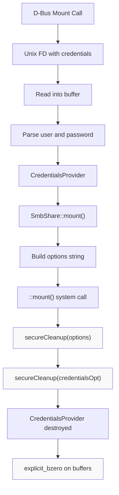
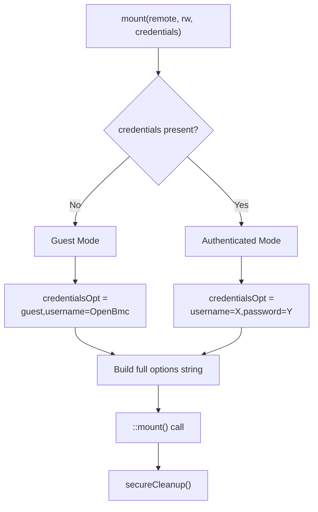
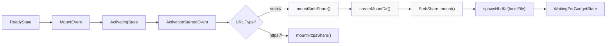
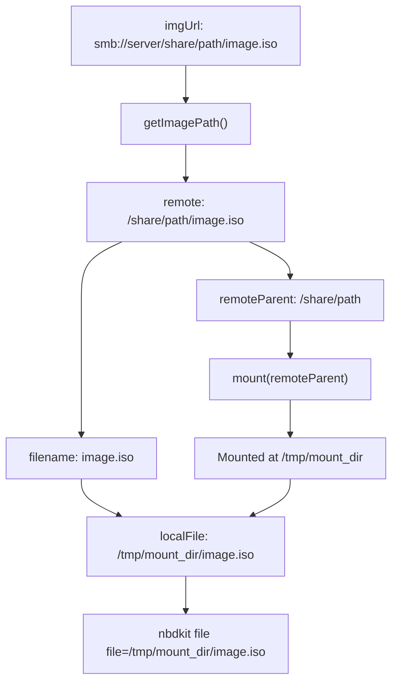
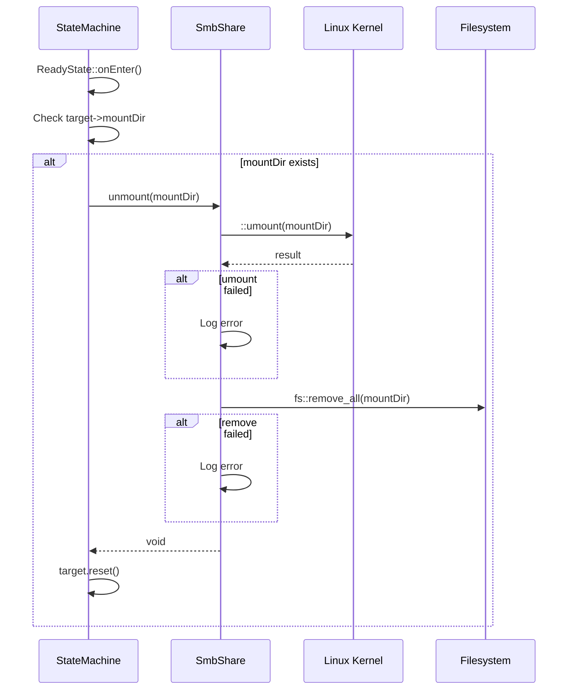

<!-- source: DeepWiki mcp.deepwiki.com · repo NVIDIA/remote-media · extra page SMB/CIFS Share Mounting · fetched 2026-10-26 -->

# SMB/CIFS Share Mounting

<details>
<summary>Relevant source files</summary>

The following files were used as context for generating this wiki page:

- [src/smb.hpp](src/smb.hpp)
- [src/state_machine.hpp](src/state_machine.hpp)
- [src/utils.hpp](src/utils.hpp)

</details>


## Purpose and Scope

This document details the SMB/CIFS share mounting implementation in the virtual media service. The `SmbShare` class provides functionality to mount remote CIFS/SMB network shares as local filesystem paths, which can then be served via nbdkit as virtual media devices. This page focuses specifically on the CIFS mounting mechanism. For HTTPS-based image sources, see [HTTPS Image Support](#3.3.2). For the overall state machine orchestration, see [MountPointStateMachine](#3.1).

The SMB/CIFS mounting capability enables the virtual media service to present ISO images or other disk images stored on Windows file shares or Samba servers to the host system as USB mass storage devices.

## The SmbShare Class

The `SmbShare` class encapsulates all SMB/CIFS mounting operations. It is defined in [src/smb.hpp:13-101]() and provides three primary operations:



**Sources:** [src/smb.hpp:13-101]()

### Key Methods

| Method | Type | Purpose |
|--------|------|---------|
| `createMountDir()` | Static | Creates temporary directory in `/tmp` for mounting |
| `mount()` | Instance | Performs CIFS mount with authentication |
| `unmount()` | Static | Unmounts share and removes directory |

## Mount Process

The SMB/CIFS mounting process involves several coordinated steps orchestrated by the `MountPointStateMachine`.



**Sources:** [src/state_machine.hpp:665-704](), [src/smb.hpp:19-58]()

### Creating Mount Directory

The `createMountDir()` static method creates a temporary mount point:



**Sources:** [src/smb.hpp:60-78]()

The mount directory is created under the system's temporary directory (typically `/tmp`) with the mount point name as a subdirectory. If a directory already exists, the method attempts to unmount it first to ensure a clean state.

### Mounting the Share

The `mount()` method performs the actual CIFS mount operation at [src/smb.hpp:19-58](). The process involves:

1. **Building mount options** - Construct the CIFS mount option string
2. **Handling credentials** - Add authentication parameters (guest or user/password)
3. **Invoking system mount** - Call `::mount()` system call
4. **Secure cleanup** - Zero out credential strings from memory

### CIFS Mount Options

The service uses specific CIFS mount options to ensure secure and reliable connections:



**Sources:** [src/smb.hpp:24-42]()

The complete option string constructed at [src/smb.hpp:24-42]() is:

```
sec=ntlmsspi,seal,vers=3.0,cache=none,{ro|rw},{credentials}
```

| Option | Purpose |
|--------|---------|
| `sec=ntlmsspi` | Use NTLM authentication with extended security (SPNEGO) |
| `seal` | Enable SMB encryption for data transfer |
| `vers=3.0` | Force SMB protocol version 3.0 |
| `cache=none` | Disable client-side caching to ensure data consistency |
| `ro` or `rw` | Mount as read-only or read-write |
| Credentials | Either `guest,username=OpenBmc` or `username=X,password=Y` |

## Credential Handling

Credential security is critical in the SMB mounting process. The system implements multiple layers of protection:



**Sources:** [src/state_machine.hpp:448-484](), [src/smb.hpp:29-48](), [src/utils.hpp:19-57]()

### Credential Flow

1. **Reception** - Credentials arrive via Unix file descriptor from D-Bus [src/state_machine.hpp:453-455]()
2. **Parsing** - User and password are extracted from NULL-delimited buffer [src/state_machine.hpp:473-475]()
3. **Encapsulation** - Wrapped in `CredentialsProvider` [src/state_machine.hpp:478-480]()
4. **Usage** - Passed to `SmbShare::mount()` [src/smb.hpp:36-39]()
5. **Cleanup** - All credential strings are zeroed with `explicit_bzero` [src/smb.hpp:47-48]()

### Guest vs Authenticated Mounting

The mount method supports two authentication modes:



**Sources:** [src/smb.hpp:30-42]()

Guest mounting is used when no credentials are provided [src/smb.hpp:32-33](), while authenticated mounting uses the username and password from the `CredentialsProvider` [src/smb.hpp:37-39]().

## State Machine Integration

The `SmbShare` class is utilized by the `MountPointStateMachine` during the activation process when a CIFS URL is detected.



**Sources:** [src/state_machine.hpp:645-704]()

### URL Parsing and Path Construction

The state machine parses the SMB URL to extract the necessary components:



**Sources:** [src/state_machine.hpp:675-681](), [src/state_machine.hpp:890-907]()

The URL parsing at [src/state_machine.hpp:879-888]() identifies CIFS URLs by the `smb://` scheme prefix. The path is then split into:
- **remoteParent**: The directory to mount (e.g., `/share/path`)
- **filename**: The image file within the mounted share (e.g., `image.iso`)
- **localFile**: The local path after mounting (e.g., `/tmp/mount_dir/image.iso`)

### Mount Sequence in mountSmbShare

The `mountSmbShare()` method at [src/state_machine.hpp:665-704]() orchestrates the entire mount workflow:

1. **Create mount directory** using `SmbShare::createMountDir()` [src/state_machine.hpp:667-672]()
2. **Parse URL** to extract remote path and filename [src/state_machine.hpp:675-681]()
3. **Mount the share** at remoteParent with credentials [src/state_machine.hpp:683-689]()
4. **Spawn nbdkit** to serve the local file [src/state_machine.hpp:691-697]()
5. **Store mount directory** in target for later cleanup [src/state_machine.hpp:701]()

If any step fails, the method performs appropriate cleanup (e.g., removing the mount directory) and returns to `ReadyState` with an error code.

## Unmount Process

The unmount operation reverses the mount process and ensures complete cleanup.



**Sources:** [src/state_machine.hpp:96-108](), [src/smb.hpp:80-97]()

### Unmount Steps

The unmount process at [src/smb.hpp:80-97]() performs two operations:

1. **System unmount** - Calls `::umount()` to detach the CIFS mount [src/smb.hpp:85-90]()
2. **Directory removal** - Removes the mount directory and all contents [src/smb.hpp:92-96]()

Both operations log errors if they fail but do not throw exceptions, ensuring that cleanup attempts continue even if one step fails.

### Automatic Cleanup

The state machine automatically triggers unmount when transitioning to `ReadyState` at [src/state_machine.hpp:96-108](). This ensures that:
- Mount points are not left orphaned after unmount operations
- Resources are cleaned up when processes fail
- Mount directories are reusable for subsequent mount operations

## Error Handling

The SMB mounting implementation includes error handling at multiple levels:

| Error Condition | Handling | Location |
|----------------|----------|----------|
| Mount directory creation fails | Return empty optional | [src/smb.hpp:70-77]() |
| Mount system call fails | Return false, log errno | [src/smb.hpp:50-55]() |
| Unmount fails | Log error, continue cleanup | [src/smb.hpp:85-90]() |
| Directory removal fails | Log error, continue cleanup | [src/smb.hpp:92-96]() |
| Malformed credentials | Throw SdBusError | [src/state_machine.hpp:467-470]() |
| Mount failed in state machine | Transition to ReadyState with error | [src/state_machine.hpp:686-689]() |

The error handling strategy is:
- **Creation failures** return empty optionals or false to indicate failure
- **Cleanup failures** are logged but don't propagate errors (best-effort cleanup)
- **State machine errors** transition to `ReadyState` with appropriate error codes and messages

**Sources:** [src/smb.hpp:13-101](), [src/state_machine.hpp:665-704]()

---

