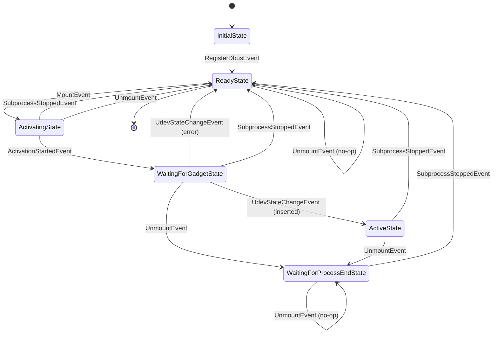
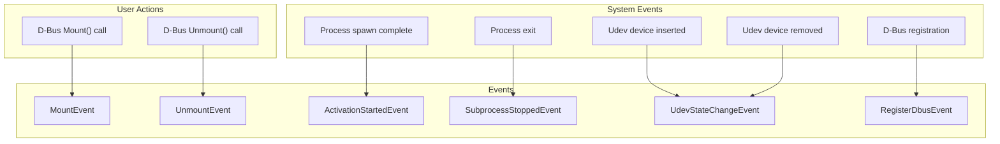
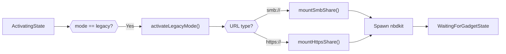

<!-- source: DeepWiki mcp.deepwiki.com · repo NVIDIA/remote-media · extra page State Transitions · fetched 2026-10-26 -->

# State Transitions

<details>
<summary>Relevant source files</summary>

The following files were used as context for generating this wiki page:

- [src/state_machine.hpp](src/state_machine.hpp)

</details>


## Purpose and Scope

This page documents the state definitions and state transitions within the `MountPointStateMachine` class. It describes the six states that manage the virtual media lifecycle, the conditions that trigger transitions between states, and the actions performed upon entering each state.

For information about event types and event processing logic, see [Event Handling](#3.1.2). For details about the D-Bus interfaces registered by the state machine, see [D-Bus Interfaces Exposed](#3.1.3).

## State Machine Overview

The `MountPointStateMachine` implements a finite state machine using `std::variant` to represent the current state. The state machine progresses through well-defined states during mount and unmount operations, ensuring proper resource management and error handling.

**State Definition**: [src/state_machine.hpp:162-164]()

```cpp
using State = std::variant<InitialState, ReadyState, ActivatingState,
                           WaitingForGadgetState, ActiveState,
                           WaitingForProcessEndState>;
```

**Sources**: [src/state_machine.hpp:162-164]()

## State Definitions

The state machine defines six distinct states, each inheriting from `BasicState`:

| State | Purpose | Data Members | Line Reference |
|-------|---------|--------------|----------------|
| `InitialState` | Transient initial state before D-Bus registration | None | [src/state_machine.hpp:75-81]() |
| `ReadyState` | Idle state, ready to accept mount requests | `std::optional<Error> error` | [src/state_machine.hpp:83-111]() |
| `ActivatingState` | Transient state during mount activation | None | [src/state_machine.hpp:113-126]() |
| `WaitingForGadgetState` | Waiting for NBD device insertion event | `std::weak_ptr<Process> process` | [src/state_machine.hpp:128-135]() |
| `ActiveState` | Virtual media is mounted and active | `std::weak_ptr<Process> process` | [src/state_machine.hpp:137-145]() |
| `WaitingForProcessEndState` | Waiting for subprocess cleanup | `std::weak_ptr<Process> process` | [src/state_machine.hpp:147-160]() |

**Sources**: [src/state_machine.hpp:75-164]()

## Complete State Transition Diagram



**Sources**: [src/state_machine.hpp:75-164](), [src/state_machine.hpp:210-961]()

## State Details

### InitialState

**Purpose**: Transient state that exists only until D-Bus interfaces are registered.

**Entry Actions**: None (`onEnter` not overridden)

**Transitions Out**:
- `RegisterDbusEvent` → `ReadyState`: Occurs during application initialization after D-Bus interfaces are registered [src/state_machine.hpp:220-231]()

**Data Members**: None beyond `BasicState`

**Sources**: [src/state_machine.hpp:75-81](), [src/state_machine.hpp:220-231]()

### ReadyState

**Purpose**: Idle state indicating the mount point is available for new mount operations. May contain error information from a previous failed operation.

**Entry Actions**: [src/state_machine.hpp:96-108]()
- Cleanup SMB mount directory if it exists
- Reset the `target` member to clear previous mount information

**Transitions Out**:
- `MountEvent` → `ActivatingState`: User-initiated mount request [src/state_machine.hpp:524-527]()
- `UnmountEvent` → `ReadyState`: No-op when already ready [src/state_machine.hpp:569-574]()

**Data Members**:
- `std::optional<Error> error`: Contains error code and message if the previous operation failed [src/state_machine.hpp:110]()

**Error Structure**: [src/state_machine.hpp:31-35]()
```cpp
struct Error
{
    std::errc code;
    std::string message;
};
```

**Sources**: [src/state_machine.hpp:83-111](), [src/state_machine.hpp:524-527]()

### ActivatingState

**Purpose**: Transient state during which the system spawns processes (nbdkit or nbd-client) and prepares resources for mounting.

**Entry Actions**: [src/state_machine.hpp:119-125]()
- Reset `exitCode` to -1
- Emit `ActivationStartedEvent` to trigger activation logic

**Transitions Out**:
- `ActivationStartedEvent` → `WaitingForGadgetState`: Process spawned successfully [src/state_machine.hpp:610-643]() (proxy mode) or [src/state_machine.hpp:645-720]() (legacy mode)
- `ActivationStartedEvent` → `ReadyState`: Process spawn failed [src/state_machine.hpp:625-628](), [src/state_machine.hpp:636-639]()
- `UnmountEvent` → `ReadyState`: Mount cancelled before process started [src/state_machine.hpp:540-543]()
- `SubprocessStoppedEvent` → `ReadyState`: Process ended unexpectedly [src/state_machine.hpp:581-584]()

**Data Members**: None beyond `BasicState`

**Sources**: [src/state_machine.hpp:113-126](), [src/state_machine.hpp:610-720]()

### WaitingForGadgetState

**Purpose**: State after a process (nbdkit or nbd-client) has been spawned, waiting for udev to detect the NBD device insertion so the USB gadget can be configured.

**Entry Actions**: None (`onEnter` not overridden)

**Transitions Out**:
- `UdevStateChangeEvent(inserted)` → `ActiveState`: NBD device detected and USB gadget configured successfully [src/state_machine.hpp:915-930]()
- `UdevStateChangeEvent(inserted)` → `ReadyState`: USB gadget configuration failed [src/state_machine.hpp:931-933]()
- `UdevStateChangeEvent(removed)` → `ReadyState`: Unexpected device removal [src/state_machine.hpp:934-937]()
- `UnmountEvent` → `WaitingForProcessEndState`: User-initiated unmount before activation complete [src/state_machine.hpp:544-548]()
- `SubprocessStoppedEvent` → `ReadyState`: Process ended before device appeared [src/state_machine.hpp:585-590]()

**Data Members**:
- `std::weak_ptr<Process> process`: Reference to the spawned nbdkit or nbd-client process [src/state_machine.hpp:134]()

**Sources**: [src/state_machine.hpp:128-135](), [src/state_machine.hpp:915-937]()

### ActiveState

**Purpose**: Normal operating state where the virtual media device is fully mounted, the USB gadget is configured, and the host can access the device.

**Entry Actions**: None (`onEnter` not overridden)

**Transitions Out**:
- `UnmountEvent` → `WaitingForProcessEndState`: User-initiated unmount [src/state_machine.hpp:549-562]()
  - Removes USB gadget configuration
  - Stops the process
  - Emits D-Bus `RESOURCE_DELETED` event
- `UnmountEvent` → `ReadyState`: If USB gadget removal fails [src/state_machine.hpp:552-555]()
- `SubprocessStoppedEvent` → `ReadyState`: Process ended unexpectedly (e.g., crash, remote disconnect) [src/state_machine.hpp:591-599]()
- `SubprocessStoppedEvent` → `ReadyState`: If USB gadget removal fails [src/state_machine.hpp:593-597]()

**Data Members**:
- `std::weak_ptr<Process> process`: Reference to the running nbdkit or nbd-client process [src/state_machine.hpp:144]()

**Sources**: [src/state_machine.hpp:137-145](), [src/state_machine.hpp:549-599]()

### WaitingForProcessEndState

**Purpose**: State during unmount where the USB gadget has been removed and the system is waiting for the nbdkit or nbd-client process to terminate cleanly.

**Entry Actions**: None (`onEnter` not overridden)

**Transitions Out**:
- `SubprocessStoppedEvent` → `ReadyState`: Process terminated [src/state_machine.hpp:600-603]()
- `UnmountEvent` → `WaitingForProcessEndState`: No-op if already waiting for cleanup [src/state_machine.hpp:563-568]()

**Data Members**:
- `std::weak_ptr<Process> process`: Reference to the process being terminated [src/state_machine.hpp:159]()

**Sources**: [src/state_machine.hpp:147-160](), [src/state_machine.hpp:600-603]()

## Transition Trigger Summary



**Sources**: [src/state_machine.hpp:210-961]()

## State Transition Conditions

### Initialization Flow

| From State | Event | Condition | To State | Code Reference |
|------------|-------|-----------|----------|----------------|
| `InitialState` | `RegisterDbusEvent` | Always | `ReadyState` | [src/state_machine.hpp:220-231]() |

### Mount Flow (Happy Path)

| From State | Event | Condition | To State | Code Reference |
|------------|-------|-----------|----------|----------------|
| `ReadyState` | `MountEvent` | Slot is empty | `ActivatingState` | [src/state_machine.hpp:524-527]() |
| `ActivatingState` | `ActivationStartedEvent` | Process spawned | `WaitingForGadgetState` | [src/state_machine.hpp:640-642](), [src/state_machine.hpp:699-703]() |
| `WaitingForGadgetState` | `UdevStateChangeEvent` | `devState == inserted` | `ActiveState` | [src/state_machine.hpp:917-930]() |

### Unmount Flow (Happy Path)

| From State | Event | Condition | To State | Code Reference |
|------------|-------|-----------|----------|----------------|
| `ActiveState` | `UnmountEvent` | USB gadget removed | `WaitingForProcessEndState` | [src/state_machine.hpp:549-562]() |
| `WaitingForProcessEndState` | `SubprocessStoppedEvent` | Process exited | `ReadyState` | [src/state_machine.hpp:600-603]() |

### Error and Edge Cases

| From State | Event | Condition | To State | Error Type | Code Reference |
|------------|-------|-----------|----------|------------|----------------|
| `ReadyState` | `MountEvent` | Slot not empty | Exception | `InvalidStateError` | [src/state_machine.hpp:530-533]() |
| `ActivatingState` | `ActivationStartedEvent` | Process spawn failed | `ReadyState` | `operation_canceled` | [src/state_machine.hpp:625-628]() |
| `WaitingForGadgetState` | `UdevStateChangeEvent` | Gadget config failed | `ReadyState` | `device_or_resource_busy` | [src/state_machine.hpp:931-933]() |
| `WaitingForGadgetState` | `SubprocessStoppedEvent` | Process crashed | `ReadyState` | `io_error` | [src/state_machine.hpp:585-590]() |
| `ActiveState` | `SubprocessStoppedEvent` | Process crashed | `ReadyState` | None or gadget error | [src/state_machine.hpp:591-599]() |
| `ActivatingState` | `UnmountEvent` | Mount cancelled early | `ReadyState` | None | [src/state_machine.hpp:540-543]() |
| `WaitingForGadgetState` | `UnmountEvent` | Unmount before active | `WaitingForProcessEndState` | None | [src/state_machine.hpp:544-548]() |

**Sources**: [src/state_machine.hpp:520-961]()

## State Entry Actions

Each state may define an `onEnter()` method that executes when transitioning into that state. The base class provides a virtual method that states can override:

```cpp
virtual void onEnter(){};  // Default no-op
```

**Implementation Details**:

| State | Has Entry Action | Actions Performed |
|-------|------------------|-------------------|
| `InitialState` | No | Uses default no-op |
| `ReadyState` | Yes | Unmounts SMB share, resets target [src/state_machine.hpp:96-108]() |
| `ActivatingState` | Yes | Resets exitCode to -1, emits ActivationStartedEvent [src/state_machine.hpp:119-125]() |
| `WaitingForGadgetState` | No | Uses default no-op |
| `ActiveState` | No | Uses default no-op |
| `WaitingForProcessEndState` | No | Uses default no-op |

**Entry Action Invocation**: [src/state_machine.hpp:1019]()

After any state transition, the `onEnter()` method is automatically called using `std::visit`:

```cpp
std::visit([](BasicState& state) { state.onEnter(); }, state);
```

**Sources**: [src/state_machine.hpp:69](), [src/state_machine.hpp:96-125](), [src/state_machine.hpp:1019]()

## Operational Mode Differences

The `ActivationStartedEvent` handles both proxy and legacy modes differently during the `ActivatingState` → `WaitingForGadgetState` transition:

### Proxy Mode


**Process**: Spawns `/usr/sbin/nbd-client` to connect to a pre-configured NBD server [src/state_machine.hpp:619-643]()

### Legacy Mode



**Process**: Spawns `/usr/sbin/nbdkit` with appropriate plugin (file or curl) based on URL type [src/state_machine.hpp:645-720]()

**Sources**: [src/state_machine.hpp:610-720]()

## State Machine Invariants

The following invariants are maintained throughout state transitions:

1. **Process Lifetime**: A `Process` reference exists only in `WaitingForGadgetState`, `ActiveState`, and `WaitingForProcessEndState`
2. **Target Validity**: The `target` member is set only between `MountEvent` and return to `ReadyState`
3. **Single Active Mount**: Only one mount operation can be active per `MountPointStateMachine` instance
4. **Error Propagation**: Errors are stored in `ReadyState` for later retrieval via D-Bus properties
5. **Exit Code**: The `exitCode` is reset to -1 on mount attempt and updated when process exits

**Sources**: [src/state_machine.hpp:1060-1074]()

---

