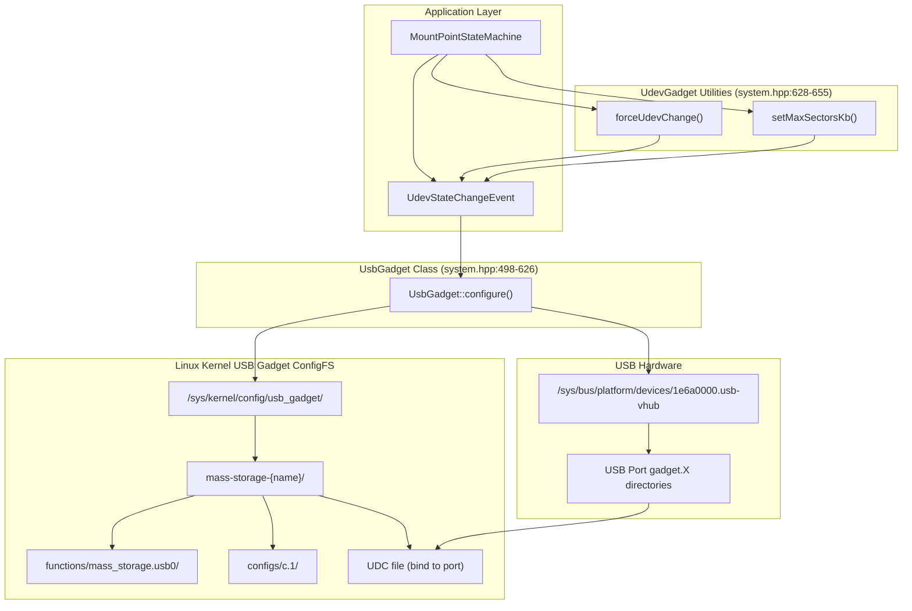
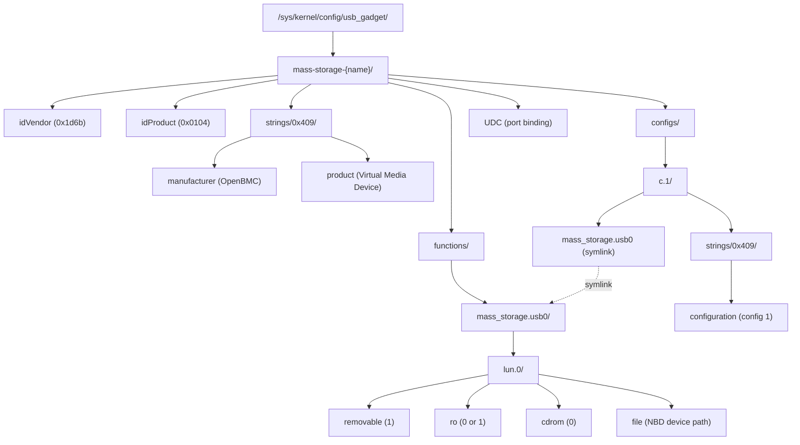
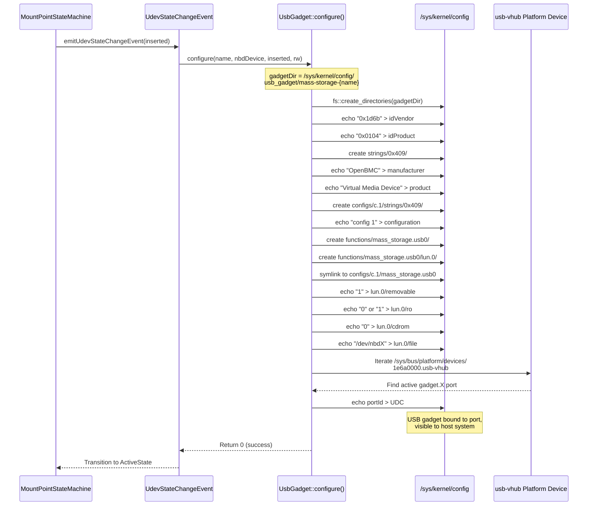
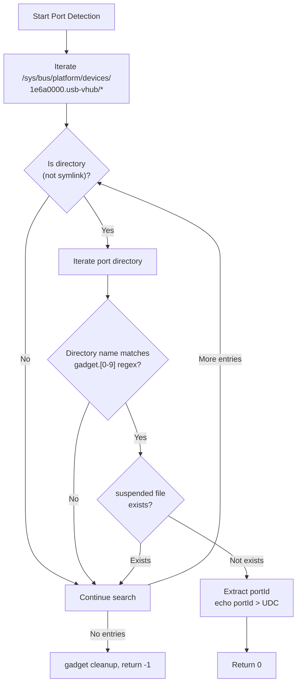
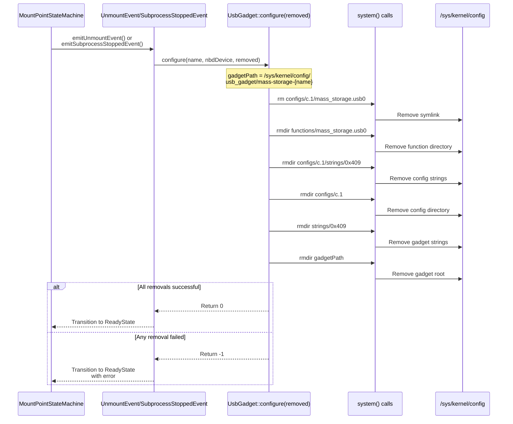
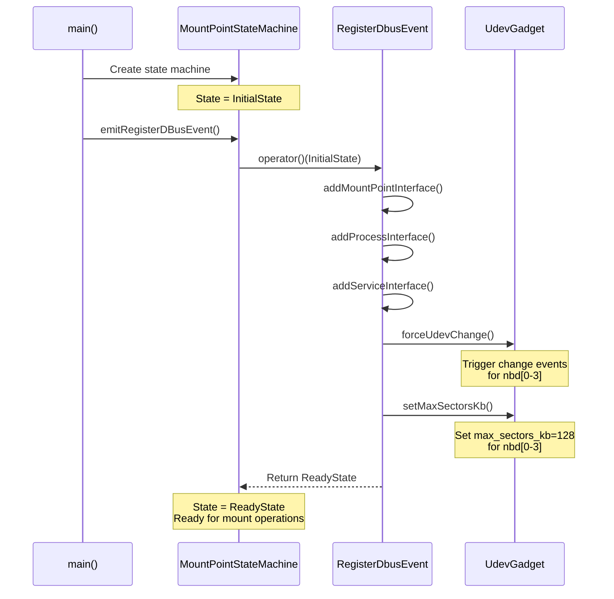
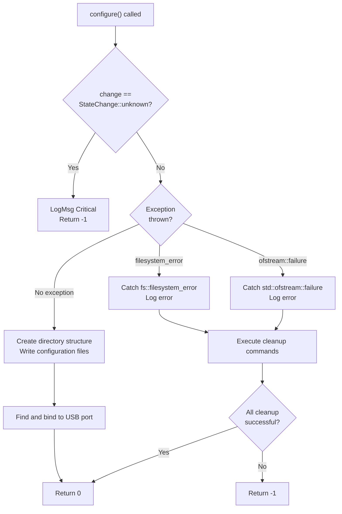

<!-- source: DeepWiki mcp.deepwiki.com · repo NVIDIA/remote-media · extra page UsbGadget Configuration · fetched 2026-10-26 -->

# UsbGadget Configuration

<details>
<summary>Relevant source files</summary>

The following files were used as context for generating this wiki page:

- [src/state_machine.hpp](src/state_machine.hpp)
- [src/system.hpp](src/system.hpp)

</details>


## Purpose and Scope

This document describes the USB mass storage gadget configuration subsystem, which creates and manages Linux USB gadget devices to present NBD block devices as USB mass storage to a host system. The `UsbGadget` class handles the creation of `/sys/kernel/config/usb_gadget` directory structures, configuration of vendor/product identifiers, LUN (Logical Unit Number) setup, and port binding operations.

For information about NBD device management, see [NBDDevice Management](#3.2.1). For details on how the state machine orchestrates gadget configuration during mount operations, see [MountPointStateMachine](#3.1).

**Sources:** [src/system.hpp:498-626]()

---

## Architecture Overview

The USB Gadget subsystem operates through the Linux USB Gadget ConfigFS interface, which exposes USB device configuration as a filesystem hierarchy under `/sys/kernel/config/usb_gadget`. The `UsbGadget` class manipulates this filesystem to create virtual USB mass storage devices.

### Component Structure



**Sources:** [src/system.hpp:498-656](), [src/state_machine.hpp:910-937]()

---

## USB Gadget ConfigFS Directory Structure

The `UsbGadget::configure()` function creates a hierarchical directory structure under `/sys/kernel/config/usb_gadget`. The exact paths are constructed based on the mount point name.

### Directory Hierarchy



**Sources:** [src/system.hpp:521-550]()

---

## Configuration Operations

### Insertion Flow

When a virtual media device becomes active, the system configures a USB gadget through the following sequence:



**Sources:** [src/system.hpp:531-571](), [src/state_machine.hpp:915-932]()

### Key Configuration Parameters

| File Path | Value | Purpose |
|-----------|-------|---------|
| `idVendor` | `0x1d6b` | USB vendor ID (Linux Foundation) |
| `idProduct` | `0x0104` | USB product ID (Multifunction Composite Gadget) |
| `strings/0x409/manufacturer` | `OpenBMC` | Manufacturer string (US English) |
| `strings/0x409/product` | `Virtual Media Device ({name})` | Product description with mount point name |
| `configs/c.1/strings/0x409/configuration` | `config 1` | Configuration description |
| `lun.0/removable` | `1` | Mark as removable media |
| `lun.0/ro` | `0` (RW) or `1` (RO) | Write protection flag |
| `lun.0/cdrom` | `0` | Not a CD-ROM device |
| `lun.0/file` | `/dev/nbdX` | Block device to expose |
| `UDC` | Port ID (e.g., `1e6a0000.usb-vhub:pX`) | Bind gadget to USB port |

**Sources:** [src/system.hpp:536-550]()

---

## USB Port Detection and Binding

The USB gadget must be bound to an available USB port on the platform. The configuration logic searches for an active port in the USB virtual hub.

### Port Detection Algorithm



The algorithm searches for a non-suspended gadget directory (matching pattern `gadget.[0-9]`) within the USB hub platform device directory structure. When found, it extracts the port ID from the parent directory name and writes it to the `UDC` file to bind the gadget.

**Sources:** [src/system.hpp:552-571]()

---

## Cleanup and Removal Operations

When unmounting virtual media, the USB gadget must be cleanly removed to release system resources and notify the host.

### Removal Sequence

The cleanup process executes in strict order using shell commands to remove the ConfigFS hierarchy:



**Sources:** [src/system.hpp:589-624](), [src/state_machine.hpp:551-561](), [src/state_machine.hpp:591-598]()

### Cleanup Command Sequence

The removal commands are executed in a specific order to satisfy ConfigFS dependency requirements:

| Step | Command | Purpose |
|------|---------|---------|
| 1 | `rm {gadgetPath}/configs/c.1/mass_storage.usb0` | Remove function symlink from configuration |
| 2 | `rmdir {gadgetPath}/functions/mass_storage.usb0` | Remove mass storage function directory |
| 3 | `rmdir {gadgetPath}/configs/c.1/strings/0x409` | Remove configuration strings |
| 4 | `rmdir {gadgetPath}/configs/c.1` | Remove configuration directory |
| 5 | `rmdir {gadgetPath}/strings/0x409` | Remove gadget strings |
| 6 | `rmdir {gadgetPath}` | Remove gadget root directory |

**Sources:** [src/system.hpp:589-618]()

---

## State Machine Integration

The `UsbGadget` configuration is tightly integrated with the `MountPointStateMachine` lifecycle.

### Integration Points

```mermaid
stateDiagram-v2
    [*] --> InitialState
    InitialState --> ReadyState: RegisterDbusEvent<br/>UdevGadget::forceUdevChange()<br/>UdevGadget::setMaxSectorsKb()
    
    ReadyState --> ActivatingState: MountEvent
    ActivatingState --> WaitingForGadgetState: Process spawned<br/>(nbdkit or nbd-client)
    
    WaitingForGadgetState --> ActiveState: UdevStateChangeEvent(inserted)<br/>UsbGadget::configure(inserted)
    
    ActiveState --> WaitingForProcessEndState: UnmountEvent<br/>UsbGadget::configure(removed)
    
    ActiveState --> ReadyState: SubprocessStoppedEvent<br/>UsbGadget::configure(removed)
    
    WaitingForProcessEndState --> ReadyState: SubprocessStoppedEvent
    
    note right of ReadyState: UdevGadget initialization<br/>on service startup
    note right of ActiveState: USB gadget active,<br/>visible to host
```

### Key Function Calls

| State Transition | Function | Line Reference |
|------------------|----------|----------------|
| InitialState → ReadyState | `UdevGadget::forceUdevChange()` | [src/state_machine.hpp:228]() |
| InitialState → ReadyState | `UdevGadget::setMaxSectorsKb()` | [src/state_machine.hpp:229]() |
| WaitingForGadgetState → ActiveState | `UsbGadget::configure(inserted)` | [src/state_machine.hpp:919-922]() |
| ActiveState → ReadyState/WaitingForProcessEndState | `UsbGadget::configure(removed)` | [src/state_machine.hpp:966-968]() |

**Sources:** [src/state_machine.hpp:210-240](), [src/state_machine.hpp:910-937](), [src/state_machine.hpp:964-976]()

---

## Initialization Workarounds

The `UdevGadget` class provides two initialization workarounds to address kernel-related issues.

### Force Udev Change Events

The `forceUdevChange()` function triggers udev change events for NBD devices during service initialization:

**Purpose:** Workaround for HSD18020136609 - prevents disconnection on first mount event after reboot. This issue is related to kernel changes between versions 5.10.67 and 5.14.11.

**Implementation:**
```
Writes "change" to /sys/block/nbd[0-3]/uevent
```

**Sources:** [src/system.hpp:631-645]()

### Max Sectors Configuration

The `setMaxSectorsKb()` function sets the maximum transfer size for NBD devices:

**Purpose:** Configures the kernel block layer to use 128KB maximum sector size for optimal performance.

**Implementation:**
```
Writes "128" to /sys/block/nbd[0-3]/queue/max_sectors_kb
```

**Sources:** [src/system.hpp:647-654]()

### Initialization Timing

Both functions are called during the `RegisterDbusEvent` transition from `InitialState` to `ReadyState`, before any mount operations occur:



**Sources:** [src/state_machine.hpp:220-230]()

---

## Error Handling

The `UsbGadget::configure()` function handles errors through exception catching and return codes.

### Error Scenarios

| Error Type | Detection | Handling | Return Value |
|------------|-----------|----------|--------------|
| Filesystem error | `fs::filesystem_error` exception | Log error, proceed to cleanup | `-1` |
| File I/O error | `std::ofstream::failure` exception | Log error, proceed to cleanup | `-1` |
| Unknown state | `change == StateChange::unknown` | Log critical error, early return | `-1` |
| Cleanup failure | `system()` returns non-zero | Log error, continue remaining cleanup | `-1` |

### Exception Handling Flow



**Sources:** [src/system.hpp:512-624]()

---

## FsHelper Base Class

The `UsbGadget` and `UdevGadget` classes inherit from the `FsHelper` utility class, which provides filesystem manipulation helpers.

### echoToFile() Method

The `echoToFile()` static method writes content to a file and ensures proper flushing:

**Signature:**
```cpp
static bool echoToFile(const fs::path& fname, const std::string& content)
```

**Behavior:**
- Opens file in append mode with exception-enabled error handling
- Writes content followed by newline (ensures flush)
- Closes file
- Logs the operation at Debug level
- Returns `true` on success

**Exception Safety:** Throws `std::ofstream::failbit` or `std::ofstream::badbit` on errors, which are caught by callers.

**Sources:** [src/system.hpp:483-496]()

---

## Usage Examples from State Machine

### Gadget Configuration on Device Insertion

When the `DeviceMonitor` detects an NBD device becoming available (size > 0), the state machine receives a `UdevStateChangeEvent(inserted)`:

```cpp
// From src/state_machine.hpp:915-932
State operator()(const WaitingForGadgetState& state)
{
    if (devState == StateChange::inserted)
    {
        int32_t ret = UsbGadget::configure(
            state.machine.name,           // Mount point name (e.g., "Slot_0")
            state.machine.config.nbdDevice, // NBD device (e.g., nbd0)
            devState,                     // StateChange::inserted
            state.machine.target ? state.machine.target->rw : false); // Read-write flag
        
        if (ret == 0)
        {
            // Send D-Bus event notification
            sendEvent(state.machine.bus, MESSAGE_TYPE::RESOURCE_CREATED, ...);
            return ActiveState(state);
        }
        return ReadyState(state, std::errc::device_or_resource_busy,
                         "Unable to configure gadget");
    }
    // ... error handling
}
```

**Sources:** [src/state_machine.hpp:915-936]()

### Gadget Removal on Unmount

When the state machine processes an unmount request in `ActiveState`, it calls `removeUsbGadget()`:

```cpp
// From src/state_machine.hpp:964-976
bool removeUsbGadget(const BasicState& state)
{
    int32_t ret = UsbGadget::configure(
        state.machine.name,
        state.machine.config.nbdDevice,
        StateChange::removed);  // Trigger cleanup
    
    if (ret != 0)
    {
        LogMsg(Logger::Critical, name, " Some serious failure happen!");
        return false;
    }
    return true;
}
```

**Sources:** [src/state_machine.hpp:964-976](), [src/state_machine.hpp:551-555](), [src/state_machine.hpp:593-596]()

---

