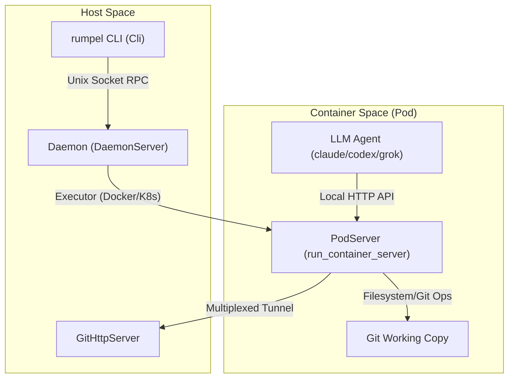
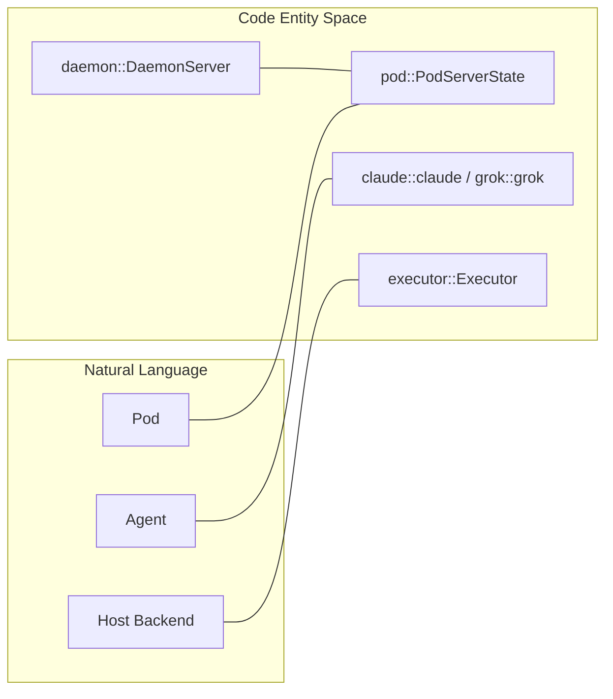

<!-- source: DeepWiki mcp.deepwiki.com · repo NVIDIA/rumpelpod · page 1 Rumpelpod Overview · fetched 2026-10-26 -->

# Rumpelpod Overview

Relevant source files

The following files were used as context for generating this wiki page:

- [.devcontainer/commit-msg](.devcontainer/commit-msg)
- [AGENTS.md](AGENTS.md)
- [CHANGELOG.md](CHANGELOG.md)
- [CONTRIBUTING.md](CONTRIBUTING.md)
- [GUIDE.md](GUIDE.md)
- [README.md](README.md)
- [rumpelpod/src/claude.rs](rumpelpod/src/claude.rs)
- [rumpelpod/src/command_ext.rs](rumpelpod/src/command_ext.rs)
- [rumpelpod/src/completions.rs](rumpelpod/src/completions.rs)
- [rumpelpod/src/lib.rs](rumpelpod/src/lib.rs)
- [rumpelpod/src/main.rs](rumpelpod/src/main.rs)
- [rumpelpod/src/service.rs](rumpelpod/src/service.rs)

Rumpelpod is a technical tool designed to run isolated LLM (Large Language Model) coding agents within secure, containerized environments called "pods" [AGENTS.md:1-1](). By leveraging Docker, Podman, or Kubernetes, Rumpelpod provides agents with a full Linux environment, automatic git synchronization, and specialized tooling to perform software engineering tasks without risking the host system's integrity [CHANGELOG.md:14-25]().

### Core Purpose
The system addresses the challenge of running untrusted code generated by LLMs. It creates a "pod"—an isolated workspace—that mirrors the developer's local repository but keeps all executions, filesystem changes, and network activity contained [README.md:17-22](). This allows agents to build, test, and modify code safely while providing the developer with tools to review and merge changes back to the host [GUIDE.md:37-54]().

### High-Level Architecture
Rumpelpod operates as a distributed system consisting of a background daemon, a CLI, and an in-container server.

**Rumpelpod Component Relationship**

Sources: [rumpelpod/src/lib.rs:112-147](), [rumpelpod/src/daemon/mod.rs:1-20](), [rumpelpod/src/pod/mod.rs:139-147]()

### Main Components

| Component | Code Entity | Responsibility |
| :--- | :--- | :--- |
| **CLI** | `Cli` [rumpelpod/src/cli.rs:113]() | The primary interface for users to manage pods and launch agents. |
| **Daemon** | `DaemonServer` [rumpelpod/src/daemon/mod.rs]() | A background process that manages pod lifecycles and persists state in SQLite. |
| **Pod Server** | `run_container_server` [rumpelpod/src/pod/mod.rs:140]() | An HTTP server running inside the pod to provide the agent with controlled access to the environment. |
| **Executor** | `Executor` trait [rumpelpod/src/executor.rs]() | Abstraction layer for interacting with different backends like `DockerBackend` or `K8sBackend`. |
| **Git Gateway** | `gateway` module [rumpelpod/src/gateway.rs]() | Manages synchronization of git refs between the host and the isolated pod. |

### System Integration
Rumpelpod integrates deeply with the developer's workflow by reading standard `.devcontainer/devcontainer.json` files to define the environment [GUIDE.md:65-75](). It uses a custom git namespace (`refs/rumpelpod/<branch>@<pod>`) to track pod-specific work without polluting the main branch history until the user explicitly runs a merge [GUIDE.md:37-54]().

**Rumpelpod Entity Mapping**

Sources: [rumpelpod/src/pod/mod.rs:1-50](), [rumpelpod/src/claude.rs:24-121](), [rumpelpod/src/executor.rs:1-20]()

### Next Steps
*   **[Getting Started](#1.1)**: Step-by-step guide for installation via `rumpel system-install` [rumpelpod/src/service.rs:41-49]() and running your first pod with `rumpel enter` [rumpelpod/src/enter.rs]().
*   **[Configuration Reference](#1.2)**: Detailed reference for `devcontainer.json` support and the `.rumpelpod.json` file [rumpelpod/src/config.rs]().
*   **Core Architecture**: Deep dive into the `DaemonServer` [rumpelpod/src/daemon/mod.rs]() and the multiplexed TCP tunnels [rumpelpod/src/tunnel.rs]().

Sources: [README.md:1-35](), [GUIDE.md:1-62](), [rumpelpod/src/lib.rs:107-240](), [CHANGELOG.md:1-26]()

---

