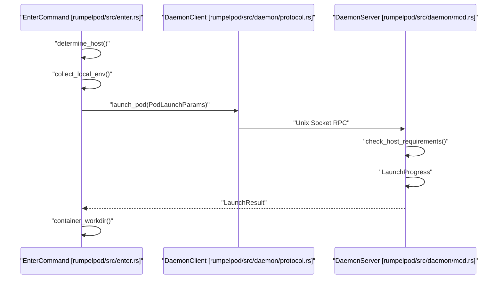
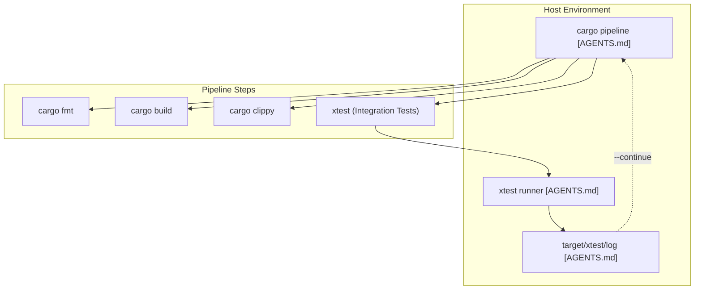

<!-- source: DeepWiki mcp.deepwiki.com · repo NVIDIA/rumpelpod · page 1.1 Getting Started · fetched 2026-10-26 -->

# Getting Started

Relevant source files

The following files were used as context for generating this wiki page:

- [.devcontainer/commit-msg](.devcontainer/commit-msg)
- [AGENTS.md](AGENTS.md)
- [CONTRIBUTING.md](CONTRIBUTING.md)
- [GUIDE.md](GUIDE.md)
- [README.md](README.md)
- [rumpelpod/src/enter.rs](rumpelpod/src/enter.rs)

Rumpelpod is an isolated LLM agent runner designed to provide a secure, reproducible environment for AI agents to interact with codebases [README.md:1-4](). Each pod is a container with its own checkout of the repository, synchronized back to the local machine via git [GUIDE.md:3-5]().

## Prerequisites

Before installing Rumpelpod, ensure the following are installed on your host system:
*   **Git**: Essential for workspace synchronization [README.md:13-18]().
*   **Docker or Podman**: Required for the `Localhost` and `Ssh` executors [README.md:13-13](), [rumpelpod/src/enter.rs:137-143]().
*   **Rust Toolchain**: Required for building the project and running the development pipeline [AGENTS.md:7-12]().
*   **SSH**: Required if you plan to run pods on remote hosts [GUIDE.md:5-6]().
*   **kubectl**: Optional, required for Kubernetes-based pods [README.md:13-13]().

## Installation

The primary method for setting up the Rumpelpod environment involves a bootstrap script followed by the system-level installation command [GUIDE.md:18-23]().

### `rumpel system-install`
This command prepares the host machine by:
1.  Installing the `rumpel` binary to a location in your `PATH`.
2.  Setting up the background daemon (`DaemonServer`) which manages the lifecycle of all pods [rumpelpod/src/enter.rs:14-17]().
3.  Initializing the state directory for SQLite persistence and Unix socket communication.

## Initializing a Project

Rumpelpod relies on the standard `devcontainer.json` format to define the environment [GUIDE.md:65-69]().

1.  **Create `.devcontainer/devcontainer.json`**: Define your image, features, and workspace settings.
2.  **Optional `.rumpelpod.json`**: Create this file in the repository root to specify settings unique to Rumpelpod, such as the execution `Host` [rumpelpod/src/enter.rs:112-135]().

### Configuration Mapping

| Setting | Source | Purpose |
| :--- | :--- | :--- |
| `image`, `mounts`, `runArgs` | `devcontainer.json` | Defines the container environment [GUIDE.md:71-75](). |
| `host` | `.rumpelpod.json` | Determines if the pod runs on `Localhost`, `Ssh`, or `Kubernetes` [rumpelpod/src/enter.rs:112-143](). |
| `localEnv` | Host Shell | Variables prefixed with `${localEnv:VAR}` are captured from the host and substituted by the daemon [rumpelpod/src/enter.rs:145-154](). |

**Sources:** [rumpelpod/src/enter.rs:112-154](), [GUIDE.md:63-106]()

## Launching a Pod: `rumpel enter`

The `rumpel enter` command is the entry point for developers to gain shell access to a pod [GUIDE.md:55-59](). It triggers a data flow between the CLI and the background daemon.

### Pod Launch Data Flow

The following diagram illustrates how the `EnterCommand` interacts with the `DaemonClient` to instantiate a pod.

**Diagram: Pod Initialization Flow**

**Sources:** [rumpelpod/src/enter.rs:12-17](), [rumpelpod/src/enter.rs:33-37](), [rumpelpod/src/enter.rs:64-110](), [rumpelpod/src/enter.rs:112-154]()

### Key Functions
*   `determine_host`: Resolves the target execution environment (Local vs Remote) from CLI overrides or JSON config [rumpelpod/src/enter.rs:112-143]().
*   `collect_local_env`: Scans `devcontainer.json` for `${localEnv:...}` variables to forward to the daemon, as the daemon lacks access to the user's shell [rumpelpod/src/enter.rs:145-154]().
*   `container_workdir`: Maps the local machine's current directory to the corresponding path inside the container workspace [rumpelpod/src/enter.rs:33-37]().

## Development Workflow: `cargo pipeline`

Developers contributing to Rumpelpod must use `cargo pipeline` instead of standard cargo commands to ensure consistency and proper logging [AGENTS.md:7-12]().

### The Pipeline Execution Model

The `cargo pipeline` orchestrates several steps and records output to `target/xtest/<timestamp>.log` [AGENTS.md:7-10]().

**Diagram: Development Pipeline Entities**

**Sources:** [AGENTS.md:7-17](), [AGENTS.md:25-31]()

### Pipeline Features
*   **Persistence**: It records test results. Using `--continue` allows the pipeline to resume by skipping tests that already passed [AGENTS.md:8-17]().
*   **Isolation**: The `xtest` runner executes each test in a separate process with its own timeout and retry logic [AGENTS.md:25-27]().
*   **Smoke Testing**: For rapid iteration, it is recommended to run specific smoke tests first, such as `enter_smoke_test`, `claude_smoke`, or `gateway_pod_commit_triggers_push` [AGENTS.md:13-15]().

## Contribution Rules

To maintain the integrity of the codebase, all developers must adhere to the following:
*   **DCO Sign-off**: Every commit must be signed off using `git commit -s`. This is enforced by a git hook [AGENTS.md:6](), [.devcontainer/commit-msg:1-9]().
*   **No Unicode**: Comments and code must remain in ASCII unless specifically testing Unicode support [AGENTS.md:34-35]().
*   **Explicit Matching**: Never use "default" or "fallthrough" when matching known variants; every case must be explicitly handled [AGENTS.md:40-41]().
*   **Error Handling**: Do not ignore errors. Prefer failing hard over continuing in a degraded state [AGENTS.md:42-46]().

**Sources:** [AGENTS.md:1-60](), [.devcontainer/commit-msg:1-10](), [CONTRIBUTING.md:61-74]()

---

