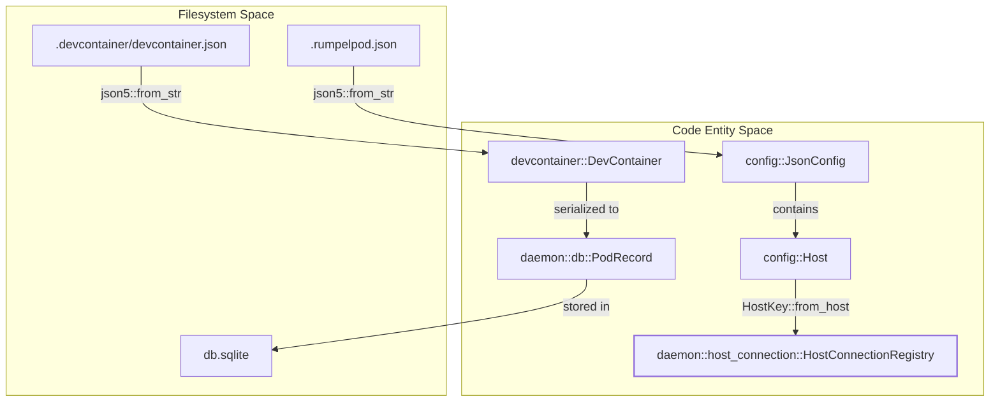
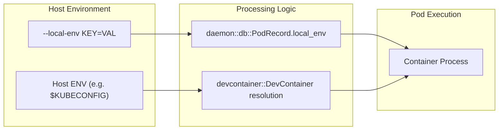

<!-- source: DeepWiki mcp.deepwiki.com · repo NVIDIA/rumpelpod · page 1.2 Configuration Reference · fetched 2026-10-26 -->

# Configuration Reference

Relevant source files

The following files were used as context for generating this wiki page:

- [rumpelpod/src/config.rs](rumpelpod/src/config.rs)
- [rumpelpod/src/daemon/db.rs](rumpelpod/src/daemon/db.rs)
- [rumpelpod/src/daemon/host_connection.rs](rumpelpod/src/daemon/host_connection.rs)
- [rumpelpod/src/devcontainer.rs](rumpelpod/src/devcontainer.rs)
- [rumpelpod/tests/cli/devcontainer/build_paths.rs](rumpelpod/tests/cli/devcontainer/build_paths.rs)
- [rumpelpod/tests/cli/devcontainer/mod.rs](rumpelpod/tests/cli/devcontainer/mod.rs)
- [rumpelpod/tests/cli/k8s/mod.rs](rumpelpod/tests/cli/k8s/mod.rs)

Rumpelpod configuration is driven by two primary sources: the standard `devcontainer.json` for container environment definitions and an optional `.rumpelpod.json` for pod-specific orchestration settings. This page details the supported fields, the data structures used for parsing, and the mechanisms for environment variable substitution.

## 1. devcontainer.json Support

Rumpelpod utilizes `devcontainer.json` to define the base environment of a pod. It uses the `json5` parser to support comments and trailing commas [rumpelpod/src/config.rs:14-15](). The daemon captures the raw source of this file at pod creation and stores it in the SQLite database to ensure consistency for future operations like `fork` [rumpelpod/src/daemon/db.rs:88-90]().

### Supported Fields
The `DevContainer` struct in `rumpelpod/src/devcontainer.rs` defines the subset of the DevContainer spec supported by Rumpelpod:

| Field | Description | Code Reference |
| :--- | :--- | :--- |
| `image` | The base Docker image to use for the pod. | [rumpelpod/src/devcontainer.rs:110]() |
| `remoteUser` | The user to run devcontainer tools as inside the container. | [rumpelpod/src/devcontainer.rs:51]() |
| `containerUser` | User for all operations inside the container. | [rumpelpod/src/devcontainer.rs:55]() |
| `workspaceFolder` | Path to open when connecting to the container. | [rumpelpod/src/devcontainer.rs:134]() |
| `mounts` | Additional mounts for the container (e.g., `source=...,target=...`). | [rumpelpod/src/devcontainer.rs:91]() |
| `runArgs` | Docker CLI arguments for running the container. | [rumpelpod/src/devcontainer.rs:138]() |
| `containerEnv` | Environment variables set inside the container. | [rumpelpod/src/devcontainer.rs:43]() |
| `remoteEnv` | Environment variables for devcontainer tools/processes. | [rumpelpod/src/devcontainer.rs:47]() |
| `forwardPorts` | Ports to forward from the container to the local machine. | [rumpelpod/src/devcontainer.rs:31]() |
| `build` | Configuration for Dockerfile-based containers. | [rumpelpod/src/devcontainer.rs:114]() |
| `initializeCommand` | Command to run on the host during initialization. | [rumpelpod/src/devcontainer.rs:160]() |

**Sources:** [rumpelpod/src/devcontainer.rs:19-171](), [rumpelpod/src/config.rs:10-15](), [rumpelpod/src/daemon/db.rs:88-90]()

---

## 2. .rumpelpod.json Reference

The `.rumpelpod.json` file resides in the repository root and provides settings for the Rumpelpod daemon that lack a `devcontainer.json` equivalent, such as remote host definitions and agent behaviors [rumpelpod/src/config.rs:11-12]().

### Host Configuration
The `Host` enum determines where the pod is executed [rumpelpod/src/config.rs:109-150]().

*   **Localhost**: The local machine using Docker or Podman [rumpelpod/src/config.rs:111-114]().
*   **SSH**: A remote host accessed via SSH. Rumpelpod uses `ssh ... <engine> system dial-stdio` for communication [rumpelpod/src/daemon/host_connection.rs:11-13]().
*   **Kubernetes**: Execution within a K8s cluster [rumpelpod/src/config.rs:124-149]().
    *   `context`: The kubeconfig context name.
    *   `namespace`: K8s namespace (defaults to "default").
    *   `registry`: Required. The registry for pushing/pulling prepared images.
    *   `node_selector`: Optional map of labels for scheduling.
    *   `tolerations`: Optional list of `KubernetesToleration` objects.

### Container Engine Resolution
Rumpelpod supports `docker` and `podman` via the `ContainerEngine` enum [rumpelpod/src/config.rs:28-35](). The `Auto` setting prefers `docker` if found on the `PATH`, falling back to `podman` [rumpelpod/src/config.rs:61-67]().

### Configuration Data Flow
The `HostConnectionRegistry` manages the lifecycle of connections based on these configurations, ensuring that remote hosts have background monitors for liveness and reconnection [rumpelpod/src/daemon/host_connection.rs:138-142]().

**Configuration Resolution Diagram**

**Sources:** [rumpelpod/src/config.rs:109-150](), [rumpelpod/src/devcontainer.rs:19-171](), [rumpelpod/src/daemon/host_connection.rs:138-170](), [rumpelpod/src/daemon/db.rs:76-96]()

---

## 3. Environment Variable Substitution

Rumpelpod performs substitution on specific fields within `devcontainer.json` to allow dynamic configuration based on the host environment.

### Rules
1.  **Scope**: Substitution is primarily applied to `mounts`, `containerEnv`, `remoteEnv`, and `runArgs`.
2.  **Path Constraints**: Rumpelpod enforces strict security boundaries. For example, `dockerfile` and `context` paths in the `build` configuration must remain under the repository root [rumpelpod/tests/cli/devcontainer/build_paths.rs:52-77]().
3.  **Local Environment**: The `--local-env` CLI argument allows passing host environment variables into the pod, which are stored as a JSON array in the `PodRecord` [rumpelpod/src/daemon/db.rs:91-93]().

### Host to Pod Environment Mapping
The following diagram illustrates how host environment variables are resolved and passed into the container lifecycle.

**Variable Substitution Process**

**Sources:** [rumpelpod/src/daemon/db.rs:91-93](), [rumpelpod/tests/cli/devcontainer/build_paths.rs:52-77](), [rumpelpod/src/config.rs:128-135]()

---

## 4. Kubernetes Specifics

When using the `Kubernetes` host type, Rumpelpod requires a `registry` to facilitate the transfer of locally built images to the cluster [rumpelpod/src/config.rs:133-134]().

### KubernetesToleration
The `KubernetesToleration` struct allows pods to be scheduled on nodes with specific taints [rumpelpod/src/config.rs:181-188]():
*   `key`: The taint key.
*   `operator`: `Equal` or `Exists`.
*   `value`: The taint value.
*   `effect`: `NoSchedule`, `PreferNoSchedule`, or `NoExecute`.

### Registry and Builder
If a `builder` (a `docker buildx` builder name) is not specified, Rumpelpod uses the local `image_builder` (Docker or Podman) to build the image before pushing it to the defined `registry` [rumpelpod/src/config.rs:140-149]().

**Sources:** [rumpelpod/src/config.rs:124-149](), [rumpelpod/src/config.rs:181-188](), [rumpelpod/tests/cli/k8s/mod.rs:112-136]()

---

