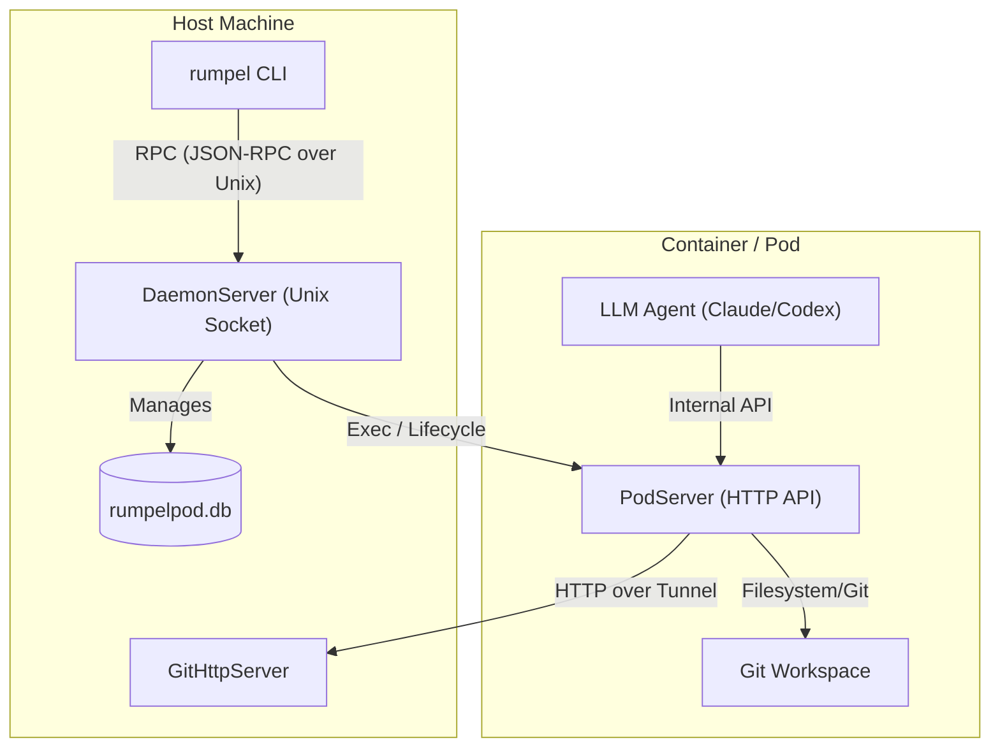
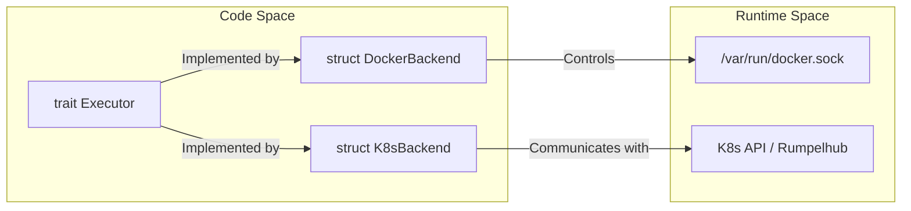

<!-- source: DeepWiki mcp.deepwiki.com · repo NVIDIA/rumpelpod · page 2 Core Architecture · fetched 2026-10-26 -->

# Core Architecture

Relevant source files

The following files were used as context for generating this wiki page:

- [Cargo.lock](Cargo.lock)
- [THIRD-PARTY-NOTICES](THIRD-PARTY-NOTICES)
- [rumpelpod/Cargo.toml](rumpelpod/Cargo.toml)
- [rumpelpod/src/daemon.rs](rumpelpod/src/daemon.rs)
- [rumpelpod/src/daemon/protocol.rs](rumpelpod/src/daemon/protocol.rs)
- [rumpelpod/src/exec_proxy.rs](rumpelpod/src/exec_proxy.rs)
- [rumpelpod/src/list.rs](rumpelpod/src/list.rs)
- [rumpelpod/tests/cli/list.rs](rumpelpod/tests/cli/list.rs)
- [tools/Cargo.toml](tools/Cargo.toml)

The rumpelpod system is a distributed architecture designed to isolate LLM agents and development environments within containers (Pods) while maintaining a seamless experience on the host machine. It consists of three primary layers: the **CLI**, the **Daemon**, and the **Pod Server**.

### High-Level Component Interaction

The following diagram illustrates the relationship between the host-side components and the containerized environment.

**System Overview: Host to Pod Connectivity**

Sources: [rumpelpod/src/daemon.rs:4-8](), [rumpelpod/src/daemon.rs:37-40](), [rumpelpod/src/daemon/protocol.rs:4-9]()

---

### The Daemon (`DaemonServer`)

The daemon is the central orchestrator of the rumpelpod system. It runs as a background process on the host and manages the lifecycle of all pods.

- **Lifecycle Management**: Handles the creation, starting, stopping, and deletion of pods via the `Executor` abstraction [rumpelpod/src/daemon.rs:144-153]().
- **State Persistence**: Uses a SQLite database ([rumpelpod/src/daemon/db.rs]()) to track pod metadata, container IDs, and host associations.
- **RPC Interface**: Provides a Unix socket-based API defined in `protocol.rs` for the CLI to request actions like `enter`, `stop`, or `list` [rumpelpod/src/daemon/protocol.rs:4-46]().
- **Git Bridge**: Orchestrates the `GitHttpServer` which allows pods to fetch and push code back to the host repository through a secure tunnel [rumpelpod/src/daemon.rs:37-37]().

For details, see [Daemon](#2.1).

Sources: [rumpelpod/src/daemon.rs:4-10](), [rumpelpod/src/daemon/protocol.rs:186-200]()

---

### The Pod Server (`PodServerState`)

Every rumpelpod container runs a dedicated Rust binary in `container-serve` mode. This server acts as the "brain" inside the pod, providing a high-level API for LLM agents and the host CLI.

- **Agent Integration**: Exposes endpoints for Claude and Codex to interact with the environment safely, maintaining session state like `ClaudeState` and `CodexState` [rumpelpod/src/daemon/protocol.rs:172-176]().
- **Environment Resolution**: Probes the container's shell environment and merges it with `devcontainer.json` settings [rumpelpod/src/daemon.rs:98-107]().
- **Filesystem & Git**: Provides authenticated HTTP wrappers around filesystem operations and git commands to avoid raw `docker exec` overhead.
- **SSH Relay**: Manages a relay to allow the pod to use the host's SSH agent for remote git operations.

For details, see [Pod Server (In-Container HTTP API)](#2.2).

Sources: [rumpelpod/src/daemon/protocol.rs:47-70](), [rumpelpod/src/daemon.rs:128-136]()

---

### Executor Engine

Rumpelpod abstracts the underlying container runtime through the `Executor` trait. This allows the system to support multiple backends transparently.

| Backend | Code Entity | Description |
| :--- | :--- | :--- |
| **Docker** | `DockerBackend` | Local container management using the Docker CLI/Socket. |
| **Kubernetes** | `K8sBackend` | Remote pod management via `kubectl` and the `rumpelhub` companion. |

**Code Entity Mapping: Executor Abstraction**

Sources: [rumpelpod/src/daemon.rs:35-35](), [rumpelpod/src/daemon.rs:54-73]()

For details, see [Executor Engine and Backend Abstraction](#2.3).

---

### Networking and Tunnels

Connectivity between the host and the pod is established using a multiplexed TCP tunnel. This tunnel is carried over the standard input/output streams of a `docker exec` or `kubectl exec` session, bypassing the need for exposed ports or complex VPNs.

- **Port Forwarding**: Allows the host to access services running inside the pod via `AddForwardedPortRequest` [rumpelpod/src/daemon/protocol.rs:41-43]().
- **Git Tunnel**: Specifically routes git traffic to the host's `GitHttpServer`.
- **HTTP Proxy**: The `exec_proxy` module provides a host-side proxy that translates standard TCP/HTTP requests into the tunnel protocol by exec-ing `rumpel tcp-proxy` inside the pod [rumpelpod/src/exec_proxy.rs:7-10]().

For details, see [Networking: Tunnels, Proxies, and Port Forwarding](#2.4).

Sources: [rumpelpod/src/exec_proxy.rs:41-50](), [rumpelpod/src/exec_proxy.rs:131-142]()

---

