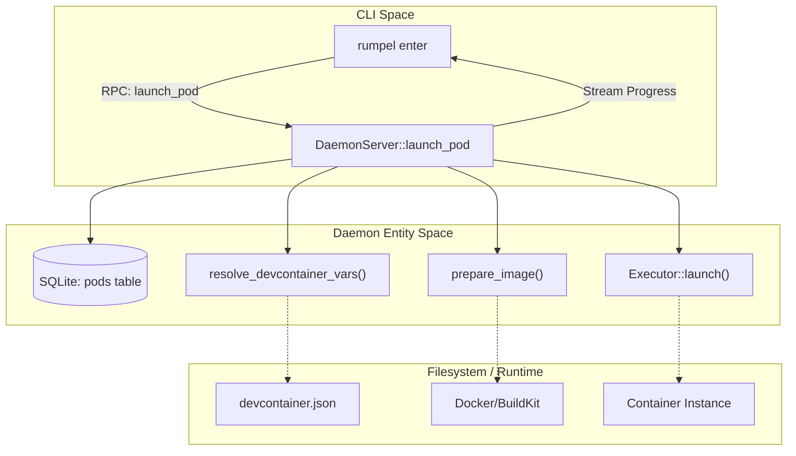
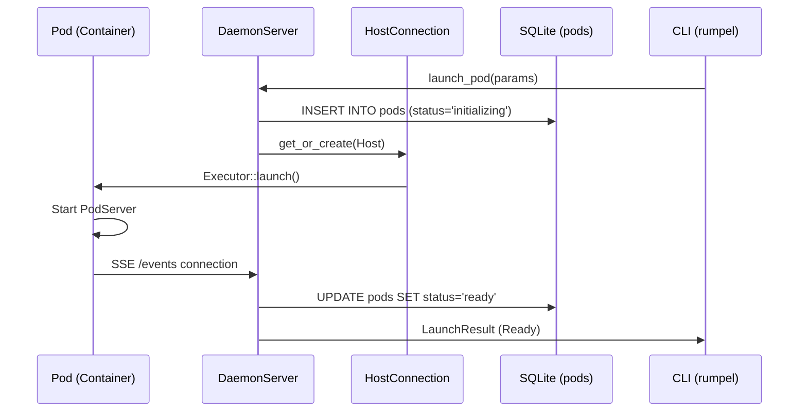

<!-- source: DeepWiki mcp.deepwiki.com · repo NVIDIA/rumpelpod · page 2.1 Daemon · fetched 2026-10-26 -->

# Daemon

Relevant source files

The following files were used as context for generating this wiki page:

- [rumpelpod/src/config.rs](rumpelpod/src/config.rs)
- [rumpelpod/src/daemon.rs](rumpelpod/src/daemon.rs)
- [rumpelpod/src/daemon/db.rs](rumpelpod/src/daemon/db.rs)
- [rumpelpod/src/daemon/host_connection.rs](rumpelpod/src/daemon/host_connection.rs)
- [rumpelpod/src/daemon/pod_connection.rs](rumpelpod/src/daemon/pod_connection.rs)
- [rumpelpod/src/daemon/protocol.rs](rumpelpod/src/daemon/protocol.rs)
- [rumpelpod/src/daemon/reconnect.rs](rumpelpod/src/daemon/reconnect.rs)
- [rumpelpod/src/list.rs](rumpelpod/src/list.rs)
- [rumpelpod/src/pty_session.rs](rumpelpod/src/pty_session.rs)
- [rumpelpod/tests/cli/k8s/mod.rs](rumpelpod/tests/cli/k8s/mod.rs)
- [rumpelpod/tests/cli/list.rs](rumpelpod/tests/cli/list.rs)

The `DaemonServer` is the central orchestrator of the rumpelpod system. It runs as a background process on the host machine, managing the lifecycle of isolated agent environments (pods), persisting state in a local database, and providing an RPC interface for the CLI via a Unix domain socket.

## Architecture and Lifecycle Management

The daemon acts as a bridge between the user's local repository and the containerized execution environment. It handles the complexities of image building, container configuration, and networking setup.

### Pod Lifecycle Operations
The daemon implements core lifecycle operations defined in the `Daemon` trait [rumpelpod/src/daemon/protocol.rs:252-308]():

*   **Launch/Recreate**: Resolves `devcontainer.json`, builds the environment-specific image, and starts the container. Recreate specifically replaces an existing container while preserving its identity in the database [rumpelpod/src/daemon.rs:983-1025]().
*   **Fork**: Creates a new pod by snapshotting a source pod. It captures the source's `devcontainer.json`, environment variables, and git state [rumpelpod/src/daemon.rs:1054-1092]().
*   **Stop/Delete**: Gracefully shuts down containers and removes associated resources. Deletion is performed via background tasks to ensure the CLI remains responsive [rumpelpod/src/daemon.rs:1237-1253]().
*   **Merge**: Facilitates the transfer of changes from a pod back to the host repository by orchestrating git operations between the two environments.

### Code Entity Map: Lifecycle Flow
The following diagram maps the natural language operations to the specific internal functions and data structures used during a pod launch.

**Diagram: Pod Launch Logic Flow**

Sources: [rumpelpod/src/daemon.rs:910-968](), [rumpelpod/src/daemon/protocol.rs:252-262](), [rumpelpod/src/devcontainer.rs:885-910]()

## State Persistence (SQLite)

The daemon uses a local SQLite database to maintain a source of truth for all pods across sessions. This allows the daemon to be restarted without losing track of running containers or their configurations.

### Database Schema
The database (managed via `rusqlite`) is stored at `$XDG_STATE_HOME/rumpelpod/db.sqlite` [rumpelpod/src/daemon/db.rs:98-110](). The `pods` table includes:
*   `repo_path`: The host-side path to the git repository [rumpelpod/src/daemon/db.rs:78]().
*   `name`: The unique identifier for the pod within that repo [rumpelpod/src/daemon/db.rs:79]().
*   `status`: The current lifecycle state (e.g., `initializing`, `ready`, `deleting`) [rumpelpod/src/daemon/db.rs:34-47]().
*   `devcontainer_json`: The resolved configuration captured at creation [rumpelpod/src/daemon/db.rs:90]().
*   `local_env`: JSON-serialized "KEY=VALUE" strings of host environment variables [rumpelpod/src/daemon/db.rs:93]().

Sources: [rumpelpod/src/daemon/db.rs:34-152](), [rumpelpod/src/daemon.rs:178-188]()

## Unix Socket RPC Protocol

Communication between the CLI and the daemon occurs over a Unix domain socket, typically located at `/tmp/rumpelpod.sock` (configurable via `RUMPELPOD_DAEMON_SOCKET`) [rumpelpod/src/daemon.rs:49-50]().

### Protocol Implementation
The protocol uses `axum` over a `UnixListener` [rumpelpod/src/daemon.rs:1398-1415](). It leverages JSON-RPC style interactions but is optimized for streaming responses (e.g., build logs) using Server-Sent Events (SSE).

**Key Protocol Structures:**
*   `PodLaunchParams`: Encapsulates everything needed to start a pod, including `pod_name`, `repo_path`, and `local_env_vars` [rumpelpod/src/daemon/protocol.rs:186-210]().
*   `LaunchResult`: Returns the `container_url` and `container_token` required for the CLI to connect to the internal Pod Server [rumpelpod/src/daemon/protocol.rs:49-70]().

Sources: [rumpelpod/src/daemon/protocol.rs:4-27](), [rumpelpod/src/daemon.rs:1398-1427]()

## Host and Pod Connections

The daemon manages connectivity through two specialized registries: `HostConnectionRegistry` and `PodConnectionRegistry`.

### Host Connectivity
A `HostConnection` represents a communication channel to a backend (Localhost, SSH, or Kubernetes) [rumpelpod/src/daemon/host_connection.rs:6-28](). It runs a background monitor that performs liveness probes and manages reconnection for all pods on that host [rumpelpod/src/daemon/host_connection.rs:16-22]().

### Pod Connectivity
A `PodConnection` owns host-side resources specific to a running pod, including the `ExecProxyHandle` for the pod server, the `TunnelHandle` for git traffic, and optional SSH agents or LLM proxies [rumpelpod/src/daemon/pod_connection.rs:6-9]().

**Diagram: Connection and State Mapping**

Sources: [rumpelpod/src/daemon/host_connection.rs:138-170](), [rumpelpod/src/daemon/pod_connection.rs:98-142](), [rumpelpod/src/daemon/reconnect.rs:8-22]()

## Key Functions and Classes

| Entity | File | Description |
| :--- | :--- | :--- |
| `DaemonServer` | [rumpelpod/src/daemon.rs:1342]() | The main struct implementing the `Daemon` RPC trait. |
| `HostConnectionRegistry` | [rumpelpod/src/daemon/host_connection.rs:138]() | Deduplicates and manages background monitors for remote hosts. |
| `PodConnection` | [rumpelpod/src/daemon/pod_connection.rs:98]() | Manages proxies, tunnels, and the event loop for a specific pod. |
| `prepare_image` | [rumpelpod/src/daemon.rs:245]() | Orchestrates the `devcontainer` build process and image tagging. |
| `ReconnectEvent` | [rumpelpod/src/daemon/reconnect.rs:11]() | Enum for events streamed to clients during connection attempts. |

Sources: [rumpelpod/src/daemon.rs:1342-1382](), [rumpelpod/src/daemon/host_connection.rs:138-150](), [rumpelpod/src/daemon/pod_connection.rs:98-111]()

---

