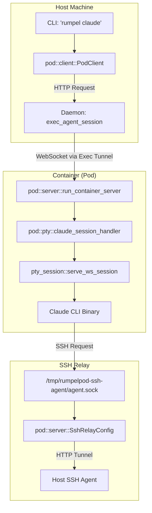
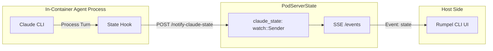

<!-- source: DeepWiki mcp.deepwiki.com · repo NVIDIA/rumpelpod · page 2.2 Pod Server (In-Container HTTP API) · fetched 2026-10-26 -->

# Pod Server (In-Container HTTP API)

Relevant source files

The following files were used as context for generating this wiki page:

- [rumpelpod/src/cp.rs](rumpelpod/src/cp.rs)
- [rumpelpod/src/pod/client.rs](rumpelpod/src/pod/client.rs)
- [rumpelpod/src/pod/git_setup.rs](rumpelpod/src/pod/git_setup.rs)
- [rumpelpod/src/pod/pty.rs](rumpelpod/src/pod/pty.rs)
- [rumpelpod/src/pod/server.rs](rumpelpod/src/pod/server.rs)
- [rumpelpod/src/pod/types.rs](rumpelpod/src/pod/types.rs)
- [rumpelpod/src/tunnel.rs](rumpelpod/src/tunnel.rs)
- [rumpelpod/tests/cli/common.rs](rumpelpod/tests/cli/common.rs)
- [rumpelpod/tests/cli/fork.rs](rumpelpod/tests/cli/fork.rs)
- [rumpelpod/tests/cli/gateway/mod.rs](rumpelpod/tests/cli/gateway/mod.rs)
- [rumpelpod/tests/cli/pi/install.rs](rumpelpod/tests/cli/pi/install.rs)

The Pod Server is a specialized HTTP service that runs inside every Rumpelpod container as the devcontainer user. It is the primary interface through which the host-side daemon interacts with the container's internals, replacing complex shell-script composition via `docker exec` with a structured, type-safe Rust API.

## Overview and Purpose

The server is started via the `rumpel container-serve` command after the Rumpelpod binary is injected into the container [rumpelpod/src/pod/server.rs:4-10](). It binds to an ephemeral port on `127.0.0.1` and records this port in `/opt/rumpelpod/server-port` for internal consumers [rumpelpod/src/pod/server.rs:7-8]().

Key responsibilities include:
*   **Filesystem Operations**: High-performance file reading, writing, and tar-based transfers [rumpelpod/src/pod/types.rs:22-31]().
*   **Git Management**: Local repository setup, branch management, and dirty-tree patching [rumpelpod/src/pod/git_setup.rs:4-7]().
*   **LLM Agent Integration**: Hosting WebSocket bridges for Claude, Codex, and Grok, including state monitoring [rumpelpod/src/pod/pty.rs:4-8]().
*   **Lifecycle Management**: Executing `postStartCommand` and other devcontainer lifecycle hooks [rumpelpod/src/pod/server.rs:169-171]().
*   **SSH Relay**: Providing an in-container SSH agent socket that relays requests back to the host [rumpelpod/src/pod/server.rs:33]().

**Sources:** [rumpelpod/src/pod/server.rs:4-10](), [rumpelpod/src/pod/server.rs:31-33](), [rumpelpod/src/pod/types.rs:22-31]()

---

## Startup Lifecycle and Environment Resolution

The server follows a strict startup sequence to ensure the environment is fully resolved before allowing agent interactions.

### 1. User Switching and Tunnel Detection
The process starts as `root` (via `docker exec`) but immediately drops privileges to the container user identified during the image build using `switch_user()` [rumpelpod/src/pod/server.rs:132-140](). It then detects the `tunnel-server` port from the `TUNNEL_PORT_FILE` to establish connectivity to the host-side Git HTTP bridge [rumpelpod/src/pod/server.rs:145-148]().

### 2. The Setup Task
While the HTTP server binds immediately to serve `/events`, a background "Setup Task" handles long-running initialization [rumpelpod/src/pod/server.rs:152-155]():
1.  **Environment Probing**: Resolves the full environment by merging the base container env, probed shell env (e.g., from `.bashrc`), and `remoteEnv` settings [rumpelpod/src/pod/server.rs:99-101]().
2.  **Git Initialization**: Clones the repository and configures remotes using the `GitSetupParams` provided at startup [rumpelpod/src/pod/server.rs:133-134]().
3.  **Lifecycle Hooks**: Executes `postStartCommand` and `postAttachCommand` [rumpelpod/src/pod/server.rs:169-171]().

### 3. State Management
The `PodServerState` struct acts as the central synchronization point for all in-container activities.

| Field | Type | Purpose |
| :--- | :--- | :--- |
| `pty_sessions` | `PtySessions` | Manages active terminal sessions for agents [rumpelpod/src/pod/server.rs:78]() |
| `resolved_env` | `Arc<Mutex<HashMap>>` | The final environment used for all sub-processes [rumpelpod/src/pod/server.rs:101]() |
| `setup_progress` | `broadcast::Sender` | Streams progress updates to the host via SSE [rumpelpod/src/pod/server.rs:110]() |
| `claude_state` | `watch::Sender` | Tracks if Claude is processing or waiting for input [rumpelpod/src/pod/server.rs:88]() |
| `push_gate` | `Arc<Semaphore>` | Serializes recovery pushes to prevent git lock races [rumpelpod/src/pod/server.rs:98]() |

**Sources:** [rumpelpod/src/pod/server.rs:77-117](), [rumpelpod/src/pod/server.rs:128-171]()

---

## API Endpoints

The server implements a variety of routes to support the `rumpel` CLI operations, defined in `run_container_server` [rumpelpod/src/pod/server.rs:128]().

### Filesystem and Transfer
*   `GET /fs/read`: Returns base64-encoded file content via `FsReadResponse` [rumpelpod/src/pod/types.rs:23-31]().
*   `GET /cp` / `POST /cp`: Tar-based streaming for directory transfers [rumpelpod/src/pod/types.rs:113-116]().
*   `POST /write-home-files`: Bulk write of configuration files (e.g., `.claude/settings.json`) to the user's home directory [rumpelpod/src/pod/types.rs:142-148]().

### Git Integration
*   `GET /git/patch`: Generates a patch of the current dirty working tree [rumpelpod/src/pod/types.rs:33-35]().
*   `POST /git/patch`: Applies a patch to the working tree [rumpelpod/src/pod/types.rs:33-35]().
*   `GET /state`: Returns `StateResponse` containing branch SHAs and agent state flags for pod forking [rumpelpod/src/pod/types.rs:43-60]().

### LLM Agent and PTY
*   `GET /claude`: WebSocket route for Claude CLI sessions [rumpelpod/src/pod/pty.rs:64-76]().
*   `GET /grok`: WebSocket route for Grok CLI sessions [rumpelpod/src/pod/pty.rs:114-126]().
*   `GET /pi`: WebSocket route for Pi CLI sessions [rumpelpod/src/pod/pty.rs:100-112]().
*   `POST /notify-claude-state`: Endpoint for in-container hooks to report agent status [rumpelpod/src/pod/types.rs:195-197]().

**Sources:** [rumpelpod/src/pod/types.rs:22-204](), [rumpelpod/src/pod/pty.rs:64-126]()

---

## Data Flow: Host to Container Interaction

The following diagram illustrates how a command like `rumpel claude` traverses the system to the in-container `PodServer`.

### Command Execution Flow
"Logic Space" to "Code Entity Space" mapping for an agent session.

**Sources:** [rumpelpod/src/pod/server.rs:128-135](), [rumpelpod/src/pod/pty.rs:64-76](), [rumpelpod/src/pod/server.rs:33](), [rumpelpod/src/pod/server.rs:65-70]()

---

## Agent Session Management

Agent sessions (Claude, Grok, Pi) are handled via a specialized PTY bridge. The `PodServer` resolves the binary path for the agent (e.g., `CLAUDE_CONTAINER_BIN`) and uses `CmdTransform` to ensure the correct executable is invoked within the resolved environment [rumpelpod/src/pod/pty.rs:26-58]().

### Agent State Monitoring
The server tracks the status of LLM agents to provide feedback to the user and the daemon.

**Sources:** [rumpelpod/src/pod/types.rs:180-197](), [rumpelpod/src/pod/server.rs:88-90](), [rumpelpod/src/pod/pty.rs:69-74]()

---

## SSH Agent Relay

To allow agents to perform git operations (like pushing to a remote), the Pod Server provides an SSH agent relay.
1.  It creates a Unix socket at `SSH_AGENT_SOCK_PATH` (`/tmp/rumpelpod-ssh-agent/agent.sock`) [rumpelpod/src/pod/server.rs:33]().
2.  The `SshRelayConfig` stores the URL and token for the host-side Git HTTP server [rumpelpod/src/pod/server.rs:65-70]().
3.  When a process inside the container connects to the socket, the server relays the SSH protocol traffic over the existing HTTP tunnel back to the host's `ssh-agent`.

**Sources:** [rumpelpod/src/pod/server.rs:33](), [rumpelpod/src/pod/server.rs:65-70](), [rumpelpod/src/pod/server.rs:79]()

---

