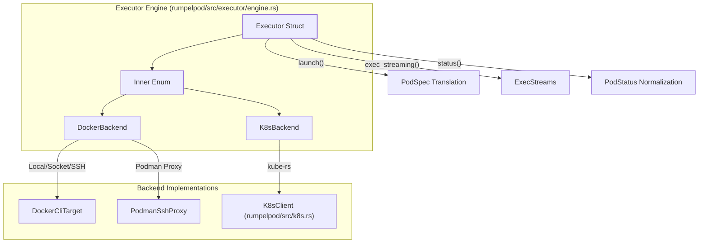
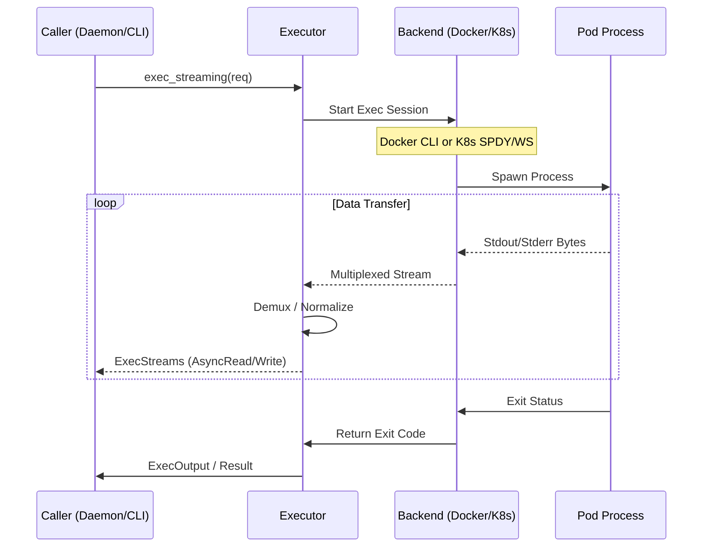

<!-- source: DeepWiki mcp.deepwiki.com · repo NVIDIA/rumpelpod · page 2.3 Executor Engine and Backend Abstraction · fetched 2026-10-26 -->

# Executor Engine and Backend Abstraction

Relevant source files

The following files were used as context for generating this wiki page:

- [Cargo.lock](Cargo.lock)
- [THIRD-PARTY-NOTICES](THIRD-PARTY-NOTICES)
- [rumpelpod/Cargo.toml](rumpelpod/Cargo.toml)
- [rumpelpod/src/exec_proxy.rs](rumpelpod/src/exec_proxy.rs)
- [rumpelpod/src/executor/engine.rs](rumpelpod/src/executor/engine.rs)
- [rumpelpod/src/executor/mod.rs](rumpelpod/src/executor/mod.rs)
- [rumpelpod/src/executor/podman_ssh.rs](rumpelpod/src/executor/podman_ssh.rs)
- [rumpelpod/src/executor/spec.rs](rumpelpod/src/executor/spec.rs)
- [rumpelpod/src/k8s.rs](rumpelpod/src/k8s.rs)
- [rumpelpod/src/registry.rs](rumpelpod/src/registry.rs)
- [tools/Cargo.toml](tools/Cargo.toml)

The Executor engine provides a unified interface for managing pod lifecycles and executing commands across different container runtimes. By abstracting the specific API calls for Docker and Kubernetes behind a common `Executor` type, rumpelpod ensures that the daemon and CLI can operate identically regardless of whether the environment is a local developer machine or a remote cluster.

## The Executor Trait and Backend Dispatch

The `Executor` struct acts as a dispatcher that routes requests to either a `DockerBackend` or a `K8sBackend` via an internal `Inner` enum [rumpelpod/src/executor/engine.rs:34-43](). This abstraction covers pod creation, status monitoring, deletion, and various execution modes.

The `Executor` is constructed using specialized constructors based on the target host:
*   `Executor::docker`: Connects via a Unix socket [rumpelpod/src/executor/engine.rs:68-80]().
*   `Executor::docker_ssh`: Connects using Docker's native SSH transport [rumpelpod/src/executor/engine.rs:82-92]().
*   `Executor::podman`: Interacts with the local Podman store [rumpelpod/src/executor/engine.rs:94-103]().
*   `Executor::kubernetes`: Connects to a cluster via a specific context and namespace [rumpelpod/src/executor/engine.rs:162-169]().

### Code Entity Mapping: Executor Engine

The following diagram maps the high-level executor concepts to the specific code entities that implement them.

**Executor Backend Architecture**

Sources: [rumpelpod/src/executor/engine.rs:34-65](), [rumpelpod/src/executor/engine.rs:177-198](), [rumpelpod/src/executor/podman_ssh.rs:32-39]()

## Pod Launch Sequences

Launching a pod involves translating a generic `PodSpec` into backend-specific configurations. The `PodSpec` contains common fields (image, env, mounts) and backend-specific buckets (`DockerOnly`, `K8sOnly`) [rumpelpod/src/executor/spec.rs:20-42]().

### Pod Identification
Rumpelpod uses a `PodId` derived from the logical pod name and a hash of the repository path to ensure uniqueness across different projects [rumpelpod/src/executor/mod.rs:181-205]().
*   **Docker:** Uses labels like `dev.rumpelpod.name` and `dev.rumpelpod.repo_path` [rumpelpod/src/executor/mod.rs:36-38]().
*   **Kubernetes:** Uses labels like `rumpelpod/pod-name` and `rumpelpod/repo-hash` [rumpelpod/src/executor/mod.rs:45-46]().

### Backend-Specific Launch Details
*   **Docker:** Mounts are handled as `Bind`, `Volume`, or `Tmpfs` [rumpelpod/src/executor/spec.rs:54-59](). The executor handles security options like `privileged` mode and `cap_add` [rumpelpod/src/executor/spec.rs:31-32]().
*   **Kubernetes:** Mounts are typically translated to `emptyDir` volumes [rumpelpod/src/k8s.rs:144-157](). The executor configures `securityContext` for capabilities and seccomp profiles [rumpelpod/src/k8s.rs:173-200]().

Sources: [rumpelpod/src/executor/mod.rs:50-81](), [rumpelpod/src/executor/spec.rs:20-42](), [rumpelpod/src/k8s.rs:120-167]()

## Execution Modes and Stream Demuxing

The engine supports various execution patterns, returning an `ExecOutput` (buffered) or `ExecStreams` (streaming) [rumpelpod/src/executor/spec.rs:115-134]().

### 1. Streaming and Interactive Mode
`ExecStreams` provides `AsyncRead` handles for `stdout` and `stderr`, and an `AsyncWrite` handle for `stdin` [rumpelpod/src/executor/spec.rs:126-134](). 
*   **Podman SSH Proxy:** For Podman on remote hosts, rumpelpod spawns a `PodmanSshProxy`. This creates a local Unix socket that tunnels traffic via `ssh ... podman system dial-stdio`, allowing the local podman CLI to interact with remote containers [rumpelpod/src/executor/podman_ssh.rs:4-18]().

### 2. Stream Demuxing and Tunnels
Rumpelpod uses exec streams as a transport for other services. For example, `start_exec_proxy` spawns `rumpel tcp-proxy` inside a pod and bridges a local TCP listener to the pod's internal ports over the exec's stdin/stdout [rumpelpod/src/exec_proxy.rs:41-50]().

**Command Execution Flow**

Sources: [rumpelpod/src/executor/spec.rs:121-134](), [rumpelpod/src/exec_proxy.rs:131-149](), [rumpelpod/src/executor/podman_ssh.rs:160-174]()

## Exit Code Normalization

The Executor engine ensures that exit codes are consistently reported as `i32` regardless of the underlying transport [rumpelpod/src/executor/spec.rs:118]().

*   **Success:** `0`.
*   **Process Exit:** The specific code returned by the shell or binary inside the container.
*   **Signals:** Normalized according to standard Unix conventions (e.g., 128 + signal number).
*   **Errors:** Errors in the executor itself (e.g., failed to reach the Docker socket) are returned as `anyhow::Result` failures rather than exit codes [rumpelpod/src/executor/engine.rs:177-182]().

Sources: [rumpelpod/src/executor/spec.rs:115-119](), [rumpelpod/src/executor/engine.rs:177-198]()

---

