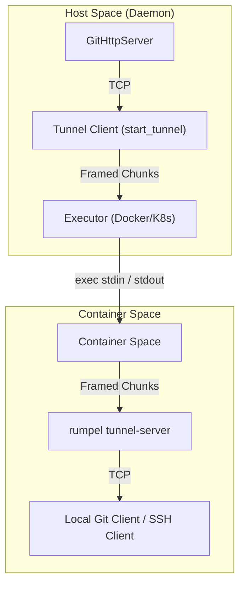
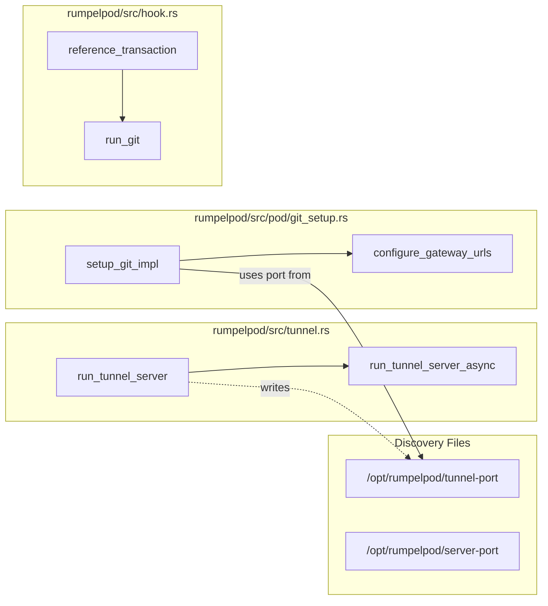
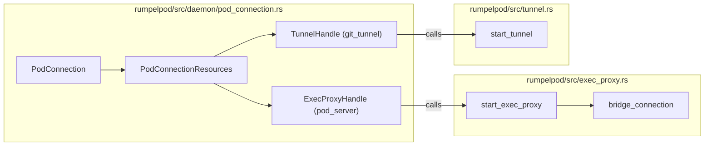

<!-- source: DeepWiki mcp.deepwiki.com · repo NVIDIA/rumpelpod · page 2.4 Networking: Tunnels, Proxies, and Port Forwarding · fetched 2026-10-26 -->

# Networking: Tunnels, Proxies, and Port Forwarding

Relevant source files

The following files were used as context for generating this wiki page:

- [Cargo.lock](Cargo.lock)
- [THIRD-PARTY-NOTICES](THIRD-PARTY-NOTICES)
- [rumpelpod/Cargo.toml](rumpelpod/Cargo.toml)
- [rumpelpod/src/daemon/pod_connection.rs](rumpelpod/src/daemon/pod_connection.rs)
- [rumpelpod/src/exec_proxy.rs](rumpelpod/src/exec_proxy.rs)
- [rumpelpod/src/git.rs](rumpelpod/src/git.rs)
- [rumpelpod/src/hook.rs](rumpelpod/src/hook.rs)
- [rumpelpod/src/pod/git_setup.rs](rumpelpod/src/pod/git_setup.rs)
- [rumpelpod/src/pty_session.rs](rumpelpod/src/pty_session.rs)
- [rumpelpod/src/tunnel.rs](rumpelpod/src/tunnel.rs)
- [tools/Cargo.toml](tools/Cargo.toml)

Rumpelpod establishes connectivity between the host machine and isolated containers (pods) using a multi-layered networking stack. Because pods may run in environments without direct IP routability (such as remote Kubernetes clusters or restricted Docker networks), rumpelpod relies on multiplexed TCP tunnels and ephemeral proxies carried over standard container execution streams (`stdin`/`stdout`).

## The Multiplexed Tunnel

The foundation of rumpelpod's networking is the `tunnel` module. It implements a framing protocol that carries multiple TCP streams over a single pair of byte streams established by exec-ing into the container [rumpelpod/src/tunnel.rs:4-9]().

### Framing Protocol
The tunnel uses a simple binary framing format:
- `stream_id` (u32 LE): Unique identifier for the sub-stream [rumpelpod/src/tunnel.rs:12]().
- `frame_type` (u8): One of `OPEN` (0x01), `DATA` (0x02), or `CLOSE` (0x03) [rumpelpod/src/tunnel.rs:14-17](), [rumpelpod/src/tunnel.rs:38-40]().
- `payload_len` (u32 LE): Length of the subsequent data, capped at 64 KiB [rumpelpod/src/tunnel.rs:12](), [rumpelpod/src/tunnel.rs:43]().

### Implementation Components
1.  **Tunnel Server (`run_tunnel_server`)**: Runs inside the container. It binds a TCP listener on loopback, assigns stream IDs, and multiplexes accepted connections over stdout [rumpelpod/src/tunnel.rs:19-21](), [rumpelpod/src/tunnel.rs:108-112](). It writes its port to a discovery file [rumpelpod/src/tunnel.rs:146-148]().
2.  **Tunnel Client (`start_tunnel`)**: Runs on the host. It uses `Executor::exec_streaming` to launch the server in the pod, demultiplexes frames from the pod's stdout, and opens local TCP connections to target host addresses [rumpelpod/src/tunnel.rs:22-25]().

**Diagram: Multiplexed Stream Data Flow**

**Sources:** [rumpelpod/src/tunnel.rs:4-25](), [rumpelpod/src/tunnel.rs:108-152]()

## Exec-Based TCP Proxies

Rumpelpod uses `exec_proxy` to route traffic into the container without requiring open ports on the container's network interface or bridge IPs.

### `ExecProxyHandle`
Instead of traditional port forwarding, the daemon calls `start_exec_proxy`, which binds a local port on the host [rumpelpod/src/exec_proxy.rs:41-48](). For every accepted connection on this host port, the daemon execs `rumpel tcp-proxy --port <target>` into the pod [rumpelpod/src/exec_proxy.rs:131-142]().

The `bridge_connection` function then pipes the host's TCP stream directly into the `stdin`/`stdout` of the `tcp-proxy` process inside the pod [rumpelpod/src/exec_proxy.rs:169-201](). This mechanism is used to reach the in-container `PodServer` [rumpelpod/src/daemon/pod_connection.rs:188-192]().

**Sources:** [rumpelpod/src/exec_proxy.rs:4-10](), [rumpelpod/src/exec_proxy.rs:125-142](), [rumpelpod/src/daemon/pod_connection.rs:182-192]()

## Git Integration and Synchronization

To synchronize code, rumpelpod runs a `GitHttpServer` on the host, which pods access via the tunnel.

1.  **Host Side**: The daemon manages a `GitHttpServer` that serves the local repository [rumpelpod/src/daemon/pod_connection.rs:7-9]().
2.  **Pod Side**: The `setup_git_impl` function configures the container's git remotes (`host` and `rumpelpod`) to point to the tunneled loopback address [rumpelpod/src/pod/git_setup.rs:86-96]().
3.  **Hooks**: A `reference-transaction` hook is installed in the pod repo [rumpelpod/src/pod/git_setup.rs:175-176](). When a commit is made in the pod, this hook automatically pushes the update back to the host via the `rumpelpod` remote [rumpelpod/src/hook.rs:97-109]().

**Sources:** [rumpelpod/src/pod/git_setup.rs:86-111](), [rumpelpod/src/hook.rs:97-134](), [rumpelpod/src/daemon/pod_connection.rs:73-75]()

## SSH Agent Relay

Rumpelpod allows the pod to use the host's SSH keys via an agent relay, enabling git operations against remote servers (like GitHub) from within the isolated pod.

- **Pod Setup**: The `PodServer` creates a Unix socket at a specific path inside the container [rumpelpod/src/daemon/pod_connection.rs:8-9]().
- **Relay**: The `SshAgentHandle` on the host side manages the lifecycle of the relay, ensuring that requests to the in-pod socket are tunneled back to the host's `SSH_AUTH_SOCK`.

**Sources:** [rumpelpod/src/daemon/pod_connection.rs:7-9](), [rumpelpod/src/daemon/pod_connection.rs:77-79]()

## Code Entity Map: Networking Components

The following diagrams map logical networking concepts to specific code entities and files.

**Diagram: In-Container Networking Entities**

**Sources:** [rumpelpod/src/tunnel.rs:108-152](), [rumpelpod/src/pod/git_setup.rs:86-96](), [rumpelpod/src/hook.rs:97-134]()

**Diagram: Host-Side Daemon Networking**

**Sources:** [rumpelpod/src/daemon/pod_connection.rs:73-80](), [rumpelpod/src/exec_proxy.rs:41-50](), [rumpelpod/src/daemon/pod_connection.rs:182-192]()

---

