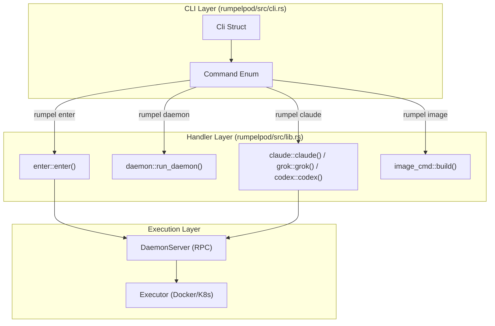
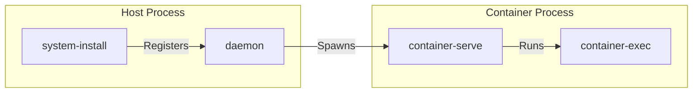

<!-- source: DeepWiki mcp.deepwiki.com · repo NVIDIA/rumpelpod · page 3 CLI Commands Reference · fetched 2026-10-26 -->

# CLI Commands Reference

Relevant source files

The following files were used as context for generating this wiki page:

- [rumpelpod/src/cli.rs](rumpelpod/src/cli.rs)
- [rumpelpod/src/completions.rs](rumpelpod/src/completions.rs)
- [rumpelpod/src/lib.rs](rumpelpod/src/lib.rs)
- [rumpelpod/src/prepared_image.rs](rumpelpod/src/prepared_image.rs)
- [rumpelpod/tests/cli/codex/install.rs](rumpelpod/tests/cli/codex/install.rs)

The `rumpel` CLI is the primary interface for managing isolated development environments (pods) and interacting with LLM agents. The CLI follows a subcommand pattern, routing requests to the background `DaemonServer` or executing local synchronization tasks.

### Command Structure Overview

The CLI is implemented using `clap` in [rumpelpod/src/cli.rs:123-126](). It categorizes functionality into pod management, agent orchestration, and system maintenance. The main entry point for command dispatch is located in `rumpelpod/src/lib.rs`.

| Category | Primary Commands | Responsibility |
| :--- | :--- | :--- |
| **Lifecycle** | `enter`, `stop`, `delete`, `recreate`, `fork` | Managing the state and existence of containers. |
| **Synchronization** | `merge`, `review`, `cp`, `ssh-add` | Moving code and credentials between host and pod. |
| **Agents** | `claude`, `codex`, `grok`, `pi` | Launching LLM-driven autonomous sessions. |
| **Infrastructure** | `image`, `hub`, `system-install` | Managing base images, K8s hubs, and local services. |

### CLI to Code Mapping

The following diagram bridges the user-facing CLI commands to their respective entry points and internal handlers.

**Command Dispatch Architecture**

Sources: [rumpelpod/src/cli.rs:136-248](), [rumpelpod/src/lib.rs:107-217]()

---

### Pod Lifecycle Commands
These commands manage the creation, execution, and termination of pods. Most lifecycle commands communicate with the `DaemonClient` to update the state in the SQLite database and trigger `Executor` actions.

*   **`enter`**: The primary entry point. It resolves the `devcontainer.json`, ensures the image exists, and launches an interactive shell or command [rumpelpod/src/lib.rs:155-157]().
*   **`list`**: Queries the daemon for all pods associated with the current repository [rumpelpod/src/lib.rs:158-160]().
*   **`fork`**: Creates a new pod based on the current state of an existing pod [rumpelpod/src/lib.rs:179-181]().
*   **`stop`**: Gracefully halts pod containers while preserving their state [rumpelpod/src/lib.rs:161-163]().

For detailed usage and flag references, see [Pod Lifecycle Commands](#3.1).

---

### LLM Agent Commands
Rumpelpod provides specialized commands to launch LLM agents inside pods. These commands handle the complexity of PTY (Pseudo-Terminal) allocation, credential forwarding, and pre-installing the agent binaries into "prepared" images [rumpelpod/src/prepared_image.rs:4-7]().

*   **`claude`**: Launches the Anthropic Claude engineer agent [rumpelpod/src/lib.rs:195-202]().
*   **`codex`**: Launches the Codex agent, ensuring the version matches the host's version [rumpelpod/src/lib.rs:203-205](), [rumpelpod/tests/cli/codex/install.rs:23-25]().
*   **`grok`**: Launches the xAI Grok agent [rumpelpod/src/lib.rs:209-211]().
*   **`pi`**: Launches the Pi coding agent [rumpelpod/src/lib.rs:206-208]().

For details on session management and "always-approve" hooks, see [LLM Agent Commands](#3.2).

---

### Image Management Commands
These commands handle the building and distribution of the `devcontainer` images and "prepared" images that include rumpelpod binaries.

*   **`image build`**: Uses `docker buildx` to create a deterministic, content-addressed image based on the `devcontainer.json` definition [rumpelpod/src/lib.rs:183]().
*   **`image fetch`**: Pulls the required image from a remote registry, particularly useful in Kubernetes environments [rumpelpod/src/lib.rs:184]().
*   **`prepare-image`**: Internal command to bake the repository and agent CLIs into a new image layer [rumpelpod/src/lib.rs:215-217]().

For details on the content-addressing logic and `BuildxMode`, see [Image Management Commands](#3.3).

---

### Internal & System Commands
Rumpelpod includes several "hidden" or low-level commands used for system integration and internal plumbing.

**System Plumbing Mapping**

Sources: [rumpelpod/src/lib.rs:113-154]()

*   **`system-install`**: Installs the `rumpel daemon` as a background service [rumpelpod/src/lib.rs:149-151]().
*   **`container-serve`**: The entrypoint for the in-container `PodServer` that provides the HTTP API for agents [rumpelpod/src/lib.rs:125-148]().
*   **`tunnel-server`**: Manages the multiplexed TCP tunnel between the host and the container [rumpelpod/src/lib.rs:116-118]().
*   **`completions`**: Generates shell completion scripts for Bash, Zsh, and Fish [rumpelpod/src/lib.rs:218-225](), [rumpelpod/src/completions.rs:154-157]().

Sources: [rumpelpod/src/cli.rs:123-248](), [rumpelpod/src/lib.rs:107-240](), [rumpelpod/src/prepared_image.rs:4-40]()

---

