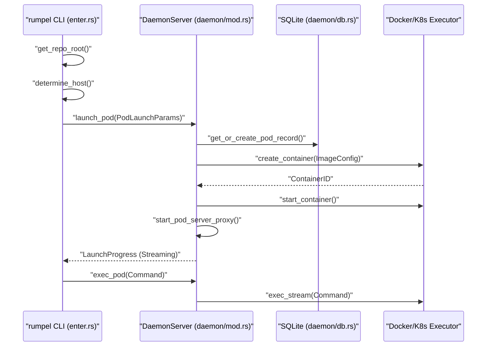
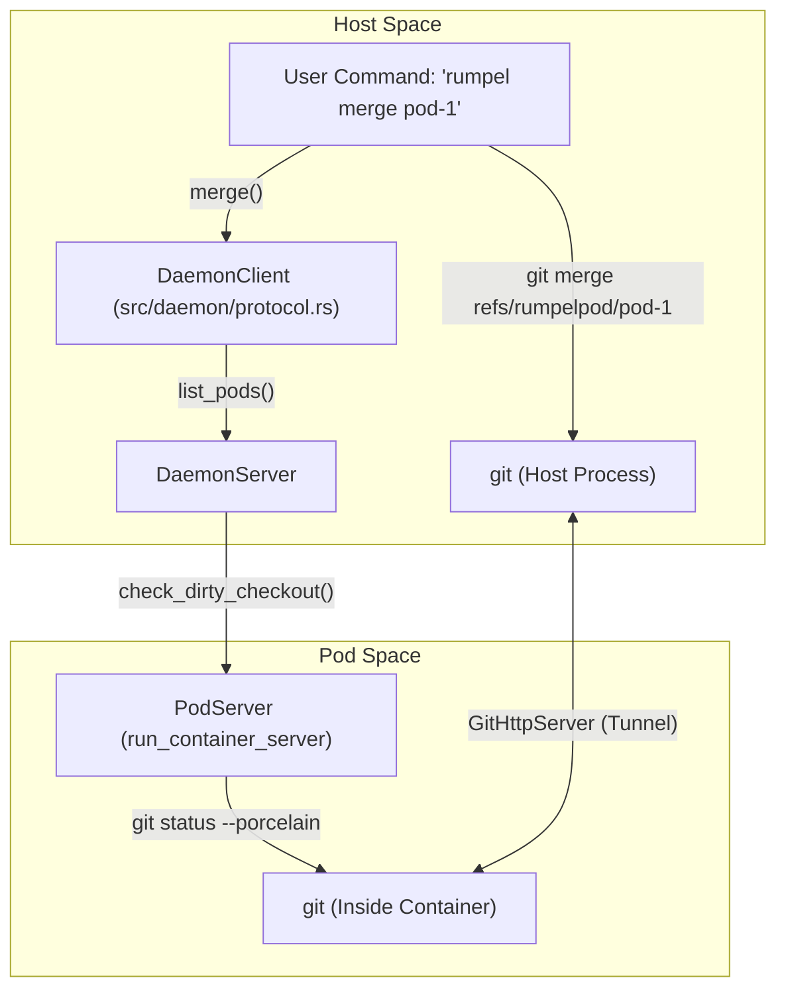

<!-- source: DeepWiki mcp.deepwiki.com · repo NVIDIA/rumpelpod · page 3.1 Pod Lifecycle Commands · fetched 2026-10-26 -->

# Pod Lifecycle Commands

Relevant source files

The following files were used as context for generating this wiki page:

- [rumpelpod/src/cp.rs](rumpelpod/src/cp.rs)
- [rumpelpod/src/daemon/protocol.rs](rumpelpod/src/daemon/protocol.rs)
- [rumpelpod/src/delete.rs](rumpelpod/src/delete.rs)
- [rumpelpod/src/enter.rs](rumpelpod/src/enter.rs)
- [rumpelpod/src/fork.rs](rumpelpod/src/fork.rs)
- [rumpelpod/src/list.rs](rumpelpod/src/list.rs)
- [rumpelpod/src/merge.rs](rumpelpod/src/merge.rs)
- [rumpelpod/src/pod/client.rs](rumpelpod/src/pod/client.rs)
- [rumpelpod/src/prune.rs](rumpelpod/src/prune.rs)
- [rumpelpod/src/recreate.rs](rumpelpod/src/recreate.rs)
- [rumpelpod/src/review.rs](rumpelpod/src/review.rs)
- [rumpelpod/src/stop.rs](rumpelpod/src/stop.rs)
- [rumpelpod/tests/cli/cp.rs](rumpelpod/tests/cli/cp.rs)
- [rumpelpod/tests/cli/enter.rs](rumpelpod/tests/cli/enter.rs)
- [rumpelpod/tests/cli/list.rs](rumpelpod/tests/cli/list.rs)
- [rumpelpod/tests/cli/merge.rs](rumpelpod/tests/cli/merge.rs)
- [rumpelpod/tests/cli/prune.rs](rumpelpod/tests/cli/prune.rs)
- [rumpelpod/tests/cli/recreate.rs](rumpelpod/tests/cli/recreate.rs)
- [rumpelpod/tests/cli/review.rs](rumpelpod/tests/cli/review.rs)

This page provides a technical reference for the `rumpel` CLI commands that manage the lifecycle of pods. These commands interact with the `DaemonServer` via the Unix socket RPC protocol to create, manipulate, and destroy containerized development environments.

## Overview of Command Flow

Pod lifecycle commands generally follow a pattern:
1.  **Local Context Discovery**: The CLI identifies the git repository root [rumpelpod/src/enter.rs:19-20]() and current branch [rumpelpod/src/enter.rs:19]().
2.  **Configuration Loading**: The CLI loads `.rumpelpod.json` and `.devcontainer/devcontainer.json` to determine the target `Host` (Localhost, SSH, or Kubernetes) [rumpelpod/src/enter.rs:113-143]().
3.  **Daemon RPC**: The CLI connects to the daemon socket [rumpelpod/src/enter.rs:38-39]() and invokes methods on the `DaemonClient` [rumpelpod/src/daemon/protocol.rs:41-70]().
4.  **Executor Execution**: The daemon uses an `Executor` (Docker or Kubernetes) to perform the low-level container operations [rumpelpod/src/daemon/protocol.rs:138-153]().

### Command to Code Mapping

| CLI Command | Source Entry Point | Daemon Protocol Method |
| :--- | :--- | :--- |
| `enter` | `enter()` [rumpelpod/src/enter.rs:220]() | `launch_pod` [rumpelpod/src/enter.rs:275]() |
| `recreate` | `recreate()` [rumpelpod/src/recreate.rs:19]() | `recreate_pod` [rumpelpod/src/recreate.rs:47]() |
| `list` | `list()` [rumpelpod/src/list.rs:35]() | `list_pods` [rumpelpod/src/list.rs:41]() |
| `stop` | `stop()` [rumpelpod/src/stop.rs:19]() | `stop_pod` |
| `delete` | `delete()` [rumpelpod/src/delete.rs:22]() | `delete_pod` [rumpelpod/src/delete.rs:68]() |
| `fork` | `fork()` [rumpelpod/src/fork.rs:21]() | `fork_pod` [rumpelpod/src/fork.rs:50]() |
| `merge` | `merge()` [rumpelpod/src/merge.rs:197]() | `merge_pod` (Host-side git ops) |
| `prune` | `prune()` [rumpelpod/src/prune.rs:35]() | `delete_pod` (iterative) [rumpelpod/src/prune.rs:75]() |

**Sources:** [rumpelpod/src/enter.rs:220-350](), [rumpelpod/src/recreate.rs:19-72](), [rumpelpod/src/list.rs:35-104](), [rumpelpod/src/delete.rs:22-79](), [rumpelpod/src/fork.rs:21-68](), [rumpelpod/src/merge.rs:197-220]()

## Core Lifecycle Commands

### rumpel enter
The primary entry point for pod interaction. It ensures a pod exists and then executes a command (or starts an interactive shell) inside it.

*   **Implementation**: If `--create` is passed, it first calls `launch_pod` [rumpelpod/src/enter.rs:275-290](). It then calls `exec_pod` to start the session [rumpelpod/src/enter.rs:315-325]().
*   **Workdir Mapping**: It automatically maps the host's current directory to the corresponding path inside the container's repo mount [rumpelpod/src/enter.rs:33-37]().
*   **Environment Substitution**: It collects `${localEnv:VAR}` variables from the host to allow the daemon to resolve them in the `devcontainer.json` [rumpelpod/src/enter.rs:151-154]().
*   **Host Requirements**: It logs and validates `hostRequirements` (CPU, Memory, GPU, Storage) [rumpelpod/src/enter.rs:64-110](). For Kubernetes, these are translated into pod resource requests [rumpelpod/src/enter.rs:107-108]().

**Sources:** [rumpelpod/src/enter.rs:220-350](), [rumpelpod/src/enter.rs:64-110](), [rumpelpod/src/enter.rs:151-154]()

### rumpel recreate
Forcefully destroys an existing pod and recreates it from scratch using the current configuration.

*   **Data Flow**: It validates the pod exists [rumpelpod/src/recreate.rs:24-28](), then sends `PodLaunchParams` to the daemon's `recreate_pod` endpoint [rumpelpod/src/recreate.rs:47-61]().
*   **State Preservation**: Unlike a fresh `enter`, it preserves the repository state (including dirty files and untracked files) while resetting the container filesystem (e.g., `/tmp`) [rumpelpod/tests/cli/recreate.rs:16-67](). It also preserves LLM agent states like `ClaudeState` and `CodexState` [rumpelpod/tests/cli/recreate.rs:98-144]().

**Sources:** [rumpelpod/src/recreate.rs:19-72](), [rumpelpod/tests/cli/recreate.rs:16-144]()

### rumpel list, stop, delete, and prune
Basic management of pod states.

*   **list**: Queries the daemon for pods associated with the current repo [rumpelpod/src/list.rs:41](). Displays pod name, LLM agent status (Claude/Codex), git state, lifecycle status, and container ID [rumpelpod/src/list.rs:54-65]().
*   **stop**: Sends a stop request to the daemon. The pod remains in the database and its disk state is preserved.
*   **delete**: Removes the container and the pod entry from the daemon's database [rumpelpod/src/delete.rs:68](). It warns or prompts if the pod has unmerged commits [rumpelpod/src/delete.rs:41-58]().
*   **prune**: Bulk deletes pods in `Stopped`, `Gone`, or `Broken` states [rumpelpod/src/prune.rs:14-24]().

**Sources:** [rumpelpod/src/list.rs:35-104](), [rumpelpod/src/delete.rs:22-79](), [rumpelpod/src/prune.rs:13-33]()

## Advanced Branching and Merging

### rumpel fork
Creates a new pod by cloning an existing one.

*   **Safety Checks**: Validates source existence and target name availability before requesting the fork [rumpelpod/src/fork.rs:30-38]().
*   **Agent State**: Prompts the user if the source pod is mid-turn (processing) to avoid capturing inconsistent agent states [rumpelpod/src/fork.rs:74-113]().
*   **Implementation**: Forwards a `ForkPodRequest` to the daemon [rumpelpod/src/fork.rs:50-55]().

**Sources:** [rumpelpod/src/fork.rs:21-113]()

### rumpel merge
Integrates changes from a pod back into the host repository.

*   **Implementation**:
    1.  Verifies the pod exists [rumpelpod/src/merge.rs:204-208]().
    2.  Checks for uncommitted changes inside the container [rumpelpod/src/merge.rs:18-61]().
    3.  Resolves a "description file" (e.g., `SUMMARY.md`) to use as the merge commit message [rumpelpod/src/merge.rs:112-161]().
    4.  Executes `git merge` on the host against the pod's git ref `refs/rumpelpod/<name>` [rumpelpod/src/merge.rs:212-230]().

**Sources:** [rumpelpod/src/merge.rs:18-61](), [rumpelpod/src/merge.rs:112-230]()

### rumpel review
Uses `git difftool` to review changes between the pod and the host.

*   **Mechanism**: It identifies the merge base, extracts files from the pod's branch and the base into a temporary directory, and invokes the configured `diff.tool` [rumpelpod/src/review.rs:22-142]().

**Sources:** [rumpelpod/src/review.rs:4-142]()

## Resource and Utility Commands

### rumpel cp
Copies files between the host and a running pod.
*   **Implementation**: Uses the `Executor::cp_to` and `Executor::cp_from` methods via the daemon.

### rumpel ports
Lists or manages port forwarding from the pod to the host.
*   **Data Flow**: The daemon tracks `PortInfo` (container port, local port, label) [rumpelpod/src/daemon/protocol.rs:179-184]().

### rumpel ssh-add
Forwards the host's SSH agent to the pod.
*   **Mechanism**: Identifies `SSH_AUTH_SOCK` on the host and passes it to the daemon in `PodLaunchParams` [rumpelpod/src/recreate.rs:45-60]().

## Logic Flow Diagrams

### Pod Launch Sequence (rumpel enter)
This diagram shows the transition from CLI invocation to the creation of a containerized environment.

**Sources:** [rumpelpod/src/enter.rs:220-300](), [rumpelpod/src/daemon/protocol.rs:47-70]()

### Git Integration during Merge
How the system bridges the "Natural Language Space" (user wants to merge) to "Code Entity Space" (git refs and pod server).

**Sources:** [rumpelpod/src/merge.rs:18-61](), [rumpelpod/src/merge.rs:197-230](), [rumpelpod/src/enter.rs:19-20]()

---

