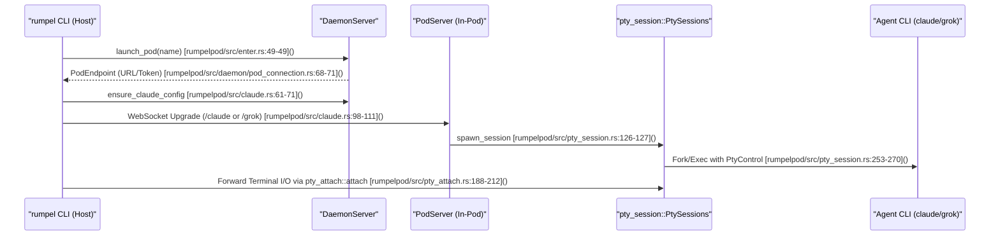
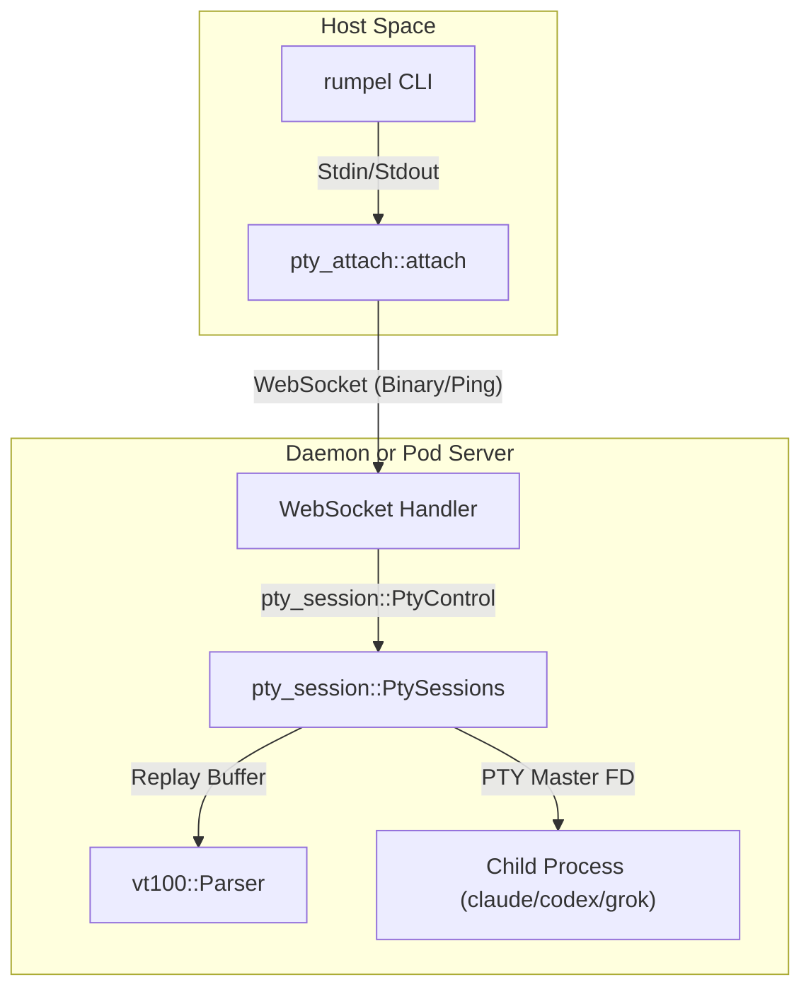

<!-- source: DeepWiki mcp.deepwiki.com · repo NVIDIA/rumpelpod · page 3.2 LLM Agent Commands · fetched 2026-10-26 -->

# LLM Agent Commands

Relevant source files

The following files were used as context for generating this wiki page:

- [CHANGELOG.md](CHANGELOG.md)
- [rumpelpod/src/claude.rs](rumpelpod/src/claude.rs)
- [rumpelpod/src/codex.rs](rumpelpod/src/codex.rs)
- [rumpelpod/src/command_ext.rs](rumpelpod/src/command_ext.rs)
- [rumpelpod/src/daemon/pod_connection.rs](rumpelpod/src/daemon/pod_connection.rs)
- [rumpelpod/src/grok.rs](rumpelpod/src/grok.rs)
- [rumpelpod/src/pi.rs](rumpelpod/src/pi.rs)
- [rumpelpod/src/pty_attach.rs](rumpelpod/src/pty_attach.rs)
- [rumpelpod/src/pty_session.rs](rumpelpod/src/pty_session.rs)
- [rumpelpod/src/service.rs](rumpelpod/src/service.rs)
- [rumpelpod/tests/cli/codex/detach.rs](rumpelpod/tests/cli/codex/detach.rs)
- [rumpelpod/tests/cli/grok/common.rs](rumpelpod/tests/cli/grok/common.rs)
- [rumpelpod/tests/cli/grok/smoke.rs](rumpelpod/tests/cli/grok/smoke.rs)

LLM Agent Commands in `rumpelpod` provide a technical interface for launching and interacting with AI coding assistants (Anthropic Claude, OpenAI Codex, and xAI Grok) within the isolated environment of a pod. These commands automate credential forwarding, session persistence via PTY (Pseudo-Terminal) multiplexing, and the injection of security-bypass hooks to streamline agentic workflows.

## Overview of Agent Commands

The primary entry points for LLM agents are:
*   `rumpel claude`: Launches the Anthropic Claude CLI inside the pod [rumpelpod/src/claude.rs:24-121]().
*   `rumpel grok`: Launches the xAI Grok CLI inside the pod [rumpelpod/src/grok.rs:34-93]().
*   `rumpel codex`: Attaches to a host-side Codex TUI that interacts with the pod [rumpelpod/src/codex.rs:47-104]().

These commands manage a lifecycle that includes PTY session attachment, automatic pod launching, and host-to-pod credential synchronization.

### Agent Session Initialization

The initialization flow differs between container-native agents (Claude/Grok) and host-resident agents (Codex).

**Container-Native Agent Flow (Claude/Grok)**

Sources: [rumpelpod/src/claude.rs:48-111](), [rumpelpod/src/pty_session.rs:126-133](), [rumpelpod/src/daemon/pod_connection.rs:68-71](), [rumpelpod/src/pty_attach.rs:188-212]()

---

## Credential Forwarding

To prevent users from having to re-authenticate inside every pod, `rumpelpod` forwards host-side credentials into the container before starting the agent session.

### Claude Credentials
The `claude` command reads local OAuth credentials from `~/.claude/.credentials.json` or the macOS Keychain [rumpelpod/src/claude.rs:129-177](). These are forwarded to the daemon via `EnsureClaudeConfigRequest` [rumpelpod/src/daemon/protocol.rs:322-332](), which then persists them into the pod's home directory.

### Grok Credentials
The `grok` command forwards the `XAI_API_KEY` environment variable [rumpelpod/src/grok.rs:110-116](). It synchronizes the `~/.grok/` directory (containing `auth.json` and `config.toml`) by creating a tarball and uploading it via `PodClient::put_agent_files` [rumpelpod/src/grok.rs:135-152]().

### Codex Credentials
Codex credentials (typically `~/.codex/auth.json`) are used by the host-side Codex process. The daemon manages a `CodexProxyHandle` that injects `RUMPELPOD_CODEX_PROXY_TOKEN` into the local Codex process to allow it to communicate with the pod-side proxy [rumpelpod/src/codex.rs:205-212]().

Sources: [rumpelpod/src/claude.rs:129-177](), [rumpelpod/src/grok.rs:110-152](), [rumpelpod/src/codex.rs:205-212](), [rumpelpod/src/daemon/protocol.rs:322-332]()

---

## PTY Session Management

Agent sessions use a "screen-style" persistence model. The `pty_session` module maintains a virtual terminal buffer (`vt100::Parser`) so that the full TUI state is replayed immediately upon reattachment [rumpelpod/src/pty_session.rs:4-9]().

### Implementation Components
*   **PtySessions Registry**: A shared map of active PTY sessions identified by name [rumpelpod/src/pty_session.rs:66-70]().
*   **VT100 Parser**: Tracks the screen state for replay on reattach, allowing users to detach (Ctrl-a d) and return to the exact same visual state [rumpelpod/src/pty_session.rs:43-45]().
*   **Attach Logic**: `pty_attach::attach` handles the client-side terminal raw mode, window resizing (via `TIOCGWINSZ`), and WebSocket heartbeats [rumpelpod/src/pty_attach.rs:143-149](), [rumpelpod/src/pty_attach.rs:46-46]().

**PTY Data Flow Architecture**

Sources: [rumpelpod/src/pty_session.rs:4-50](), [rumpelpod/src/pty_attach.rs:143-160](), [rumpelpod/src/codex.rs:165-180]()

---

## Approval Hooks and Sandboxing

`rumpelpod` allows agents to operate autonomously while providing safety controls.

### Claude: Permission Hooks
Claude sessions can be launched with `permission_hook` enabled [rumpelpod/src/claude.rs:42-44](). This tells the daemon to configure the container so that Claude's permission requests are intercepted. If `skip_permissions` is active, the agent is launched with `--dangerously-skip-permissions` [rumpelpod/src/claude.rs:82-84]().

### Grok: Always-Approve
The `grok` command supports an `--always-approve` flag, which is passed directly to the in-container binary if configured in `.rumpelpod.json` [rumpelpod/src/grok.rs:55-58]().

### Codex: Approval Bypass
Codex sessions can be configured to bypass approvals and sandboxing via the `no_dangerously_bypass_approvals_and_sandbox` query parameter during the WebSocket upgrade to the daemon [rumpelpod/src/codex.rs:61-68]().

Sources: [rumpelpod/src/claude.rs:39-84](), [rumpelpod/src/grok.rs:42-58](), [rumpelpod/src/codex.rs:61-68]()

---

## Agent State Persistence

Agent state is maintained across disconnections and pod restarts:

1.  **PTY Persistence**: The `pty_session` keeps the child process alive even when the WebSocket client disconnects [rumpelpod/src/pty_session.rs:141-148]().
2.  **State Directory Synchronization**: Claude session history is preserved by the daemon's `EnsureClaudeConfig` logic, which can copy existing sessions into new pods [rumpelpod/src/claude.rs:70-70]().
3.  **Daemon-Managed Codex**: The host-side Codex TUI is owned by the daemon's `PtySessions` registry, ensuring the TUI survives `Ctrl-a d` and reattaches to the same pod connection [rumpelpod/src/codex.rs:13-16]().

Sources: [rumpelpod/src/pty_session.rs:141-148](), [rumpelpod/src/claude.rs:70-70](), [rumpelpod/src/codex.rs:13-16](), [rumpelpod/src/daemon/pod_connection.rs:106-107]()

---

