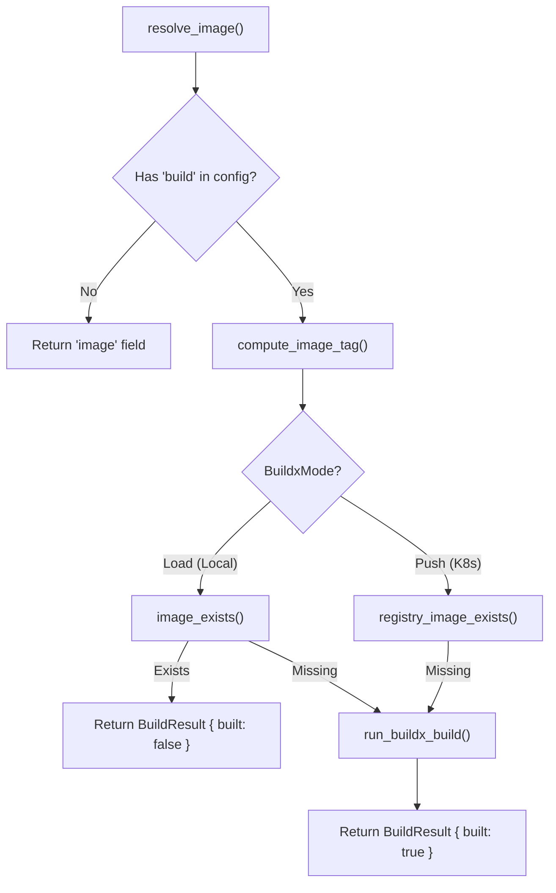
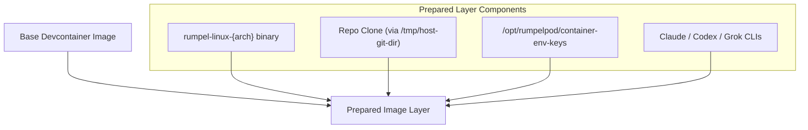

<!-- source: DeepWiki mcp.deepwiki.com · repo NVIDIA/rumpelpod · page 3.3 Image Management Commands · fetched 2026-10-26 -->

# Image Management Commands

Relevant source files

The following files were used as context for generating this wiki page:

- [rumpelpod/src/cli.rs](rumpelpod/src/cli.rs)
- [rumpelpod/src/image.rs](rumpelpod/src/image.rs)
- [rumpelpod/src/image_cmd.rs](rumpelpod/src/image_cmd.rs)
- [rumpelpod/src/prepared_image.rs](rumpelpod/src/prepared_image.rs)
- [rumpelpod/tests/cli/codex/install.rs](rumpelpod/tests/cli/codex/install.rs)
- [rumpelpod/tests/cli/devcontainer/image.rs](rumpelpod/tests/cli/devcontainer/image.rs)

Rumpelpod manages development environment images by extending the standard `devcontainer.json` specification. It utilizes `docker buildx` for multi-platform builds and implements a deterministic, content-addressed tagging system to ensure that identical build contexts result in reusable image layers across different pods.

## Overview of Image Commands

Rumpelpod provides two primary commands for manual image management, though these are typically invoked automatically during the `rumpel enter` lifecycle.

| Command | Purpose | Primary Function |
| :--- | :--- | :--- |
| `rumpel image build` | Forces a build of the Dockerfile defined in `devcontainer.json`. | `build()` [rumpelpod/src/image_cmd.rs:14-64]() |
| `rumpel image fetch` | Pulls the pre-built image specified in the `image` field of `devcontainer.json`. | `fetch()` [rumpelpod/src/image_cmd.rs:66-96]() |

Sources: [rumpelpod/src/image_cmd.rs:4-96]()

## Deterministic Content-Addressed Tagging

Rumpelpod does not rely on standard Docker tags like `latest`. Instead, it computes a unique hash based on the build context to provide deterministic image resolution.

### Tag Computation Logic
The function `compute_image_tag` generates a SHA-256 hash of the following inputs:
1.  **Dockerfile Content**: The literal bytes of the Dockerfile [rumpelpod/src/image.rs:260-264]().
2.  **Build Arguments**: Any `buildArgs` defined in `devcontainer.json` [rumpelpod/src/image.rs:266-271]().
3.  **Context Filesystem**: A recursive hash of all files within the build context, including file permissions (executable bit) [rumpelpod/src/image.rs:273-280]().
4.  **Context Path**: Optionally, the absolute path to the context on the host machine [rumpelpod/src/image.rs:282-286]().

### Image Resolution Flow
The `resolve_image` function [rumpelpod/src/image.rs:195-247]() determines if a build is necessary by checking for the existence of the computed tag in the target environment.

**Image Resolution Pipeline**

Sources: [rumpelpod/src/image.rs:139-247](), [rumpelpod/src/image.rs:253-306]()

## Buildx Execution and Modes

Rumpelpod uses `docker buildx build` as its underlying engine. This allows for advanced features like multi-platform support and remote caching. The `BuildxMode` enum [rumpelpod/src/image.rs:130-143]() determines how the resulting image is handled based on the `Host` configuration.

### Buildx Modes
*   **`BuildxMode::Load`**: Used for `Localhost` or `Ssh` hosts. Appends `--load` to the build command, which exports the image to the local Docker daemon's image store [rumpelpod/src/image.rs:132-136]().
*   **`BuildxMode::Push`**: Used for `Kubernetes` hosts. Appends `--push` to the build command, sending the image to a remote registry so the cluster can pull it [rumpelpod/src/image.rs:138-142]().

### Implementation Details
The `run_buildx_build` function constructs the CLI command [rumpelpod/src/image.rs:335-420](). It applies the `-H` (Docker Host) flag via `apply_docker_host` [rumpelpod/src/image.rs:30-78]() to target specific Unix sockets or SSH URIs.

**Command Construction Logic**
| Component | Implementation |
| :--- | :--- |
| **Docker Host** | `apply_docker_host(&mut cmd, ...)` [rumpelpod/src/image.rs:356]() |
| **Output Handling** | Captured via `Stdio::piped()` and processed line-by-line [rumpelpod/src/image.rs:383-388]() |
| **Platform** | Inferred from the `Host` architecture or defaulted to `linux/amd64` [rumpelpod/src/image.rs:360-363]() |

Sources: [rumpelpod/src/image.rs:130-188](), [rumpelpod/src/image.rs:335-420]()

## The Prepared Image Pipeline

To optimize pod startup, Rumpelpod builds a "Prepared Image" on top of the resolved devcontainer image. This prepared layer contains the Rumpelpod binary, a pre-cloned repository, and optional AI agent CLIs (Claude, Codex, Grok). This logic is implemented in `rumpelpod/src/prepared_image.rs`.

### Prepared Tagging
The prepared image tag is content-addressed, incorporating the `RUMPEL_VERSION_INFO` [rumpelpod/src/prepared_image.rs:197]() to ensure that updates to the Rumpelpod binary trigger a rebuild of the prepared layer.

**Prepared Image Composition**

### Key Prepared Image Files
*   **`CONTAINER_ENV_KEYS_PATH`**: A file at `/opt/rumpelpod/container-env-keys` listing allowed environment variables for forking [rumpelpod/src/prepared_image.rs:40]().
*   **`BUILD_GIT_DIR_PATH`**: A temporary mount point `/tmp/host-git-dir` used during the build to transfer the git state without sending the entire context [rumpelpod/src/prepared_image.rs:44]().
*   **Agent Version Pinning**: Rumpelpod detects local versions of agent CLIs (e.g., `detect_local_codex` [rumpelpod/src/prepared_image.rs:82]()) to ensure the prepared image matches the host's development environment [rumpelpod/tests/cli/codex/install.rs:23-69]().

Sources: [rumpelpod/src/prepared_image.rs:4-77](), [rumpelpod/src/prepared_image.rs:197-210](), [rumpelpod/tests/cli/codex/install.rs:4-69]()

---

