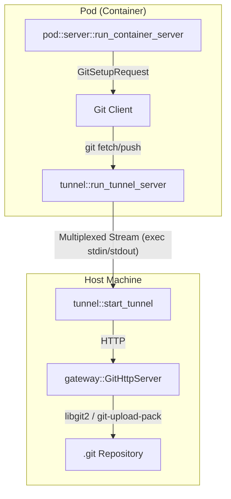
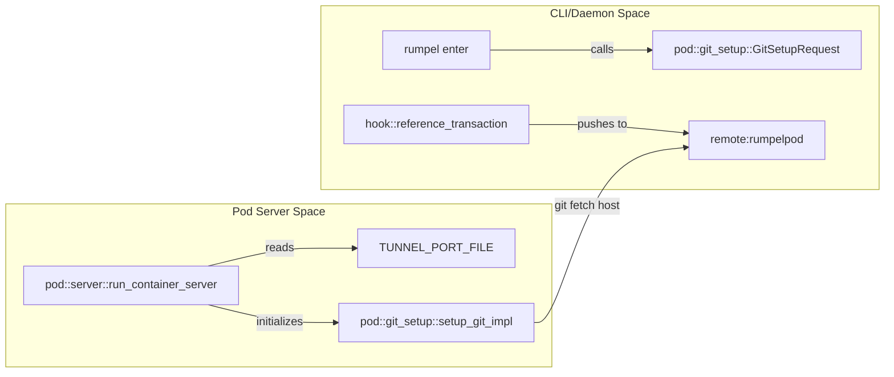

<!-- source: DeepWiki mcp.deepwiki.com · repo NVIDIA/rumpelpod · page 4 Git Integration · fetched 2026-10-26 -->

# Git Integration

Relevant source files

The following files were used as context for generating this wiki page:

- [rumpelpod/src/git.rs](rumpelpod/src/git.rs)
- [rumpelpod/src/hook.rs](rumpelpod/src/hook.rs)
- [rumpelpod/src/pod/git_setup.rs](rumpelpod/src/pod/git_setup.rs)
- [rumpelpod/src/pod/server.rs](rumpelpod/src/pod/server.rs)
- [rumpelpod/src/tunnel.rs](rumpelpod/src/tunnel.rs)
- [rumpelpod/tests/cli/gateway/mod.rs](rumpelpod/tests/cli/gateway/mod.rs)

Rumpelpod provides a deep integration with Git to ensure that the environment inside a pod is a faithful representation of the host's development state, including uncommitted changes and submodules. This integration is facilitated by a dedicated Git HTTP server on the host, a multiplexed tunnel for transport, and a specialized reference namespace to isolate pod-specific work.

### High-Level Architecture

The Git integration bridges the host's physical repository with the pod's isolated filesystem. When a pod is initialized, it does not clone from a remote upstream; instead, it clones directly from the host via a secure tunnel.

#### Git Integration Flow

**Sources:** [rumpelpod/src/pod/server.rs:142-160](), [rumpelpod/src/tunnel.rs:4-25](), [rumpelpod/src/pod/git_setup.rs:86-96]()

### Git Ref Namespace and Synchronization

Rumpelpod avoids polluting the standard `refs/heads/` namespace on the host. Instead, it uses a dedicated namespace: `refs/rumpelpod/`.

*   **Host Branches:** Standard branches remain at `refs/heads/*`.
*   **Pod Branches:** Each pod has its own branch tracked on the host at `refs/rumpelpod/<branch>@<pod>` [rumpelpod/src/pod/git_setup.rs:90-91]().
*   **Reference Transaction Hook:** A custom hook inside the pod [rumpelpod/src/hook.rs:97-100]() automatically pushes branch updates back to the host whenever a commit is made.
*   **Dirty Tree Sync:** Rumpelpod can synchronize uncommitted changes by creating temporary commits or patches that are transferred during the pod setup phase.
*   **Submodules:** The system ensures that submodule states are preserved and that pods can resolve submodule URLs back to the host via the same tunnel mechanism [rumpelpod/src/pod/git_setup.rs:55-61]().

For details on how refs are structured and how the synchronization logic handles edge cases, see **[Git Ref Namespace and Synchronization](#4.1)**.

**Sources:** [rumpelpod/src/pod/git_setup.rs:1-50](), [rumpelpod/src/git.rs:70-82](), [rumpelpod/src/hook.rs:97-168]()

### Git HTTP Server and Tunnel

Because pods often run in environments without direct network access to the host's local files (especially in Kubernetes), rumpelpod implements a custom transport layer.

*   **GitHttpServer:** A host-side server that implements the Git Smart Protocol. It uses `git-upload-pack` and `git-receive-pack` to serve the repository.
*   **Multiplexed Tunnel:** Git traffic is carried over a multiplexed TCP tunnel that runs inside a standard `exec` stream. The pod-side `run_tunnel_server` binds a loopback TCP listener and assignments stream IDs [rumpelpod/src/tunnel.rs:19-21]().
*   **Authentication:** The server requires a bearer token, which is generated by the daemon and passed to the pod server [rumpelpod/src/pod/server.rs:63-70]().

For details on the tunnel implementation and the HTTP server configuration, see **[Git HTTP Server and Tunnel](#4.2)**.

**Sources:** [rumpelpod/src/tunnel.rs:4-40](), [rumpelpod/src/pod/server.rs:63-70](), [rumpelpod/src/pod/server.rs:142-148]()

### Code Entity Mapping

The following diagram maps the logical Git operations to the specific Rust modules and functions responsible for them.

#### Entity Mapping: Git Operations

**Sources:** [rumpelpod/src/pod/server.rs:128-148](), [rumpelpod/src/pod/git_setup.rs:24-41](), [rumpelpod/src/hook.rs:97-105]()

### Key Components

| Component | Responsibility | Location |
| :--- | :--- | :--- |
| `GitIdentity` | Captures `user.name` and `user.email` from the host to mirror in the pod. | [rumpelpod/src/git.rs:19-23]() |
| `setup_git_impl` | The function inside the pod that performs the initial configuration and host fetch. | [rumpelpod/src/pod/git_setup.rs:86]() |
| `reference_transaction` | Hook that pushes branch updates to `refs/rumpelpod/` on the host. | [rumpelpod/src/hook.rs:97]() |
| `run_tunnel_server` | In-pod listener that multiplexes Git TCP traffic over the exec stream. | [rumpelpod/src/tunnel.rs:108]() |
| `prepare_lfs_for_new_ref` | Optimizes LFS uploads for new pod-specific refs to avoid full-history scans. | [rumpelpod/src/git.rs:126-130]() |

**Sources:** [rumpelpod/src/git.rs:19-23](), [rumpelpod/src/pod/git_setup.rs:86](), [rumpelpod/src/hook.rs:97](), [rumpelpod/src/tunnel.rs:108]()

---

