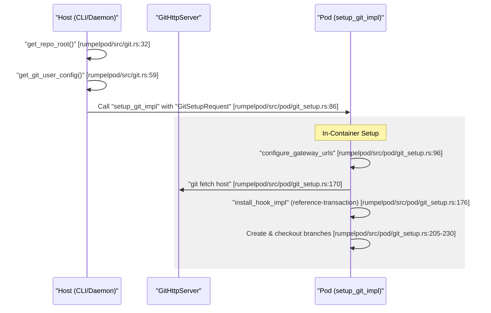
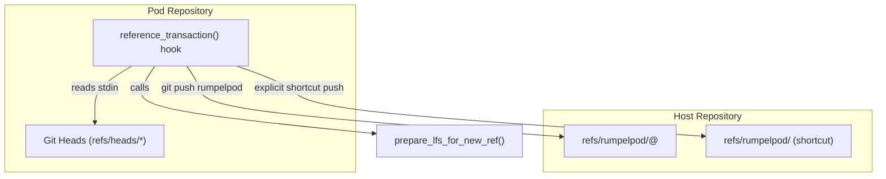

<!-- source: DeepWiki mcp.deepwiki.com · repo NVIDIA/rumpelpod · page 4.1 Git Ref Namespace and Synchronization · fetched 2026-10-26 -->

# Git Ref Namespace and Synchronization

<details>
<summary>Relevant source files</summary>

The following files were used as context for generating this wiki page:

- [rumpelpod/src/git.rs](rumpelpod/src/git.rs)
- [rumpelpod/src/hook.rs](rumpelpod/src/hook.rs)
- [rumpelpod/src/pod/git_setup.rs](rumpelpod/src/pod/git_setup.rs)
- [rumpelpod/src/tunnel.rs](rumpelpod/src/tunnel.rs)
- [rumpelpod/tests/cli/gateway/submodules.rs](rumpelpod/tests/cli/gateway/submodules.rs)

</details>


Rumpelpod employs a specialized Git reference namespace to manage the relationship between a developer's host repository and one or more isolated pod environments. This system ensures that LLM agents and developers working inside pods have a consistent view of the code while maintaining isolation from the host's primary branches.

## Git Reference Namespace

Rumpelpod organizes Git refs to distinguish between host-local state and pod-specific state. This allows multiple pods to exist for the same repository without colliding.

| Ref Pattern | Description |
|:---|:---|
| `refs/heads/*` | Standard host branches. The pod sees these via the `host` remote [rumpelpod/src/pod/git_setup.rs:108-111](). |
| `refs/rumpelpod/<branch>@<pod>` | Pod-specific branches stored on the host. `<branch>` is the name within the pod, and `<pod>` is the unique pod name [rumpelpod/src/pod/git_setup.rs:90](). |
| `refs/rumpelpod/<pod>` | A shortcut ref on the host pointing to the pod's primary branch [rumpelpod/src/pod/git_setup.rs:148-152](). |
| `refs/remotes/host/*` | Inside the pod, this remote tracks the host's `refs/heads/*` [rumpelpod/src/pod/git_setup.rs:108-111](). |

### The `rumpelpod/` Namespace
When a pod is created, it typically creates a branch named after the pod itself. This branch is backed by a ref on the host: `refs/rumpelpod/<branch>@<pod>`. The `GitHttpServer` on the host side ensures that pushes are namespaced correctly [rumpelpod/src/pod/git_setup.rs:90](). Additionally, a primary branch shortcut is pushed to `refs/rumpelpod/<pod>` so the host sees a clean remote ref for each pod [rumpelpod/src/pod/git_setup.rs:148-152]().

**Sources:** [rumpelpod/src/pod/git_setup.rs:86-167](), [rumpelpod/src/hook.rs:136-164]()

## Synchronization Flow

Synchronization occurs in two primary phases: initial pod setup and ongoing updates triggered by Git hooks.

### Initial Setup and Identity Transfer
When a pod is launched, the system orchestrates the transfer of the current host state:

1.  **Git Identity**: The host's `user.name` and `user.email` are read via `get_git_user_config` [rumpelpod/src/git.rs:59-68]() and passed to the pod via `GitSetupRequest` [rumpelpod/src/pod/git_setup.rs:24-41]().
2.  **Remote Configuration**: The pod is configured with two primary remotes: `host` (for fetching) and `rumpelpod` (for pushing) [rumpelpod/src/pod/git_setup.rs:96-160]().
3.  **Hook Installation**: A `reference-transaction` hook is installed in the pod's repository to automate pushing changes back to the host [rumpelpod/src/pod/git_setup.rs:176-178]().

### Data Flow: Host to Pod Sync
This diagram illustrates how the host and pod components interact during the Git setup phase.

**Host-Pod Git Synchronization**

**Sources:** [rumpelpod/src/git.rs:32-68](), [rumpelpod/src/pod/git_setup.rs:86-230](), [rumpelpod/src/hook.rs:97-168]()

## The Reference-Transaction Hook

Rumpelpod uses a `reference-transaction` hook inside the pod to ensure that every commit made (by a human or an agent) is immediately mirrored back to the host.

1.  **Hook Invocation**: The hook runs after a ref update is committed [rumpelpod/src/hook.rs:97-100]().
2.  **Ref Parsing**: It reads `oldvalue newvalue refname` from stdin to identify what changed [rumpelpod/src/hook.rs:63-79]().
3.  **Automated Push**: For every branch update in `refs/heads/*`, the hook executes `git push rumpelpod <branch>` [rumpelpod/src/hook.rs:127-134]().
4.  **Shortcut Update**: If the updated branch is the primary branch, it also updates the `refs/rumpelpod/<pod>` shortcut [rumpelpod/src/hook.rs:140-164]().

### Git LFS Optimization
To avoid expensive full-history scans during every hook-triggered push, Rumpelpod includes logic to skip the Git LFS pre-push hook if the objects are already known to be available on the host [rumpelpod/src/git.rs:118-142](). The hook calls `prepare_lfs_for_new_ref` to determine if it can safely set `GIT_LFS_SKIP_PUSH=1` [rumpelpod/src/hook.rs:115-122]().

**Implementation Mapping**

**Sources:** [rumpelpod/src/hook.rs:97-168](), [rumpelpod/src/git.rs:118-142]()

## Submodule Handling

Submodules are synchronized using the same gateway mechanism. The system resolves the Git directory for submodules (which may be located in the parent's `.git/modules` directory) to ensure refs land in the correct place [rumpelpod/tests/cli/gateway/submodules.rs:109-114]().

- **Pod to Host**: Commits made inside a pod's submodule are mirrored to the host's submodule git directory under the pod's namespace [rumpelpod/tests/cli/gateway/submodules.rs:113-120]().
- **Host to Pod**: Pods can fetch host submodule updates through the `host` remote configured within the submodule itself [rumpelpod/tests/cli/gateway/submodules.rs:164-170]().

**Sources:** [rumpelpod/tests/cli/gateway/submodules.rs:55-120](), [rumpelpod/tests/cli/gateway/submodules.rs:123-193]()

## Implementation Details

### `GitSetupRequest`
The `GitSetupRequest` struct defines the configuration sent to the pod to initialize its Git environment.

```rust
pub struct GitSetupRequest {
    pub repo_path: PathBuf,
    pub url: String,
    pub token: String,
    pub pod_name: String,
    pub extra_host_fetch: Vec<String>,
    pub branches: Vec<GitSetupBranch>,
    pub primary: String,
    pub git_identity: Option<GitIdentity>,
}
```
[rumpelpod/src/pod/git_setup.rs:24-41]()

### Key Functions
- `setup_git_impl`: Orchestrates the Git configuration inside the container [rumpelpod/src/pod/git_setup.rs:86]().
- `reference_transaction`: The entry point for the pod-side Git hook [rumpelpod/src/hook.rs:97]().
- `prepare_lfs_for_new_ref`: Determines if LFS upload can be optimized during a push [rumpelpod/src/git.rs:126]().
- `get_repo_root`: Discovers the absolute path to the host repository root [rumpelpod/src/git.rs:32]().

**Sources:** [rumpelpod/src/pod/git_setup.rs:86-167](), [rumpelpod/src/hook.rs:97-168](), [rumpelpod/src/git.rs:32-55](), [rumpelpod/src/git.rs:126-142]()

---

