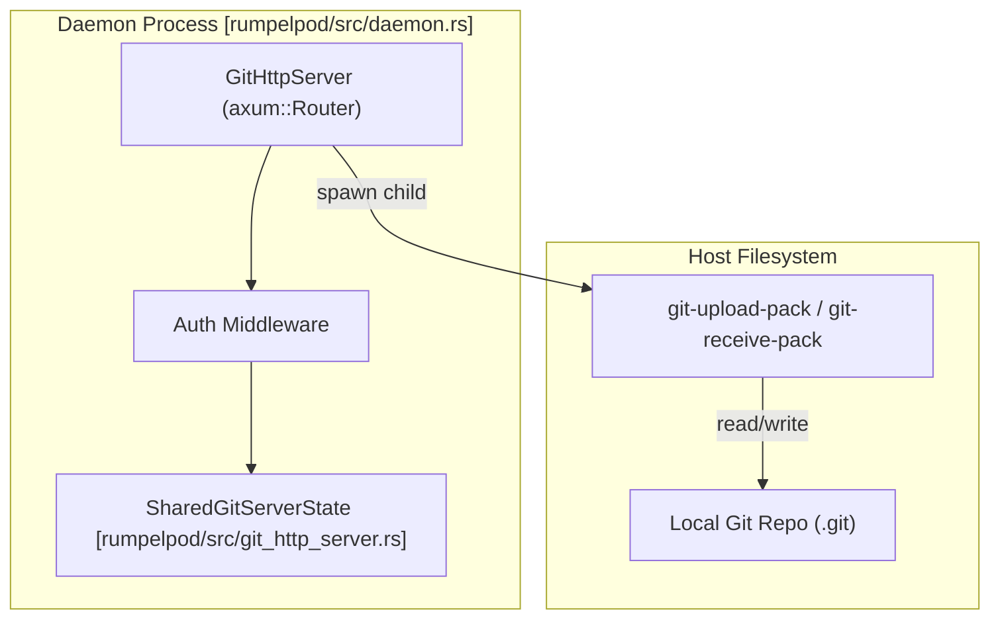
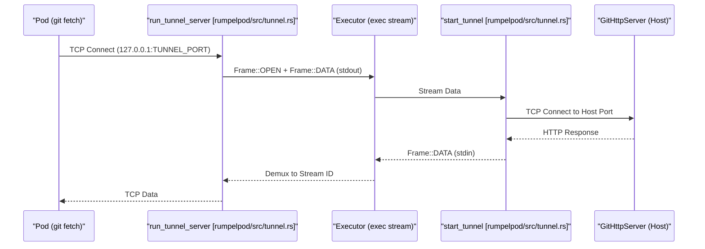

<!-- source: DeepWiki mcp.deepwiki.com · repo NVIDIA/rumpelpod · page 4.2 Git HTTP Server and Tunnel · fetched 2026-10-26 -->

# Git HTTP Server and Tunnel

Relevant source files

The following files were used as context for generating this wiki page:

- [rumpelpod/src/daemon.rs](rumpelpod/src/daemon.rs)
- [rumpelpod/src/git.rs](rumpelpod/src/git.rs)
- [rumpelpod/src/hook.rs](rumpelpod/src/hook.rs)
- [rumpelpod/src/pod/git_setup.rs](rumpelpod/src/pod/git_setup.rs)
- [rumpelpod/src/tunnel.rs](rumpelpod/src/tunnel.rs)

The Git HTTP Server and Tunnel mechanism provides a secure, multiplexed communication bridge between the host machine and isolated pods. This system allows pods to perform git operations (fetch/push) against the host's local repository and facilitates the relaying of SSH agent traffic, all without requiring direct network exposure of the host to the container.

## Host-Side GitHttpServer

The `GitHttpServer` is a specialized HTTP server running within the Rumpelpod daemon. It serves as the primary git remote for all managed pods.

### Implementation and Role
The server is implemented using the `axum` framework and is initialized within the daemon's main lifecycle [rumpelpod/src/daemon.rs:37-37](). It manages a `SharedGitServerState` which tracks active repositories and authentication tokens.

Key responsibilities include:
- **Git Smart HTTP Protocol**: Serving git repository data via `git-upload-pack` and `git-receive-pack` [rumpelpod/src/git_http_server.rs:170-194]().
- **Authentication**: Validating requests using a per-pod bearer token generated at launch [rumpelpod/src/git_http_server.rs:141-168]().
- **SSH Agent Relay**: Providing an endpoint for pods to tunnel SSH agent requests back to the host's `ssh-agent` [rumpelpod/src/git_http_server.rs:248-278]().

### Data Flow: Host Git Server
The following diagram illustrates how the `GitHttpServer` interacts with the daemon and the host's filesystem.

**Diagram: GitHttpServer Architecture**

Sources: [rumpelpod/src/git_http_server.rs:24-42](), [rumpelpod/src/git_http_server.rs:170-194](), [rumpelpod/src/daemon.rs:37-37]()

## Multiplexed Tunnel Protocol

Because pods may be running in environments (like Kubernetes or remote Docker hosts) where the host's IP is not directly reachable, Rumpelpod establishes a multiplexed TCP tunnel over standard container execution streams [rumpelpod/src/tunnel.rs:4-9]().

### Tunnel Establishment
The tunnel is created by executing the `rumpel tunnel-server` command inside the pod via the executor's `exec_streaming` interface [rumpelpod/src/tunnel.rs:22-25](). This creates a bidirectional stream over the container's `stdin` and `stdout`.

- **Host Side**: The daemon initiates the tunnel and demultiplexes frames from the pod's `stdout`, opening local TCP connections to the target `GitHttpServer` for each stream [rumpelpod/src/tunnel.rs:22-25]().
- **Pod Side**: The `run_tunnel_server` function binds a loopback TCP listener inside the container, assigns stream IDs, and multiplexes accepted connections over `stdout` [rumpelpod/src/tunnel.rs:19-21]().

### Framing and Multiplexing
The tunnel protocol uses a binary framing format to carry multiple TCP streams over a single pipe [rumpelpod/src/tunnel.rs:11-17]():
*   **Header (9 bytes)**: `[stream_id: u32 LE] [frame_type: u8] [payload_len: u32 LE]` [rumpelpod/src/tunnel.rs:45-46]().
*   **Frame Types**: `OPEN` (0x01) to initiate a stream, `DATA` (0x02) for bidirectional payload (max 64 KiB), and `CLOSE` (0x03) for graceful termination [rumpelpod/src/tunnel.rs:38-43]().

**Diagram: Tunnel Data Path**

Sources: [rumpelpod/src/tunnel.rs:11-46](), [rumpelpod/src/tunnel.rs:108-112](), [rumpelpod/src/tunnel.rs:38-40]()

## Pod-Side Git Operations

Once the tunnel is established, the pod server (`PodServerState`) and the `git_setup` module configure the local git environment to utilize it.

### Git Configuration
During the `setup_git_impl` process, the pod is configured to use the tunnel as its gateway to the host repository [rumpelpod/src/pod/git_setup.rs:86-91]().

1.  **Remote Setup**: Adds a git remote named `host` pointing to the tunnel URL. It fetches `refs/heads/*` into `refs/remotes/host/*` [rumpelpod/src/pod/git_setup.rs:96-111]().
2.  **Push Mapping**: Configures the `rumpelpod` remote to push local branches to a namespaced ref on the host: `+refs/heads/*:refs/rumpelpod/*@{pod_name}` [rumpelpod/src/pod/git_setup.rs:90-90]().
3.  **Credential Injection**: A bearer token is used to authenticate requests through the gateway [rumpelpod/src/pod/git_setup.rs:96-96]().

### Fetch and Push Flow
When an agent or user runs `git fetch host` inside the pod:
1.  The `git` binary connects to the local `tunnel-server` port recorded in `TUNNEL_PORT_FILE` [rumpelpod/src/tunnel.rs:115-116]().
2.  The `tunnel-server` forwards the request through the multiplexed `exec` stream to the host daemon.
3.  The host daemon proxies the request to the `GitHttpServer`.
4.  `GitHttpServer` validates the token and executes `git-upload-pack` on the host repository [rumpelpod/src/git_http_server.rs:170-194]().

### Reference Transaction Hook
To ensure the host repository stays updated with pod changes, a `reference-transaction` hook is installed in the pod [rumpelpod/src/pod/git_setup.rs:75-78](). When a branch is updated in the pod, this hook triggers a `git push rumpelpod` to sync the new commits back to the host's namespaced refs [rumpelpod/src/hook.rs:97-101]().

**Table: Component Responsibilities**

| Component | Location | Responsibility |
| :--- | :--- | :--- |
| `GitHttpServer` | Host (Daemon) | Serves git refs via Smart HTTP and proxies SSH agent calls [rumpelpod/src/git_http_server.rs:24-42](). |
| `start_tunnel` | Host (Daemon) | Initiates the `exec` session and demultiplexes pod traffic to host ports [rumpelpod/src/tunnel.rs:22-25](). |
| `run_tunnel_server` | Pod | Binds a loopback TCP listener and multiplexes pod traffic into the `exec` stream [rumpelpod/src/tunnel.rs:108-112](). |
| `setup_git_impl` | Pod | Configures remotes, fetch/push refspecs, and identity inside the pod repo [rumpelpod/src/pod/git_setup.rs:86-100](). |

Sources: [rumpelpod/src/tunnel.rs:4-46](), [rumpelpod/src/pod/git_setup.rs:75-120](), [rumpelpod/src/git_http_server.rs:170-194](), [rumpelpod/src/hook.rs:97-168]()

---

