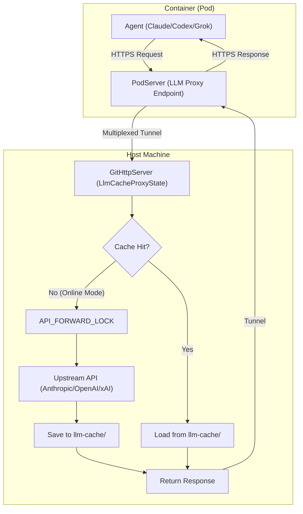
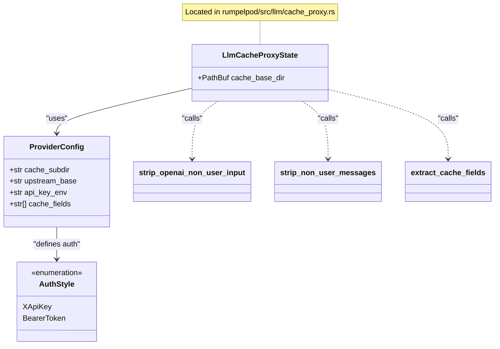

<!-- source: DeepWiki mcp.deepwiki.com · repo NVIDIA/rumpelpod · page 5 LLM Cache Proxy · fetched 2026-10-26 -->

# LLM Cache Proxy

<details>
<summary>Relevant source files</summary>

The following files were used as context for generating this wiki page:

- [llm-cache/AGENTS.md](llm-cache/AGENTS.md)
- [llm-cache/CLAUDE.md](llm-cache/CLAUDE.md)
- [llm-cache/README.md](llm-cache/README.md)
- [llm-cache/claude-cli/response/11df08aeccfea2a00bd525dcfd671a5403b69c0d8335e274743218b9cf79752e](llm-cache/claude-cli/response/11df08aeccfea2a00bd525dcfd671a5403b69c0d8335e274743218b9cf79752e)
- [llm-cache/claude-cli/response/8c3e7f2b17010ef971a8ab77235a9b22578f2f01e2c900a884d94e41d0efac5c](llm-cache/claude-cli/response/8c3e7f2b17010ef971a8ab77235a9b22578f2f01e2c900a884d94e41d0efac5c)
- [llm-cache/claude-cli/response/a9f227fef0c136ee2f10eeb87cbede019874ace75c9b6d57685b4785d4ccf436](llm-cache/claude-cli/response/a9f227fef0c136ee2f10eeb87cbede019874ace75c9b6d57685b4785d4ccf436)
- [llm-cache/claude-cli/response/d2b092c149b089737d1e4fd9062682e6e28b92ac0996281061bc177c0dc6cc69](llm-cache/claude-cli/response/d2b092c149b089737d1e4fd9062682e6e28b92ac0996281061bc177c0dc6cc69)
- [llm-cache/claude-cli/response/dfe0fc796537c407671433ab4825b0ff0118bec0b99de06cfc263a7ca9599b8d](llm-cache/claude-cli/response/dfe0fc796537c407671433ab4825b0ff0118bec0b99de06cfc263a7ca9599b8d)
- [llm-cache/codex/response/55dbe3edaa0df277321da0ae4c7d106c9545ace3123f55272d611903a93f8f25](llm-cache/codex/response/55dbe3edaa0df277321da0ae4c7d106c9545ace3123f55272d611903a93f8f25)
- [llm-cache/codex/response/84a87c1da423b5d3a0158799cbce681f45bba73e4b08845bb5c50c981f3c2f2e](llm-cache/codex/response/84a87c1da423b5d3a0158799cbce681f45bba73e4b08845bb5c50c981f3c2f2e)
- [llm-cache/codex/response/b2929450dd3d1ecb7e372d4b438e5e26657f0f3679d27b28309c5b94ad5fcc46](llm-cache/codex/response/b2929450dd3d1ecb7e372d4b438e5e26657f0f3679d27b28309c5b94ad5fcc46)
- [llm-cache/grok/request/6456f67439d4b333e5f382b49267e5fa6bda46ed6d766aad43f7e78aaad45d92](llm-cache/grok/request/6456f67439d4b333e5f382b49267e5fa6bda46ed6d766aad43f7e78aaad45d92)
- [llm-cache/grok/request/ba9ef2ab37fc3bff7fd4c9c94238f253d1a006443f0ed4fd446856491603c6f6](llm-cache/grok/request/ba9ef2ab37fc3bff7fd4c9c94238f253d1a006443f0ed4fd446856491603c6f6)
- [llm-cache/grok/response/0f7ecb702eb06390614c25c5c035687131b5a0deec017af12f8d466dd521fb9a](llm-cache/grok/response/0f7ecb702eb06390614c25c5c035687131b5a0deec017af12f8d466dd521fb9a)
- [llm-cache/grok/response/6456f67439d4b333e5f382b49267e5fa6bda46ed6d766aad43f7e78aaad45d92](llm-cache/grok/response/6456f67439d4b333e5f382b49267e5fa6bda46ed6d766aad43f7e78aaad45d92)
- [rumpelpod/src/llm/cache_proxy.rs](rumpelpod/src/llm/cache_proxy.rs)

</details>


The `cache_proxy` module provides a deterministic HTTP caching layer for LLM API requests [rumpelpod/src/llm/cache_proxy.rs:4-7](). It is primarily used during integration testing to allow LLM agents (Claude, Codex, Grok) to run in an offline mode, replaying recorded responses to ensure test stability and reduce API costs [rumpelpod/src/llm/cache_proxy.rs:7-13]().

The proxy runs as part of the host-side `GitHttpServer` and receives forwarded requests from the in-container `PodServer` via the existing execution tunnel [rumpelpod/src/llm/cache_proxy.rs:6-10]().

### Data Flow: Request Interception

The following diagram illustrates how an LLM request from a containerized agent is intercepted and handled by the cache proxy.

**LLM Request Path**

**Sources:** [rumpelpod/src/llm/cache_proxy.rs:4-10](), [rumpelpod/src/llm/cache_proxy.rs:28-32](), [rumpelpod/src/llm/cache_proxy.rs:94-96]()

---

### Provider Configurations

The proxy supports multiple LLM providers, each with specific configurations for upstream URLs, authentication styles, and cache key fields [rumpelpod/src/llm/cache_proxy.rs:38-55]().

| Provider | Subdirectory | Upstream Base | Auth Style | Cache Fields |
| :--- | :--- | :--- | :--- | :--- |
| `anthropic` | `claude-cli` | `https://api.anthropic.com` | `X-API-Key` | `model`, `messages`, `stream` |
| `openai` | `codex` | `https://api.openai.com` | `Bearer` | `messages`, `input`, `stream` |
| `xai` | `grok` | `https://api.x.ai` | `Bearer` | `model`, `messages`, `input`, `stream` |

**Sources:** [rumpelpod/src/llm/cache_proxy.rs:57-92]()

---

### Deterministic Cache Keys

To ensure cache portability across different environments and dates, the proxy performs normalization on request bodies before hashing them into a cache key.

#### 1. Volatile Data Stripping
*   **Codex (OpenAI):** The `strip_openai_non_user_input` function removes the `<environment_context>` block which contains machine-specific paths, timezones, and dates [rumpelpod/src/llm/cache_proxy.rs:107-119]().
*   **Grok (xAI):** The `strip_non_user_messages` function drops volatile system prompts (containing working directories and tool lists) to key only on stable user turns [rumpelpod/src/llm/cache_proxy.rs:138-147](). It also removes the "skills reminder" user turn because the ordering of available skills varies run-to-run [rumpelpod/src/llm/cache_proxy.rs:155-161]().

#### 2. Field Extraction
The `extract_cache_fields` function ensures that only semantic fields (like conversation history) contribute to the hash, while metadata like `temperature` or `top_p` is ignored to survive CLI version changes [rumpelpod/src/llm/cache_proxy.rs:166-178]().

**Sources:** [rumpelpod/src/llm/cache_proxy.rs:107-184]()

---

### Cache Directory Structure

Caches are stored in the `llm-cache/` directory, organized by provider and hash. Each request generates two files: one for the raw request (for debugging) and one for the serialized response [rumpelpod/src/llm/cache_proxy.rs:29-32]().

**Directory Hierarchy**
```text
llm-cache/
├── claude-cli/
│   ├── request/
│   │   └── a9f227fef0c136ee2f10eeb87cbede019874ace75c9b6d57685b4785d4ccf436
│   └── response/
│       └── a9f227fef0c136ee2f10eeb87cbede019874ace75c9b6d57685b4785d4ccf436
├── codex/
│   ├── request/
│   │   └── 84a87c1da423b5d3a0158799cbce681f45bba73e4b08845bb5c50c981f3c2f2e
│   └── response/
│       └── 84a87c1da423b5d3a0158799cbce681f45bba73e4b08845bb5c50c981f3c2f2e
└── grok/
    ├── request/
    │   └── 6456f67439d4b333e5f382b49267e5fa6bda46ed6d766aad43f7e78aaad45d92
    └── response/
        └── 6456f67439d4b333e5f382b49267e5fa6bda46ed6d766aad43f7e78aaad45d92
```

The response file contains a JSON header with HTTP metadata (status, path, headers) followed by the raw response body [llm-cache/grok/response/6456f67439d4b333e5f382b49267e5fa6bda46ed6d766aad43f7e78aaad45d92:1](). It supports both standard JSON and `text/event-stream` for streaming responses used by Claude and Codex [llm-cache/claude-cli/response/a9f227fef0c136ee2f10eeb87cbede019874ace75c9b6d57685b4785d4ccf436:2-24](), [llm-cache/codex/response/b2929450dd3d1ecb7e372d4b438e5e26657f0f3679d27b28309c5b94ad5fcc46:1-3]().

**Sources:** [rumpelpod/src/llm/cache_proxy.rs:29-32](), [llm-cache/grok/response/6456f67439d4b333e5f382b49267e5fa6bda46ed6d766aad43f7e78aaad45d92:1](), [llm-cache/claude-cli/response/a9f227fef0c136ee2f10eeb87cbede019874ace75c9b6d57685b4785d4ccf436:1-24]()

---

### Implementation Details

#### Request Handling Logic
The proxy logic is encapsulated in the `LlmCacheProxyState` struct [rumpelpod/src/llm/cache_proxy.rs:28-32](). When a request arrives:
1.  The provider is identified from the URL path [rumpelpod/src/llm/cache_proxy.rs:57-58]().
2.  The request body is normalized via `extract_cache_fields` and hashed to find a potential match in `llm-cache/<provider>/response/<hash>` [rumpelpod/src/llm/cache_proxy.rs:166-184]().
3.  If a cache miss occurs and `RUMPELPOD_TEST_LLM_OFFLINE` allows it, the proxy acquires the `API_FORWARD_LOCK` to prevent redundant upstream calls from parallel tests [rumpelpod/src/llm/cache_proxy.rs:94-96]().

#### Association of Code Entities
This diagram maps the logical components to the Rust implementation.

**Code Entity Map**

**Sources:** [rumpelpod/src/llm/cache_proxy.rs:28-184]()

---

