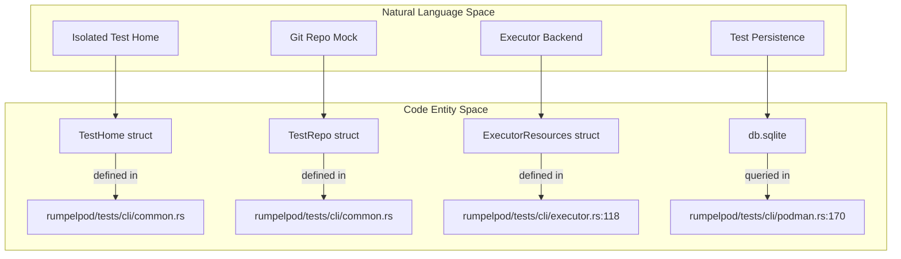
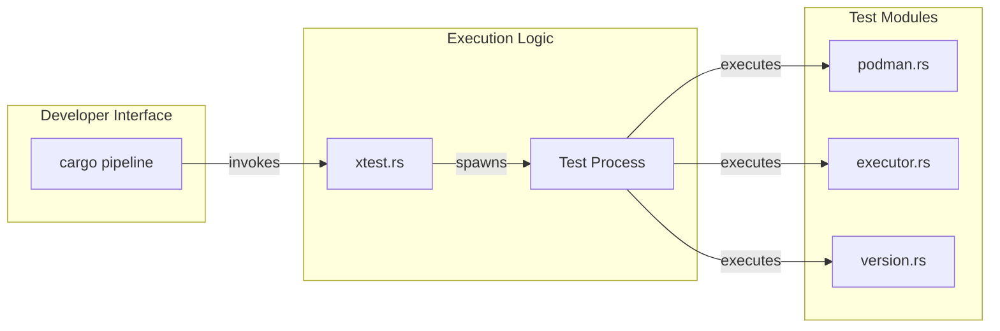

<!-- source: DeepWiki mcp.deepwiki.com · repo NVIDIA/rumpelpod · page 6 Testing Infrastructure · fetched 2026-10-26 -->

# Testing Infrastructure

Relevant source files

The following files were used as context for generating this wiki page:

- [rumpelpod/build.rs](rumpelpod/build.rs)
- [rumpelpod/tests/cli.rs](rumpelpod/tests/cli.rs)
- [rumpelpod/tests/cli/executor.rs](rumpelpod/tests/cli/executor.rs)
- [rumpelpod/tests/cli/podman.rs](rumpelpod/tests/cli/podman.rs)
- [rumpelpod/tests/cli/version.rs](rumpelpod/tests/cli/version.rs)
- [tools/src/bin/pipeline.rs](tools/src/bin/pipeline.rs)
- [tools/src/bin/xtest.rs](tools/src/bin/xtest.rs)
- [tools/src/lib.rs](tools/src/lib.rs)

The rumpelpod testing infrastructure is designed for high-fidelity integration testing of isolated LLM agents. Because the system manages complex interactions between a host daemon, containerized environments, and external LLM APIs, the test suite emphasizes end-to-end scenarios over unit tests [tools/src/bin/xtest.rs:6-12]().

Testing is orchestrated by a custom `xtest` runner and a `cargo pipeline` wrapper, ensuring that every test runs in a clean, isolated environment with predictable resource management, per-process isolation, and failure recovery [tools/src/bin/xtest.rs:14-34]().

## Testing Philosophy

*   **Process Isolation**: Rust's built-in test runner runs all tests inside one process, which is unsuitable for tests that talk to Docker or SSH. Our runner invokes each test as a separate process [tools/src/bin/xtest.rs:6-16]().
*   **Executor Agnosticism**: The infrastructure supports running the same test suite against local Docker, Podman, or remote Kubernetes clusters (EKS, Hetzner, k3d) [tools/src/bin/xtest.rs:87-94](), [rumpelpod/tests/cli/executor.rs:49-54]().
*   **Small Binaries**: The `dev` profile uses `opt-level=z` to keep the `rumpel` binary small (~28 MB), as every test copies this binary into a Docker image [tools/src/bin/xtest.rs:40-45]().
*   **Determinism**: LLM responses are cached using a proxy to ensure tests remain stable and can run offline.

## Core Components

### 1. xtest Runner and cargo pipeline
The `xtest` runner is a custom tool that builds cross-architecture rumpel binaries (e.g., `x86_64` and `aarch64` musl targets) [tools/src/bin/xtest.rs:82-85]() and manages test execution with SIGKILL-based timeouts, retries with a global `RETRY_BUDGET`, and skip directives [tools/src/bin/xtest.rs:18-30](). The `cargo pipeline` tool wraps `xtest` to provide a unified workflow that includes formatting checks, linting, and building with log persistence and `--continue` support [tools/src/bin/pipeline.rs:4-12]().

For details, see [xtest Runner and cargo pipeline](#6.1).

### 2. Integration Test Harness
The harness provides the `TestHome`, `TestRepo`, and `TestDaemon` abstractions [rumpelpod/tests/cli/podman.rs:20](). It uses `ExecutorResources` to set up environment-specific configurations like SSH remote hosts or Kubernetes namespaces [rumpelpod/tests/cli/executor.rs:118-130](). It strictly controls the `$PATH` to prevent host system leakage.

For details, see [Integration Test Harness](#6.2).

### 3. Agent Integration Tests
These tests validate the behavior of LLM agents (`claude`, `codex`, `grok`) within pods [rumpelpod/tests/cli.rs:4-33](). They utilize specialized session harnesses to simulate interactive terminal sessions and verify system prompt adherence and session isolation.

For details, see [Agent Integration Tests](#6.3).

## System Mapping: Test Entities to Code

The following diagrams bridge the gap between high-level testing concepts and the specific code entities implementing them.

### Test Environment Mapping
"This diagram maps the conceptual requirements for an isolated test to the specific Rust structs and logic that provide them."

**Sources:** [rumpelpod/tests/cli/common.rs:20](), [rumpelpod/tests/cli/executor.rs:118-123](), [rumpelpod/tests/cli/podman.rs:170-175]()

### Test Execution Flow
"This diagram shows the relationship between the developer commands and the underlying test runner entities."

**Sources:** [tools/src/bin/pipeline.rs:6-12](), [tools/src/bin/xtest.rs:14-20](), [rumpelpod/tests/cli.rs:1-64]()

## Key Test Fixtures

| Entity | Role | File Reference |
| :--- | :--- | :--- |
| `xtest` | Custom runner providing timeouts, retries, and architecture builds. | [tools/src/bin/xtest.rs:4-39]() |
| `ExecutorResources` | Manages backend-specific resources (Docker, Podman, SSH, K8s). | [rumpelpod/tests/cli/executor.rs:118-147]() |
| `TestDaemon` | Orchestrates a background `rumpelpod daemon` for a test case. | [rumpelpod/tests/cli/podman.rs:44]() |
| `cargo pipeline` | Orchestrates the full CI flow: fmt -> build -> clippy -> xtest. | [tools/src/bin/pipeline.rs:199-215]() |

## Development Workflow

Developers are instructed to run tests via `cargo pipeline` [tools/src/bin/pipeline.rs:4-12](). This ensures:
1.  **Log Persistence**: Combined stdout/stderr is saved to `target/xtest/<timestamp>.log` [tools/src/bin/pipeline.rs:8-12]().
2.  **Resumability**: `--continue` parses the most recent log to skip passed tests [tools/src/bin/pipeline.rs:128-151]().
3.  **Binary Matching**: The runner ensures the `rumpel` binary used inside containers matches the architecture of the test environment [tools/src/bin/xtest.rs:14-16]().

**Sources:**
- [tools/src/bin/xtest.rs:1-140]()
- [tools/src/bin/pipeline.rs:1-215]()
- [rumpelpod/tests/cli/executor.rs:1-147]()
- [rumpelpod/tests/cli/podman.rs:1-189]()
- [rumpelpod/tests/cli/version.rs:1-66]()

---

