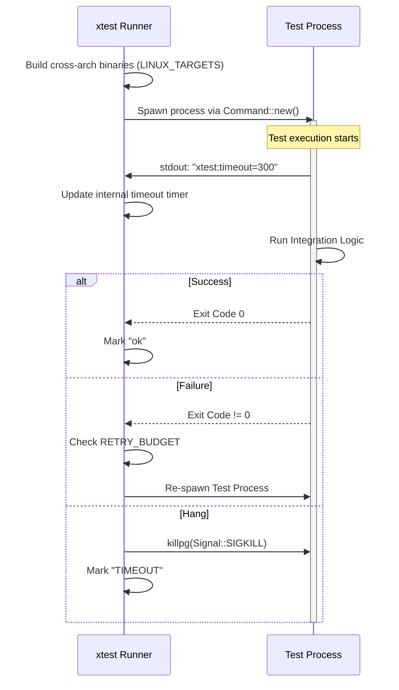
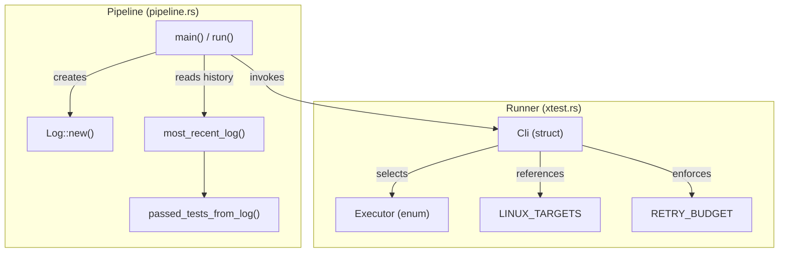

<!-- source: DeepWiki mcp.deepwiki.com · repo NVIDIA/rumpelpod · page 6.1 xtest Runner and cargo pipeline · fetched 2026-10-26 -->

# xtest Runner and cargo pipeline

Relevant source files

The following files were used as context for generating this wiki page:

- [.github/workflows/ci.yml](.github/workflows/ci.yml)
- [ci/run-pipeline.sh](ci/run-pipeline.sh)
- [rumpelpod/build.rs](rumpelpod/build.rs)
- [rumpelpod/tests/cli.rs](rumpelpod/tests/cli.rs)
- [rumpelpod/tests/cli/version.rs](rumpelpod/tests/cli/version.rs)
- [tools/src/bin/pipeline.rs](tools/src/bin/pipeline.rs)
- [tools/src/bin/xtest.rs](tools/src/bin/xtest.rs)
- [tools/src/lib.rs](tools/src/lib.rs)

The rumpelpod testing infrastructure is designed for high-reliability integration testing of containerized environments. It consists of a custom test runner, `xtest`, which provides process isolation and retry logic, and a `cargo pipeline` orchestration tool that manages the full development lifecycle from linting to test execution with persistent logging.

## xtest Runner

`xtest` is a custom test runner designed to address the limitations of the standard `cargo test` when dealing with long-running integration tests that interact with Docker, Kubernetes, and LLM APIs. It ensures that every test case is executed in a dedicated process to prevent cross-test pollution and allows for fine-grained control over timeouts and retries [tools/src/bin/xtest.rs:6-12]().

### Key Features and Implementation

*   **Per-Process Isolation**: Unlike the standard Rust test runner, `xtest` invokes each test as a separate process [tools/src/bin/xtest.rs:14-15](). This ensures that environment variable mutations, file descriptor leaks, or hangs in one test cannot block the whole suite [tools/src/bin/xtest.rs:9-12]().
*   **Timeouts**: Each test process is killed via process-group `SIGKILL` if it exceeds a deadline [tools/src/bin/xtest.rs:18-19](). The default is 120 seconds [tools/src/bin/xtest.rs:54-54](). Tests can dynamically adjust their own timeout by printing `println!("xtest:timeout=SECS")` [tools/src/bin/xtest.rs:20-20]().
*   **Retries and Budgets**: Failed tests are re-run up to a specified count (default 1) [tools/src/bin/xtest.rs:22-22](). To prevent flaky-test workarounds from masking systemic failures, a global `RETRY_BUDGET` (default 10) limits total retries across the entire suite [tools/src/bin/xtest.rs:77-79]().
*   **Skip Directives**: Tests can declare themselves not applicable for a configuration (e.g., missing credentials or incompatible executor) by printing `println!("xtest:skip")` [tools/src/bin/xtest.rs:26-29]().
*   **Cross-Architecture Builds**: The runner builds rumpel binaries for both `x86_64` and `aarch64` Linux (musl) to ensure the flat layout matches production environments during container-based tests [tools/src/bin/xtest.rs:14-15](), [tools/src/bin/xtest.rs:82-85]().

### xtest Execution Lifecycle

The following diagram illustrates how the `xtest` runner manages the execution lifecycle of a single test process.

**xtest Execution Lifecycle**

**Sources:** [tools/src/bin/xtest.rs:6-39](), [tools/src/bin/xtest.rs:71-79](), [tools/src/bin/xtest.rs:82-85](), [tools/src/lib.rs:159-175]()

## cargo pipeline Orchestration

`cargo pipeline` is the primary entry point for developers and CI. It wraps formatting, building, linting, and testing into a unified gate [tools/src/bin/pipeline.rs:4-5]().

### Pipeline Stages

The pipeline executes the following steps via `run_cmd` or the `Log` wrapper:
1.  **Format**: `cargo fmt -- --check` [tools/src/bin/pipeline.rs:199-200]().
2.  **Build**: `cargo build --all-targets` (with `-D warnings` to treat lints as errors) [tools/src/bin/pipeline.rs:204-211]().
3.  **Clippy**: `cargo clippy --all-targets` [tools/src/bin/pipeline.rs:214-219]().
4.  **Git Status**: Checks for uncommitted changes using `git status --porcelain` to ensure the tested code is what is committed [tools/src/bin/pipeline.rs:222-230]().
5.  **xtest**: The final stage that invokes the custom test runner [tools/src/bin/pipeline.rs:232-243]().

### Log Persistence and --continue Support

The pipeline records all output to `target/xtest/<timestamp>.log` [tools/src/bin/pipeline.rs:8-8](). It uses a `Log` struct to tee output to both `stderr` and the file [tools/src/bin/pipeline.rs:23-42]().

The `--continue` flag allows developers to resume a failed run:
1.  `most_recent_log()` finds the latest log file [tools/src/bin/pipeline.rs:107-119]().
2.  `passed_tests_from_log()` parses the file for "ok" or "SKIPPED" status lines [tools/src/bin/pipeline.rs:128-151]().
3.  These test names are written to a temporary file passed to `xtest --skip-file`, causing the runner to bypass them [tools/src/bin/pipeline.rs:186-197](), [tools/src/bin/pipeline.rs:235-237]().

### Data Flow: Pipeline to xtest

The pipeline orchestrates the build profile and environment before handing off to `xtest`.

**Code Entity Mapping: Pipeline to xtest**

**Sources:** [tools/src/bin/pipeline.rs:8-10](), [tools/src/bin/pipeline.rs:128-151](), [tools/src/bin/xtest.rs:82-85](), [tools/src/bin/xtest.rs:88-94]()

## CI/CD Integration

The pipeline is designed to be reproducible. The `ci/run-pipeline.sh` script mirrors the CI environment locally by:
1.  Building the devcontainer image [ci/run-pipeline.sh:36-36]().
2.  Booting it using the `sysbox-runc` runtime to support nested containers and systemd [ci/run-pipeline.sh:40-43]().
3.  Running `cargo pipeline --release` inside the container [ci/run-pipeline.sh:75-76]().

### Cross-Compilation and Staging
During the pipeline execution, `xtest` cross-compiles the `rumpel` binary for multiple targets. If `STAGING_DIR` is set (as in GitHub Actions), the script extracts the native binary from the container to be published as a release artifact [ci/run-pipeline.sh:83-96]().

### Summary of Configuration Options

| Feature | Flag / Env Var | Default / Behavior |
| :--- | :--- | :--- |
| **Parallelism** | `--test-threads` / `XTEST_JOBS` | `min(ncpus, 16)` [tools/src/bin/xtest.rs:53-53](), [tools/src/lib.rs:34-36]() |
| **Timeout** | `--timeout` / `XTEST_TIMEOUT` | 120 seconds [tools/src/bin/xtest.rs:54-54]() |
| **Retries** | `--retries` / `XTEST_RETRIES` | 1 retry [tools/src/bin/xtest.rs:55-55]() |
| **Executor** | `--executor` | `podman`, `eks`, `hetzner`, or `k3d` [tools/src/bin/xtest.rs:88-94]() |
| **Incremental** | `--continue` | Skips tests marked "ok" in latest log [tools/src/bin/pipeline.rs:8-10]() |

**Sources:** [tools/src/bin/xtest.rs:47-57](), [tools/src/bin/pipeline.rs:4-12](), [tools/src/lib.rs:34-36](), [ci/run-pipeline.sh:75-76]()

---

