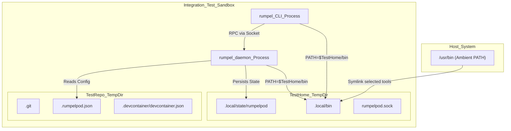
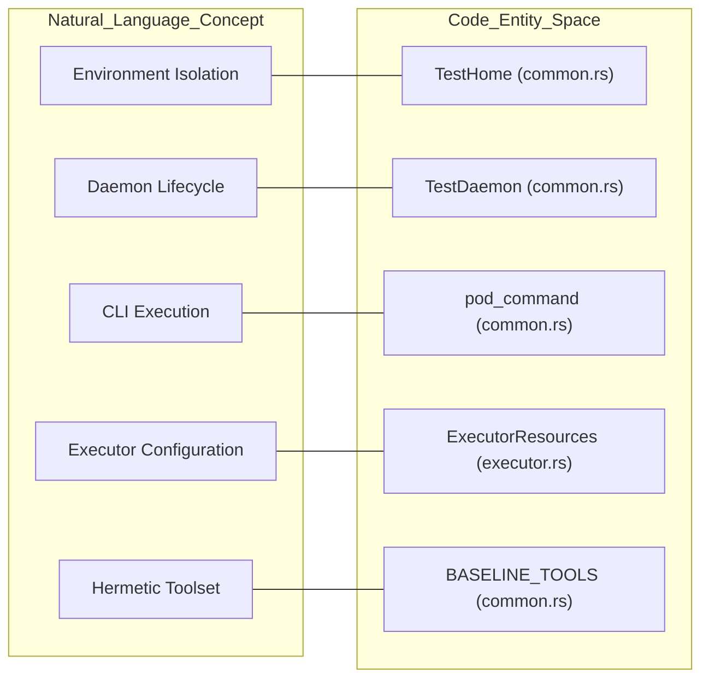

<!-- source: DeepWiki mcp.deepwiki.com · repo NVIDIA/rumpelpod · page 6.2 Integration Test Harness · fetched 2026-10-26 -->

# Integration Test Harness

Relevant source files

The following files were used as context for generating this wiki page:

- [rumpelpod/src/daemon/host_connection.rs](rumpelpod/src/daemon/host_connection.rs)
- [rumpelpod/src/pod/types.rs](rumpelpod/src/pod/types.rs)
- [rumpelpod/tests/cli/common.rs](rumpelpod/tests/cli/common.rs)
- [rumpelpod/tests/cli/executor.rs](rumpelpod/tests/cli/executor.rs)
- [rumpelpod/tests/cli/fork.rs](rumpelpod/tests/cli/fork.rs)
- [rumpelpod/tests/cli/k8s/mod.rs](rumpelpod/tests/cli/k8s/mod.rs)
- [rumpelpod/tests/cli/pi/install.rs](rumpelpod/tests/cli/pi/install.rs)
- [rumpelpod/tests/cli/podman.rs](rumpelpod/tests/cli/podman.rs)
- [rumpelpod/tests/cli/setup_progress.rs](rumpelpod/tests/cli/setup_progress.rs)
- [rumpelpod/tests/license_headers.rs](rumpelpod/tests/license_headers.rs)

The Rumpelpod integration test harness provides a hermetic environment for validating CLI behavior, daemon lifecycle, and container executor interactions. It ensures that tests are isolated from the host's configuration by mocking the user's home directory, isolating the daemon socket, and providing a controlled `PATH` containing only essential tools.

## Core Infrastructure Entities

The harness is built around several key structs and constants that manage the filesystem, process lifecycle, and external dependencies.

### TestHome
`TestHome` represents an isolated `$HOME` directory for a single test case [rumpelpod/tests/cli/common.rs:69-71](). It is created as a temporary directory [rumpelpod/tests/cli/common.rs:75-76]() and serves two primary purposes:
1.  **State Isolation**: It sets `XDG_STATE_HOME` so that the daemon's SQLite database and socket are contained within the test [rumpelpod/tests/cli/common.rs:35-36]().
2.  **Path Control**: It maintains a `.local/bin` directory which acts as the *entire* `PATH` for the test daemon and CLI [rumpelpod/tests/cli/common.rs:63-68]().

### BASELINE_TOOLS
To ensure tests are deterministic and don't rely on ambient host binaries, the harness defines `BASELINE_TOOLS` [rumpelpod/tests/cli/common.rs:48-55](). These are symlinked from the host into the `TestHome`'s bin directory [rumpelpod/tests/cli/common.rs:79-80](). They include:
*   **Core Binaries**: `rumpel`, `git`, `sh`, `bash`, `cat`, `env` [rumpelpod/tests/cli/common.rs:50]().
*   **Shell Plumbing**: Standard POSIX utilities like `awk`, `grep`, `sed`, `ls`, and `find` required for internal `git` scripts to function [rumpelpod/tests/cli/common.rs:52-55]().

### TestRepo
`TestRepo` initializes a temporary git repository [rumpelpod/tests/cli/common.rs:188-190](). Since Rumpelpod heavily relies on git for pod identity and state synchronization, `TestRepo` configures a standard test user and initial commit to provide a stable base for tests [rumpelpod/tests/cli/common.rs:201-218]().

### TestDaemon
`TestDaemon` manages the background `rumpel daemon` process [rumpelpod/tests/cli/common.rs:276-278](). It ensures the daemon is started with the correct environment variables (pointing to the `TestHome`) and provides a `DaemonClient` for direct RPC interaction when needed [rumpelpod/tests/cli/common.rs:312-314]().

### ExecutorResources
This utility prepares the backend-specific configuration (Docker, Podman, SSH, or Kubernetes) for the test [rumpelpod/tests/cli/executor.rs:118-123](). It generates the `.rumpelpod.json` configuration that tells the daemon which executor to use and where to find necessary resources like container images [rumpelpod/tests/cli/executor.rs:140-147]().

**Sources:**
*   [rumpelpod/tests/cli/common.rs:32-120]()
*   [rumpelpod/tests/cli/executor.rs:49-65]()
*   [rumpelpod/tests/cli/executor.rs:118-147]()

## Environment Isolation Diagram

The following diagram illustrates how `TestHome` and `TestRepo` isolate the test process from the host system.

**Sources:**
*   [rumpelpod/tests/cli/common.rs:57-85]()
*   [rumpelpod/tests/cli/common.rs:32-36]()
*   [rumpelpod/tests/cli/common.rs:326-340]()

## Data Flow: Test Setup to Execution

The typical flow for an integration test involves initializing the environment, starting the daemon, and then executing CLI commands via `pod_command`.

| Step | Entity/Function | Description |
| :--- | :--- | :--- |
| 1 | `TestRepo::new()` | Creates a fresh git repo [rumpelpod/tests/cli/podman.rs:41](). |
| 2 | `TestHome::new()` | Creates isolated home and seeds `BASELINE_TOOLS` [rumpelpod/tests/cli/podman.rs:42](). |
| 3 | `ExecutorResources::setup()` | Configures the backend (Docker/Podman/K8s) [rumpelpod/tests/cli/fork.rs:19](). |
| 4 | `TestDaemon::start()` | Launches the daemon in the background [rumpelpod/tests/cli/podman.rs:44](). |
| 5 | `write_test_devcontainer()` | Defines the container environment [rumpelpod/tests/cli/podman.rs:45](). |
| 6 | `pod_command()` | Executes a `rumpel` command with isolated environment variables [rumpelpod/tests/cli/podman.rs:47-48](). |

### The `pod_command` Function
`pod_command` is the primary interface for running the Rumpelpod CLI in tests [rumpelpod/tests/cli/common.rs:326](). It:
1.  Sets `PATH` to the `TestHome` bin directory [rumpelpod/tests/cli/common.rs:334]().
2.  Sets `RUMPELPOD_DAEMON_SOCKET` to the test-specific socket [rumpelpod/tests/cli/common.rs:336]().
3.  Sets `XDG_STATE_HOME` and `HOME` to the `TestHome` path [rumpelpod/tests/cli/common.rs:337-338]().

**Sources:**
*   [rumpelpod/tests/cli/common.rs:326-340]()
*   [rumpelpod/tests/cli/podman.rs:34-52]()
*   [rumpelpod/tests/cli/fork.rs:16-36]()

## Component Mapping: Code to Test Logic

This diagram maps the natural language concepts of the test harness to the specific code entities in the `tests/` directory.

**Sources:**
*   [rumpelpod/tests/cli/common.rs:42-180]()
*   [rumpelpod/tests/cli/common.rs:276-340]()
*   [rumpelpod/tests/cli/executor.rs:118-147]()

## Specialized Test Scenarios

### Multi-Executor Support
The harness dynamically switches between `Docker`, `Podman`, `Ssh`, and `K8s` based on environment variables like `RUMPELPOD_TEST_EXECUTOR` [rumpelpod/tests/cli/executor.rs:56-65](). `ExecutorResources` handles specific setup like symlinking `kubectl` for K8s [rumpelpod/tests/cli/executor.rs:128]() or starting an SSH container for remote tests [rumpelpod/tests/cli/executor.rs:179]().

### Podman Fallback and Resolution
Integration tests verify that the daemon correctly falls back to Podman when Docker is missing [rumpelpod/tests/cli/podman.rs:35-52](). It also tests the resolution of legacy `Host::Localhost` records in the SQLite database to ensure backward compatibility during daemon restarts [rumpelpod/tests/cli/podman.rs:148-188]().

### Fork and State Persistence
Tests for `rumpel fork` verify that the harness correctly captures and replicates pod state, including dirty git trees [rumpelpod/tests/cli/fork.rs:68-102](), agent-specific state like `.codex` symlinks [rumpelpod/tests/cli/fork.rs:105-143](), and LLM configurations [rumpelpod/tests/cli/fork.rs:146-192]().

### Client-Side CLI Resolution
The harness tests the ability to inject host-side binaries into the pod. For example, `image_includes_pi_from_client_path` verifies that the CLI can resolve a local `pi` binary and ensure it is installed in the pod during creation [rumpelpod/tests/cli/pi/install.rs:41-71]().

**Sources:**
*   [rumpelpod/tests/cli/executor.rs:49-65]()
*   [rumpelpod/tests/cli/podman.rs:35-52]()
*   [rumpelpod/tests/cli/fork.rs:68-192]()
*   [rumpelpod/tests/cli/pi/install.rs:41-71]()

---

