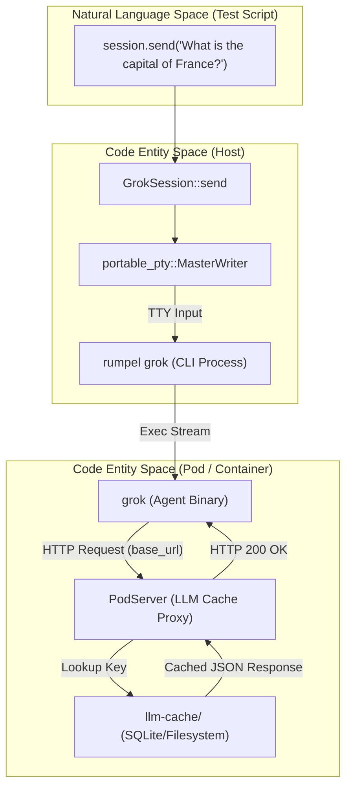
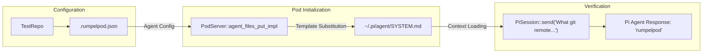

<!-- source: DeepWiki mcp.deepwiki.com · repo NVIDIA/rumpelpod · page 6.3 Agent Integration Tests · fetched 2026-10-26 -->

# Agent Integration Tests

Relevant source files

The following files were used as context for generating this wiki page:

- [rumpelpod/src/grok.rs](rumpelpod/src/grok.rs)
- [rumpelpod/src/pod/codex.rs](rumpelpod/src/pod/codex.rs)
- [rumpelpod/src/port_file.rs](rumpelpod/src/port_file.rs)
- [rumpelpod/tests/cli/claude/common.rs](rumpelpod/tests/cli/claude/common.rs)
- [rumpelpod/tests/cli/claude/fork.rs](rumpelpod/tests/cli/claude/fork.rs)
- [rumpelpod/tests/cli/codex/common.rs](rumpelpod/tests/cli/codex/common.rs)
- [rumpelpod/tests/cli/codex/host_network.rs](rumpelpod/tests/cli/codex/host_network.rs)
- [rumpelpod/tests/cli/codex/lifecycle.rs](rumpelpod/tests/cli/codex/lifecycle.rs)
- [rumpelpod/tests/cli/codex/mod.rs](rumpelpod/tests/cli/codex/mod.rs)
- [rumpelpod/tests/cli/codex/session_isolation.rs](rumpelpod/tests/cli/codex/session_isolation.rs)
- [rumpelpod/tests/cli/codex/smoke.rs](rumpelpod/tests/cli/codex/smoke.rs)
- [rumpelpod/tests/cli/codex/system_prompt.rs](rumpelpod/tests/cli/codex/system_prompt.rs)
- [rumpelpod/tests/cli/grok/common.rs](rumpelpod/tests/cli/grok/common.rs)
- [rumpelpod/tests/cli/grok/smoke.rs](rumpelpod/tests/cli/grok/smoke.rs)
- [rumpelpod/tests/cli/pi/common.rs](rumpelpod/tests/cli/pi/common.rs)
- [rumpelpod/tests/cli/pi/mod.rs](rumpelpod/tests/cli/pi/mod.rs)
- [rumpelpod/tests/cli/pi/smoke.rs](rumpelpod/tests/cli/pi/smoke.rs)
- [rumpelpod/tests/cli/pi/system_prompt.rs](rumpelpod/tests/cli/pi/system_prompt.rs)
- [rumpelpod/tests/cli/pi/tool_use.rs](rumpelpod/tests/cli/pi/tool_use.rs)

The Agent Integration Tests verify the end-to-end functionality of LLM agent CLIs (Claude, Codex, Grok, and Pi) within the rumpelpod environment. These tests ensure that host-side TUI processes can communicate with in-container agent servers, handle pod lifecycle events, and operate deterministically using a localized LLM cache proxy.

## Test Infrastructure Overview

Integration tests for agents rely on a specialized harness that simulates a real-user environment, including a fake home directory, a test git repository, and a background daemon.

### Key Components
*   **`TestHome` & `TestRepo`**: Isolated filesystem structures that prevent tests from leaking into the developer's actual environment [rumpelpod/tests/cli/grok/common.rs:79-83]().
*   **`TestDaemon`**: A managed instance of the rumpelpod daemon, often started with specific binaries (like `grok` or `codex`) baked into the prepared container images [rumpelpod/tests/cli/grok/common.rs:85-85]().
*   **PTY Harness**: Since agent CLIs use TUI (Terminal User Interface) elements, tests use `portable_pty` and `vt100` to simulate a terminal, allowing the test to "read" the screen and "type" into the agent [rumpelpod/tests/cli/grok/common.rs:100-106]().

### Sources:
* [rumpelpod/tests/cli/grok/common.rs:78-90]()
* [rumpelpod/tests/cli/grok/common.rs:96-106]()

---

## Agent-Specific Integrations

### Grok Integration
Grok integration tests verify the `rumpel grok` subcommand. Because the Grok binary is large (~142 MiB), these tests specify extended timeouts [rumpelpod/tests/cli/grok/smoke.rs:17-20](). The test harness redirects Grok's network traffic to the pod's internal **LLM Cache Proxy** via `GROK_MODELS_BASE_URL` and a per-model `base_url` in `~/.grok/config.toml` [rumpelpod/tests/cli/grok/common.rs:36-42](), [rumpelpod/tests/cli/grok/common.rs:56-72]().

### Claude Integration
Claude tests use a pinned version of the Claude CLI [rumpelpod/tests/cli/claude/common.rs:19-19](). The `ClaudeSession` harness handles the interactive TUI, including bypassing onboarding and providing fake OAuth credentials so the CLI considers the user "logged in" [rumpelpod/tests/cli/claude/common.rs:73-95]().

### Pi Integration
Pi is a Node.js-based agent. The test devcontainer installs `nodejs`, `npm`, and a pinned `@earendil-works/pi-coding-agent` package [rumpelpod/tests/cli/pi/common.rs:21-33](). Like other agents, it is routed through the cache proxy by overriding `baseUrl` in `~/.pi/agent/models.json` [rumpelpod/tests/cli/pi/common.rs:60-86]().

### Sources:
* [rumpelpod/tests/cli/grok/common.rs:19-72]()
* [rumpelpod/tests/cli/claude/common.rs:19-95]()
* [rumpelpod/tests/cli/pi/common.rs:21-86]()

---

## LLM Cache Proxy and Offline Testing

Rumpelpod uses an LLM Cache Proxy to ensure integration tests are deterministic and do not require active internet connections or consume API credits.

### Data Flow: Natural Language to Code Entities

The following diagram illustrates how a natural language prompt from a test script travels through the system to be served by the cache.

**Diagram: Prompt Execution and Caching Flow**

### Sources:
* [rumpelpod/tests/cli/grok/common.rs:64-65]() (base_url redirection)
* [rumpelpod/tests/cli/grok/common.rs:222-225]() (GrokSession::send)
* [rumpelpod/tests/cli/grok/smoke.rs:34-36]() (Natural language prompt)

---

## Session Persistence and Forking

Tests verify that agent state is correctly preserved during pod operations.

### Claude Forking
A key test verifies that `rumpel fork` carries Claude Code conversation state to a new pod [rumpelpod/tests/cli/claude/fork.rs:4-7](). This involves:
1.  Starting a session with a specific `SESSION_ID` in the source pod [rumpelpod/tests/cli/claude/fork.rs:62-73]().
2.  Waiting for the agent to become idle via `rumpel list` to ensure state is flushed to disk [rumpelpod/tests/cli/claude/fork.rs:32-54]().
3.  Forking the pod and resuming the same `SESSION_ID` in the new pod, verifying the history is present [rumpelpod/tests/cli/claude/fork.rs:85-107]().

### Codex Host Networking
Tests verify that when using Docker host networking (`--network=host`), `codex app-server` ports remain isolated. The harness starts two pods ("alpha" and "beta") and asserts that they are assigned different ports for their respective agent servers [rumpelpod/tests/cli/codex/host_network.rs:33-61]().

### Sources:
* [rumpelpod/tests/cli/claude/fork.rs:4-108]()
* [rumpelpod/tests/cli/codex/host_network.rs:33-61]()

---

## System Prompt Injection

Tests verify that rumpelpod correctly injects system instructions into the agent's environment. For Pi, this involves writing to `~/.pi/agent/SYSTEM.md` inside the container [rumpelpod/tests/cli/pi/system_prompt.rs:4-5]().

Tests confirm the agent is aware of:
1.  **Git Remotes**: The agent should recognize the `rumpelpod` remote used for inter-pod communication [rumpelpod/tests/cli/pi/system_prompt.rs:10-27]().
2.  **Tool Use**: The agent must be able to read and write files within the workspace, which is verified by polling the container filesystem via `rumpel enter` after a prompt [rumpelpod/tests/cli/pi/tool_use.rs:48-87]().

### System Prompt Verification Flow

**Diagram: System Prompt Injection and Verification**

### Sources:
* [rumpelpod/tests/cli/pi/system_prompt.rs:4-27]()
* [rumpelpod/tests/cli/pi/tool_use.rs:48-87]()
* [rumpelpod/tests/cli/codex/common.rs:37-39]() (agent_files_put_impl)

---

