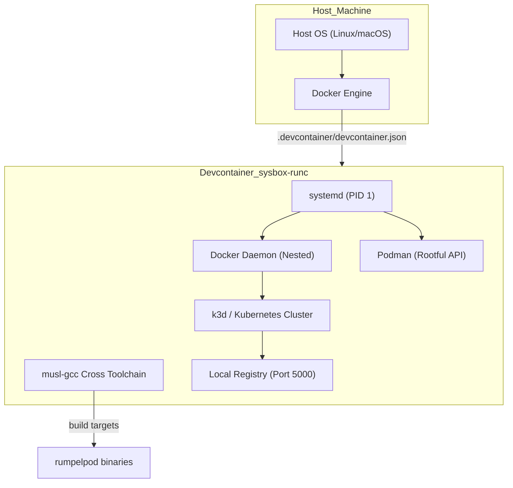
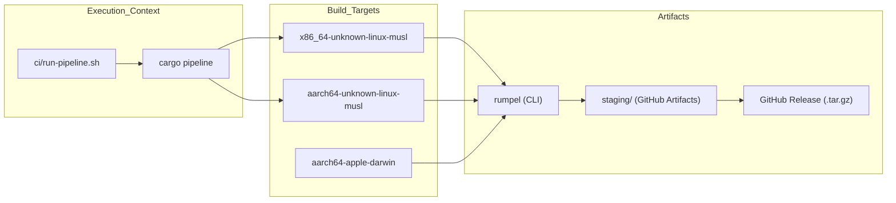

<!-- source: DeepWiki mcp.deepwiki.com · repo NVIDIA/rumpelpod · page 7 Development Environment · fetched 2026-10-26 -->

# Development Environment

Relevant source files

The following files were used as context for generating this wiki page:

- [.devcontainer/Dockerfile](.devcontainer/Dockerfile)
- [.devcontainer/devcontainer.json](.devcontainer/devcontainer.json)
- [.github/workflows/ci.yml](.github/workflows/ci.yml)
- [ci/run-pipeline.sh](ci/run-pipeline.sh)
- [rust-toolchain.toml](rust-toolchain.toml)

The rumpelpod development environment is designed to be fully containerized, providing a reproducible workspace that mirrors the production execution environment. It leverages `sysbox-runc` to enable nested containerization (Docker-in-Docker) and `systemd` for service management within the development container. This setup ensures that developers can build, test, and run LLM agents in an environment identical to the one managed by the `rumpelpod` daemon.

## Containerized Workspace

The development environment is defined via a `.devcontainer` configuration that utilizes a custom `Dockerfile` based on a pinned `debian:testing` snapshot [.devcontainer/Dockerfile:4-5](). The environment is specifically tuned for high-density container operations and cross-platform development.

### Key Environment Features
*   **Nested Containerization**: Uses `--runtime=sysbox-runc` to allow running Docker, Podman, and k3d clusters inside the devcontainer [.devcontainer/devcontainer.json:8-9]().
*   **Systemd Integration**: The container runs `systemd` as PID 1, providing a full Linux service environment [.devcontainer/Dockerfile:27-28]().
*   **Cross-Compilation**: Pre-configured toolchains and `musl` builds for `x86_64` and `aarch64` [.devcontainer/Dockerfile:135-165]().
*   **Local Registry**: A built-in k3d registry at `rumpelpod-registry.localhost:5000` for fast local image iteration [.devcontainer/Dockerfile:92-95]().
*   **Cloud Provisioning Tools**: Includes `hetzner-k3s`, `helm`, `k3d`, `eksctl`, and `awscli` for managing remote infrastructure [.devcontainer/Dockerfile:97-126]().

For a deep dive into the container architecture and the boot sequence (including `provision-k3d`), see [Devcontainer Setup](#7.1).

### Development Environment Components

The following diagram illustrates the relationship between the host, the devcontainer, and the nested resources it manages.

**Devcontainer Architecture Overview**

**Sources:** [.devcontainer/devcontainer.json:1-25](), [.devcontainer/Dockerfile:1-165]()

---

## CI/CD and Release Pipeline

Rumpelpod employs a robust pipeline for quality assurance and multi-platform distribution. The primary entry point for developers is `cargo pipeline`, which ensures consistent testing across environments.

### The CI Pipeline Workflow
The CI pipeline, defined in `ci/run-pipeline.sh`, replicates the local devcontainer environment on GitHub Actions runners [.github/workflows/ci.yml:52-57](). It manages:
1.  **Environment Parity**: Installs `sysbox` on the runner and boots the `rumpelpod-dev` image [.github/workflows/ci.yml:44-50](), [ci/run-pipeline.sh:36-43]().
2.  **Cross-Architecture Builds**: Compiles binaries for `x86_64-unknown-linux-musl` and `aarch64-unknown-linux-musl` targets as defined in the toolchain [rust-toolchain.toml:4-8]().
3.  **Automated Testing**: Runs `cargo pipeline --release` inside the containerized environment [ci/run-pipeline.sh:75-76]().
4.  **Artifact Staging**: Copies the tested release binary from the container to a host staging directory for publication [ci/run-pipeline.sh:83-96]().

### Release Distribution
The release process is automated via GitHub Actions, triggering on tag pushes [.github/workflows/ci.yml:124-126]().
*   **Linux**: Static binaries for `amd64` and `arm64` built via the devcontainer pipeline.
*   **macOS**: `darwin-arm64` binaries built directly on `macos-latest` runners [.github/workflows/ci.yml:103-112]().
*   **Artifact Assembly**: Combines all platform binaries into a single `.tar.gz` and creates a GitHub Release [.github/workflows/ci.yml:137-150]().

For details on the release workflow and the tools for cloud provisioning, see [CI/CD and Release Pipeline](#7.2).

### Pipeline and Tooling Relationship

This diagram shows how the development tools interact with the codebase to produce release artifacts.

**Build and Test Pipeline**

**Sources:** [ci/run-pipeline.sh:1-97](), [.github/workflows/ci.yml:1-150](), [rust-toolchain.toml:1-8]()

**Sources:**
* [.devcontainer/Dockerfile:1-165]()
* [.devcontainer/devcontainer.json:1-25]()
* [rust-toolchain.toml:1-8]()
* [ci/run-pipeline.sh:1-97]()
* [.github/workflows/ci.yml:1-150]()

---

