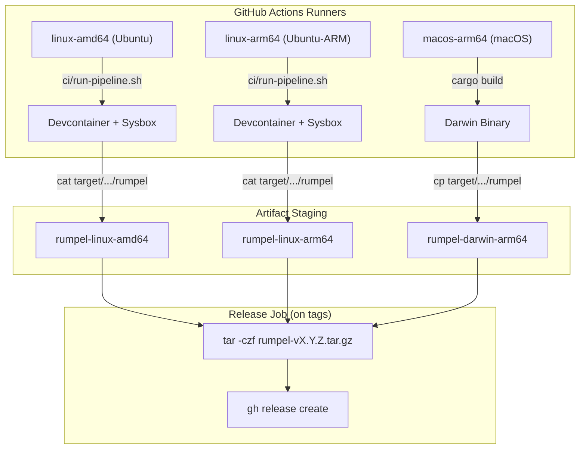
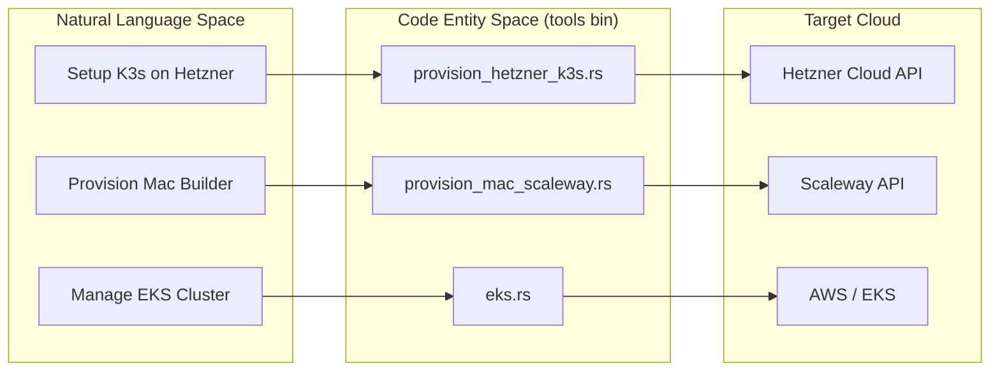

<!-- source: DeepWiki mcp.deepwiki.com · repo NVIDIA/rumpelpod · page 7.2 CI/CD and Release Pipeline · fetched 2026-10-26 -->

# CI/CD and Release Pipeline

Relevant source files

The following files were used as context for generating this wiki page:

- [.github/workflows/ci.yml](.github/workflows/ci.yml)
- [Cargo.lock](Cargo.lock)
- [THIRD-PARTY-NOTICES](THIRD-PARTY-NOTICES)
- [ci/run-pipeline.sh](ci/run-pipeline.sh)
- [rumpelpod/Cargo.toml](rumpelpod/Cargo.toml)
- [rumpelpod/build.rs](rumpelpod/build.rs)
- [rumpelpod/src/exec_proxy.rs](rumpelpod/src/exec_proxy.rs)
- [rumpelpod/tests/cli/version.rs](rumpelpod/tests/cli/version.rs)
- [tools/Cargo.toml](tools/Cargo.toml)

The rumpelpod release pipeline is an automated system designed to produce multi-platform binaries, stage artifacts, and manage cloud infrastructure for testing and deployment. It leverages GitHub Actions for orchestration, a specialized `tools/` crate for release logic, and the `ci/run-pipeline.sh` script to ensure that the published binaries are the exact ones validated by the integration test suite.

## Release Orchestration

The release process is governed by GitHub Actions defined in `.github/workflows/ci.yml` [[.github/workflows/ci.yml:1-12]](). This workflow manages the staging of artifacts and the interaction with the GitHub API to create releases.

### Multi-Platform Builds
Rumpelpod supports three primary target architectures to ensure compatibility across developer environments and cloud providers:
*   **x86_64-unknown-linux-musl**: Built on `ubuntu-24.04` runners using a devcontainer environment [[.github/workflows/ci.yml:26-62]]().
*   **aarch64-unknown-linux-musl**: Built on `ubuntu-24.04-arm` runners using a devcontainer environment [[.github/workflows/ci.yml:64-98]]().
*   **aarch64-apple-darwin**: Built on `macos-latest` runners [[.github/workflows/ci.yml:103-122]]().

The Linux targets use `musl` to ensure that the resulting `rumpel` binary is statically linked and has zero runtime dependencies [[ci/run-pipeline.sh:84-91]]().

### Versioning and Metadata
The `rumpelpod/build.rs` script embeds detailed version information into the binary at compile time via the `RUMPELPOD_VERSION_INFO` environment variable [[rumpelpod/build.rs:73-74]](). This includes:
*   **Version Tag**: Derived from `git describe --tags` (e.g., `v0.4.0`) or `v0.0.0` for untagged builds [[rumpelpod/build.rs:29-40]]().
*   **Build Date**: The date of the last commit [[rumpelpod/build.rs:27-27]]().
*   **Commit Hash**: The full 40-character SHA of `HEAD` [[rumpelpod/build.rs:26-26]]().
*   **Dirty Suffix**: A `+<hash>` suffix generated if the build tree has uncommitted changes or untracked files [[rumpelpod/build.rs:58-71]]().

The format of this metadata is strictly validated by integration tests [[rumpelpod/tests/cli/version.rs:7-66]]().

### Release Execution Flow
The following diagram illustrates how GitHub Actions coordinates the build, test, and release process.

**Release Execution Flow**

Sources: [.github/workflows/ci.yml:25-150](), [ci/run-pipeline.sh:83-96](), [rumpelpod/build.rs:25-74]()

## Devcontainer CI Pipeline (`ci/run-pipeline.sh`)

To ensure CI is reproducible locally, the Linux jobs run the entire `cargo pipeline` inside a devcontainer managed by `sysbox-runc` [[ci/run-pipeline.sh:5-9]]().

1.  **Environment Boot**: The script builds the `.devcontainer` image and starts it with `sysbox-runc` to allow nested container operations (k3d/podman) [[ci/run-pipeline.sh:36-43]]().
2.  **Commit Checkout**: It fetches the specific `COMMIT` from `REPO_URL` into the container's workspace [[ci/run-pipeline.sh:66-69]]().
3.  **Validation**: It executes `cargo pipeline --release` [[ci/run-pipeline.sh:75-76]]().
4.  **Staging**: If successful, it extracts the binary from the container to the host `STAGING_DIR` using `cat` to bypass filesystem limitations of `docker cp` under certain runtimes [[ci/run-pipeline.sh:83-96]]().

Sources: [ci/run-pipeline.sh:1-97](), [.github/workflows/ci.yml:52-57]()

## Cloud Provisioning Tools

The `tools/` crate contains several binaries dedicated to provisioning and managing the infrastructure required for rumpelpod's distributed execution and integration testing.

### Provisioning Binaries
| Binary Name | Source Path | Purpose |
| :--- | :--- | :--- |
| `eks` | `tools/src/bin/eks.rs` | Manages Amazon EKS clusters for K8s backend testing [[tools/Cargo.toml:31-33]](). |
| `provision-hetzner-k3s` | `tools/src/bin/provision_hetzner_k3s.rs` | Deploys lightweight k3s clusters on Hetzner Cloud [[tools/Cargo.toml:36-38]](). |
| `provision-hetzner-dev` | `tools/src/bin/provision_hetzner_dev.rs` | Sets up remote development instances on Hetzner [[tools/Cargo.toml:41-43]](). |
| `provision-mac-scaleway` | `tools/src/bin/provision_mac_scaleway.rs` | Provisions Apple Silicon instances on Scaleway for Darwin builds [[tools/Cargo.toml:46-48]](). |

**Infrastructure Provisioning Mapping**

Sources: [tools/Cargo.toml:30-49](), [tools/src/lib.rs:1-13]()

## Dependencies and Licensing

The release pipeline ensures compliance by documenting the licenses of all dependencies. The `THIRD-PARTY-NOTICES` file is generated using `cargo about`, covering the extensive dependency tree including `axum`, `tokio`, `rusqlite`, and `kube` [[THIRD-PARTY-NOTICES:1-24]]() [[Cargo.lock:1-200]]().

Sources: [THIRD-PARTY-NOTICES:1-7](), [rumpelpod/Cargo.toml:18-70](), [Cargo.lock:5-268]()

---

