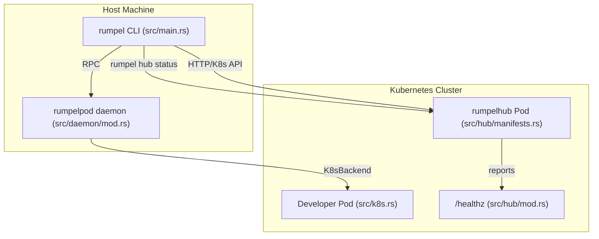
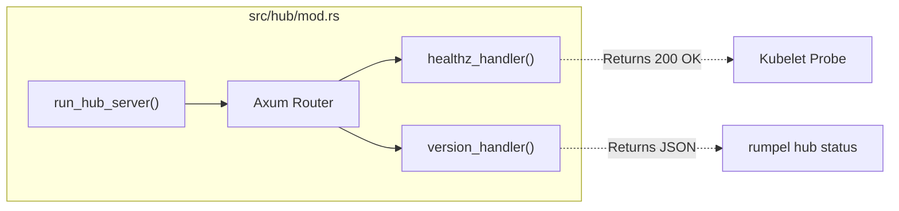

<!-- source: DeepWiki mcp.deepwiki.com · repo NVIDIA/rumpelpod · page 8 Rumpelhub (In-Cluster Companion) · fetched 2026-10-26 -->

# Rumpelhub (In-Cluster Companion)

Relevant source files

The following files were used as context for generating this wiki page:

- [rumpelpod/src/hub/image.rs](rumpelpod/src/hub/image.rs)
- [rumpelpod/src/hub/install.rs](rumpelpod/src/hub/install.rs)

Rumpelhub is a lightweight Kubernetes deployment that acts as an in-cluster companion for the `rumpelpod` daemon when operating in Kubernetes environments. It serves as a persistent anchor within the cluster, providing health signaling, version synchronization, and serving as a git-capable hub for pod management infrastructure [rumpelpod/src/hub/install.rs:4-10]().

While the `rumpelpod` daemon typically runs on the developer's host machine, it communicates with the Kubernetes API to manage remote pods. Rumpelhub provides a centralized point of presence within the cluster to verify connectivity and ensure that the cluster-side components are compatible with the host-side CLI version [rumpelpod/src/hub/image.rs:49-61]().

### System Interaction Overview

The following diagram illustrates how the `rumpelhub` deployment relates to the host-side `rumpel` CLI and the managed developer pods.

**Rumpelhub Connectivity Architecture**

Sources: [rumpelpod/src/main.rs:106-241](), [rumpelpod/src/hub/mod.rs:1-25](), [rumpelpod/src/k8s.rs:1-20](), [rumpelpod/src/hub/manifests.rs:1-15]()

---

## Hub Installation and Management

The `rumpel hub` suite of commands allows users to manage the lifecycle of the hub deployment within their active Kubernetes context. Rumpelhub is deployed as a single-replica `Deployment` associated with a `Service` and `ServiceAccount` [rumpelpod/src/hub/install.rs:109-150]().

Key management aspects include:
*   **Installation**: Uses `rumpel hub install` to build a content-addressed image and apply manifests using Server-Side Apply [rumpelpod/src/hub/install.rs:126-144]().
*   **Image Pipeline**: Builds a tiny Alpine-based image containing the `rumpel` binary and `git-daemon` [rumpelpod/src/hub/image.rs:23-28]().
*   **Discovery**: The hub is identified using a specific `HUB_SELECTOR` label (`app.kubernetes.io/name=rumpelhub`) [rumpelpod/src/hub/mod.rs:20-23]().
*   **Status Verification**: The CLI queries the hub via port-forwarding to ensure the cluster is "Rumpel-ready" [rumpelpod/src/hub/install.rs:220-250]().

For details on the deployment manifests and CLI commands, see [Hub Installation and Management](#8.1).

Sources: [rumpelpod/src/hub/install.rs:4-10](), [rumpelpod/src/hub/image.rs:18-29](), [rumpelpod/src/hub/mod.rs:20-23]()

---

## Hub HTTP Server

The Rumpelhub process runs a minimal HTTP server designed for Kubernetes probes and CLI diagnostics. Its primary responsibility is to expose the current state and version of the cluster-side infrastructure.

### Core Components

| Component | Function | Code Entity |
| :--- | :--- | :--- |
| **Health Endpoint** | Provides `/healthz` for Kubelet liveness/readiness probes. | `healthz_handler` |
| **Version Reporting** | Returns `RUMPELPOD_VERSION_INFO` for compatibility checks. | `version_handler` |
| **Server Engine** | Lightweight Axum-based listener. | `run_hub_server` |

For details on the API implementation and probe configurations, see [Hub HTTP Server](#8.2).

**Hub Server Entity Map**

Sources: [rumpelpod/src/hub/mod.rs:78-120](), [rumpelpod/src/lib.rs:139-146]()

---

## Relationship to Rumpelpod Daemon

The `rumpelhub` is not a replacement for the `rumpelpod` daemon; rather, it is a prerequisite for the `K8sBackend` used by the daemon. When the daemon's `Executor` is configured for Kubernetes, it relies on the environment prepared by the hub, such as the namespace and service account configurations [rumpelpod/src/hub/install.rs:115-125]().

The daemon uses the hub's presence to validate that the remote cluster has the necessary permissions and resources to host `rumpel` pods. If the hub is missing or reports a version mismatch (verified via `RUMPELPOD_VERSION_INFO`), the daemon or CLI will prompt the user to run `rumpel hub install` [rumpelpod/src/hub/image.rs:55-61]().

Sources: [rumpelpod/src/executor.rs:1-30](), [rumpelpod/src/k8s.rs:50-100](), [rumpelpod/src/hub/install.rs:31-76]()

---

