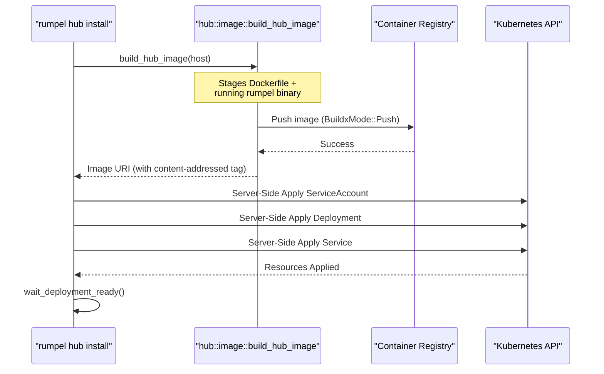
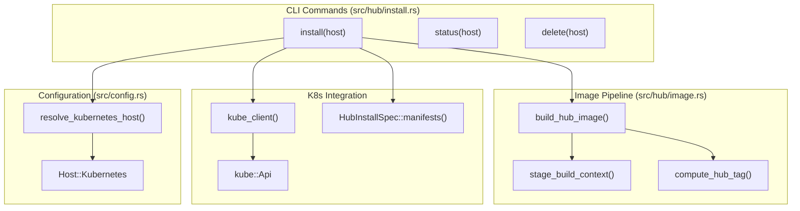

<!-- source: DeepWiki mcp.deepwiki.com · repo NVIDIA/rumpelpod · page 8.1 Hub Installation and Management · fetched 2026-10-26 -->

# Hub Installation and Management

Relevant source files

The following files were used as context for generating this wiki page:

- [rumpelpod/src/hub/image.rs](rumpelpod/src/hub/image.rs)
- [rumpelpod/src/hub/install.rs](rumpelpod/src/hub/install.rs)
- [rumpelpod/src/k8s.rs](rumpelpod/src/k8s.rs)

The `rumpel hub` command suite provides tools for managing the **Rumpelhub** component, which acts as an in-cluster companion for rumpelpod deployments targeting Kubernetes. It ensures that the cluster environment is ready to host pods by providing health checks and serving as a repository gateway.

## Overview

Rumpelhub is a lightweight Kubernetes deployment that serves as a signaling and health-checking mechanism for the rumpelpod daemon when operating in `K8sBackend` mode. The CLI manages the lifecycle of this hub—including image building, deployment, status monitoring, and removal—using standard Kubernetes API interactions via the `kube` crate [[rumpelpod/src/hub/install.rs:17-19]]().

### Key CLI Commands
- `rumpel hub install`: Builds the hub image and deploys it to the cluster using Server-Side Apply [[rumpelpod/src/hub/install.rs:110-128]]().
- `rumpel hub status`: Port-forwards to the hub service and fetches the `/healthz` endpoint [[rumpelpod/src/hub/install.rs:8-10]]().
- `rumpel hub delete`: Removes all hub-related resources identified by the `HUB_SELECTOR` [[rumpelpod/src/hub/install.rs:184-188]]().

Sources: [[rumpelpod/src/hub/install.rs:4-11]](), [[rumpelpod/src/hub/install.rs:23-23]]()

---

## Hub Installation Pipeline

The installation process is an imperative pipeline that bridges the local development environment and the remote Kubernetes cluster. It involves deterministic image tagging, container registry interactions, and Kubernetes resource orchestration.

### Data Flow: Installation

Title: Hub Installation Sequence

Sources: [[rumpelpod/src/hub/install.rs:110-150]](), [[rumpelpod/src/hub/image.rs:64-91]]()

### Implementation Details
The installation logic is encapsulated in the `install` function [[rumpelpod/src/hub/install.rs:110-110]](). 
1. **Host Resolution**: The command resolves Kubernetes configuration (context, namespace, registry) from CLI flags or `.rumpelpod.json` [[rumpelpod/src/hub/install.rs:31-76]]().
2. **Image Preparation**: It triggers an image build using `build_hub_image` [[rumpelpod/src/hub/image.rs:64-64]](). This stages the currently running `rumpel` binary into a temporary directory with a minimal Alpine-based `Dockerfile` [[rumpelpod/src/hub/image.rs:23-28]]() [[rumpelpod/src/hub/image.rs:31-47]]().
3. **Idempotent Deployment**: It uses `PatchParams::apply` for Server-Side Apply, ensuring that re-running the command is idempotent and updates fields without conflicting with unrelated annotations [[rumpelpod/src/hub/install.rs:126-144]]().
4. **Readiness Check**: After applying manifests, it blocks in `wait_deployment_ready` until `status.availableReplicas >= 1` [[rumpelpod/src/hub/install.rs:153-178]]().

Sources: [[rumpelpod/src/hub/install.rs:110-150]](), [[rumpelpod/src/hub/image.rs:49-61]]()

---

## Management and Selectors

Rumpelhub resources are identified and managed using a consistent set of Kubernetes labels and names.

| Constant | Value | Purpose |
| :--- | :--- | :--- |
| `HUB_NAME` | `"rumpelhub"` | The base name for the Deployment, Service, and SA [[rumpelpod/src/hub/install.rs:23-23]]() |
| `HUB_SELECTOR` | `"app=rumpelhub"` | Label selector used for `delete_collection` [[rumpelpod/src/hub/install.rs:23-23]]() |
| `HUB_PORT` | `80` | The service port for the hub HTTP server [[rumpelpod/src/hub/install.rs:23-23]]() |

### Hub Status Check
The `rumpel hub status` command performs health verification by:
1. Creating a `kube::Client` for the target context [[rumpelpod/src/hub/install.rs:80-94]]().
2. Establishing a port-forward to `svc/rumpelhub` [[rumpelpod/src/hub/install.rs:9-10]]().
3. Fetching the `/healthz` endpoint to confirm the hub is operational [[rumpelpod/src/hub/install.rs:10-10]]().

### Resource Deletion
The `rumpel hub delete` command is designed to be idempotent. It uses `delete_collection` with the `HUB_SELECTOR`. This approach returns an empty result rather than a 404 if no resources match, making a "delete-before-install" a silent no-op [[rumpelpod/src/hub/install.rs:180-183]]().

Sources: [[rumpelpod/src/hub/install.rs:184-190]]()

---

## Code Entity Mapping

The following diagram maps the high-level management concepts to the specific Rust modules and functions that implement them.

Title: Hub Management Code Mapping

Sources: [[rumpelpod/src/hub/install.rs:31-35]](), [[rumpelpod/src/hub/install.rs:110-120]](), [[rumpelpod/src/hub/image.rs:31-31]](), [[rumpelpod/src/hub/image.rs:55-55]]()

---

## Hub Image Pipeline

The hub image is built at install time to ensure the in-cluster binary matches the local CLI version exactly.

1. **Dockerfile Composition**: The hub uses a specialized Alpine-based Dockerfile. It installs `git` and `git-daemon` (to support `git-http-backend` for serving the host repo) and copies the local `rumpel` binary into `/usr/local/bin/rumpel` [[rumpelpod/src/hub/image.rs:23-28]]().
2. **Deterministic Tagging**: Tags are generated using `RUMPELPOD_VERSION_INFO` (e.g., `rumpelhub-<commit>-<dirty>`). This ensures that if the binary hasn't changed, the image tag remains stable [[rumpelpod/src/hub/image.rs:49-61]]().
3. **Build Execution**: The build uses `build_image_direct` with `BuildxMode::Push`. This requires the `Host` configuration to provide a valid `registry` and optionally a custom `builder` [[rumpelpod/src/hub/image.rs:83-91]]().

Sources: [[rumpelpod/src/hub/image.rs:64-77]](), [[rumpelpod/src/hub/image.rs:80-81]]()

---

