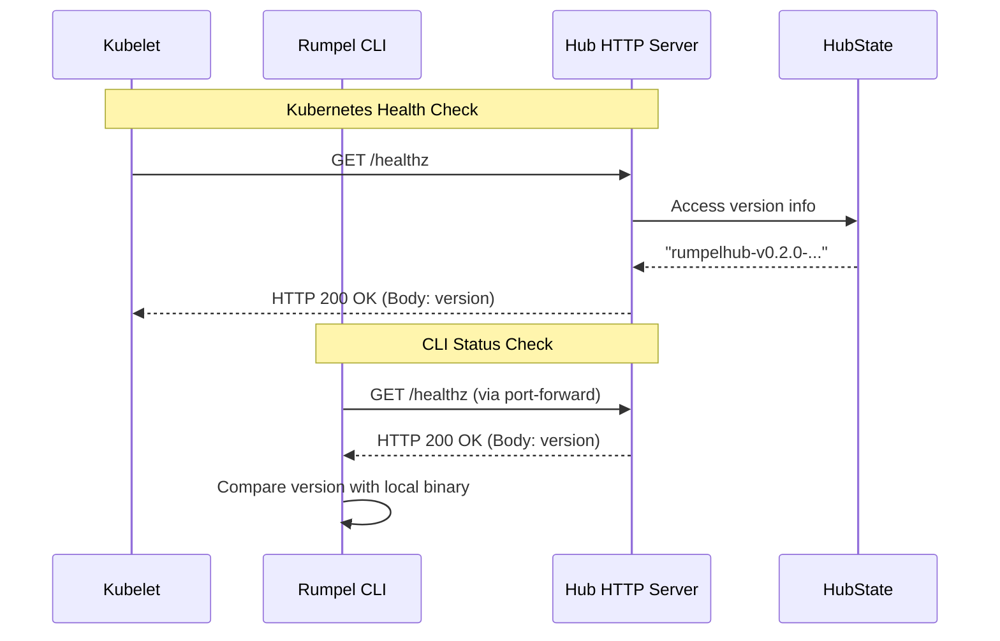
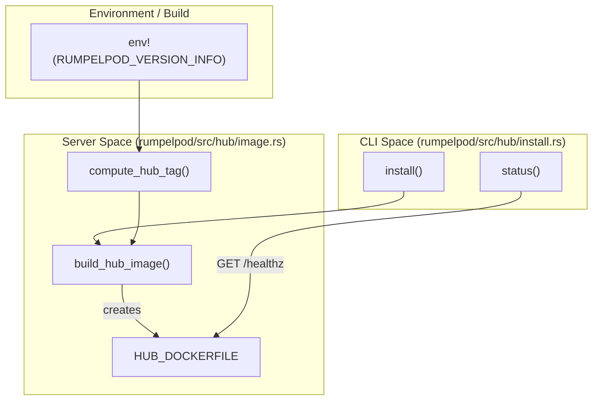

<!-- source: DeepWiki mcp.deepwiki.com · repo NVIDIA/rumpelpod · page 8.2 Hub HTTP Server · fetched 2026-10-26 -->

# Hub HTTP Server

Relevant source files

The following files were used as context for generating this wiki page:

- [rumpelpod/src/hub/image.rs](rumpelpod/src/hub/image.rs)
- [rumpelpod/src/hub/install.rs](rumpelpod/src/hub/install.rs)

The Hub HTTP Server is a lightweight web service running within the `rumpelhub` deployment in a Kubernetes cluster. Its primary purpose is to provide a standardized interface for health monitoring, version verification, and readiness checks used by both the Kubernetes infrastructure (kubelet probes) and the `rumpel` CLI.

## Overview and Purpose

The server operates as a companion to the main `rumpelpod` daemon when running in Kubernetes environments. It allows the system to:
1.  **Report Health**: Provide a `/healthz` endpoint for Kubernetes Liveness and Readiness probes.
2.  **Report Versioning**: Expose the version of the running hub image, derived from the `RUMPELPOD_VERSION_INFO` environment variable.
3.  **Status Verification**: Support the `rumpel hub status` command by providing a reachable network endpoint that confirms the hub's operational state.

## Implementation Details

The server is implemented using the `axum` framework. It is started as part of the hub execution logic, which initializes the `HubState` and binds the router to a TCP listener. The hub image itself is a minimal Alpine-based container [rumpelpod/src/hub/image.rs:23-28]() that includes `git`, `git-daemon` (for `git-http-backend`), and the `rumpel` binary [rumpelpod/src/hub/image.rs:25-27]().

### Key Components

| Component | Code Entity | Description |
| :--- | :--- | :--- |
| **State Management** | `HubState` | Holds shared configuration, specifically the version string. |
| **Image Building** | `build_hub_image` | Packages the current binary and Dockerfile into a content-addressed image [rumpelpod/src/hub/image.rs:64-91](). |
| **Installation** | `install` | Uses `HubInstallSpec` to apply the Deployment and Service to K8s [rumpelpod/src/hub/install.rs:110-150](). |
| **Status Check** | `status` | Port-forwards to the hub service and fetches `/healthz` [rumpelpod/src/hub/install.rs:9-10](). |

### Data Flow: Status Request

The following diagram illustrates how a status check flows from the CLI to the Hub HTTP server and how Kubernetes utilizes the health endpoint.

**Hub Status and Health Flow**

Sources: [rumpelpod/src/hub/install.rs:9-10](), [rumpelpod/src/hub/image.rs:55-61]()

## API Endpoints

The server exposes a minimal API surface to ensure high availability and low overhead.

### `GET /healthz`
This is the primary endpoint used for monitoring.

*   **Implementation**: The hub router serves this endpoint to report readiness.
*   **Behavior**: Returns an `HTTP 200 OK` response.
*   **Payload**: The body contains the version string, typically formatted as `rumpelhub-<commit>` [rumpelpod/src/hub/image.rs:55-61]().
*   **Usage**:
    *   **Kubelet**: Configured in the `HubInstallSpec` manifests as a probe.
    *   **CLI**: The `rumpel hub status` command fetches this endpoint to verify the hub is running [rumpelpod/src/hub/install.rs:9-10]().

## Version Reporting

The version information served by the hub is determined at image build time and reported at runtime.

1.  **Tag Generation**: `compute_hub_tag` uses the `RUMPELPOD_VERSION_INFO` environment variable (set during the Rust build) to create a unique string [rumpelpod/src/hub/image.rs:55-61]().
2.  **Tag Normalization**: The `+` separator in semantic versions is replaced with `-` to comply with Docker tag restrictions [rumpelpod/src/hub/image.rs:60-60]().
3.  **Deployment**: This version is baked into the image tag and environment, allowing the hub to identify itself to the CLI.

**Code Entity Mapping**

Sources: [rumpelpod/src/hub/image.rs:23-28](), [rumpelpod/src/hub/image.rs:55-61](), [rumpelpod/src/hub/install.rs:110-115]()

## Usage in Hub Status

When a user executes `rumpel hub status`, the CLI performs the following logic:
1.  Resolves the Kubernetes host and client [rumpelpod/src/hub/install.rs:31-94]().
2.  Establishes a connection (often via port-forwarding) to `svc/rumpelhub` on `HUB_PORT` [rumpelpod/src/hub/install.rs:9-10](), [rumpelpod/src/hub/mod.rs:23-23]().
3.  Sends an HTTP request to the `/healthz` endpoint.
4.  Reports the Hub as "Ready" if the request succeeds and the Deployment has at least one available replica [rumpelpod/src/hub/install.rs:153-178]().

Sources: [rumpelpod/src/hub/install.rs:9-10](), [rumpelpod/src/hub/install.rs:153-178](), [rumpelpod/src/hub/image.rs:55-61]()

---

