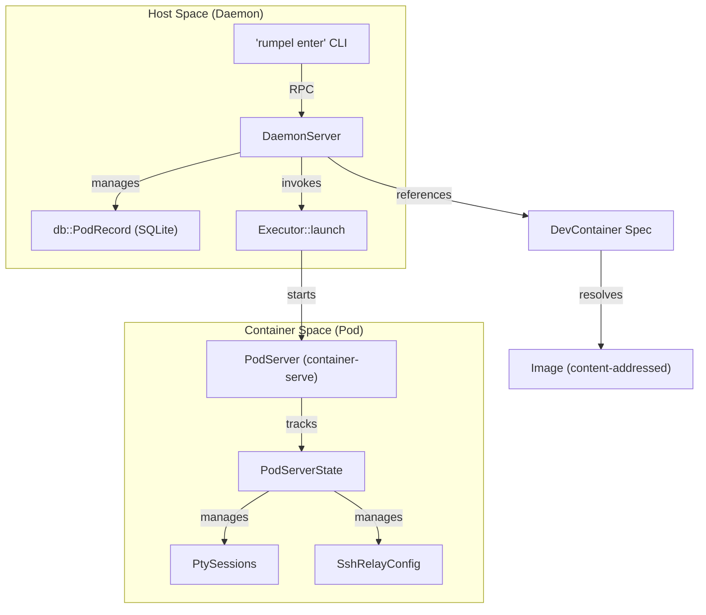
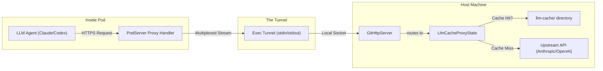

<!-- source: DeepWiki mcp.deepwiki.com · repo NVIDIA/rumpelpod · page 9 Glossary · fetched 2026-10-26 -->

# Glossary

Relevant source files

The following files were used as context for generating this wiki page:

- [CHANGELOG.md](CHANGELOG.md)
- [Cargo.lock](Cargo.lock)
- [THIRD-PARTY-NOTICES](THIRD-PARTY-NOTICES)
- [rumpelpod/Cargo.toml](rumpelpod/Cargo.toml)
- [rumpelpod/src/claude.rs](rumpelpod/src/claude.rs)
- [rumpelpod/src/cli.rs](rumpelpod/src/cli.rs)
- [rumpelpod/src/command_ext.rs](rumpelpod/src/command_ext.rs)
- [rumpelpod/src/config.rs](rumpelpod/src/config.rs)
- [rumpelpod/src/daemon.rs](rumpelpod/src/daemon.rs)
- [rumpelpod/src/daemon/db.rs](rumpelpod/src/daemon/db.rs)
- [rumpelpod/src/exec_proxy.rs](rumpelpod/src/exec_proxy.rs)
- [rumpelpod/src/executor/engine.rs](rumpelpod/src/executor/engine.rs)
- [rumpelpod/src/executor/mod.rs](rumpelpod/src/executor/mod.rs)
- [rumpelpod/src/executor/podman_ssh.rs](rumpelpod/src/executor/podman_ssh.rs)
- [rumpelpod/src/pod/server.rs](rumpelpod/src/pod/server.rs)
- [rumpelpod/src/prepared_image.rs](rumpelpod/src/prepared_image.rs)
- [rumpelpod/src/service.rs](rumpelpod/src/service.rs)
- [rumpelpod/tests/cli/codex/install.rs](rumpelpod/tests/cli/codex/install.rs)
- [rumpelpod/tests/cli/gateway/mod.rs](rumpelpod/tests/cli/gateway/mod.rs)
- [tools/Cargo.toml](tools/Cargo.toml)

This page defines codebase-specific terms, abbreviations, and domain concepts used throughout the Rumpelpod system. It serves as a technical reference for onboarding engineers to understand the internal nomenclature and how these concepts map to specific code entities.

## Core Concepts

### Pod
A **Pod** is the primary unit of isolation in Rumpelpod. It consists of a container (running on Docker, Podman, or Kubernetes) and an associated lifecycle managed by the daemon. Unlike a standard container, a Pod in Rumpelpod has a persistent identity in the daemon's SQLite database and includes an internal [Pod Server](#pod-server).
*   **Implementation**: Defined as `PodInfo` in [rumpelpod/src/daemon/protocol.rs:36-45]().
*   **Lifecycle**: Managed by `DaemonServer` in [rumpelpod/src/daemon.rs]().
*   **Persistence**: Tracked via `PodRecord` in the SQLite database [rumpelpod/src/daemon/db.rs:76-96]().

### Pod Server
The **Pod Server** (or `container-serve`) is a Rust-based HTTP server that runs *inside* the container as the devcontainer user. It acts as the bridge between the host-side daemon and the container's internal environment, handling filesystem operations, git setup, and PTY session management for LLM agents.
*   **Implementation**: `run_container_server` in [rumpelpod/src/pod/server.rs:128-135]().
*   **State**: Tracked via `PodServerState` in [rumpelpod/src/pod/server.rs:77-117]().

### Executor
The **Executor** is a backend-agnostic abstraction layer that allows Rumpelpod to target different container runtimes (Docker, Podman, or Kubernetes) using the same interface. It handles the low-level details of starting containers and executing commands within them.
*   **Implementation**: `Executor` struct in [rumpelpod/src/executor/engine.rs:35-37]().
*   **Backends**: Dispatches to `DockerBackend` or `K8sBackend` via the `Inner` enum [rumpelpod/src/executor/engine.rs:40-43]().

## Technical Terms & Jargon

| Term | Definition | Code Pointer |
| :--- | :--- | :--- |
| **BuildxMode** | Determines if a built image is loaded into a local Docker daemon (`Load`) or pushed to a remote registry (`Push`). | [rumpelpod/src/image.rs:81-92]() |
| **ContainerEngine** | The specific CLI/runtime used (Docker vs Podman). `Auto` prefers Docker but falls back to Podman. | [rumpelpod/src/config.rs:30-35]() |
| **GitHttpServer** | A host-side server that provides a Git remote to pods via a tunnel, allowing pods to fetch/push without direct network access to the host's Git refs. | [rumpelpod/src/git_http_server.rs]() |
| **LLM Cache Proxy** | An intercepting proxy that records and replays LLM API responses (Claude, Codex, Grok) to enable deterministic offline testing. | [rumpelpod/src/llm/cache_proxy.rs:4-14]() |
| **Prepared Image** | A Docker image built on top of a devcontainer image that pre-installs the `rumpel` binary, agent CLIs, and a repo clone. | [rumpelpod/src/prepared_image.rs:4-7]() |
| **Re-entry** | The process of a pod connecting back to the host's daemon or Git server via the multiplexed `exec` tunnel. | [rumpelpod/src/pod/server.rs:145-148]() |
| **xtest** | The custom integration test runner used by Rumpelpod to manage isolated test environments and parallel execution. | [tools/src/bin/xtest.rs:16-18]() |

**Sources**: [rumpelpod/src/image.rs:81-92](), [rumpelpod/src/config.rs:30-35](), [rumpelpod/src/prepared_image.rs:4-7](), [rumpelpod/src/pod/server.rs:145-148]().

## Data Flow & Relationships

### From Natural Language to Code Entities (Daemon & Pod)
The following diagram illustrates how high-level concepts mentioned in documentation map to the actual Rust structs and functions responsible for their execution.

**Daemon to Container Mapping**

**Sources**: [rumpelpod/src/daemon.rs:27-43](), [rumpelpod/src/pod/server.rs:77-117](), [rumpelpod/src/executor/engine.rs:129-160](), [rumpelpod/src/daemon/db.rs:76-96]().

### LLM Agent Integration Flow
This diagram shows the path an LLM request takes from an agent running in a pod back to the host-side cache or the internet.

**LLM Proxy Data Flow**

**Sources**: [rumpelpod/src/llm/cache_proxy.rs:4-14](), [rumpelpod/src/pod/server.rs:145-148](), [rumpelpod/src/git_http_server.rs]().

## Abbreviations

*   **DC**: `DevContainer` - Refers to the configuration derived from `devcontainer.json`. [rumpelpod/src/daemon.rs:30-34]()
*   **GHS**: `GitHttpServer` - The host-side service providing Git and LLM proxying. [rumpelpod/src/git_http_server.rs]()
*   **PTY**: `Pseudo-Terminal` - Used for interactive shell sessions and agent execution. [rumpelpod/src/pod/server.rs:78-78]()
*   **SSE**: `Server-Sent Events` - Used by the Pod Server to stream progress and status updates to the daemon. [rumpelpod/src/pod/server.rs:106-110]()

## Implementation Details

### Content-Addressed Tagging
Rumpelpod ensures deterministic environments by tagging images with a SHA-256 hash of the `devcontainer.json`, the `Dockerfile`, and the build context.
*   **Function**: `compute_image_tag` in [rumpelpod/src/image.rs:183-183]().
*   **Logic**: Iterates through the context directory using `WalkDir` to include file metadata and contents in the hash [rumpelpod/src/image.rs:18-18]().

### Environment Resolution
The system resolves environment variables at multiple stages:
1.  **Host-side**: `${localEnv:VAR}` substitution during Pod creation [rumpelpod/src/daemon.rs:31-33]().
2.  **Container-side**: Probing the shell environment and applying `remoteEnv` within the Pod Server [rumpelpod/src/pod/server.rs:99-101]().
3.  **Inheritance**: Forks inherit the environment from the source pod by snapshotting the source pod's running process environment [rumpelpod/src/daemon.rs:102-107]().

**Sources**: [rumpelpod/src/image.rs:183-183](), [rumpelpod/src/daemon.rs:31-33](), [rumpelpod/src/pod/server.rs:99-101](), [rumpelpod/src/daemon.rs:102-107]().