# Page: Rumpelpod Overview

# Rumpelpod Overview

<details>
<summary>Relevant source files</summary>

The following files were used as context for generating this wiki page:

- [.devcontainer/commit-msg](.devcontainer/commit-msg)
- [AGENTS.md](AGENTS.md)
- [CHANGELOG.md](CHANGELOG.md)
- [CONTRIBUTING.md](CONTRIBUTING.md)
- [GUIDE.md](GUIDE.md)
- [README.md](README.md)
- [rumpelpod/src/claude.rs](rumpelpod/src/claude.rs)
- [rumpelpod/src/command_ext.rs](rumpelpod/src/command_ext.rs)
- [rumpelpod/src/completions.rs](rumpelpod/src/completions.rs)
- [rumpelpod/src/lib.rs](rumpelpod/src/lib.rs)
- [rumpelpod/src/main.rs](rumpelpod/src/main.rs)
- [rumpelpod/src/service.rs](rumpelpod/src/service.rs)

</details>


Rumpelpod is a technical tool designed to run isolated LLM (Large Language Model) coding agents within secure, containerized environments called "pods" [AGENTS.md:1-1](). By leveraging Docker, Podman, or Kubernetes, Rumpelpod provides agents with a full Linux environment, automatic git synchronization, and specialized tooling to perform software engineering tasks without risking the host system's integrity [CHANGELOG.md:14-25]().

### Core Purpose
The system addresses the challenge of running untrusted code generated by LLMs. It creates a "pod"—an isolated workspace—that mirrors the developer's local repository but keeps all executions, filesystem changes, and network activity contained [README.md:17-22](). This allows agents to build, test, and modify code safely while providing the developer with tools to review and merge changes back to the host [GUIDE.md:37-54]().

### High-Level Architecture
Rumpelpod operates as a distributed system consisting of a background daemon, a CLI, and an in-container server.

**Rumpelpod Component Relationship**
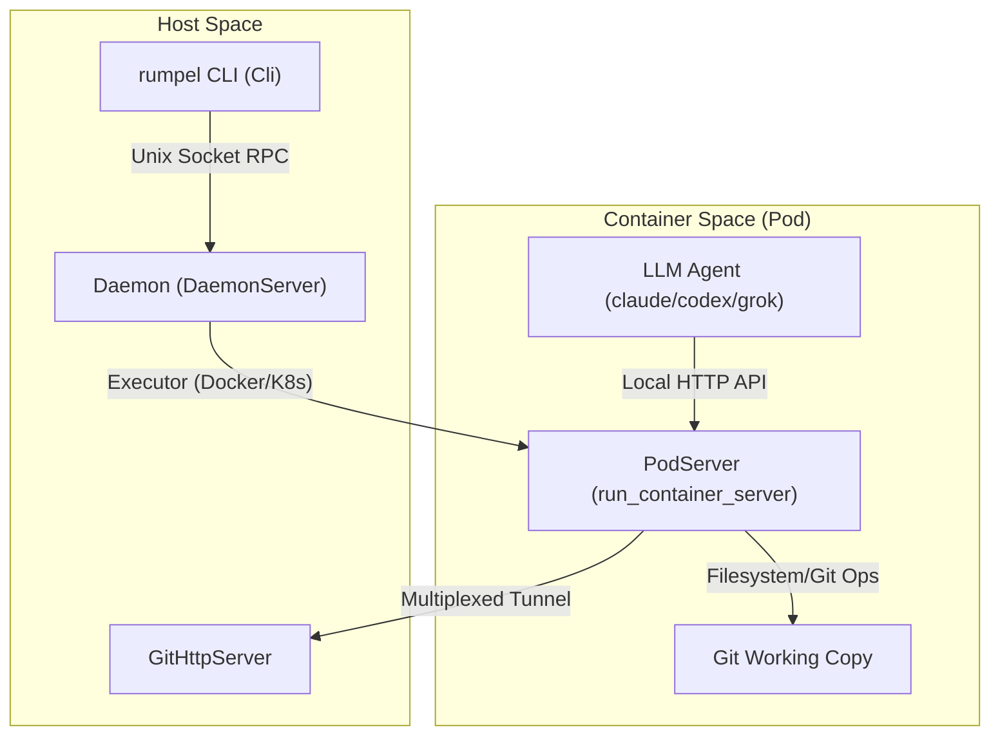
Sources: [rumpelpod/src/lib.rs:112-147](), [rumpelpod/src/daemon/mod.rs:1-20](), [rumpelpod/src/pod/mod.rs:139-147]()

### Main Components

| Component | Code Entity | Responsibility |
| :--- | :--- | :--- |
| **CLI** | `Cli` [rumpelpod/src/cli.rs:113]() | The primary interface for users to manage pods and launch agents. |
| **Daemon** | `DaemonServer` [rumpelpod/src/daemon/mod.rs]() | A background process that manages pod lifecycles and persists state in SQLite. |
| **Pod Server** | `run_container_server` [rumpelpod/src/pod/mod.rs:140]() | An HTTP server running inside the pod to provide the agent with controlled access to the environment. |
| **Executor** | `Executor` trait [rumpelpod/src/executor.rs]() | Abstraction layer for interacting with different backends like `DockerBackend` or `K8sBackend`. |
| **Git Gateway** | `gateway` module [rumpelpod/src/gateway.rs]() | Manages synchronization of git refs between the host and the isolated pod. |

### System Integration
Rumpelpod integrates deeply with the developer's workflow by reading standard `.devcontainer/devcontainer.json` files to define the environment [GUIDE.md:65-75](). It uses a custom git namespace (`refs/rumpelpod/<branch>@<pod>`) to track pod-specific work without polluting the main branch history until the user explicitly runs a merge [GUIDE.md:37-54]().

**Rumpelpod Entity Mapping**
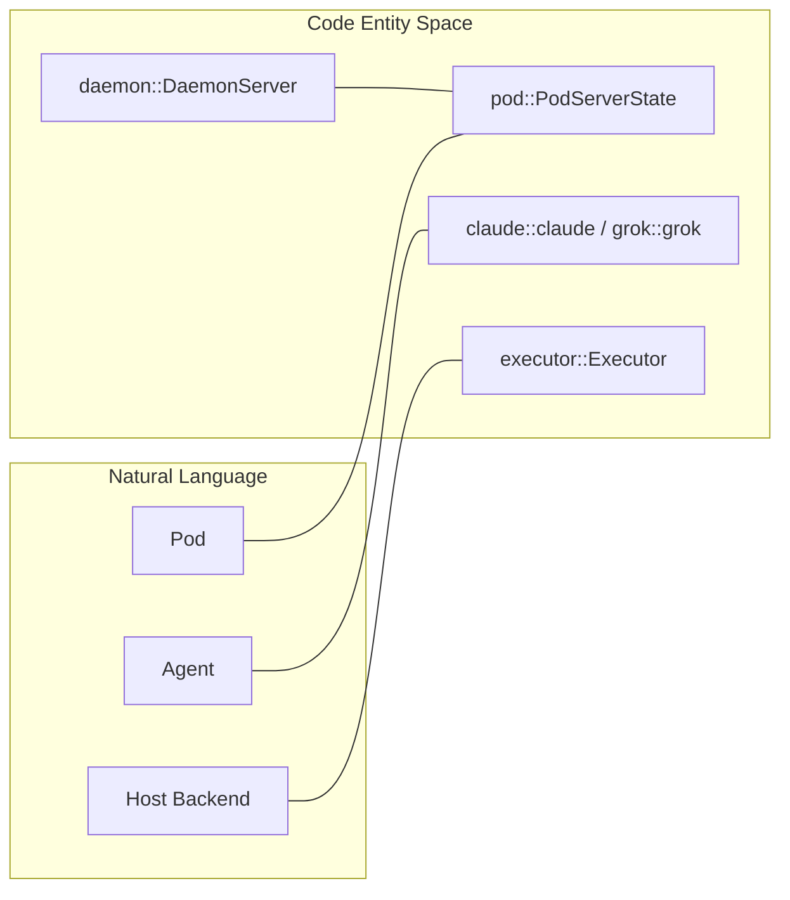
Sources: [rumpelpod/src/pod/mod.rs:1-50](), [rumpelpod/src/claude.rs:24-121](), [rumpelpod/src/executor.rs:1-20]()

### Next Steps
*   **[Getting Started](#1.1)**: Step-by-step guide for installation via `rumpel system-install` [rumpelpod/src/service.rs:41-49]() and running your first pod with `rumpel enter` [rumpelpod/src/enter.rs]().
*   **[Configuration Reference](#1.2)**: Detailed reference for `devcontainer.json` support and the `.rumpelpod.json` file [rumpelpod/src/config.rs]().
*   **Core Architecture**: Deep dive into the `DaemonServer` [rumpelpod/src/daemon/mod.rs]() and the multiplexed TCP tunnels [rumpelpod/src/tunnel.rs]().

Sources: [README.md:1-35](), [GUIDE.md:1-62](), [rumpelpod/src/lib.rs:107-240](), [CHANGELOG.md:1-26]()

---

# Page: Getting Started

# Getting Started

<details>
<summary>Relevant source files</summary>

The following files were used as context for generating this wiki page:

- [.devcontainer/commit-msg](.devcontainer/commit-msg)
- [AGENTS.md](AGENTS.md)
- [CONTRIBUTING.md](CONTRIBUTING.md)
- [GUIDE.md](GUIDE.md)
- [README.md](README.md)
- [rumpelpod/src/enter.rs](rumpelpod/src/enter.rs)

</details>


Rumpelpod is an isolated LLM agent runner designed to provide a secure, reproducible environment for AI agents to interact with codebases [README.md:1-4](). Each pod is a container with its own checkout of the repository, synchronized back to the local machine via git [GUIDE.md:3-5]().

## Prerequisites

Before installing Rumpelpod, ensure the following are installed on your host system:
*   **Git**: Essential for workspace synchronization [README.md:13-18]().
*   **Docker or Podman**: Required for the `Localhost` and `Ssh` executors [README.md:13-13](), [rumpelpod/src/enter.rs:137-143]().
*   **Rust Toolchain**: Required for building the project and running the development pipeline [AGENTS.md:7-12]().
*   **SSH**: Required if you plan to run pods on remote hosts [GUIDE.md:5-6]().
*   **kubectl**: Optional, required for Kubernetes-based pods [README.md:13-13]().

## Installation

The primary method for setting up the Rumpelpod environment involves a bootstrap script followed by the system-level installation command [GUIDE.md:18-23]().

### `rumpel system-install`
This command prepares the host machine by:
1.  Installing the `rumpel` binary to a location in your `PATH`.
2.  Setting up the background daemon (`DaemonServer`) which manages the lifecycle of all pods [rumpelpod/src/enter.rs:14-17]().
3.  Initializing the state directory for SQLite persistence and Unix socket communication.

## Initializing a Project

Rumpelpod relies on the standard `devcontainer.json` format to define the environment [GUIDE.md:65-69]().

1.  **Create `.devcontainer/devcontainer.json`**: Define your image, features, and workspace settings.
2.  **Optional `.rumpelpod.json`**: Create this file in the repository root to specify settings unique to Rumpelpod, such as the execution `Host` [rumpelpod/src/enter.rs:112-135]().

### Configuration Mapping

| Setting | Source | Purpose |
| :--- | :--- | :--- |
| `image`, `mounts`, `runArgs` | `devcontainer.json` | Defines the container environment [GUIDE.md:71-75](). |
| `host` | `.rumpelpod.json` | Determines if the pod runs on `Localhost`, `Ssh`, or `Kubernetes` [rumpelpod/src/enter.rs:112-143](). |
| `localEnv` | Host Shell | Variables prefixed with `${localEnv:VAR}` are captured from the host and substituted by the daemon [rumpelpod/src/enter.rs:145-154](). |

**Sources:** [rumpelpod/src/enter.rs:112-154](), [GUIDE.md:63-106]()

## Launching a Pod: `rumpel enter`

The `rumpel enter` command is the entry point for developers to gain shell access to a pod [GUIDE.md:55-59](). It triggers a data flow between the CLI and the background daemon.

### Pod Launch Data Flow

The following diagram illustrates how the `EnterCommand` interacts with the `DaemonClient` to instantiate a pod.

**Diagram: Pod Initialization Flow**
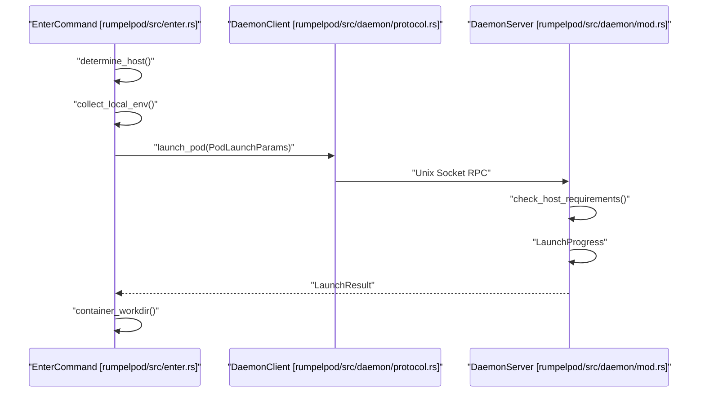
**Sources:** [rumpelpod/src/enter.rs:12-17](), [rumpelpod/src/enter.rs:33-37](), [rumpelpod/src/enter.rs:64-110](), [rumpelpod/src/enter.rs:112-154]()

### Key Functions
*   `determine_host`: Resolves the target execution environment (Local vs Remote) from CLI overrides or JSON config [rumpelpod/src/enter.rs:112-143]().
*   `collect_local_env`: Scans `devcontainer.json` for `${localEnv:...}` variables to forward to the daemon, as the daemon lacks access to the user's shell [rumpelpod/src/enter.rs:145-154]().
*   `container_workdir`: Maps the local machine's current directory to the corresponding path inside the container workspace [rumpelpod/src/enter.rs:33-37]().

## Development Workflow: `cargo pipeline`

Developers contributing to Rumpelpod must use `cargo pipeline` instead of standard cargo commands to ensure consistency and proper logging [AGENTS.md:7-12]().

### The Pipeline Execution Model

The `cargo pipeline` orchestrates several steps and records output to `target/xtest/<timestamp>.log` [AGENTS.md:7-10]().

**Diagram: Development Pipeline Entities**
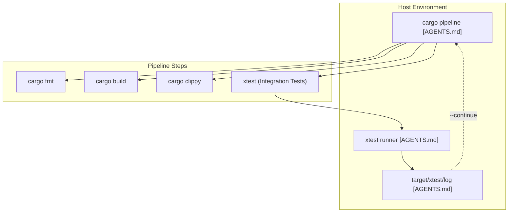
**Sources:** [AGENTS.md:7-17](), [AGENTS.md:25-31]()

### Pipeline Features
*   **Persistence**: It records test results. Using `--continue` allows the pipeline to resume by skipping tests that already passed [AGENTS.md:8-17]().
*   **Isolation**: The `xtest` runner executes each test in a separate process with its own timeout and retry logic [AGENTS.md:25-27]().
*   **Smoke Testing**: For rapid iteration, it is recommended to run specific smoke tests first, such as `enter_smoke_test`, `claude_smoke`, or `gateway_pod_commit_triggers_push` [AGENTS.md:13-15]().

## Contribution Rules

To maintain the integrity of the codebase, all developers must adhere to the following:
*   **DCO Sign-off**: Every commit must be signed off using `git commit -s`. This is enforced by a git hook [AGENTS.md:6](), [.devcontainer/commit-msg:1-9]().
*   **No Unicode**: Comments and code must remain in ASCII unless specifically testing Unicode support [AGENTS.md:34-35]().
*   **Explicit Matching**: Never use "default" or "fallthrough" when matching known variants; every case must be explicitly handled [AGENTS.md:40-41]().
*   **Error Handling**: Do not ignore errors. Prefer failing hard over continuing in a degraded state [AGENTS.md:42-46]().

**Sources:** [AGENTS.md:1-60](), [.devcontainer/commit-msg:1-10](), [CONTRIBUTING.md:61-74]()

---

# Page: Configuration Reference

# Configuration Reference

<details>
<summary>Relevant source files</summary>

The following files were used as context for generating this wiki page:

- [rumpelpod/src/config.rs](rumpelpod/src/config.rs)
- [rumpelpod/src/daemon/db.rs](rumpelpod/src/daemon/db.rs)
- [rumpelpod/src/daemon/host_connection.rs](rumpelpod/src/daemon/host_connection.rs)
- [rumpelpod/src/devcontainer.rs](rumpelpod/src/devcontainer.rs)
- [rumpelpod/tests/cli/devcontainer/build_paths.rs](rumpelpod/tests/cli/devcontainer/build_paths.rs)
- [rumpelpod/tests/cli/devcontainer/mod.rs](rumpelpod/tests/cli/devcontainer/mod.rs)
- [rumpelpod/tests/cli/k8s/mod.rs](rumpelpod/tests/cli/k8s/mod.rs)

</details>


Rumpelpod configuration is driven by two primary sources: the standard `devcontainer.json` for container environment definitions and an optional `.rumpelpod.json` for pod-specific orchestration settings. This page details the supported fields, the data structures used for parsing, and the mechanisms for environment variable substitution.

## 1. devcontainer.json Support

Rumpelpod utilizes `devcontainer.json` to define the base environment of a pod. It uses the `json5` parser to support comments and trailing commas [rumpelpod/src/config.rs:14-15](). The daemon captures the raw source of this file at pod creation and stores it in the SQLite database to ensure consistency for future operations like `fork` [rumpelpod/src/daemon/db.rs:88-90]().

### Supported Fields
The `DevContainer` struct in `rumpelpod/src/devcontainer.rs` defines the subset of the DevContainer spec supported by Rumpelpod:

| Field | Description | Code Reference |
| :--- | :--- | :--- |
| `image` | The base Docker image to use for the pod. | [rumpelpod/src/devcontainer.rs:110]() |
| `remoteUser` | The user to run devcontainer tools as inside the container. | [rumpelpod/src/devcontainer.rs:51]() |
| `containerUser` | User for all operations inside the container. | [rumpelpod/src/devcontainer.rs:55]() |
| `workspaceFolder` | Path to open when connecting to the container. | [rumpelpod/src/devcontainer.rs:134]() |
| `mounts` | Additional mounts for the container (e.g., `source=...,target=...`). | [rumpelpod/src/devcontainer.rs:91]() |
| `runArgs` | Docker CLI arguments for running the container. | [rumpelpod/src/devcontainer.rs:138]() |
| `containerEnv` | Environment variables set inside the container. | [rumpelpod/src/devcontainer.rs:43]() |
| `remoteEnv` | Environment variables for devcontainer tools/processes. | [rumpelpod/src/devcontainer.rs:47]() |
| `forwardPorts` | Ports to forward from the container to the local machine. | [rumpelpod/src/devcontainer.rs:31]() |
| `build` | Configuration for Dockerfile-based containers. | [rumpelpod/src/devcontainer.rs:114]() |
| `initializeCommand` | Command to run on the host during initialization. | [rumpelpod/src/devcontainer.rs:160]() |

**Sources:** [rumpelpod/src/devcontainer.rs:19-171](), [rumpelpod/src/config.rs:10-15](), [rumpelpod/src/daemon/db.rs:88-90]()

---

## 2. .rumpelpod.json Reference

The `.rumpelpod.json` file resides in the repository root and provides settings for the Rumpelpod daemon that lack a `devcontainer.json` equivalent, such as remote host definitions and agent behaviors [rumpelpod/src/config.rs:11-12]().

### Host Configuration
The `Host` enum determines where the pod is executed [rumpelpod/src/config.rs:109-150]().

*   **Localhost**: The local machine using Docker or Podman [rumpelpod/src/config.rs:111-114]().
*   **SSH**: A remote host accessed via SSH. Rumpelpod uses `ssh ... <engine> system dial-stdio` for communication [rumpelpod/src/daemon/host_connection.rs:11-13]().
*   **Kubernetes**: Execution within a K8s cluster [rumpelpod/src/config.rs:124-149]().
    *   `context`: The kubeconfig context name.
    *   `namespace`: K8s namespace (defaults to "default").
    *   `registry`: Required. The registry for pushing/pulling prepared images.
    *   `node_selector`: Optional map of labels for scheduling.
    *   `tolerations`: Optional list of `KubernetesToleration` objects.

### Container Engine Resolution
Rumpelpod supports `docker` and `podman` via the `ContainerEngine` enum [rumpelpod/src/config.rs:28-35](). The `Auto` setting prefers `docker` if found on the `PATH`, falling back to `podman` [rumpelpod/src/config.rs:61-67]().

### Configuration Data Flow
The `HostConnectionRegistry` manages the lifecycle of connections based on these configurations, ensuring that remote hosts have background monitors for liveness and reconnection [rumpelpod/src/daemon/host_connection.rs:138-142]().

**Configuration Resolution Diagram**
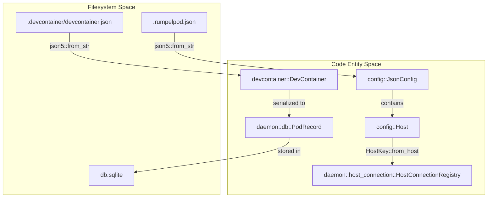
**Sources:** [rumpelpod/src/config.rs:109-150](), [rumpelpod/src/devcontainer.rs:19-171](), [rumpelpod/src/daemon/host_connection.rs:138-170](), [rumpelpod/src/daemon/db.rs:76-96]()

---

## 3. Environment Variable Substitution

Rumpelpod performs substitution on specific fields within `devcontainer.json` to allow dynamic configuration based on the host environment.

### Rules
1.  **Scope**: Substitution is primarily applied to `mounts`, `containerEnv`, `remoteEnv`, and `runArgs`.
2.  **Path Constraints**: Rumpelpod enforces strict security boundaries. For example, `dockerfile` and `context` paths in the `build` configuration must remain under the repository root [rumpelpod/tests/cli/devcontainer/build_paths.rs:52-77]().
3.  **Local Environment**: The `--local-env` CLI argument allows passing host environment variables into the pod, which are stored as a JSON array in the `PodRecord` [rumpelpod/src/daemon/db.rs:91-93]().

### Host to Pod Environment Mapping
The following diagram illustrates how host environment variables are resolved and passed into the container lifecycle.

**Variable Substitution Process**
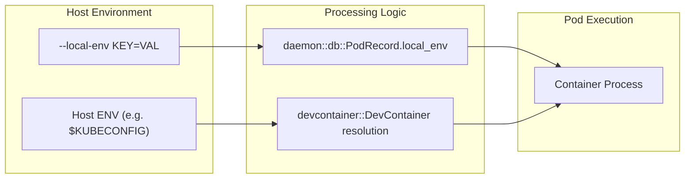
**Sources:** [rumpelpod/src/daemon/db.rs:91-93](), [rumpelpod/tests/cli/devcontainer/build_paths.rs:52-77](), [rumpelpod/src/config.rs:128-135]()

---

## 4. Kubernetes Specifics

When using the `Kubernetes` host type, Rumpelpod requires a `registry` to facilitate the transfer of locally built images to the cluster [rumpelpod/src/config.rs:133-134]().

### KubernetesToleration
The `KubernetesToleration` struct allows pods to be scheduled on nodes with specific taints [rumpelpod/src/config.rs:181-188]():
*   `key`: The taint key.
*   `operator`: `Equal` or `Exists`.
*   `value`: The taint value.
*   `effect`: `NoSchedule`, `PreferNoSchedule`, or `NoExecute`.

### Registry and Builder
If a `builder` (a `docker buildx` builder name) is not specified, Rumpelpod uses the local `image_builder` (Docker or Podman) to build the image before pushing it to the defined `registry` [rumpelpod/src/config.rs:140-149]().

**Sources:** [rumpelpod/src/config.rs:124-149](), [rumpelpod/src/config.rs:181-188](), [rumpelpod/tests/cli/k8s/mod.rs:112-136]()

---

# Page: Core Architecture

# Core Architecture

<details>
<summary>Relevant source files</summary>

The following files were used as context for generating this wiki page:

- [Cargo.lock](Cargo.lock)
- [THIRD-PARTY-NOTICES](THIRD-PARTY-NOTICES)
- [rumpelpod/Cargo.toml](rumpelpod/Cargo.toml)
- [rumpelpod/src/daemon.rs](rumpelpod/src/daemon.rs)
- [rumpelpod/src/daemon/protocol.rs](rumpelpod/src/daemon/protocol.rs)
- [rumpelpod/src/exec_proxy.rs](rumpelpod/src/exec_proxy.rs)
- [rumpelpod/src/list.rs](rumpelpod/src/list.rs)
- [rumpelpod/tests/cli/list.rs](rumpelpod/tests/cli/list.rs)
- [tools/Cargo.toml](tools/Cargo.toml)

</details>


The rumpelpod system is a distributed architecture designed to isolate LLM agents and development environments within containers (Pods) while maintaining a seamless experience on the host machine. It consists of three primary layers: the **CLI**, the **Daemon**, and the **Pod Server**.

### High-Level Component Interaction

The following diagram illustrates the relationship between the host-side components and the containerized environment.

**System Overview: Host to Pod Connectivity**
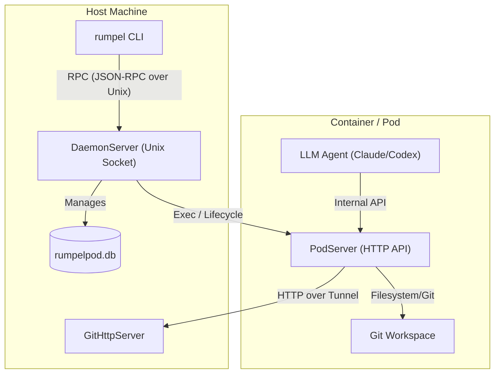
Sources: [rumpelpod/src/daemon.rs:4-8](), [rumpelpod/src/daemon.rs:37-40](), [rumpelpod/src/daemon/protocol.rs:4-9]()

---

### The Daemon (`DaemonServer`)

The daemon is the central orchestrator of the rumpelpod system. It runs as a background process on the host and manages the lifecycle of all pods.

- **Lifecycle Management**: Handles the creation, starting, stopping, and deletion of pods via the `Executor` abstraction [rumpelpod/src/daemon.rs:144-153]().
- **State Persistence**: Uses a SQLite database ([rumpelpod/src/daemon/db.rs]()) to track pod metadata, container IDs, and host associations.
- **RPC Interface**: Provides a Unix socket-based API defined in `protocol.rs` for the CLI to request actions like `enter`, `stop`, or `list` [rumpelpod/src/daemon/protocol.rs:4-46]().
- **Git Bridge**: Orchestrates the `GitHttpServer` which allows pods to fetch and push code back to the host repository through a secure tunnel [rumpelpod/src/daemon.rs:37-37]().

For details, see [Daemon](#2.1).

Sources: [rumpelpod/src/daemon.rs:4-10](), [rumpelpod/src/daemon/protocol.rs:186-200]()

---

### The Pod Server (`PodServerState`)

Every rumpelpod container runs a dedicated Rust binary in `container-serve` mode. This server acts as the "brain" inside the pod, providing a high-level API for LLM agents and the host CLI.

- **Agent Integration**: Exposes endpoints for Claude and Codex to interact with the environment safely, maintaining session state like `ClaudeState` and `CodexState` [rumpelpod/src/daemon/protocol.rs:172-176]().
- **Environment Resolution**: Probes the container's shell environment and merges it with `devcontainer.json` settings [rumpelpod/src/daemon.rs:98-107]().
- **Filesystem & Git**: Provides authenticated HTTP wrappers around filesystem operations and git commands to avoid raw `docker exec` overhead.
- **SSH Relay**: Manages a relay to allow the pod to use the host's SSH agent for remote git operations.

For details, see [Pod Server (In-Container HTTP API)](#2.2).

Sources: [rumpelpod/src/daemon/protocol.rs:47-70](), [rumpelpod/src/daemon.rs:128-136]()

---

### Executor Engine

Rumpelpod abstracts the underlying container runtime through the `Executor` trait. This allows the system to support multiple backends transparently.

| Backend | Code Entity | Description |
| :--- | :--- | :--- |
| **Docker** | `DockerBackend` | Local container management using the Docker CLI/Socket. |
| **Kubernetes** | `K8sBackend` | Remote pod management via `kubectl` and the `rumpelhub` companion. |

**Code Entity Mapping: Executor Abstraction**
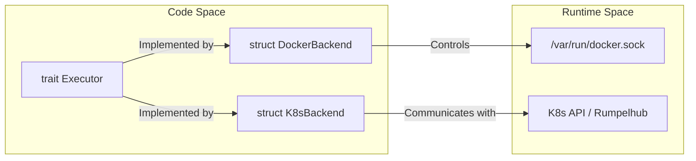
Sources: [rumpelpod/src/daemon.rs:35-35](), [rumpelpod/src/daemon.rs:54-73]()

For details, see [Executor Engine and Backend Abstraction](#2.3).

---

### Networking and Tunnels

Connectivity between the host and the pod is established using a multiplexed TCP tunnel. This tunnel is carried over the standard input/output streams of a `docker exec` or `kubectl exec` session, bypassing the need for exposed ports or complex VPNs.

- **Port Forwarding**: Allows the host to access services running inside the pod via `AddForwardedPortRequest` [rumpelpod/src/daemon/protocol.rs:41-43]().
- **Git Tunnel**: Specifically routes git traffic to the host's `GitHttpServer`.
- **HTTP Proxy**: The `exec_proxy` module provides a host-side proxy that translates standard TCP/HTTP requests into the tunnel protocol by exec-ing `rumpel tcp-proxy` inside the pod [rumpelpod/src/exec_proxy.rs:7-10]().

For details, see [Networking: Tunnels, Proxies, and Port Forwarding](#2.4).

Sources: [rumpelpod/src/exec_proxy.rs:41-50](), [rumpelpod/src/exec_proxy.rs:131-142]()

---

# Page: Daemon

# Daemon

<details>
<summary>Relevant source files</summary>

The following files were used as context for generating this wiki page:

- [rumpelpod/src/config.rs](rumpelpod/src/config.rs)
- [rumpelpod/src/daemon.rs](rumpelpod/src/daemon.rs)
- [rumpelpod/src/daemon/db.rs](rumpelpod/src/daemon/db.rs)
- [rumpelpod/src/daemon/host_connection.rs](rumpelpod/src/daemon/host_connection.rs)
- [rumpelpod/src/daemon/pod_connection.rs](rumpelpod/src/daemon/pod_connection.rs)
- [rumpelpod/src/daemon/protocol.rs](rumpelpod/src/daemon/protocol.rs)
- [rumpelpod/src/daemon/reconnect.rs](rumpelpod/src/daemon/reconnect.rs)
- [rumpelpod/src/list.rs](rumpelpod/src/list.rs)
- [rumpelpod/src/pty_session.rs](rumpelpod/src/pty_session.rs)
- [rumpelpod/tests/cli/k8s/mod.rs](rumpelpod/tests/cli/k8s/mod.rs)
- [rumpelpod/tests/cli/list.rs](rumpelpod/tests/cli/list.rs)

</details>


The `DaemonServer` is the central orchestrator of the rumpelpod system. It runs as a background process on the host machine, managing the lifecycle of isolated agent environments (pods), persisting state in a local database, and providing an RPC interface for the CLI via a Unix domain socket.

## Architecture and Lifecycle Management

The daemon acts as a bridge between the user's local repository and the containerized execution environment. It handles the complexities of image building, container configuration, and networking setup.

### Pod Lifecycle Operations
The daemon implements core lifecycle operations defined in the `Daemon` trait [rumpelpod/src/daemon/protocol.rs:252-308]():

*   **Launch/Recreate**: Resolves `devcontainer.json`, builds the environment-specific image, and starts the container. Recreate specifically replaces an existing container while preserving its identity in the database [rumpelpod/src/daemon.rs:983-1025]().
*   **Fork**: Creates a new pod by snapshotting a source pod. It captures the source's `devcontainer.json`, environment variables, and git state [rumpelpod/src/daemon.rs:1054-1092]().
*   **Stop/Delete**: Gracefully shuts down containers and removes associated resources. Deletion is performed via background tasks to ensure the CLI remains responsive [rumpelpod/src/daemon.rs:1237-1253]().
*   **Merge**: Facilitates the transfer of changes from a pod back to the host repository by orchestrating git operations between the two environments.

### Code Entity Map: Lifecycle Flow
The following diagram maps the natural language operations to the specific internal functions and data structures used during a pod launch.

**Diagram: Pod Launch Logic Flow**
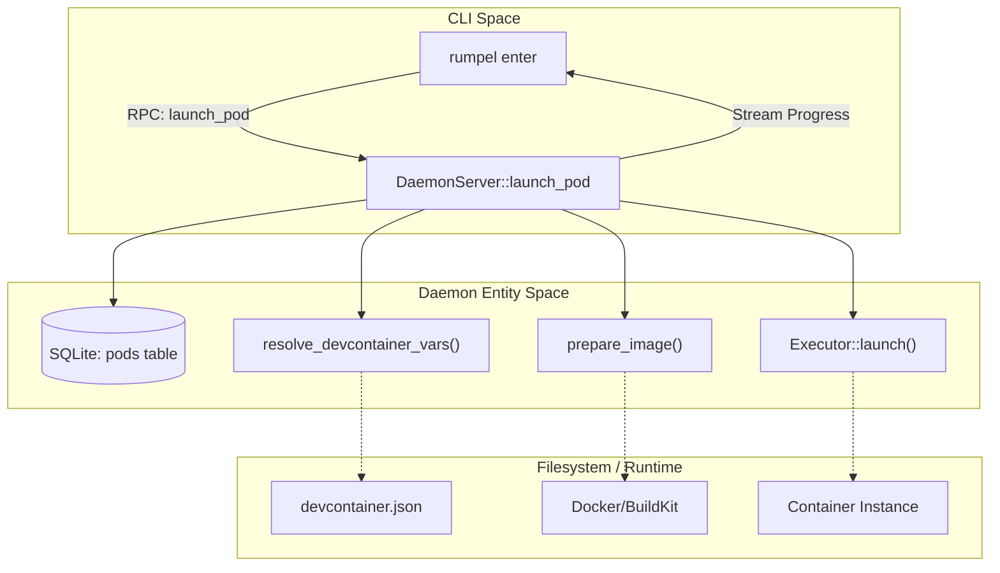
Sources: [rumpelpod/src/daemon.rs:910-968](), [rumpelpod/src/daemon/protocol.rs:252-262](), [rumpelpod/src/devcontainer.rs:885-910]()

## State Persistence (SQLite)

The daemon uses a local SQLite database to maintain a source of truth for all pods across sessions. This allows the daemon to be restarted without losing track of running containers or their configurations.

### Database Schema
The database (managed via `rusqlite`) is stored at `$XDG_STATE_HOME/rumpelpod/db.sqlite` [rumpelpod/src/daemon/db.rs:98-110](). The `pods` table includes:
*   `repo_path`: The host-side path to the git repository [rumpelpod/src/daemon/db.rs:78]().
*   `name`: The unique identifier for the pod within that repo [rumpelpod/src/daemon/db.rs:79]().
*   `status`: The current lifecycle state (e.g., `initializing`, `ready`, `deleting`) [rumpelpod/src/daemon/db.rs:34-47]().
*   `devcontainer_json`: The resolved configuration captured at creation [rumpelpod/src/daemon/db.rs:90]().
*   `local_env`: JSON-serialized "KEY=VALUE" strings of host environment variables [rumpelpod/src/daemon/db.rs:93]().

Sources: [rumpelpod/src/daemon/db.rs:34-152](), [rumpelpod/src/daemon.rs:178-188]()

## Unix Socket RPC Protocol

Communication between the CLI and the daemon occurs over a Unix domain socket, typically located at `/tmp/rumpelpod.sock` (configurable via `RUMPELPOD_DAEMON_SOCKET`) [rumpelpod/src/daemon.rs:49-50]().

### Protocol Implementation
The protocol uses `axum` over a `UnixListener` [rumpelpod/src/daemon.rs:1398-1415](). It leverages JSON-RPC style interactions but is optimized for streaming responses (e.g., build logs) using Server-Sent Events (SSE).

**Key Protocol Structures:**
*   `PodLaunchParams`: Encapsulates everything needed to start a pod, including `pod_name`, `repo_path`, and `local_env_vars` [rumpelpod/src/daemon/protocol.rs:186-210]().
*   `LaunchResult`: Returns the `container_url` and `container_token` required for the CLI to connect to the internal Pod Server [rumpelpod/src/daemon/protocol.rs:49-70]().

Sources: [rumpelpod/src/daemon/protocol.rs:4-27](), [rumpelpod/src/daemon.rs:1398-1427]()

## Host and Pod Connections

The daemon manages connectivity through two specialized registries: `HostConnectionRegistry` and `PodConnectionRegistry`.

### Host Connectivity
A `HostConnection` represents a communication channel to a backend (Localhost, SSH, or Kubernetes) [rumpelpod/src/daemon/host_connection.rs:6-28](). It runs a background monitor that performs liveness probes and manages reconnection for all pods on that host [rumpelpod/src/daemon/host_connection.rs:16-22]().

### Pod Connectivity
A `PodConnection` owns host-side resources specific to a running pod, including the `ExecProxyHandle` for the pod server, the `TunnelHandle` for git traffic, and optional SSH agents or LLM proxies [rumpelpod/src/daemon/pod_connection.rs:6-9]().

**Diagram: Connection and State Mapping**
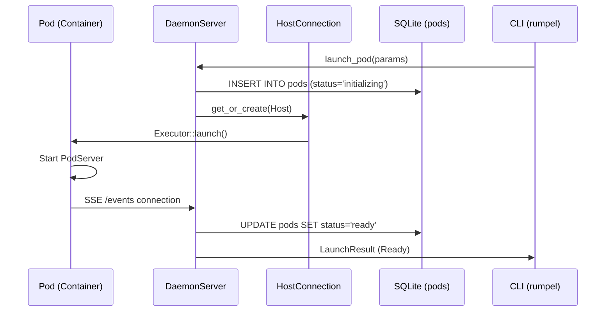
Sources: [rumpelpod/src/daemon/host_connection.rs:138-170](), [rumpelpod/src/daemon/pod_connection.rs:98-142](), [rumpelpod/src/daemon/reconnect.rs:8-22]()

## Key Functions and Classes

| Entity | File | Description |
| :--- | :--- | :--- |
| `DaemonServer` | [rumpelpod/src/daemon.rs:1342]() | The main struct implementing the `Daemon` RPC trait. |
| `HostConnectionRegistry` | [rumpelpod/src/daemon/host_connection.rs:138]() | Deduplicates and manages background monitors for remote hosts. |
| `PodConnection` | [rumpelpod/src/daemon/pod_connection.rs:98]() | Manages proxies, tunnels, and the event loop for a specific pod. |
| `prepare_image` | [rumpelpod/src/daemon.rs:245]() | Orchestrates the `devcontainer` build process and image tagging. |
| `ReconnectEvent` | [rumpelpod/src/daemon/reconnect.rs:11]() | Enum for events streamed to clients during connection attempts. |

Sources: [rumpelpod/src/daemon.rs:1342-1382](), [rumpelpod/src/daemon/host_connection.rs:138-150](), [rumpelpod/src/daemon/pod_connection.rs:98-111]()

---

# Page: Pod Server (In-Container HTTP API)

# Pod Server (In-Container HTTP API)

<details>
<summary>Relevant source files</summary>

The following files were used as context for generating this wiki page:

- [rumpelpod/src/cp.rs](rumpelpod/src/cp.rs)
- [rumpelpod/src/pod/client.rs](rumpelpod/src/pod/client.rs)
- [rumpelpod/src/pod/git_setup.rs](rumpelpod/src/pod/git_setup.rs)
- [rumpelpod/src/pod/pty.rs](rumpelpod/src/pod/pty.rs)
- [rumpelpod/src/pod/server.rs](rumpelpod/src/pod/server.rs)
- [rumpelpod/src/pod/types.rs](rumpelpod/src/pod/types.rs)
- [rumpelpod/src/tunnel.rs](rumpelpod/src/tunnel.rs)
- [rumpelpod/tests/cli/common.rs](rumpelpod/tests/cli/common.rs)
- [rumpelpod/tests/cli/fork.rs](rumpelpod/tests/cli/fork.rs)
- [rumpelpod/tests/cli/gateway/mod.rs](rumpelpod/tests/cli/gateway/mod.rs)
- [rumpelpod/tests/cli/pi/install.rs](rumpelpod/tests/cli/pi/install.rs)

</details>


The Pod Server is a specialized HTTP service that runs inside every Rumpelpod container as the devcontainer user. It is the primary interface through which the host-side daemon interacts with the container's internals, replacing complex shell-script composition via `docker exec` with a structured, type-safe Rust API.

## Overview and Purpose

The server is started via the `rumpel container-serve` command after the Rumpelpod binary is injected into the container [rumpelpod/src/pod/server.rs:4-10](). It binds to an ephemeral port on `127.0.0.1` and records this port in `/opt/rumpelpod/server-port` for internal consumers [rumpelpod/src/pod/server.rs:7-8]().

Key responsibilities include:
*   **Filesystem Operations**: High-performance file reading, writing, and tar-based transfers [rumpelpod/src/pod/types.rs:22-31]().
*   **Git Management**: Local repository setup, branch management, and dirty-tree patching [rumpelpod/src/pod/git_setup.rs:4-7]().
*   **LLM Agent Integration**: Hosting WebSocket bridges for Claude, Codex, and Grok, including state monitoring [rumpelpod/src/pod/pty.rs:4-8]().
*   **Lifecycle Management**: Executing `postStartCommand` and other devcontainer lifecycle hooks [rumpelpod/src/pod/server.rs:169-171]().
*   **SSH Relay**: Providing an in-container SSH agent socket that relays requests back to the host [rumpelpod/src/pod/server.rs:33]().

**Sources:** [rumpelpod/src/pod/server.rs:4-10](), [rumpelpod/src/pod/server.rs:31-33](), [rumpelpod/src/pod/types.rs:22-31]()

---

## Startup Lifecycle and Environment Resolution

The server follows a strict startup sequence to ensure the environment is fully resolved before allowing agent interactions.

### 1. User Switching and Tunnel Detection
The process starts as `root` (via `docker exec`) but immediately drops privileges to the container user identified during the image build using `switch_user()` [rumpelpod/src/pod/server.rs:132-140](). It then detects the `tunnel-server` port from the `TUNNEL_PORT_FILE` to establish connectivity to the host-side Git HTTP bridge [rumpelpod/src/pod/server.rs:145-148]().

### 2. The Setup Task
While the HTTP server binds immediately to serve `/events`, a background "Setup Task" handles long-running initialization [rumpelpod/src/pod/server.rs:152-155]():
1.  **Environment Probing**: Resolves the full environment by merging the base container env, probed shell env (e.g., from `.bashrc`), and `remoteEnv` settings [rumpelpod/src/pod/server.rs:99-101]().
2.  **Git Initialization**: Clones the repository and configures remotes using the `GitSetupParams` provided at startup [rumpelpod/src/pod/server.rs:133-134]().
3.  **Lifecycle Hooks**: Executes `postStartCommand` and `postAttachCommand` [rumpelpod/src/pod/server.rs:169-171]().

### 3. State Management
The `PodServerState` struct acts as the central synchronization point for all in-container activities.

| Field | Type | Purpose |
| :--- | :--- | :--- |
| `pty_sessions` | `PtySessions` | Manages active terminal sessions for agents [rumpelpod/src/pod/server.rs:78]() |
| `resolved_env` | `Arc<Mutex<HashMap>>` | The final environment used for all sub-processes [rumpelpod/src/pod/server.rs:101]() |
| `setup_progress` | `broadcast::Sender` | Streams progress updates to the host via SSE [rumpelpod/src/pod/server.rs:110]() |
| `claude_state` | `watch::Sender` | Tracks if Claude is processing or waiting for input [rumpelpod/src/pod/server.rs:88]() |
| `push_gate` | `Arc<Semaphore>` | Serializes recovery pushes to prevent git lock races [rumpelpod/src/pod/server.rs:98]() |

**Sources:** [rumpelpod/src/pod/server.rs:77-117](), [rumpelpod/src/pod/server.rs:128-171]()

---

## API Endpoints

The server implements a variety of routes to support the `rumpel` CLI operations, defined in `run_container_server` [rumpelpod/src/pod/server.rs:128]().

### Filesystem and Transfer
*   `GET /fs/read`: Returns base64-encoded file content via `FsReadResponse` [rumpelpod/src/pod/types.rs:23-31]().
*   `GET /cp` / `POST /cp`: Tar-based streaming for directory transfers [rumpelpod/src/pod/types.rs:113-116]().
*   `POST /write-home-files`: Bulk write of configuration files (e.g., `.claude/settings.json`) to the user's home directory [rumpelpod/src/pod/types.rs:142-148]().

### Git Integration
*   `GET /git/patch`: Generates a patch of the current dirty working tree [rumpelpod/src/pod/types.rs:33-35]().
*   `POST /git/patch`: Applies a patch to the working tree [rumpelpod/src/pod/types.rs:33-35]().
*   `GET /state`: Returns `StateResponse` containing branch SHAs and agent state flags for pod forking [rumpelpod/src/pod/types.rs:43-60]().

### LLM Agent and PTY
*   `GET /claude`: WebSocket route for Claude CLI sessions [rumpelpod/src/pod/pty.rs:64-76]().
*   `GET /grok`: WebSocket route for Grok CLI sessions [rumpelpod/src/pod/pty.rs:114-126]().
*   `GET /pi`: WebSocket route for Pi CLI sessions [rumpelpod/src/pod/pty.rs:100-112]().
*   `POST /notify-claude-state`: Endpoint for in-container hooks to report agent status [rumpelpod/src/pod/types.rs:195-197]().

**Sources:** [rumpelpod/src/pod/types.rs:22-204](), [rumpelpod/src/pod/pty.rs:64-126]()

---

## Data Flow: Host to Container Interaction

The following diagram illustrates how a command like `rumpel claude` traverses the system to the in-container `PodServer`.

### Command Execution Flow
"Logic Space" to "Code Entity Space" mapping for an agent session.

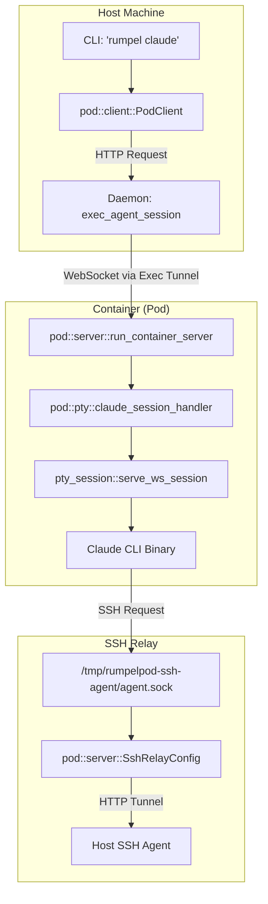

**Sources:** [rumpelpod/src/pod/server.rs:128-135](), [rumpelpod/src/pod/pty.rs:64-76](), [rumpelpod/src/pod/server.rs:33](), [rumpelpod/src/pod/server.rs:65-70]()

---

## Agent Session Management

Agent sessions (Claude, Grok, Pi) are handled via a specialized PTY bridge. The `PodServer` resolves the binary path for the agent (e.g., `CLAUDE_CONTAINER_BIN`) and uses `CmdTransform` to ensure the correct executable is invoked within the resolved environment [rumpelpod/src/pod/pty.rs:26-58]().

### Agent State Monitoring
The server tracks the status of LLM agents to provide feedback to the user and the daemon.

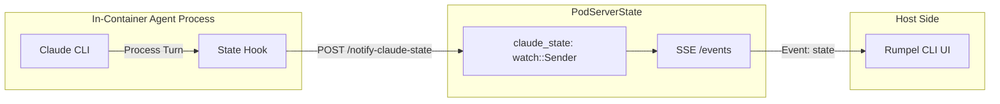

**Sources:** [rumpelpod/src/pod/types.rs:180-197](), [rumpelpod/src/pod/server.rs:88-90](), [rumpelpod/src/pod/pty.rs:69-74]()

---

## SSH Agent Relay

To allow agents to perform git operations (like pushing to a remote), the Pod Server provides an SSH agent relay.
1.  It creates a Unix socket at `SSH_AGENT_SOCK_PATH` (`/tmp/rumpelpod-ssh-agent/agent.sock`) [rumpelpod/src/pod/server.rs:33]().
2.  The `SshRelayConfig` stores the URL and token for the host-side Git HTTP server [rumpelpod/src/pod/server.rs:65-70]().
3.  When a process inside the container connects to the socket, the server relays the SSH protocol traffic over the existing HTTP tunnel back to the host's `ssh-agent`.

**Sources:** [rumpelpod/src/pod/server.rs:33](), [rumpelpod/src/pod/server.rs:65-70](), [rumpelpod/src/pod/server.rs:79]()

---

# Page: Executor Engine and Backend Abstraction

# Executor Engine and Backend Abstraction

<details>
<summary>Relevant source files</summary>

The following files were used as context for generating this wiki page:

- [Cargo.lock](Cargo.lock)
- [THIRD-PARTY-NOTICES](THIRD-PARTY-NOTICES)
- [rumpelpod/Cargo.toml](rumpelpod/Cargo.toml)
- [rumpelpod/src/exec_proxy.rs](rumpelpod/src/exec_proxy.rs)
- [rumpelpod/src/executor/engine.rs](rumpelpod/src/executor/engine.rs)
- [rumpelpod/src/executor/mod.rs](rumpelpod/src/executor/mod.rs)
- [rumpelpod/src/executor/podman_ssh.rs](rumpelpod/src/executor/podman_ssh.rs)
- [rumpelpod/src/executor/spec.rs](rumpelpod/src/executor/spec.rs)
- [rumpelpod/src/k8s.rs](rumpelpod/src/k8s.rs)
- [rumpelpod/src/registry.rs](rumpelpod/src/registry.rs)
- [tools/Cargo.toml](tools/Cargo.toml)

</details>


The Executor engine provides a unified interface for managing pod lifecycles and executing commands across different container runtimes. By abstracting the specific API calls for Docker and Kubernetes behind a common `Executor` type, rumpelpod ensures that the daemon and CLI can operate identically regardless of whether the environment is a local developer machine or a remote cluster.

## The Executor Trait and Backend Dispatch

The `Executor` struct acts as a dispatcher that routes requests to either a `DockerBackend` or a `K8sBackend` via an internal `Inner` enum [rumpelpod/src/executor/engine.rs:34-43](). This abstraction covers pod creation, status monitoring, deletion, and various execution modes.

The `Executor` is constructed using specialized constructors based on the target host:
*   `Executor::docker`: Connects via a Unix socket [rumpelpod/src/executor/engine.rs:68-80]().
*   `Executor::docker_ssh`: Connects using Docker's native SSH transport [rumpelpod/src/executor/engine.rs:82-92]().
*   `Executor::podman`: Interacts with the local Podman store [rumpelpod/src/executor/engine.rs:94-103]().
*   `Executor::kubernetes`: Connects to a cluster via a specific context and namespace [rumpelpod/src/executor/engine.rs:162-169]().

### Code Entity Mapping: Executor Engine

The following diagram maps the high-level executor concepts to the specific code entities that implement them.

**Executor Backend Architecture**
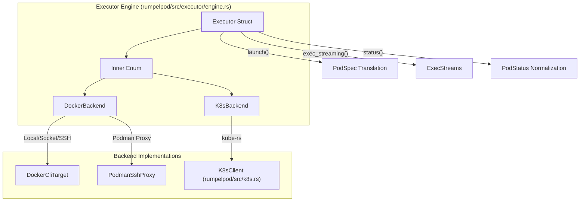
Sources: [rumpelpod/src/executor/engine.rs:34-65](), [rumpelpod/src/executor/engine.rs:177-198](), [rumpelpod/src/executor/podman_ssh.rs:32-39]()

## Pod Launch Sequences

Launching a pod involves translating a generic `PodSpec` into backend-specific configurations. The `PodSpec` contains common fields (image, env, mounts) and backend-specific buckets (`DockerOnly`, `K8sOnly`) [rumpelpod/src/executor/spec.rs:20-42]().

### Pod Identification
Rumpelpod uses a `PodId` derived from the logical pod name and a hash of the repository path to ensure uniqueness across different projects [rumpelpod/src/executor/mod.rs:181-205]().
*   **Docker:** Uses labels like `dev.rumpelpod.name` and `dev.rumpelpod.repo_path` [rumpelpod/src/executor/mod.rs:36-38]().
*   **Kubernetes:** Uses labels like `rumpelpod/pod-name` and `rumpelpod/repo-hash` [rumpelpod/src/executor/mod.rs:45-46]().

### Backend-Specific Launch Details
*   **Docker:** Mounts are handled as `Bind`, `Volume`, or `Tmpfs` [rumpelpod/src/executor/spec.rs:54-59](). The executor handles security options like `privileged` mode and `cap_add` [rumpelpod/src/executor/spec.rs:31-32]().
*   **Kubernetes:** Mounts are typically translated to `emptyDir` volumes [rumpelpod/src/k8s.rs:144-157](). The executor configures `securityContext` for capabilities and seccomp profiles [rumpelpod/src/k8s.rs:173-200]().

Sources: [rumpelpod/src/executor/mod.rs:50-81](), [rumpelpod/src/executor/spec.rs:20-42](), [rumpelpod/src/k8s.rs:120-167]()

## Execution Modes and Stream Demuxing

The engine supports various execution patterns, returning an `ExecOutput` (buffered) or `ExecStreams` (streaming) [rumpelpod/src/executor/spec.rs:115-134]().

### 1. Streaming and Interactive Mode
`ExecStreams` provides `AsyncRead` handles for `stdout` and `stderr`, and an `AsyncWrite` handle for `stdin` [rumpelpod/src/executor/spec.rs:126-134](). 
*   **Podman SSH Proxy:** For Podman on remote hosts, rumpelpod spawns a `PodmanSshProxy`. This creates a local Unix socket that tunnels traffic via `ssh ... podman system dial-stdio`, allowing the local podman CLI to interact with remote containers [rumpelpod/src/executor/podman_ssh.rs:4-18]().

### 2. Stream Demuxing and Tunnels
Rumpelpod uses exec streams as a transport for other services. For example, `start_exec_proxy` spawns `rumpel tcp-proxy` inside a pod and bridges a local TCP listener to the pod's internal ports over the exec's stdin/stdout [rumpelpod/src/exec_proxy.rs:41-50]().

**Command Execution Flow**
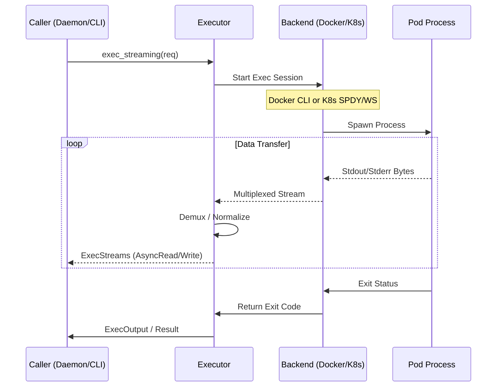
Sources: [rumpelpod/src/executor/spec.rs:121-134](), [rumpelpod/src/exec_proxy.rs:131-149](), [rumpelpod/src/executor/podman_ssh.rs:160-174]()

## Exit Code Normalization

The Executor engine ensures that exit codes are consistently reported as `i32` regardless of the underlying transport [rumpelpod/src/executor/spec.rs:118]().

*   **Success:** `0`.
*   **Process Exit:** The specific code returned by the shell or binary inside the container.
*   **Signals:** Normalized according to standard Unix conventions (e.g., 128 + signal number).
*   **Errors:** Errors in the executor itself (e.g., failed to reach the Docker socket) are returned as `anyhow::Result` failures rather than exit codes [rumpelpod/src/executor/engine.rs:177-182]().

Sources: [rumpelpod/src/executor/spec.rs:115-119](), [rumpelpod/src/executor/engine.rs:177-198]()

---

# Page: Networking: Tunnels, Proxies, and Port Forwarding

# Networking: Tunnels, Proxies, and Port Forwarding

<details>
<summary>Relevant source files</summary>

The following files were used as context for generating this wiki page:

- [Cargo.lock](Cargo.lock)
- [THIRD-PARTY-NOTICES](THIRD-PARTY-NOTICES)
- [rumpelpod/Cargo.toml](rumpelpod/Cargo.toml)
- [rumpelpod/src/daemon/pod_connection.rs](rumpelpod/src/daemon/pod_connection.rs)
- [rumpelpod/src/exec_proxy.rs](rumpelpod/src/exec_proxy.rs)
- [rumpelpod/src/git.rs](rumpelpod/src/git.rs)
- [rumpelpod/src/hook.rs](rumpelpod/src/hook.rs)
- [rumpelpod/src/pod/git_setup.rs](rumpelpod/src/pod/git_setup.rs)
- [rumpelpod/src/pty_session.rs](rumpelpod/src/pty_session.rs)
- [rumpelpod/src/tunnel.rs](rumpelpod/src/tunnel.rs)
- [tools/Cargo.toml](tools/Cargo.toml)

</details>


Rumpelpod establishes connectivity between the host machine and isolated containers (pods) using a multi-layered networking stack. Because pods may run in environments without direct IP routability (such as remote Kubernetes clusters or restricted Docker networks), rumpelpod relies on multiplexed TCP tunnels and ephemeral proxies carried over standard container execution streams (`stdin`/`stdout`).

## The Multiplexed Tunnel

The foundation of rumpelpod's networking is the `tunnel` module. It implements a framing protocol that carries multiple TCP streams over a single pair of byte streams established by exec-ing into the container [rumpelpod/src/tunnel.rs:4-9]().

### Framing Protocol
The tunnel uses a simple binary framing format:
- `stream_id` (u32 LE): Unique identifier for the sub-stream [rumpelpod/src/tunnel.rs:12]().
- `frame_type` (u8): One of `OPEN` (0x01), `DATA` (0x02), or `CLOSE` (0x03) [rumpelpod/src/tunnel.rs:14-17](), [rumpelpod/src/tunnel.rs:38-40]().
- `payload_len` (u32 LE): Length of the subsequent data, capped at 64 KiB [rumpelpod/src/tunnel.rs:12](), [rumpelpod/src/tunnel.rs:43]().

### Implementation Components
1.  **Tunnel Server (`run_tunnel_server`)**: Runs inside the container. It binds a TCP listener on loopback, assigns stream IDs, and multiplexes accepted connections over stdout [rumpelpod/src/tunnel.rs:19-21](), [rumpelpod/src/tunnel.rs:108-112](). It writes its port to a discovery file [rumpelpod/src/tunnel.rs:146-148]().
2.  **Tunnel Client (`start_tunnel`)**: Runs on the host. It uses `Executor::exec_streaming` to launch the server in the pod, demultiplexes frames from the pod's stdout, and opens local TCP connections to target host addresses [rumpelpod/src/tunnel.rs:22-25]().

**Diagram: Multiplexed Stream Data Flow**
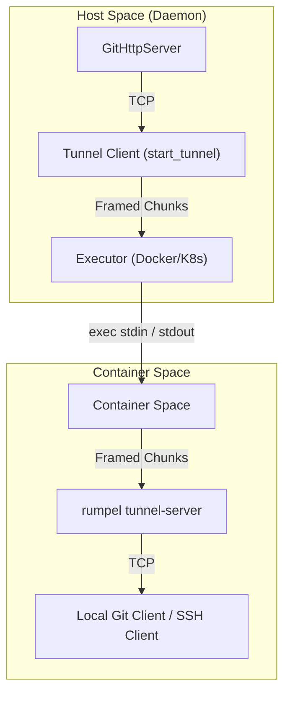
**Sources:** [rumpelpod/src/tunnel.rs:4-25](), [rumpelpod/src/tunnel.rs:108-152]()

## Exec-Based TCP Proxies

Rumpelpod uses `exec_proxy` to route traffic into the container without requiring open ports on the container's network interface or bridge IPs.

### `ExecProxyHandle`
Instead of traditional port forwarding, the daemon calls `start_exec_proxy`, which binds a local port on the host [rumpelpod/src/exec_proxy.rs:41-48](). For every accepted connection on this host port, the daemon execs `rumpel tcp-proxy --port <target>` into the pod [rumpelpod/src/exec_proxy.rs:131-142]().

The `bridge_connection` function then pipes the host's TCP stream directly into the `stdin`/`stdout` of the `tcp-proxy` process inside the pod [rumpelpod/src/exec_proxy.rs:169-201](). This mechanism is used to reach the in-container `PodServer` [rumpelpod/src/daemon/pod_connection.rs:188-192]().

**Sources:** [rumpelpod/src/exec_proxy.rs:4-10](), [rumpelpod/src/exec_proxy.rs:125-142](), [rumpelpod/src/daemon/pod_connection.rs:182-192]()

## Git Integration and Synchronization

To synchronize code, rumpelpod runs a `GitHttpServer` on the host, which pods access via the tunnel.

1.  **Host Side**: The daemon manages a `GitHttpServer` that serves the local repository [rumpelpod/src/daemon/pod_connection.rs:7-9]().
2.  **Pod Side**: The `setup_git_impl` function configures the container's git remotes (`host` and `rumpelpod`) to point to the tunneled loopback address [rumpelpod/src/pod/git_setup.rs:86-96]().
3.  **Hooks**: A `reference-transaction` hook is installed in the pod repo [rumpelpod/src/pod/git_setup.rs:175-176](). When a commit is made in the pod, this hook automatically pushes the update back to the host via the `rumpelpod` remote [rumpelpod/src/hook.rs:97-109]().

**Sources:** [rumpelpod/src/pod/git_setup.rs:86-111](), [rumpelpod/src/hook.rs:97-134](), [rumpelpod/src/daemon/pod_connection.rs:73-75]()

## SSH Agent Relay

Rumpelpod allows the pod to use the host's SSH keys via an agent relay, enabling git operations against remote servers (like GitHub) from within the isolated pod.

- **Pod Setup**: The `PodServer` creates a Unix socket at a specific path inside the container [rumpelpod/src/daemon/pod_connection.rs:8-9]().
- **Relay**: The `SshAgentHandle` on the host side manages the lifecycle of the relay, ensuring that requests to the in-pod socket are tunneled back to the host's `SSH_AUTH_SOCK`.

**Sources:** [rumpelpod/src/daemon/pod_connection.rs:7-9](), [rumpelpod/src/daemon/pod_connection.rs:77-79]()

## Code Entity Map: Networking Components

The following diagrams map logical networking concepts to specific code entities and files.

**Diagram: In-Container Networking Entities**
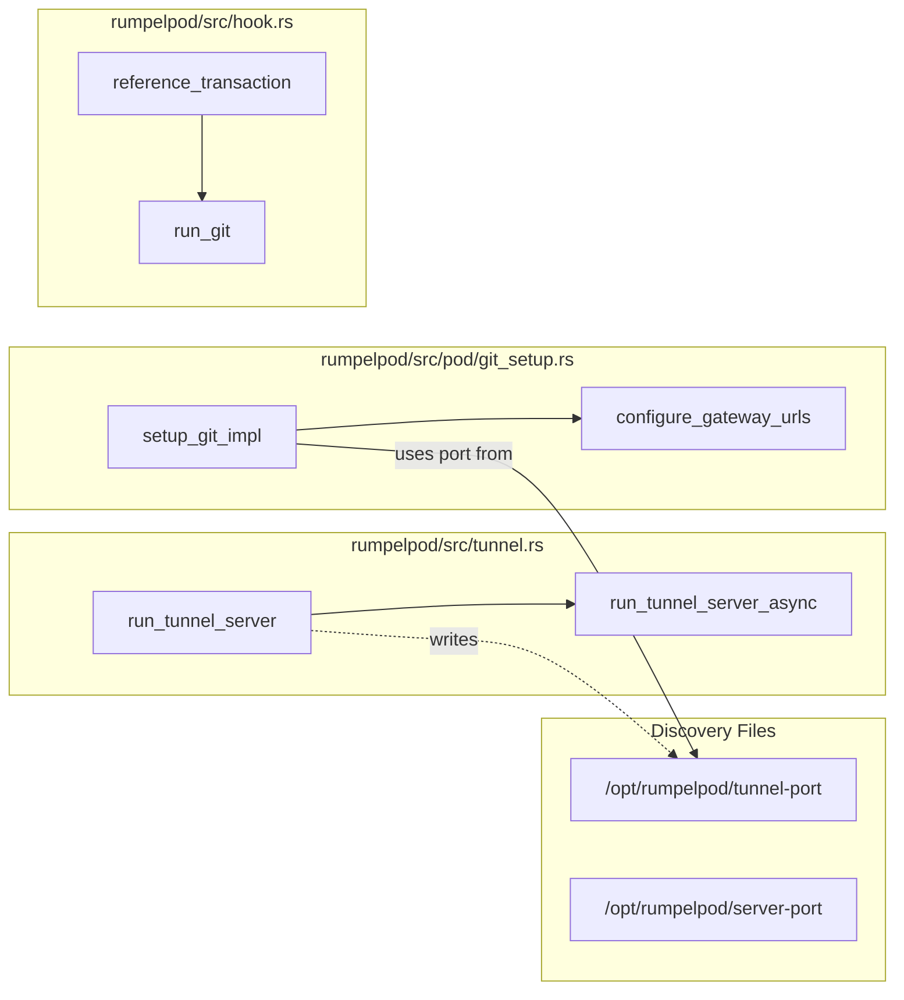
**Sources:** [rumpelpod/src/tunnel.rs:108-152](), [rumpelpod/src/pod/git_setup.rs:86-96](), [rumpelpod/src/hook.rs:97-134]()

**Diagram: Host-Side Daemon Networking**
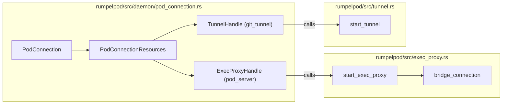
**Sources:** [rumpelpod/src/daemon/pod_connection.rs:73-80](), [rumpelpod/src/exec_proxy.rs:41-50](), [rumpelpod/src/daemon/pod_connection.rs:182-192]()

---

# Page: CLI Commands Reference

# CLI Commands Reference

<details>
<summary>Relevant source files</summary>

The following files were used as context for generating this wiki page:

- [rumpelpod/src/cli.rs](rumpelpod/src/cli.rs)
- [rumpelpod/src/completions.rs](rumpelpod/src/completions.rs)
- [rumpelpod/src/lib.rs](rumpelpod/src/lib.rs)
- [rumpelpod/src/prepared_image.rs](rumpelpod/src/prepared_image.rs)
- [rumpelpod/tests/cli/codex/install.rs](rumpelpod/tests/cli/codex/install.rs)

</details>


The `rumpel` CLI is the primary interface for managing isolated development environments (pods) and interacting with LLM agents. The CLI follows a subcommand pattern, routing requests to the background `DaemonServer` or executing local synchronization tasks.

### Command Structure Overview

The CLI is implemented using `clap` in [rumpelpod/src/cli.rs:123-126](). It categorizes functionality into pod management, agent orchestration, and system maintenance. The main entry point for command dispatch is located in `rumpelpod/src/lib.rs`.

| Category | Primary Commands | Responsibility |
| :--- | :--- | :--- |
| **Lifecycle** | `enter`, `stop`, `delete`, `recreate`, `fork` | Managing the state and existence of containers. |
| **Synchronization** | `merge`, `review`, `cp`, `ssh-add` | Moving code and credentials between host and pod. |
| **Agents** | `claude`, `codex`, `grok`, `pi` | Launching LLM-driven autonomous sessions. |
| **Infrastructure** | `image`, `hub`, `system-install` | Managing base images, K8s hubs, and local services. |

### CLI to Code Mapping

The following diagram bridges the user-facing CLI commands to their respective entry points and internal handlers.

**Command Dispatch Architecture**
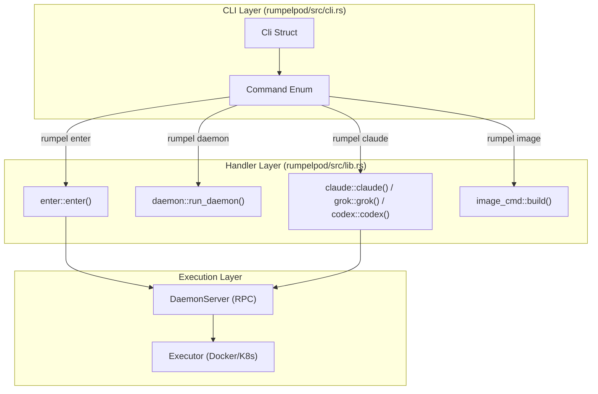
Sources: [rumpelpod/src/cli.rs:136-248](), [rumpelpod/src/lib.rs:107-217]()

---

### Pod Lifecycle Commands
These commands manage the creation, execution, and termination of pods. Most lifecycle commands communicate with the `DaemonClient` to update the state in the SQLite database and trigger `Executor` actions.

*   **`enter`**: The primary entry point. It resolves the `devcontainer.json`, ensures the image exists, and launches an interactive shell or command [rumpelpod/src/lib.rs:155-157]().
*   **`list`**: Queries the daemon for all pods associated with the current repository [rumpelpod/src/lib.rs:158-160]().
*   **`fork`**: Creates a new pod based on the current state of an existing pod [rumpelpod/src/lib.rs:179-181]().
*   **`stop`**: Gracefully halts pod containers while preserving their state [rumpelpod/src/lib.rs:161-163]().

For detailed usage and flag references, see [Pod Lifecycle Commands](#3.1).

---

### LLM Agent Commands
Rumpelpod provides specialized commands to launch LLM agents inside pods. These commands handle the complexity of PTY (Pseudo-Terminal) allocation, credential forwarding, and pre-installing the agent binaries into "prepared" images [rumpelpod/src/prepared_image.rs:4-7]().

*   **`claude`**: Launches the Anthropic Claude engineer agent [rumpelpod/src/lib.rs:195-202]().
*   **`codex`**: Launches the Codex agent, ensuring the version matches the host's version [rumpelpod/src/lib.rs:203-205](), [rumpelpod/tests/cli/codex/install.rs:23-25]().
*   **`grok`**: Launches the xAI Grok agent [rumpelpod/src/lib.rs:209-211]().
*   **`pi`**: Launches the Pi coding agent [rumpelpod/src/lib.rs:206-208]().

For details on session management and "always-approve" hooks, see [LLM Agent Commands](#3.2).

---

### Image Management Commands
These commands handle the building and distribution of the `devcontainer` images and "prepared" images that include rumpelpod binaries.

*   **`image build`**: Uses `docker buildx` to create a deterministic, content-addressed image based on the `devcontainer.json` definition [rumpelpod/src/lib.rs:183]().
*   **`image fetch`**: Pulls the required image from a remote registry, particularly useful in Kubernetes environments [rumpelpod/src/lib.rs:184]().
*   **`prepare-image`**: Internal command to bake the repository and agent CLIs into a new image layer [rumpelpod/src/lib.rs:215-217]().

For details on the content-addressing logic and `BuildxMode`, see [Image Management Commands](#3.3).

---

### Internal & System Commands
Rumpelpod includes several "hidden" or low-level commands used for system integration and internal plumbing.

**System Plumbing Mapping**
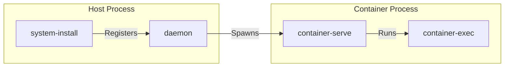
Sources: [rumpelpod/src/lib.rs:113-154]()

*   **`system-install`**: Installs the `rumpel daemon` as a background service [rumpelpod/src/lib.rs:149-151]().
*   **`container-serve`**: The entrypoint for the in-container `PodServer` that provides the HTTP API for agents [rumpelpod/src/lib.rs:125-148]().
*   **`tunnel-server`**: Manages the multiplexed TCP tunnel between the host and the container [rumpelpod/src/lib.rs:116-118]().
*   **`completions`**: Generates shell completion scripts for Bash, Zsh, and Fish [rumpelpod/src/lib.rs:218-225](), [rumpelpod/src/completions.rs:154-157]().

Sources: [rumpelpod/src/cli.rs:123-248](), [rumpelpod/src/lib.rs:107-240](), [rumpelpod/src/prepared_image.rs:4-40]()

---

# Page: Pod Lifecycle Commands

# Pod Lifecycle Commands

<details>
<summary>Relevant source files</summary>

The following files were used as context for generating this wiki page:

- [rumpelpod/src/cp.rs](rumpelpod/src/cp.rs)
- [rumpelpod/src/daemon/protocol.rs](rumpelpod/src/daemon/protocol.rs)
- [rumpelpod/src/delete.rs](rumpelpod/src/delete.rs)
- [rumpelpod/src/enter.rs](rumpelpod/src/enter.rs)
- [rumpelpod/src/fork.rs](rumpelpod/src/fork.rs)
- [rumpelpod/src/list.rs](rumpelpod/src/list.rs)
- [rumpelpod/src/merge.rs](rumpelpod/src/merge.rs)
- [rumpelpod/src/pod/client.rs](rumpelpod/src/pod/client.rs)
- [rumpelpod/src/prune.rs](rumpelpod/src/prune.rs)
- [rumpelpod/src/recreate.rs](rumpelpod/src/recreate.rs)
- [rumpelpod/src/review.rs](rumpelpod/src/review.rs)
- [rumpelpod/src/stop.rs](rumpelpod/src/stop.rs)
- [rumpelpod/tests/cli/cp.rs](rumpelpod/tests/cli/cp.rs)
- [rumpelpod/tests/cli/enter.rs](rumpelpod/tests/cli/enter.rs)
- [rumpelpod/tests/cli/list.rs](rumpelpod/tests/cli/list.rs)
- [rumpelpod/tests/cli/merge.rs](rumpelpod/tests/cli/merge.rs)
- [rumpelpod/tests/cli/prune.rs](rumpelpod/tests/cli/prune.rs)
- [rumpelpod/tests/cli/recreate.rs](rumpelpod/tests/cli/recreate.rs)
- [rumpelpod/tests/cli/review.rs](rumpelpod/tests/cli/review.rs)

</details>


This page provides a technical reference for the `rumpel` CLI commands that manage the lifecycle of pods. These commands interact with the `DaemonServer` via the Unix socket RPC protocol to create, manipulate, and destroy containerized development environments.

## Overview of Command Flow

Pod lifecycle commands generally follow a pattern:
1.  **Local Context Discovery**: The CLI identifies the git repository root [rumpelpod/src/enter.rs:19-20]() and current branch [rumpelpod/src/enter.rs:19]().
2.  **Configuration Loading**: The CLI loads `.rumpelpod.json` and `.devcontainer/devcontainer.json` to determine the target `Host` (Localhost, SSH, or Kubernetes) [rumpelpod/src/enter.rs:113-143]().
3.  **Daemon RPC**: The CLI connects to the daemon socket [rumpelpod/src/enter.rs:38-39]() and invokes methods on the `DaemonClient` [rumpelpod/src/daemon/protocol.rs:41-70]().
4.  **Executor Execution**: The daemon uses an `Executor` (Docker or Kubernetes) to perform the low-level container operations [rumpelpod/src/daemon/protocol.rs:138-153]().

### Command to Code Mapping

| CLI Command | Source Entry Point | Daemon Protocol Method |
| :--- | :--- | :--- |
| `enter` | `enter()` [rumpelpod/src/enter.rs:220]() | `launch_pod` [rumpelpod/src/enter.rs:275]() |
| `recreate` | `recreate()` [rumpelpod/src/recreate.rs:19]() | `recreate_pod` [rumpelpod/src/recreate.rs:47]() |
| `list` | `list()` [rumpelpod/src/list.rs:35]() | `list_pods` [rumpelpod/src/list.rs:41]() |
| `stop` | `stop()` [rumpelpod/src/stop.rs:19]() | `stop_pod` |
| `delete` | `delete()` [rumpelpod/src/delete.rs:22]() | `delete_pod` [rumpelpod/src/delete.rs:68]() |
| `fork` | `fork()` [rumpelpod/src/fork.rs:21]() | `fork_pod` [rumpelpod/src/fork.rs:50]() |
| `merge` | `merge()` [rumpelpod/src/merge.rs:197]() | `merge_pod` (Host-side git ops) |
| `prune` | `prune()` [rumpelpod/src/prune.rs:35]() | `delete_pod` (iterative) [rumpelpod/src/prune.rs:75]() |

**Sources:** [rumpelpod/src/enter.rs:220-350](), [rumpelpod/src/recreate.rs:19-72](), [rumpelpod/src/list.rs:35-104](), [rumpelpod/src/delete.rs:22-79](), [rumpelpod/src/fork.rs:21-68](), [rumpelpod/src/merge.rs:197-220]()

## Core Lifecycle Commands

### rumpel enter
The primary entry point for pod interaction. It ensures a pod exists and then executes a command (or starts an interactive shell) inside it.

*   **Implementation**: If `--create` is passed, it first calls `launch_pod` [rumpelpod/src/enter.rs:275-290](). It then calls `exec_pod` to start the session [rumpelpod/src/enter.rs:315-325]().
*   **Workdir Mapping**: It automatically maps the host's current directory to the corresponding path inside the container's repo mount [rumpelpod/src/enter.rs:33-37]().
*   **Environment Substitution**: It collects `${localEnv:VAR}` variables from the host to allow the daemon to resolve them in the `devcontainer.json` [rumpelpod/src/enter.rs:151-154]().
*   **Host Requirements**: It logs and validates `hostRequirements` (CPU, Memory, GPU, Storage) [rumpelpod/src/enter.rs:64-110](). For Kubernetes, these are translated into pod resource requests [rumpelpod/src/enter.rs:107-108]().

**Sources:** [rumpelpod/src/enter.rs:220-350](), [rumpelpod/src/enter.rs:64-110](), [rumpelpod/src/enter.rs:151-154]()

### rumpel recreate
Forcefully destroys an existing pod and recreates it from scratch using the current configuration.

*   **Data Flow**: It validates the pod exists [rumpelpod/src/recreate.rs:24-28](), then sends `PodLaunchParams` to the daemon's `recreate_pod` endpoint [rumpelpod/src/recreate.rs:47-61]().
*   **State Preservation**: Unlike a fresh `enter`, it preserves the repository state (including dirty files and untracked files) while resetting the container filesystem (e.g., `/tmp`) [rumpelpod/tests/cli/recreate.rs:16-67](). It also preserves LLM agent states like `ClaudeState` and `CodexState` [rumpelpod/tests/cli/recreate.rs:98-144]().

**Sources:** [rumpelpod/src/recreate.rs:19-72](), [rumpelpod/tests/cli/recreate.rs:16-144]()

### rumpel list, stop, delete, and prune
Basic management of pod states.

*   **list**: Queries the daemon for pods associated with the current repo [rumpelpod/src/list.rs:41](). Displays pod name, LLM agent status (Claude/Codex), git state, lifecycle status, and container ID [rumpelpod/src/list.rs:54-65]().
*   **stop**: Sends a stop request to the daemon. The pod remains in the database and its disk state is preserved.
*   **delete**: Removes the container and the pod entry from the daemon's database [rumpelpod/src/delete.rs:68](). It warns or prompts if the pod has unmerged commits [rumpelpod/src/delete.rs:41-58]().
*   **prune**: Bulk deletes pods in `Stopped`, `Gone`, or `Broken` states [rumpelpod/src/prune.rs:14-24]().

**Sources:** [rumpelpod/src/list.rs:35-104](), [rumpelpod/src/delete.rs:22-79](), [rumpelpod/src/prune.rs:13-33]()

## Advanced Branching and Merging

### rumpel fork
Creates a new pod by cloning an existing one.

*   **Safety Checks**: Validates source existence and target name availability before requesting the fork [rumpelpod/src/fork.rs:30-38]().
*   **Agent State**: Prompts the user if the source pod is mid-turn (processing) to avoid capturing inconsistent agent states [rumpelpod/src/fork.rs:74-113]().
*   **Implementation**: Forwards a `ForkPodRequest` to the daemon [rumpelpod/src/fork.rs:50-55]().

**Sources:** [rumpelpod/src/fork.rs:21-113]()

### rumpel merge
Integrates changes from a pod back into the host repository.

*   **Implementation**:
    1.  Verifies the pod exists [rumpelpod/src/merge.rs:204-208]().
    2.  Checks for uncommitted changes inside the container [rumpelpod/src/merge.rs:18-61]().
    3.  Resolves a "description file" (e.g., `SUMMARY.md`) to use as the merge commit message [rumpelpod/src/merge.rs:112-161]().
    4.  Executes `git merge` on the host against the pod's git ref `refs/rumpelpod/<name>` [rumpelpod/src/merge.rs:212-230]().

**Sources:** [rumpelpod/src/merge.rs:18-61](), [rumpelpod/src/merge.rs:112-230]()

### rumpel review
Uses `git difftool` to review changes between the pod and the host.

*   **Mechanism**: It identifies the merge base, extracts files from the pod's branch and the base into a temporary directory, and invokes the configured `diff.tool` [rumpelpod/src/review.rs:22-142]().

**Sources:** [rumpelpod/src/review.rs:4-142]()

## Resource and Utility Commands

### rumpel cp
Copies files between the host and a running pod.
*   **Implementation**: Uses the `Executor::cp_to` and `Executor::cp_from` methods via the daemon.

### rumpel ports
Lists or manages port forwarding from the pod to the host.
*   **Data Flow**: The daemon tracks `PortInfo` (container port, local port, label) [rumpelpod/src/daemon/protocol.rs:179-184]().

### rumpel ssh-add
Forwards the host's SSH agent to the pod.
*   **Mechanism**: Identifies `SSH_AUTH_SOCK` on the host and passes it to the daemon in `PodLaunchParams` [rumpelpod/src/recreate.rs:45-60]().

## Logic Flow Diagrams

### Pod Launch Sequence (rumpel enter)
This diagram shows the transition from CLI invocation to the creation of a containerized environment.

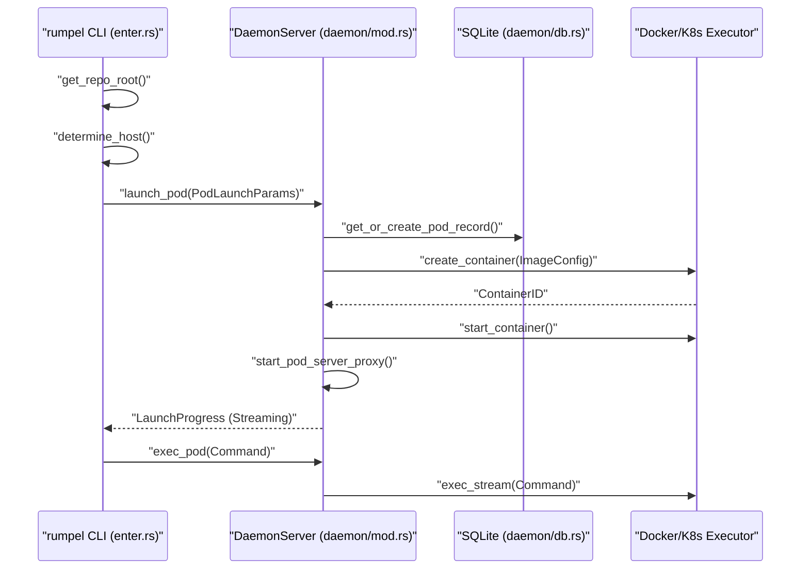
**Sources:** [rumpelpod/src/enter.rs:220-300](), [rumpelpod/src/daemon/protocol.rs:47-70]()

### Git Integration during Merge
How the system bridges the "Natural Language Space" (user wants to merge) to "Code Entity Space" (git refs and pod server).

```mermaid
graph TD
    subgraph "Host Space"
        User["User Command: 'rumpel merge pod-1'"]
        GitHost["git (Host Process)"]
        Daemon["DaemonServer"]
        Client["DaemonClient (src/daemon/protocol.rs)"]
    end

    subgraph "Pod Space"
        PodServer["PodServer (run_container_server)"]
        GitPod["git (Inside Container)"]
    end

    User -->|"merge()"| Client
    Client -->|"list_pods()"| Daemon
    Daemon -->|"check_dirty_checkout()"| PodServer
    PodServer -->|"git status --porcelain"| GitPod
    User -->|"git merge refs/rumpelpod/pod-1"| GitHost
    GitHost <-->|"GitHttpServer (Tunnel)"| GitPod
```
**Sources:** [rumpelpod/src/merge.rs:18-61](), [rumpelpod/src/merge.rs:197-230](), [rumpelpod/src/enter.rs:19-20]()

---

# Page: LLM Agent Commands

# LLM Agent Commands

<details>
<summary>Relevant source files</summary>

The following files were used as context for generating this wiki page:

- [CHANGELOG.md](CHANGELOG.md)
- [rumpelpod/src/claude.rs](rumpelpod/src/claude.rs)
- [rumpelpod/src/codex.rs](rumpelpod/src/codex.rs)
- [rumpelpod/src/command_ext.rs](rumpelpod/src/command_ext.rs)
- [rumpelpod/src/daemon/pod_connection.rs](rumpelpod/src/daemon/pod_connection.rs)
- [rumpelpod/src/grok.rs](rumpelpod/src/grok.rs)
- [rumpelpod/src/pi.rs](rumpelpod/src/pi.rs)
- [rumpelpod/src/pty_attach.rs](rumpelpod/src/pty_attach.rs)
- [rumpelpod/src/pty_session.rs](rumpelpod/src/pty_session.rs)
- [rumpelpod/src/service.rs](rumpelpod/src/service.rs)
- [rumpelpod/tests/cli/codex/detach.rs](rumpelpod/tests/cli/codex/detach.rs)
- [rumpelpod/tests/cli/grok/common.rs](rumpelpod/tests/cli/grok/common.rs)
- [rumpelpod/tests/cli/grok/smoke.rs](rumpelpod/tests/cli/grok/smoke.rs)

</details>


LLM Agent Commands in `rumpelpod` provide a technical interface for launching and interacting with AI coding assistants (Anthropic Claude, OpenAI Codex, and xAI Grok) within the isolated environment of a pod. These commands automate credential forwarding, session persistence via PTY (Pseudo-Terminal) multiplexing, and the injection of security-bypass hooks to streamline agentic workflows.

## Overview of Agent Commands

The primary entry points for LLM agents are:
*   `rumpel claude`: Launches the Anthropic Claude CLI inside the pod [rumpelpod/src/claude.rs:24-121]().
*   `rumpel grok`: Launches the xAI Grok CLI inside the pod [rumpelpod/src/grok.rs:34-93]().
*   `rumpel codex`: Attaches to a host-side Codex TUI that interacts with the pod [rumpelpod/src/codex.rs:47-104]().

These commands manage a lifecycle that includes PTY session attachment, automatic pod launching, and host-to-pod credential synchronization.

### Agent Session Initialization

The initialization flow differs between container-native agents (Claude/Grok) and host-resident agents (Codex).

**Container-Native Agent Flow (Claude/Grok)**
```mermaid
sequenceDiagram
    participant Host as "rumpel CLI (Host)"
    participant Daemon as "DaemonServer"
    participant Pod as "PodServer (In-Pod)"
    participant PTY as "pty_session::PtySessions"
    participant Agent as "Agent CLI (claude/grok)"

    Host->>Daemon: launch_pod(name) [rumpelpod/src/enter.rs:49-49]()
    Daemon-->>Host: PodEndpoint (URL/Token) [rumpelpod/src/daemon/pod_connection.rs:68-71]()
    Host->>Daemon: ensure_claude_config [rumpelpod/src/claude.rs:61-71]()
    Host->>Pod: WebSocket Upgrade (/claude or /grok) [rumpelpod/src/claude.rs:98-111]()
    Pod->>PTY: spawn_session [rumpelpod/src/pty_session.rs:126-127]()
    PTY->>Agent: Fork/Exec with PtyControl [rumpelpod/src/pty_session.rs:253-270]()
    Host->>PTY: Forward Terminal I/O via pty_attach::attach [rumpelpod/src/pty_attach.rs:188-212]()
```
Sources: [rumpelpod/src/claude.rs:48-111](), [rumpelpod/src/pty_session.rs:126-133](), [rumpelpod/src/daemon/pod_connection.rs:68-71](), [rumpelpod/src/pty_attach.rs:188-212]()

---

## Credential Forwarding

To prevent users from having to re-authenticate inside every pod, `rumpelpod` forwards host-side credentials into the container before starting the agent session.

### Claude Credentials
The `claude` command reads local OAuth credentials from `~/.claude/.credentials.json` or the macOS Keychain [rumpelpod/src/claude.rs:129-177](). These are forwarded to the daemon via `EnsureClaudeConfigRequest` [rumpelpod/src/daemon/protocol.rs:322-332](), which then persists them into the pod's home directory.

### Grok Credentials
The `grok` command forwards the `XAI_API_KEY` environment variable [rumpelpod/src/grok.rs:110-116](). It synchronizes the `~/.grok/` directory (containing `auth.json` and `config.toml`) by creating a tarball and uploading it via `PodClient::put_agent_files` [rumpelpod/src/grok.rs:135-152]().

### Codex Credentials
Codex credentials (typically `~/.codex/auth.json`) are used by the host-side Codex process. The daemon manages a `CodexProxyHandle` that injects `RUMPELPOD_CODEX_PROXY_TOKEN` into the local Codex process to allow it to communicate with the pod-side proxy [rumpelpod/src/codex.rs:205-212]().

Sources: [rumpelpod/src/claude.rs:129-177](), [rumpelpod/src/grok.rs:110-152](), [rumpelpod/src/codex.rs:205-212](), [rumpelpod/src/daemon/protocol.rs:322-332]()

---

## PTY Session Management

Agent sessions use a "screen-style" persistence model. The `pty_session` module maintains a virtual terminal buffer (`vt100::Parser`) so that the full TUI state is replayed immediately upon reattachment [rumpelpod/src/pty_session.rs:4-9]().

### Implementation Components
*   **PtySessions Registry**: A shared map of active PTY sessions identified by name [rumpelpod/src/pty_session.rs:66-70]().
*   **VT100 Parser**: Tracks the screen state for replay on reattach, allowing users to detach (Ctrl-a d) and return to the exact same visual state [rumpelpod/src/pty_session.rs:43-45]().
*   **Attach Logic**: `pty_attach::attach` handles the client-side terminal raw mode, window resizing (via `TIOCGWINSZ`), and WebSocket heartbeats [rumpelpod/src/pty_attach.rs:143-149](), [rumpelpod/src/pty_attach.rs:46-46]().

**PTY Data Flow Architecture**
```mermaid
graph TD
    subgraph "Host Space"
        CLI["rumpel CLI"]
        PTY_A["pty_attach::attach"]
    end

    subgraph "Daemon or Pod Server"
        WS_H["WebSocket Handler"]
        PTY_S["pty_session::PtySessions"]
        VT["vt100::Parser"]
        CHILD["Child Process (claude/codex/grok)"]
    end

    CLI -- "Stdin/Stdout" --> PTY_A
    PTY_A -- "WebSocket (Binary/Ping)" --> WS_H
    WS_H -- "pty_session::PtyControl" --> PTY_S
    PTY_S -- "Replay Buffer" --> VT
    PTY_S -- "PTY Master FD" --> CHILD
```
Sources: [rumpelpod/src/pty_session.rs:4-50](), [rumpelpod/src/pty_attach.rs:143-160](), [rumpelpod/src/codex.rs:165-180]()

---

## Approval Hooks and Sandboxing

`rumpelpod` allows agents to operate autonomously while providing safety controls.

### Claude: Permission Hooks
Claude sessions can be launched with `permission_hook` enabled [rumpelpod/src/claude.rs:42-44](). This tells the daemon to configure the container so that Claude's permission requests are intercepted. If `skip_permissions` is active, the agent is launched with `--dangerously-skip-permissions` [rumpelpod/src/claude.rs:82-84]().

### Grok: Always-Approve
The `grok` command supports an `--always-approve` flag, which is passed directly to the in-container binary if configured in `.rumpelpod.json` [rumpelpod/src/grok.rs:55-58]().

### Codex: Approval Bypass
Codex sessions can be configured to bypass approvals and sandboxing via the `no_dangerously_bypass_approvals_and_sandbox` query parameter during the WebSocket upgrade to the daemon [rumpelpod/src/codex.rs:61-68]().

Sources: [rumpelpod/src/claude.rs:39-84](), [rumpelpod/src/grok.rs:42-58](), [rumpelpod/src/codex.rs:61-68]()

---

## Agent State Persistence

Agent state is maintained across disconnections and pod restarts:

1.  **PTY Persistence**: The `pty_session` keeps the child process alive even when the WebSocket client disconnects [rumpelpod/src/pty_session.rs:141-148]().
2.  **State Directory Synchronization**: Claude session history is preserved by the daemon's `EnsureClaudeConfig` logic, which can copy existing sessions into new pods [rumpelpod/src/claude.rs:70-70]().
3.  **Daemon-Managed Codex**: The host-side Codex TUI is owned by the daemon's `PtySessions` registry, ensuring the TUI survives `Ctrl-a d` and reattaches to the same pod connection [rumpelpod/src/codex.rs:13-16]().

Sources: [rumpelpod/src/pty_session.rs:141-148](), [rumpelpod/src/claude.rs:70-70](), [rumpelpod/src/codex.rs:13-16](), [rumpelpod/src/daemon/pod_connection.rs:106-107]()

---

# Page: Image Management Commands

# Image Management Commands

<details>
<summary>Relevant source files</summary>

The following files were used as context for generating this wiki page:

- [rumpelpod/src/cli.rs](rumpelpod/src/cli.rs)
- [rumpelpod/src/image.rs](rumpelpod/src/image.rs)
- [rumpelpod/src/image_cmd.rs](rumpelpod/src/image_cmd.rs)
- [rumpelpod/src/prepared_image.rs](rumpelpod/src/prepared_image.rs)
- [rumpelpod/tests/cli/codex/install.rs](rumpelpod/tests/cli/codex/install.rs)
- [rumpelpod/tests/cli/devcontainer/image.rs](rumpelpod/tests/cli/devcontainer/image.rs)

</details>


Rumpelpod manages development environment images by extending the standard `devcontainer.json` specification. It utilizes `docker buildx` for multi-platform builds and implements a deterministic, content-addressed tagging system to ensure that identical build contexts result in reusable image layers across different pods.

## Overview of Image Commands

Rumpelpod provides two primary commands for manual image management, though these are typically invoked automatically during the `rumpel enter` lifecycle.

| Command | Purpose | Primary Function |
| :--- | :--- | :--- |
| `rumpel image build` | Forces a build of the Dockerfile defined in `devcontainer.json`. | `build()` [rumpelpod/src/image_cmd.rs:14-64]() |
| `rumpel image fetch` | Pulls the pre-built image specified in the `image` field of `devcontainer.json`. | `fetch()` [rumpelpod/src/image_cmd.rs:66-96]() |

Sources: [rumpelpod/src/image_cmd.rs:4-96]()

## Deterministic Content-Addressed Tagging

Rumpelpod does not rely on standard Docker tags like `latest`. Instead, it computes a unique hash based on the build context to provide deterministic image resolution.

### Tag Computation Logic
The function `compute_image_tag` generates a SHA-256 hash of the following inputs:
1.  **Dockerfile Content**: The literal bytes of the Dockerfile [rumpelpod/src/image.rs:260-264]().
2.  **Build Arguments**: Any `buildArgs` defined in `devcontainer.json` [rumpelpod/src/image.rs:266-271]().
3.  **Context Filesystem**: A recursive hash of all files within the build context, including file permissions (executable bit) [rumpelpod/src/image.rs:273-280]().
4.  **Context Path**: Optionally, the absolute path to the context on the host machine [rumpelpod/src/image.rs:282-286]().

### Image Resolution Flow
The `resolve_image` function [rumpelpod/src/image.rs:195-247]() determines if a build is necessary by checking for the existence of the computed tag in the target environment.

**Image Resolution Pipeline**
```mermaid
graph TD
    Start["resolve_image()"] --> HasBuild{"Has 'build' in config?"}
    HasBuild -- "No" --> ReturnImage["Return 'image' field"]
    HasBuild -- "Yes" --> Hash["compute_image_tag()"]
    Hash --> Mode{"BuildxMode?"}
    Mode -- "Load (Local)" --> CheckLocal["image_exists()"]
    Mode -- "Push (K8s)" --> CheckRegistry["registry_image_exists()"]
    CheckLocal -- "Exists" --> Success["Return BuildResult { built: false }"]
    CheckLocal -- "Missing" --> Build["run_buildx_build()"]
    CheckRegistry -- "Missing" --> Build
    Build --> SuccessBuilt["Return BuildResult { built: true }"]
```
Sources: [rumpelpod/src/image.rs:139-247](), [rumpelpod/src/image.rs:253-306]()

## Buildx Execution and Modes

Rumpelpod uses `docker buildx build` as its underlying engine. This allows for advanced features like multi-platform support and remote caching. The `BuildxMode` enum [rumpelpod/src/image.rs:130-143]() determines how the resulting image is handled based on the `Host` configuration.

### Buildx Modes
*   **`BuildxMode::Load`**: Used for `Localhost` or `Ssh` hosts. Appends `--load` to the build command, which exports the image to the local Docker daemon's image store [rumpelpod/src/image.rs:132-136]().
*   **`BuildxMode::Push`**: Used for `Kubernetes` hosts. Appends `--push` to the build command, sending the image to a remote registry so the cluster can pull it [rumpelpod/src/image.rs:138-142]().

### Implementation Details
The `run_buildx_build` function constructs the CLI command [rumpelpod/src/image.rs:335-420](). It applies the `-H` (Docker Host) flag via `apply_docker_host` [rumpelpod/src/image.rs:30-78]() to target specific Unix sockets or SSH URIs.

**Command Construction Logic**
| Component | Implementation |
| :--- | :--- |
| **Docker Host** | `apply_docker_host(&mut cmd, ...)` [rumpelpod/src/image.rs:356]() |
| **Output Handling** | Captured via `Stdio::piped()` and processed line-by-line [rumpelpod/src/image.rs:383-388]() |
| **Platform** | Inferred from the `Host` architecture or defaulted to `linux/amd64` [rumpelpod/src/image.rs:360-363]() |

Sources: [rumpelpod/src/image.rs:130-188](), [rumpelpod/src/image.rs:335-420]()

## The Prepared Image Pipeline

To optimize pod startup, Rumpelpod builds a "Prepared Image" on top of the resolved devcontainer image. This prepared layer contains the Rumpelpod binary, a pre-cloned repository, and optional AI agent CLIs (Claude, Codex, Grok). This logic is implemented in `rumpelpod/src/prepared_image.rs`.

### Prepared Tagging
The prepared image tag is content-addressed, incorporating the `RUMPEL_VERSION_INFO` [rumpelpod/src/prepared_image.rs:197]() to ensure that updates to the Rumpelpod binary trigger a rebuild of the prepared layer.

**Prepared Image Composition**
```mermaid
graph TD
    Base["Base Devcontainer Image"] --> Prep["Prepared Image Layer"]
    subgraph "Prepared Layer Components"
        Bin["rumpel-linux-{arch} binary"]
        Git["Repo Clone (via /tmp/host-git-dir)"]
        Env["/opt/rumpelpod/container-env-keys"]
        Agents["Claude / Codex / Grok CLIs"]
    end
    Bin --> Prep
    Git --> Prep
    Env --> Prep
    Agents --> Prep
```

### Key Prepared Image Files
*   **`CONTAINER_ENV_KEYS_PATH`**: A file at `/opt/rumpelpod/container-env-keys` listing allowed environment variables for forking [rumpelpod/src/prepared_image.rs:40]().
*   **`BUILD_GIT_DIR_PATH`**: A temporary mount point `/tmp/host-git-dir` used during the build to transfer the git state without sending the entire context [rumpelpod/src/prepared_image.rs:44]().
*   **Agent Version Pinning**: Rumpelpod detects local versions of agent CLIs (e.g., `detect_local_codex` [rumpelpod/src/prepared_image.rs:82]()) to ensure the prepared image matches the host's development environment [rumpelpod/tests/cli/codex/install.rs:23-69]().

Sources: [rumpelpod/src/prepared_image.rs:4-77](), [rumpelpod/src/prepared_image.rs:197-210](), [rumpelpod/tests/cli/codex/install.rs:4-69]()

---

# Page: Git Integration

# Git Integration

<details>
<summary>Relevant source files</summary>

The following files were used as context for generating this wiki page:

- [rumpelpod/src/git.rs](rumpelpod/src/git.rs)
- [rumpelpod/src/hook.rs](rumpelpod/src/hook.rs)
- [rumpelpod/src/pod/git_setup.rs](rumpelpod/src/pod/git_setup.rs)
- [rumpelpod/src/pod/server.rs](rumpelpod/src/pod/server.rs)
- [rumpelpod/src/tunnel.rs](rumpelpod/src/tunnel.rs)
- [rumpelpod/tests/cli/gateway/mod.rs](rumpelpod/tests/cli/gateway/mod.rs)

</details>


Rumpelpod provides a deep integration with Git to ensure that the environment inside a pod is a faithful representation of the host's development state, including uncommitted changes and submodules. This integration is facilitated by a dedicated Git HTTP server on the host, a multiplexed tunnel for transport, and a specialized reference namespace to isolate pod-specific work.

### High-Level Architecture

The Git integration bridges the host's physical repository with the pod's isolated filesystem. When a pod is initialized, it does not clone from a remote upstream; instead, it clones directly from the host via a secure tunnel.

#### Git Integration Flow
```mermaid
graph TD
    subgraph "Host Machine"
        Repo[".git Repository"]
        GHS["gateway::GitHttpServer"]
        Tunnel["tunnel::start_tunnel"]
    end

    subgraph "Pod (Container)"
        PS["pod::server::run_container_server"]
        Git["Git Client"]
        TunnelServer["tunnel::run_tunnel_server"]
    end

    Git -- "git fetch/push" --> TunnelServer
    TunnelServer -- "Multiplexed Stream (exec stdin/stdout)" --> Tunnel
    Tunnel -- "HTTP" --> GHS
    GHS -- "libgit2 / git-upload-pack" --> Repo

    PS -- "GitSetupRequest" --> Git
```
**Sources:** [rumpelpod/src/pod/server.rs:142-160](), [rumpelpod/src/tunnel.rs:4-25](), [rumpelpod/src/pod/git_setup.rs:86-96]()

### Git Ref Namespace and Synchronization

Rumpelpod avoids polluting the standard `refs/heads/` namespace on the host. Instead, it uses a dedicated namespace: `refs/rumpelpod/`.

*   **Host Branches:** Standard branches remain at `refs/heads/*`.
*   **Pod Branches:** Each pod has its own branch tracked on the host at `refs/rumpelpod/<branch>@<pod>` [rumpelpod/src/pod/git_setup.rs:90-91]().
*   **Reference Transaction Hook:** A custom hook inside the pod [rumpelpod/src/hook.rs:97-100]() automatically pushes branch updates back to the host whenever a commit is made.
*   **Dirty Tree Sync:** Rumpelpod can synchronize uncommitted changes by creating temporary commits or patches that are transferred during the pod setup phase.
*   **Submodules:** The system ensures that submodule states are preserved and that pods can resolve submodule URLs back to the host via the same tunnel mechanism [rumpelpod/src/pod/git_setup.rs:55-61]().

For details on how refs are structured and how the synchronization logic handles edge cases, see **[Git Ref Namespace and Synchronization](#4.1)**.

**Sources:** [rumpelpod/src/pod/git_setup.rs:1-50](), [rumpelpod/src/git.rs:70-82](), [rumpelpod/src/hook.rs:97-168]()

### Git HTTP Server and Tunnel

Because pods often run in environments without direct network access to the host's local files (especially in Kubernetes), rumpelpod implements a custom transport layer.

*   **GitHttpServer:** A host-side server that implements the Git Smart Protocol. It uses `git-upload-pack` and `git-receive-pack` to serve the repository.
*   **Multiplexed Tunnel:** Git traffic is carried over a multiplexed TCP tunnel that runs inside a standard `exec` stream. The pod-side `run_tunnel_server` binds a loopback TCP listener and assignments stream IDs [rumpelpod/src/tunnel.rs:19-21]().
*   **Authentication:** The server requires a bearer token, which is generated by the daemon and passed to the pod server [rumpelpod/src/pod/server.rs:63-70]().

For details on the tunnel implementation and the HTTP server configuration, see **[Git HTTP Server and Tunnel](#4.2)**.

**Sources:** [rumpelpod/src/tunnel.rs:4-40](), [rumpelpod/src/pod/server.rs:63-70](), [rumpelpod/src/pod/server.rs:142-148]()

### Code Entity Mapping

The following diagram maps the logical Git operations to the specific Rust modules and functions responsible for them.

#### Entity Mapping: Git Operations
```mermaid
graph LR
    subgraph "CLI/Daemon Space"
        CMD["rumpel enter"] -- "calls" --> GS["pod::git_setup::GitSetupRequest"]
        HOOK["hook::reference_transaction"] -- "pushes to" --> REMOTE["remote:rumpelpod"]
    end

    subgraph "Pod Server Space"
        PS["pod::server::run_container_server"] -- "reads" --> TF["TUNNEL_PORT_FILE"]
        PS -- "initializes" --> GSU["pod::git_setup::setup_git_impl"]
    end

    GSU -- "git fetch host" --> REMOTE
```
**Sources:** [rumpelpod/src/pod/server.rs:128-148](), [rumpelpod/src/pod/git_setup.rs:24-41](), [rumpelpod/src/hook.rs:97-105]()

### Key Components

| Component | Responsibility | Location |
| :--- | :--- | :--- |
| `GitIdentity` | Captures `user.name` and `user.email` from the host to mirror in the pod. | [rumpelpod/src/git.rs:19-23]() |
| `setup_git_impl` | The function inside the pod that performs the initial configuration and host fetch. | [rumpelpod/src/pod/git_setup.rs:86]() |
| `reference_transaction` | Hook that pushes branch updates to `refs/rumpelpod/` on the host. | [rumpelpod/src/hook.rs:97]() |
| `run_tunnel_server` | In-pod listener that multiplexes Git TCP traffic over the exec stream. | [rumpelpod/src/tunnel.rs:108]() |
| `prepare_lfs_for_new_ref` | Optimizes LFS uploads for new pod-specific refs to avoid full-history scans. | [rumpelpod/src/git.rs:126-130]() |

**Sources:** [rumpelpod/src/git.rs:19-23](), [rumpelpod/src/pod/git_setup.rs:86](), [rumpelpod/src/hook.rs:97](), [rumpelpod/src/tunnel.rs:108]()

---

# Page: Git Ref Namespace and Synchronization

# Git Ref Namespace and Synchronization

<details>
<summary>Relevant source files</summary>

The following files were used as context for generating this wiki page:

- [rumpelpod/src/git.rs](rumpelpod/src/git.rs)
- [rumpelpod/src/hook.rs](rumpelpod/src/hook.rs)
- [rumpelpod/src/pod/git_setup.rs](rumpelpod/src/pod/git_setup.rs)
- [rumpelpod/src/tunnel.rs](rumpelpod/src/tunnel.rs)
- [rumpelpod/tests/cli/gateway/submodules.rs](rumpelpod/tests/cli/gateway/submodules.rs)

</details>


Rumpelpod employs a specialized Git reference namespace to manage the relationship between a developer's host repository and one or more isolated pod environments. This system ensures that LLM agents and developers working inside pods have a consistent view of the code while maintaining isolation from the host's primary branches.

## Git Reference Namespace

Rumpelpod organizes Git refs to distinguish between host-local state and pod-specific state. This allows multiple pods to exist for the same repository without colliding.

| Ref Pattern | Description |
|:---|:---|
| `refs/heads/*` | Standard host branches. The pod sees these via the `host` remote [rumpelpod/src/pod/git_setup.rs:108-111](). |
| `refs/rumpelpod/<branch>@<pod>` | Pod-specific branches stored on the host. `<branch>` is the name within the pod, and `<pod>` is the unique pod name [rumpelpod/src/pod/git_setup.rs:90](). |
| `refs/rumpelpod/<pod>` | A shortcut ref on the host pointing to the pod's primary branch [rumpelpod/src/pod/git_setup.rs:148-152](). |
| `refs/remotes/host/*` | Inside the pod, this remote tracks the host's `refs/heads/*` [rumpelpod/src/pod/git_setup.rs:108-111](). |

### The `rumpelpod/` Namespace
When a pod is created, it typically creates a branch named after the pod itself. This branch is backed by a ref on the host: `refs/rumpelpod/<branch>@<pod>`. The `GitHttpServer` on the host side ensures that pushes are namespaced correctly [rumpelpod/src/pod/git_setup.rs:90](). Additionally, a primary branch shortcut is pushed to `refs/rumpelpod/<pod>` so the host sees a clean remote ref for each pod [rumpelpod/src/pod/git_setup.rs:148-152]().

**Sources:** [rumpelpod/src/pod/git_setup.rs:86-167](), [rumpelpod/src/hook.rs:136-164]()

## Synchronization Flow

Synchronization occurs in two primary phases: initial pod setup and ongoing updates triggered by Git hooks.

### Initial Setup and Identity Transfer
When a pod is launched, the system orchestrates the transfer of the current host state:

1.  **Git Identity**: The host's `user.name` and `user.email` are read via `get_git_user_config` [rumpelpod/src/git.rs:59-68]() and passed to the pod via `GitSetupRequest` [rumpelpod/src/pod/git_setup.rs:24-41]().
2.  **Remote Configuration**: The pod is configured with two primary remotes: `host` (for fetching) and `rumpelpod` (for pushing) [rumpelpod/src/pod/git_setup.rs:96-160]().
3.  **Hook Installation**: A `reference-transaction` hook is installed in the pod's repository to automate pushing changes back to the host [rumpelpod/src/pod/git_setup.rs:176-178]().

### Data Flow: Host to Pod Sync
This diagram illustrates how the host and pod components interact during the Git setup phase.

**Host-Pod Git Synchronization**
```mermaid
sequenceDiagram
    participant H as "Host (CLI/Daemon)"
    participant GHS as "GitHttpServer"
    participant PS as "Pod (setup_git_impl)"
    
    H->>H: "get_repo_root()" [rumpelpod/src/git.rs:32]
    H->>H: "get_git_user_config()" [rumpelpod/src/git.rs:59]
    H->>PS: Call "setup_git_impl" with "GitSetupRequest" [rumpelpod/src/pod/git_setup.rs:86]
    
    rect rgb(240, 240, 240)
    Note over PS: In-Container Setup
    PS->>PS: "configure_gateway_urls" [rumpelpod/src/pod/git_setup.rs:96]
    PS->>GHS: "git fetch host" [rumpelpod/src/pod/git_setup.rs:170]
    PS->>PS: "install_hook_impl" (reference-transaction) [rumpelpod/src/pod/git_setup.rs:176]
    PS->>PS: Create & checkout branches [rumpelpod/src/pod/git_setup.rs:205-230]
    end
```
**Sources:** [rumpelpod/src/git.rs:32-68](), [rumpelpod/src/pod/git_setup.rs:86-230](), [rumpelpod/src/hook.rs:97-168]()

## The Reference-Transaction Hook

Rumpelpod uses a `reference-transaction` hook inside the pod to ensure that every commit made (by a human or an agent) is immediately mirrored back to the host.

1.  **Hook Invocation**: The hook runs after a ref update is committed [rumpelpod/src/hook.rs:97-100]().
2.  **Ref Parsing**: It reads `oldvalue newvalue refname` from stdin to identify what changed [rumpelpod/src/hook.rs:63-79]().
3.  **Automated Push**: For every branch update in `refs/heads/*`, the hook executes `git push rumpelpod <branch>` [rumpelpod/src/hook.rs:127-134]().
4.  **Shortcut Update**: If the updated branch is the primary branch, it also updates the `refs/rumpelpod/<pod>` shortcut [rumpelpod/src/hook.rs:140-164]().

### Git LFS Optimization
To avoid expensive full-history scans during every hook-triggered push, Rumpelpod includes logic to skip the Git LFS pre-push hook if the objects are already known to be available on the host [rumpelpod/src/git.rs:118-142](). The hook calls `prepare_lfs_for_new_ref` to determine if it can safely set `GIT_LFS_SKIP_PUSH=1` [rumpelpod/src/hook.rs:115-122]().

**Implementation Mapping**
```mermaid
graph TD
    subgraph "Pod Repository"
        RT["reference_transaction() hook"]
        GH["Git Heads (refs/heads/*)"]
    end

    subgraph "Host Repository"
        RPN["refs/rumpelpod/<branch>@<pod>"]
        RPS["refs/rumpelpod/<pod> (shortcut)"]
    end

    RT -- "reads stdin" --> GH
    RT -- "git push rumpelpod" --> RPN
    RT -- "explicit shortcut push" --> RPS
    RT -- "calls" --> LFS["prepare_lfs_for_new_ref()"]
```
**Sources:** [rumpelpod/src/hook.rs:97-168](), [rumpelpod/src/git.rs:118-142]()

## Submodule Handling

Submodules are synchronized using the same gateway mechanism. The system resolves the Git directory for submodules (which may be located in the parent's `.git/modules` directory) to ensure refs land in the correct place [rumpelpod/tests/cli/gateway/submodules.rs:109-114]().

- **Pod to Host**: Commits made inside a pod's submodule are mirrored to the host's submodule git directory under the pod's namespace [rumpelpod/tests/cli/gateway/submodules.rs:113-120]().
- **Host to Pod**: Pods can fetch host submodule updates through the `host` remote configured within the submodule itself [rumpelpod/tests/cli/gateway/submodules.rs:164-170]().

**Sources:** [rumpelpod/tests/cli/gateway/submodules.rs:55-120](), [rumpelpod/tests/cli/gateway/submodules.rs:123-193]()

## Implementation Details

### `GitSetupRequest`
The `GitSetupRequest` struct defines the configuration sent to the pod to initialize its Git environment.

```rust
pub struct GitSetupRequest {
    pub repo_path: PathBuf,
    pub url: String,
    pub token: String,
    pub pod_name: String,
    pub extra_host_fetch: Vec<String>,
    pub branches: Vec<GitSetupBranch>,
    pub primary: String,
    pub git_identity: Option<GitIdentity>,
}
```
[rumpelpod/src/pod/git_setup.rs:24-41]()

### Key Functions
- `setup_git_impl`: Orchestrates the Git configuration inside the container [rumpelpod/src/pod/git_setup.rs:86]().
- `reference_transaction`: The entry point for the pod-side Git hook [rumpelpod/src/hook.rs:97]().
- `prepare_lfs_for_new_ref`: Determines if LFS upload can be optimized during a push [rumpelpod/src/git.rs:126]().
- `get_repo_root`: Discovers the absolute path to the host repository root [rumpelpod/src/git.rs:32]().

**Sources:** [rumpelpod/src/pod/git_setup.rs:86-167](), [rumpelpod/src/hook.rs:97-168](), [rumpelpod/src/git.rs:32-55](), [rumpelpod/src/git.rs:126-142]()

---

# Page: Git HTTP Server and Tunnel

# Git HTTP Server and Tunnel

<details>
<summary>Relevant source files</summary>

The following files were used as context for generating this wiki page:

- [rumpelpod/src/daemon.rs](rumpelpod/src/daemon.rs)
- [rumpelpod/src/git.rs](rumpelpod/src/git.rs)
- [rumpelpod/src/hook.rs](rumpelpod/src/hook.rs)
- [rumpelpod/src/pod/git_setup.rs](rumpelpod/src/pod/git_setup.rs)
- [rumpelpod/src/tunnel.rs](rumpelpod/src/tunnel.rs)

</details>


The Git HTTP Server and Tunnel mechanism provides a secure, multiplexed communication bridge between the host machine and isolated pods. This system allows pods to perform git operations (fetch/push) against the host's local repository and facilitates the relaying of SSH agent traffic, all without requiring direct network exposure of the host to the container.

## Host-Side GitHttpServer

The `GitHttpServer` is a specialized HTTP server running within the Rumpelpod daemon. It serves as the primary git remote for all managed pods.

### Implementation and Role
The server is implemented using the `axum` framework and is initialized within the daemon's main lifecycle [rumpelpod/src/daemon.rs:37-37](). It manages a `SharedGitServerState` which tracks active repositories and authentication tokens.

Key responsibilities include:
- **Git Smart HTTP Protocol**: Serving git repository data via `git-upload-pack` and `git-receive-pack` [rumpelpod/src/git_http_server.rs:170-194]().
- **Authentication**: Validating requests using a per-pod bearer token generated at launch [rumpelpod/src/git_http_server.rs:141-168]().
- **SSH Agent Relay**: Providing an endpoint for pods to tunnel SSH agent requests back to the host's `ssh-agent` [rumpelpod/src/git_http_server.rs:248-278]().

### Data Flow: Host Git Server
The following diagram illustrates how the `GitHttpServer` interacts with the daemon and the host's filesystem.

**Diagram: GitHttpServer Architecture**
```mermaid
graph TD
    subgraph "Daemon Process [rumpelpod/src/daemon.rs]"
        A["GitHttpServer (axum::Router)"]
        B["SharedGitServerState [rumpelpod/src/git_http_server.rs]"]
        C["Auth Middleware"]
    end

    subgraph "Host Filesystem"
        D["Local Git Repo (.git)"]
        E["git-upload-pack / git-receive-pack"]
    end

    A --> C
    C --> B
    A -- "spawn child" --> E
    E -- "read/write" --> D
```
Sources: [rumpelpod/src/git_http_server.rs:24-42](), [rumpelpod/src/git_http_server.rs:170-194](), [rumpelpod/src/daemon.rs:37-37]()

## Multiplexed Tunnel Protocol

Because pods may be running in environments (like Kubernetes or remote Docker hosts) where the host's IP is not directly reachable, Rumpelpod establishes a multiplexed TCP tunnel over standard container execution streams [rumpelpod/src/tunnel.rs:4-9]().

### Tunnel Establishment
The tunnel is created by executing the `rumpel tunnel-server` command inside the pod via the executor's `exec_streaming` interface [rumpelpod/src/tunnel.rs:22-25](). This creates a bidirectional stream over the container's `stdin` and `stdout`.

- **Host Side**: The daemon initiates the tunnel and demultiplexes frames from the pod's `stdout`, opening local TCP connections to the target `GitHttpServer` for each stream [rumpelpod/src/tunnel.rs:22-25]().
- **Pod Side**: The `run_tunnel_server` function binds a loopback TCP listener inside the container, assigns stream IDs, and multiplexes accepted connections over `stdout` [rumpelpod/src/tunnel.rs:19-21]().

### Framing and Multiplexing
The tunnel protocol uses a binary framing format to carry multiple TCP streams over a single pipe [rumpelpod/src/tunnel.rs:11-17]():
*   **Header (9 bytes)**: `[stream_id: u32 LE] [frame_type: u8] [payload_len: u32 LE]` [rumpelpod/src/tunnel.rs:45-46]().
*   **Frame Types**: `OPEN` (0x01) to initiate a stream, `DATA` (0x02) for bidirectional payload (max 64 KiB), and `CLOSE` (0x03) for graceful termination [rumpelpod/src/tunnel.rs:38-43]().

**Diagram: Tunnel Data Path**
```mermaid
sequenceDiagram
    participant P as "Pod (git fetch)"
    participant TS as "run_tunnel_server [rumpelpod/src/tunnel.rs]"
    participant E as "Executor (exec stream)"
    participant D as "start_tunnel [rumpelpod/src/tunnel.rs]"
    participant GHS as "GitHttpServer (Host)"

    P->>TS: TCP Connect (127.0.0.1:TUNNEL_PORT)
    TS->>E: Frame::OPEN + Frame::DATA (stdout)
    E->>D: Stream Data
    D->>GHS: TCP Connect to Host Port
    GHS-->>D: HTTP Response
    D-->>E: Frame::DATA (stdin)
    E-->>TS: Demux to Stream ID
    TS-->>P: TCP Data
```
Sources: [rumpelpod/src/tunnel.rs:11-46](), [rumpelpod/src/tunnel.rs:108-112](), [rumpelpod/src/tunnel.rs:38-40]()

## Pod-Side Git Operations

Once the tunnel is established, the pod server (`PodServerState`) and the `git_setup` module configure the local git environment to utilize it.

### Git Configuration
During the `setup_git_impl` process, the pod is configured to use the tunnel as its gateway to the host repository [rumpelpod/src/pod/git_setup.rs:86-91]().

1.  **Remote Setup**: Adds a git remote named `host` pointing to the tunnel URL. It fetches `refs/heads/*` into `refs/remotes/host/*` [rumpelpod/src/pod/git_setup.rs:96-111]().
2.  **Push Mapping**: Configures the `rumpelpod` remote to push local branches to a namespaced ref on the host: `+refs/heads/*:refs/rumpelpod/*@{pod_name}` [rumpelpod/src/pod/git_setup.rs:90-90]().
3.  **Credential Injection**: A bearer token is used to authenticate requests through the gateway [rumpelpod/src/pod/git_setup.rs:96-96]().

### Fetch and Push Flow
When an agent or user runs `git fetch host` inside the pod:
1.  The `git` binary connects to the local `tunnel-server` port recorded in `TUNNEL_PORT_FILE` [rumpelpod/src/tunnel.rs:115-116]().
2.  The `tunnel-server` forwards the request through the multiplexed `exec` stream to the host daemon.
3.  The host daemon proxies the request to the `GitHttpServer`.
4.  `GitHttpServer` validates the token and executes `git-upload-pack` on the host repository [rumpelpod/src/git_http_server.rs:170-194]().

### Reference Transaction Hook
To ensure the host repository stays updated with pod changes, a `reference-transaction` hook is installed in the pod [rumpelpod/src/pod/git_setup.rs:75-78](). When a branch is updated in the pod, this hook triggers a `git push rumpelpod` to sync the new commits back to the host's namespaced refs [rumpelpod/src/hook.rs:97-101]().

**Table: Component Responsibilities**

| Component | Location | Responsibility |
| :--- | :--- | :--- |
| `GitHttpServer` | Host (Daemon) | Serves git refs via Smart HTTP and proxies SSH agent calls [rumpelpod/src/git_http_server.rs:24-42](). |
| `start_tunnel` | Host (Daemon) | Initiates the `exec` session and demultiplexes pod traffic to host ports [rumpelpod/src/tunnel.rs:22-25](). |
| `run_tunnel_server` | Pod | Binds a loopback TCP listener and multiplexes pod traffic into the `exec` stream [rumpelpod/src/tunnel.rs:108-112](). |
| `setup_git_impl` | Pod | Configures remotes, fetch/push refspecs, and identity inside the pod repo [rumpelpod/src/pod/git_setup.rs:86-100](). |

Sources: [rumpelpod/src/tunnel.rs:4-46](), [rumpelpod/src/pod/git_setup.rs:75-120](), [rumpelpod/src/git_http_server.rs:170-194](), [rumpelpod/src/hook.rs:97-168]()

---

# Page: LLM Cache Proxy

# LLM Cache Proxy

<details>
<summary>Relevant source files</summary>

The following files were used as context for generating this wiki page:

- [llm-cache/AGENTS.md](llm-cache/AGENTS.md)
- [llm-cache/CLAUDE.md](llm-cache/CLAUDE.md)
- [llm-cache/README.md](llm-cache/README.md)
- [llm-cache/claude-cli/response/11df08aeccfea2a00bd525dcfd671a5403b69c0d8335e274743218b9cf79752e](llm-cache/claude-cli/response/11df08aeccfea2a00bd525dcfd671a5403b69c0d8335e274743218b9cf79752e)
- [llm-cache/claude-cli/response/8c3e7f2b17010ef971a8ab77235a9b22578f2f01e2c900a884d94e41d0efac5c](llm-cache/claude-cli/response/8c3e7f2b17010ef971a8ab77235a9b22578f2f01e2c900a884d94e41d0efac5c)
- [llm-cache/claude-cli/response/a9f227fef0c136ee2f10eeb87cbede019874ace75c9b6d57685b4785d4ccf436](llm-cache/claude-cli/response/a9f227fef0c136ee2f10eeb87cbede019874ace75c9b6d57685b4785d4ccf436)
- [llm-cache/claude-cli/response/d2b092c149b089737d1e4fd9062682e6e28b92ac0996281061bc177c0dc6cc69](llm-cache/claude-cli/response/d2b092c149b089737d1e4fd9062682e6e28b92ac0996281061bc177c0dc6cc69)
- [llm-cache/claude-cli/response/dfe0fc796537c407671433ab4825b0ff0118bec0b99de06cfc263a7ca9599b8d](llm-cache/claude-cli/response/dfe0fc796537c407671433ab4825b0ff0118bec0b99de06cfc263a7ca9599b8d)
- [llm-cache/codex/response/55dbe3edaa0df277321da0ae4c7d106c9545ace3123f55272d611903a93f8f25](llm-cache/codex/response/55dbe3edaa0df277321da0ae4c7d106c9545ace3123f55272d611903a93f8f25)
- [llm-cache/codex/response/84a87c1da423b5d3a0158799cbce681f45bba73e4b08845bb5c50c981f3c2f2e](llm-cache/codex/response/84a87c1da423b5d3a0158799cbce681f45bba73e4b08845bb5c50c981f3c2f2e)
- [llm-cache/codex/response/b2929450dd3d1ecb7e372d4b438e5e26657f0f3679d27b28309c5b94ad5fcc46](llm-cache/codex/response/b2929450dd3d1ecb7e372d4b438e5e26657f0f3679d27b28309c5b94ad5fcc46)
- [llm-cache/grok/request/6456f67439d4b333e5f382b49267e5fa6bda46ed6d766aad43f7e78aaad45d92](llm-cache/grok/request/6456f67439d4b333e5f382b49267e5fa6bda46ed6d766aad43f7e78aaad45d92)
- [llm-cache/grok/request/ba9ef2ab37fc3bff7fd4c9c94238f253d1a006443f0ed4fd446856491603c6f6](llm-cache/grok/request/ba9ef2ab37fc3bff7fd4c9c94238f253d1a006443f0ed4fd446856491603c6f6)
- [llm-cache/grok/response/0f7ecb702eb06390614c25c5c035687131b5a0deec017af12f8d466dd521fb9a](llm-cache/grok/response/0f7ecb702eb06390614c25c5c035687131b5a0deec017af12f8d466dd521fb9a)
- [llm-cache/grok/response/6456f67439d4b333e5f382b49267e5fa6bda46ed6d766aad43f7e78aaad45d92](llm-cache/grok/response/6456f67439d4b333e5f382b49267e5fa6bda46ed6d766aad43f7e78aaad45d92)
- [rumpelpod/src/llm/cache_proxy.rs](rumpelpod/src/llm/cache_proxy.rs)

</details>


The `cache_proxy` module provides a deterministic HTTP caching layer for LLM API requests [rumpelpod/src/llm/cache_proxy.rs:4-7](). It is primarily used during integration testing to allow LLM agents (Claude, Codex, Grok) to run in an offline mode, replaying recorded responses to ensure test stability and reduce API costs [rumpelpod/src/llm/cache_proxy.rs:7-13]().

The proxy runs as part of the host-side `GitHttpServer` and receives forwarded requests from the in-container `PodServer` via the existing execution tunnel [rumpelpod/src/llm/cache_proxy.rs:6-10]().

### Data Flow: Request Interception

The following diagram illustrates how an LLM request from a containerized agent is intercepted and handled by the cache proxy.

**LLM Request Path**
```mermaid
graph TD
    subgraph "Container (Pod)"
        A["Agent (Claude/Codex/Grok)"] -- "HTTPS Request" --> B["PodServer (LLM Proxy Endpoint)"]
    end

    subgraph "Host Machine"
        B -- "Multiplexed Tunnel" --> C["GitHttpServer (LlmCacheProxyState)"]
        C --> D{"Cache Hit?"}
        D -- "Yes" --> E["Load from llm-cache/"]
        D -- "No (Online Mode)" --> F["API_FORWARD_LOCK"]
        F --> G["Upstream API (Anthropic/OpenAI/xAI)"]
        G --> H["Save to llm-cache/"]
        H --> I["Return Response"]
        E --> I
    end
    I -- "Tunnel" --> B
    B -- "HTTPS Response" --> A
```
**Sources:** [rumpelpod/src/llm/cache_proxy.rs:4-10](), [rumpelpod/src/llm/cache_proxy.rs:28-32](), [rumpelpod/src/llm/cache_proxy.rs:94-96]()

---

### Provider Configurations

The proxy supports multiple LLM providers, each with specific configurations for upstream URLs, authentication styles, and cache key fields [rumpelpod/src/llm/cache_proxy.rs:38-55]().

| Provider | Subdirectory | Upstream Base | Auth Style | Cache Fields |
| :--- | :--- | :--- | :--- | :--- |
| `anthropic` | `claude-cli` | `https://api.anthropic.com` | `X-API-Key` | `model`, `messages`, `stream` |
| `openai` | `codex` | `https://api.openai.com` | `Bearer` | `messages`, `input`, `stream` |
| `xai` | `grok` | `https://api.x.ai` | `Bearer` | `model`, `messages`, `input`, `stream` |

**Sources:** [rumpelpod/src/llm/cache_proxy.rs:57-92]()

---

### Deterministic Cache Keys

To ensure cache portability across different environments and dates, the proxy performs normalization on request bodies before hashing them into a cache key.

#### 1. Volatile Data Stripping
*   **Codex (OpenAI):** The `strip_openai_non_user_input` function removes the `<environment_context>` block which contains machine-specific paths, timezones, and dates [rumpelpod/src/llm/cache_proxy.rs:107-119]().
*   **Grok (xAI):** The `strip_non_user_messages` function drops volatile system prompts (containing working directories and tool lists) to key only on stable user turns [rumpelpod/src/llm/cache_proxy.rs:138-147](). It also removes the "skills reminder" user turn because the ordering of available skills varies run-to-run [rumpelpod/src/llm/cache_proxy.rs:155-161]().

#### 2. Field Extraction
The `extract_cache_fields` function ensures that only semantic fields (like conversation history) contribute to the hash, while metadata like `temperature` or `top_p` is ignored to survive CLI version changes [rumpelpod/src/llm/cache_proxy.rs:166-178]().

**Sources:** [rumpelpod/src/llm/cache_proxy.rs:107-184]()

---

### Cache Directory Structure

Caches are stored in the `llm-cache/` directory, organized by provider and hash. Each request generates two files: one for the raw request (for debugging) and one for the serialized response [rumpelpod/src/llm/cache_proxy.rs:29-32]().

**Directory Hierarchy**
```text
llm-cache/
├── claude-cli/
│   ├── request/
│   │   └── a9f227fef0c136ee2f10eeb87cbede019874ace75c9b6d57685b4785d4ccf436
│   └── response/
│       └── a9f227fef0c136ee2f10eeb87cbede019874ace75c9b6d57685b4785d4ccf436
├── codex/
│   ├── request/
│   │   └── 84a87c1da423b5d3a0158799cbce681f45bba73e4b08845bb5c50c981f3c2f2e
│   └── response/
│       └── 84a87c1da423b5d3a0158799cbce681f45bba73e4b08845bb5c50c981f3c2f2e
└── grok/
    ├── request/
    │   └── 6456f67439d4b333e5f382b49267e5fa6bda46ed6d766aad43f7e78aaad45d92
    └── response/
        └── 6456f67439d4b333e5f382b49267e5fa6bda46ed6d766aad43f7e78aaad45d92
```

The response file contains a JSON header with HTTP metadata (status, path, headers) followed by the raw response body [llm-cache/grok/response/6456f67439d4b333e5f382b49267e5fa6bda46ed6d766aad43f7e78aaad45d92:1](). It supports both standard JSON and `text/event-stream` for streaming responses used by Claude and Codex [llm-cache/claude-cli/response/a9f227fef0c136ee2f10eeb87cbede019874ace75c9b6d57685b4785d4ccf436:2-24](), [llm-cache/codex/response/b2929450dd3d1ecb7e372d4b438e5e26657f0f3679d27b28309c5b94ad5fcc46:1-3]().

**Sources:** [rumpelpod/src/llm/cache_proxy.rs:29-32](), [llm-cache/grok/response/6456f67439d4b333e5f382b49267e5fa6bda46ed6d766aad43f7e78aaad45d92:1](), [llm-cache/claude-cli/response/a9f227fef0c136ee2f10eeb87cbede019874ace75c9b6d57685b4785d4ccf436:1-24]()

---

### Implementation Details

#### Request Handling Logic
The proxy logic is encapsulated in the `LlmCacheProxyState` struct [rumpelpod/src/llm/cache_proxy.rs:28-32](). When a request arrives:
1.  The provider is identified from the URL path [rumpelpod/src/llm/cache_proxy.rs:57-58]().
2.  The request body is normalized via `extract_cache_fields` and hashed to find a potential match in `llm-cache/<provider>/response/<hash>` [rumpelpod/src/llm/cache_proxy.rs:166-184]().
3.  If a cache miss occurs and `RUMPELPOD_TEST_LLM_OFFLINE` allows it, the proxy acquires the `API_FORWARD_LOCK` to prevent redundant upstream calls from parallel tests [rumpelpod/src/llm/cache_proxy.rs:94-96]().

#### Association of Code Entities
This diagram maps the logical components to the Rust implementation.

**Code Entity Map**
```mermaid
classDiagram
    class LlmCacheProxyState {
        +PathBuf cache_base_dir
    }
    class ProviderConfig {
        +str cache_subdir
        +str upstream_base
        +str api_key_env
        +str[] cache_fields
    }
    class AuthStyle {
        <<enumeration>>
        XApiKey
        BearerToken
    }

    LlmCacheProxyState --> ProviderConfig : "uses"
    ProviderConfig --> AuthStyle : "defines auth"
    
    LlmCacheProxyState ..> strip_openai_non_user_input : "calls"
    LlmCacheProxyState ..> strip_non_user_messages : "calls"
    LlmCacheProxyState ..> extract_cache_fields : "calls"
    
    note for LlmCacheProxyState "Located in rumpelpod/src/llm/cache_proxy.rs"
```
**Sources:** [rumpelpod/src/llm/cache_proxy.rs:28-184]()

---

# Page: Testing Infrastructure

# Testing Infrastructure

<details>
<summary>Relevant source files</summary>

The following files were used as context for generating this wiki page:

- [rumpelpod/build.rs](rumpelpod/build.rs)
- [rumpelpod/tests/cli.rs](rumpelpod/tests/cli.rs)
- [rumpelpod/tests/cli/executor.rs](rumpelpod/tests/cli/executor.rs)
- [rumpelpod/tests/cli/podman.rs](rumpelpod/tests/cli/podman.rs)
- [rumpelpod/tests/cli/version.rs](rumpelpod/tests/cli/version.rs)
- [tools/src/bin/pipeline.rs](tools/src/bin/pipeline.rs)
- [tools/src/bin/xtest.rs](tools/src/bin/xtest.rs)
- [tools/src/lib.rs](tools/src/lib.rs)

</details>


The rumpelpod testing infrastructure is designed for high-fidelity integration testing of isolated LLM agents. Because the system manages complex interactions between a host daemon, containerized environments, and external LLM APIs, the test suite emphasizes end-to-end scenarios over unit tests [tools/src/bin/xtest.rs:6-12]().

Testing is orchestrated by a custom `xtest` runner and a `cargo pipeline` wrapper, ensuring that every test runs in a clean, isolated environment with predictable resource management, per-process isolation, and failure recovery [tools/src/bin/xtest.rs:14-34]().

## Testing Philosophy

*   **Process Isolation**: Rust's built-in test runner runs all tests inside one process, which is unsuitable for tests that talk to Docker or SSH. Our runner invokes each test as a separate process [tools/src/bin/xtest.rs:6-16]().
*   **Executor Agnosticism**: The infrastructure supports running the same test suite against local Docker, Podman, or remote Kubernetes clusters (EKS, Hetzner, k3d) [tools/src/bin/xtest.rs:87-94](), [rumpelpod/tests/cli/executor.rs:49-54]().
*   **Small Binaries**: The `dev` profile uses `opt-level=z` to keep the `rumpel` binary small (~28 MB), as every test copies this binary into a Docker image [tools/src/bin/xtest.rs:40-45]().
*   **Determinism**: LLM responses are cached using a proxy to ensure tests remain stable and can run offline.

## Core Components

### 1. xtest Runner and cargo pipeline
The `xtest` runner is a custom tool that builds cross-architecture rumpel binaries (e.g., `x86_64` and `aarch64` musl targets) [tools/src/bin/xtest.rs:82-85]() and manages test execution with SIGKILL-based timeouts, retries with a global `RETRY_BUDGET`, and skip directives [tools/src/bin/xtest.rs:18-30](). The `cargo pipeline` tool wraps `xtest` to provide a unified workflow that includes formatting checks, linting, and building with log persistence and `--continue` support [tools/src/bin/pipeline.rs:4-12]().

For details, see [xtest Runner and cargo pipeline](#6.1).

### 2. Integration Test Harness
The harness provides the `TestHome`, `TestRepo`, and `TestDaemon` abstractions [rumpelpod/tests/cli/podman.rs:20](). It uses `ExecutorResources` to set up environment-specific configurations like SSH remote hosts or Kubernetes namespaces [rumpelpod/tests/cli/executor.rs:118-130](). It strictly controls the `$PATH` to prevent host system leakage.

For details, see [Integration Test Harness](#6.2).

### 3. Agent Integration Tests
These tests validate the behavior of LLM agents (`claude`, `codex`, `grok`) within pods [rumpelpod/tests/cli.rs:4-33](). They utilize specialized session harnesses to simulate interactive terminal sessions and verify system prompt adherence and session isolation.

For details, see [Agent Integration Tests](#6.3).

## System Mapping: Test Entities to Code

The following diagrams bridge the gap between high-level testing concepts and the specific code entities implementing them.

### Test Environment Mapping
"This diagram maps the conceptual requirements for an isolated test to the specific Rust structs and logic that provide them."

```mermaid
graph TD
    subgraph "Natural Language Space"
        A["Isolated Test Home"]
        B["Git Repo Mock"]
        C["Executor Backend"]
        D["Test Persistence"]
    end

    subgraph "Code Entity Space"
        A --> A1["TestHome struct"]
        B --> B1["TestRepo struct"]
        C --> C1["ExecutorResources struct"]
        D --> D1["db.sqlite"]
        
        A1 -- "defined in" --> A2["rumpelpod/tests/cli/common.rs"]
        B1 -- "defined in" --> B2["rumpelpod/tests/cli/common.rs"]
        C1 -- "defined in" --> C2["rumpelpod/tests/cli/executor.rs:118"]
        D1 -- "queried in" --> D2["rumpelpod/tests/cli/podman.rs:170"]
    end
```
**Sources:** [rumpelpod/tests/cli/common.rs:20](), [rumpelpod/tests/cli/executor.rs:118-123](), [rumpelpod/tests/cli/podman.rs:170-175]()

### Test Execution Flow
"This diagram shows the relationship between the developer commands and the underlying test runner entities."

```mermaid
graph LR
    subgraph "Developer Interface"
        Cmd["cargo pipeline"]
    end

    subgraph "Execution Logic"
        Runner["xtest.rs"]
        T_Proc["Test Process"]
    end

    subgraph "Test Modules"
        PM["podman.rs"]
        EX["executor.rs"]
        VS["version.rs"]
    end

    Cmd -- "invokes" --> Runner
    Runner -- "spawns" --> T_Proc
    T_Proc -- "executes" --> PM
    T_Proc -- "executes" --> EX
    T_Proc -- "executes" --> VS
```
**Sources:** [tools/src/bin/pipeline.rs:6-12](), [tools/src/bin/xtest.rs:14-20](), [rumpelpod/tests/cli.rs:1-64]()

## Key Test Fixtures

| Entity | Role | File Reference |
| :--- | :--- | :--- |
| `xtest` | Custom runner providing timeouts, retries, and architecture builds. | [tools/src/bin/xtest.rs:4-39]() |
| `ExecutorResources` | Manages backend-specific resources (Docker, Podman, SSH, K8s). | [rumpelpod/tests/cli/executor.rs:118-147]() |
| `TestDaemon` | Orchestrates a background `rumpelpod daemon` for a test case. | [rumpelpod/tests/cli/podman.rs:44]() |
| `cargo pipeline` | Orchestrates the full CI flow: fmt -> build -> clippy -> xtest. | [tools/src/bin/pipeline.rs:199-215]() |

## Development Workflow

Developers are instructed to run tests via `cargo pipeline` [tools/src/bin/pipeline.rs:4-12](). This ensures:
1.  **Log Persistence**: Combined stdout/stderr is saved to `target/xtest/<timestamp>.log` [tools/src/bin/pipeline.rs:8-12]().
2.  **Resumability**: `--continue` parses the most recent log to skip passed tests [tools/src/bin/pipeline.rs:128-151]().
3.  **Binary Matching**: The runner ensures the `rumpel` binary used inside containers matches the architecture of the test environment [tools/src/bin/xtest.rs:14-16]().

**Sources:**
- [tools/src/bin/xtest.rs:1-140]()
- [tools/src/bin/pipeline.rs:1-215]()
- [rumpelpod/tests/cli/executor.rs:1-147]()
- [rumpelpod/tests/cli/podman.rs:1-189]()
- [rumpelpod/tests/cli/version.rs:1-66]()

---

# Page: xtest Runner and cargo pipeline

# xtest Runner and cargo pipeline

<details>
<summary>Relevant source files</summary>

The following files were used as context for generating this wiki page:

- [.github/workflows/ci.yml](.github/workflows/ci.yml)
- [ci/run-pipeline.sh](ci/run-pipeline.sh)
- [rumpelpod/build.rs](rumpelpod/build.rs)
- [rumpelpod/tests/cli.rs](rumpelpod/tests/cli.rs)
- [rumpelpod/tests/cli/version.rs](rumpelpod/tests/cli/version.rs)
- [tools/src/bin/pipeline.rs](tools/src/bin/pipeline.rs)
- [tools/src/bin/xtest.rs](tools/src/bin/xtest.rs)
- [tools/src/lib.rs](tools/src/lib.rs)

</details>


The rumpelpod testing infrastructure is designed for high-reliability integration testing of containerized environments. It consists of a custom test runner, `xtest`, which provides process isolation and retry logic, and a `cargo pipeline` orchestration tool that manages the full development lifecycle from linting to test execution with persistent logging.

## xtest Runner

`xtest` is a custom test runner designed to address the limitations of the standard `cargo test` when dealing with long-running integration tests that interact with Docker, Kubernetes, and LLM APIs. It ensures that every test case is executed in a dedicated process to prevent cross-test pollution and allows for fine-grained control over timeouts and retries [tools/src/bin/xtest.rs:6-12]().

### Key Features and Implementation

*   **Per-Process Isolation**: Unlike the standard Rust test runner, `xtest` invokes each test as a separate process [tools/src/bin/xtest.rs:14-15](). This ensures that environment variable mutations, file descriptor leaks, or hangs in one test cannot block the whole suite [tools/src/bin/xtest.rs:9-12]().
*   **Timeouts**: Each test process is killed via process-group `SIGKILL` if it exceeds a deadline [tools/src/bin/xtest.rs:18-19](). The default is 120 seconds [tools/src/bin/xtest.rs:54-54](). Tests can dynamically adjust their own timeout by printing `println!("xtest:timeout=SECS")` [tools/src/bin/xtest.rs:20-20]().
*   **Retries and Budgets**: Failed tests are re-run up to a specified count (default 1) [tools/src/bin/xtest.rs:22-22](). To prevent flaky-test workarounds from masking systemic failures, a global `RETRY_BUDGET` (default 10) limits total retries across the entire suite [tools/src/bin/xtest.rs:77-79]().
*   **Skip Directives**: Tests can declare themselves not applicable for a configuration (e.g., missing credentials or incompatible executor) by printing `println!("xtest:skip")` [tools/src/bin/xtest.rs:26-29]().
*   **Cross-Architecture Builds**: The runner builds rumpel binaries for both `x86_64` and `aarch64` Linux (musl) to ensure the flat layout matches production environments during container-based tests [tools/src/bin/xtest.rs:14-15](), [tools/src/bin/xtest.rs:82-85]().

### xtest Execution Lifecycle

The following diagram illustrates how the `xtest` runner manages the execution lifecycle of a single test process.

**xtest Execution Lifecycle**
```mermaid
sequenceDiagram
    participant X as xtest Runner
    participant T as Test Process
    
    X->>X: Build cross-arch binaries (LINUX_TARGETS)
    X->>T: Spawn process via Command::new()
    activate T
    Note over T: Test execution starts
    T->>X: stdout: "xtest:timeout=300"
    X->>X: Update internal timeout timer
    T->>T: Run Integration Logic
    alt Success
        T-->>X: Exit Code 0
        X->>X: Mark "ok"
    else Failure
        T-->>X: Exit Code != 0
        X->>X: Check RETRY_BUDGET
        X->>T: Re-spawn Test Process
    else Hang
        X->>T: killpg(Signal::SIGKILL)
        X->>X: Mark "TIMEOUT"
    end
    deactivate T
```

**Sources:** [tools/src/bin/xtest.rs:6-39](), [tools/src/bin/xtest.rs:71-79](), [tools/src/bin/xtest.rs:82-85](), [tools/src/lib.rs:159-175]()

## cargo pipeline Orchestration

`cargo pipeline` is the primary entry point for developers and CI. It wraps formatting, building, linting, and testing into a unified gate [tools/src/bin/pipeline.rs:4-5]().

### Pipeline Stages

The pipeline executes the following steps via `run_cmd` or the `Log` wrapper:
1.  **Format**: `cargo fmt -- --check` [tools/src/bin/pipeline.rs:199-200]().
2.  **Build**: `cargo build --all-targets` (with `-D warnings` to treat lints as errors) [tools/src/bin/pipeline.rs:204-211]().
3.  **Clippy**: `cargo clippy --all-targets` [tools/src/bin/pipeline.rs:214-219]().
4.  **Git Status**: Checks for uncommitted changes using `git status --porcelain` to ensure the tested code is what is committed [tools/src/bin/pipeline.rs:222-230]().
5.  **xtest**: The final stage that invokes the custom test runner [tools/src/bin/pipeline.rs:232-243]().

### Log Persistence and --continue Support

The pipeline records all output to `target/xtest/<timestamp>.log` [tools/src/bin/pipeline.rs:8-8](). It uses a `Log` struct to tee output to both `stderr` and the file [tools/src/bin/pipeline.rs:23-42]().

The `--continue` flag allows developers to resume a failed run:
1.  `most_recent_log()` finds the latest log file [tools/src/bin/pipeline.rs:107-119]().
2.  `passed_tests_from_log()` parses the file for "ok" or "SKIPPED" status lines [tools/src/bin/pipeline.rs:128-151]().
3.  These test names are written to a temporary file passed to `xtest --skip-file`, causing the runner to bypass them [tools/src/bin/pipeline.rs:186-197](), [tools/src/bin/pipeline.rs:235-237]().

### Data Flow: Pipeline to xtest

The pipeline orchestrates the build profile and environment before handing off to `xtest`.

**Code Entity Mapping: Pipeline to xtest**
```mermaid
graph TD
    subgraph "Pipeline (pipeline.rs)"
        P["main() / run()"]
        LC["Log::new()"]
        GL["most_recent_log()"]
        PT["passed_tests_from_log()"]
    end

    subgraph "Runner (xtest.rs)"
        XC["Cli (struct)"]
        XR["Executor (enum)"]
        RT["LINUX_TARGETS"]
        RB["RETRY_BUDGET"]
    end

    P -->|creates| LC
    P -->|reads history| GL
    GL --> PT
    P -->|invokes| XC
    XC -->|selects| XR
    XC -->|references| RT
    XC -->|enforces| RB
```

**Sources:** [tools/src/bin/pipeline.rs:8-10](), [tools/src/bin/pipeline.rs:128-151](), [tools/src/bin/xtest.rs:82-85](), [tools/src/bin/xtest.rs:88-94]()

## CI/CD Integration

The pipeline is designed to be reproducible. The `ci/run-pipeline.sh` script mirrors the CI environment locally by:
1.  Building the devcontainer image [ci/run-pipeline.sh:36-36]().
2.  Booting it using the `sysbox-runc` runtime to support nested containers and systemd [ci/run-pipeline.sh:40-43]().
3.  Running `cargo pipeline --release` inside the container [ci/run-pipeline.sh:75-76]().

### Cross-Compilation and Staging
During the pipeline execution, `xtest` cross-compiles the `rumpel` binary for multiple targets. If `STAGING_DIR` is set (as in GitHub Actions), the script extracts the native binary from the container to be published as a release artifact [ci/run-pipeline.sh:83-96]().

### Summary of Configuration Options

| Feature | Flag / Env Var | Default / Behavior |
| :--- | :--- | :--- |
| **Parallelism** | `--test-threads` / `XTEST_JOBS` | `min(ncpus, 16)` [tools/src/bin/xtest.rs:53-53](), [tools/src/lib.rs:34-36]() |
| **Timeout** | `--timeout` / `XTEST_TIMEOUT` | 120 seconds [tools/src/bin/xtest.rs:54-54]() |
| **Retries** | `--retries` / `XTEST_RETRIES` | 1 retry [tools/src/bin/xtest.rs:55-55]() |
| **Executor** | `--executor` | `podman`, `eks`, `hetzner`, or `k3d` [tools/src/bin/xtest.rs:88-94]() |
| **Incremental** | `--continue` | Skips tests marked "ok" in latest log [tools/src/bin/pipeline.rs:8-10]() |

**Sources:** [tools/src/bin/xtest.rs:47-57](), [tools/src/bin/pipeline.rs:4-12](), [tools/src/lib.rs:34-36](), [ci/run-pipeline.sh:75-76]()

---

# Page: Integration Test Harness

# Integration Test Harness

<details>
<summary>Relevant source files</summary>

The following files were used as context for generating this wiki page:

- [rumpelpod/src/daemon/host_connection.rs](rumpelpod/src/daemon/host_connection.rs)
- [rumpelpod/src/pod/types.rs](rumpelpod/src/pod/types.rs)
- [rumpelpod/tests/cli/common.rs](rumpelpod/tests/cli/common.rs)
- [rumpelpod/tests/cli/executor.rs](rumpelpod/tests/cli/executor.rs)
- [rumpelpod/tests/cli/fork.rs](rumpelpod/tests/cli/fork.rs)
- [rumpelpod/tests/cli/k8s/mod.rs](rumpelpod/tests/cli/k8s/mod.rs)
- [rumpelpod/tests/cli/pi/install.rs](rumpelpod/tests/cli/pi/install.rs)
- [rumpelpod/tests/cli/podman.rs](rumpelpod/tests/cli/podman.rs)
- [rumpelpod/tests/cli/setup_progress.rs](rumpelpod/tests/cli/setup_progress.rs)
- [rumpelpod/tests/license_headers.rs](rumpelpod/tests/license_headers.rs)

</details>


The Rumpelpod integration test harness provides a hermetic environment for validating CLI behavior, daemon lifecycle, and container executor interactions. It ensures that tests are isolated from the host's configuration by mocking the user's home directory, isolating the daemon socket, and providing a controlled `PATH` containing only essential tools.

## Core Infrastructure Entities

The harness is built around several key structs and constants that manage the filesystem, process lifecycle, and external dependencies.

### TestHome
`TestHome` represents an isolated `$HOME` directory for a single test case [rumpelpod/tests/cli/common.rs:69-71](). It is created as a temporary directory [rumpelpod/tests/cli/common.rs:75-76]() and serves two primary purposes:
1.  **State Isolation**: It sets `XDG_STATE_HOME` so that the daemon's SQLite database and socket are contained within the test [rumpelpod/tests/cli/common.rs:35-36]().
2.  **Path Control**: It maintains a `.local/bin` directory which acts as the *entire* `PATH` for the test daemon and CLI [rumpelpod/tests/cli/common.rs:63-68]().

### BASELINE_TOOLS
To ensure tests are deterministic and don't rely on ambient host binaries, the harness defines `BASELINE_TOOLS` [rumpelpod/tests/cli/common.rs:48-55](). These are symlinked from the host into the `TestHome`'s bin directory [rumpelpod/tests/cli/common.rs:79-80](). They include:
*   **Core Binaries**: `rumpel`, `git`, `sh`, `bash`, `cat`, `env` [rumpelpod/tests/cli/common.rs:50]().
*   **Shell Plumbing**: Standard POSIX utilities like `awk`, `grep`, `sed`, `ls`, and `find` required for internal `git` scripts to function [rumpelpod/tests/cli/common.rs:52-55]().

### TestRepo
`TestRepo` initializes a temporary git repository [rumpelpod/tests/cli/common.rs:188-190](). Since Rumpelpod heavily relies on git for pod identity and state synchronization, `TestRepo` configures a standard test user and initial commit to provide a stable base for tests [rumpelpod/tests/cli/common.rs:201-218]().

### TestDaemon
`TestDaemon` manages the background `rumpel daemon` process [rumpelpod/tests/cli/common.rs:276-278](). It ensures the daemon is started with the correct environment variables (pointing to the `TestHome`) and provides a `DaemonClient` for direct RPC interaction when needed [rumpelpod/tests/cli/common.rs:312-314]().

### ExecutorResources
This utility prepares the backend-specific configuration (Docker, Podman, SSH, or Kubernetes) for the test [rumpelpod/tests/cli/executor.rs:118-123](). It generates the `.rumpelpod.json` configuration that tells the daemon which executor to use and where to find necessary resources like container images [rumpelpod/tests/cli/executor.rs:140-147]().

**Sources:**
*   [rumpelpod/tests/cli/common.rs:32-120]()
*   [rumpelpod/tests/cli/executor.rs:49-65]()
*   [rumpelpod/tests/cli/executor.rs:118-147]()

## Environment Isolation Diagram

The following diagram illustrates how `TestHome` and `TestRepo` isolate the test process from the host system.

```mermaid
graph TD
    subgraph "Host_System"
        HostBin["/usr/bin (Ambient PATH)"]
    end

    subgraph "Integration_Test_Sandbox"
        direction TB
        subgraph "TestHome_TempDir"
            BinDir[".local/bin"]
            StateDir[".local/state/rumpelpod"]
            Socket["rumpelpod.sock"]
        end

        subgraph "TestRepo_TempDir"
            GitDir[".git"]
            Config[".rumpelpod.json"]
            DC[".devcontainer/devcontainer.json"]
        end

        CLI["rumpel_CLI_Process"]
        Daemon["rumpel_daemon_Process"]
    end

    HostBin -- "Symlink selected tools" --> BinDir
    CLI -- "RPC via Socket" --> Daemon
    Daemon -- "Reads Config" --> Config
    Daemon -- "Persists State" --> StateDir
    CLI -- "PATH=$TestHome/bin" --> BinDir
    Daemon -- "PATH=$TestHome/bin" --> BinDir
```
**Sources:**
*   [rumpelpod/tests/cli/common.rs:57-85]()
*   [rumpelpod/tests/cli/common.rs:32-36]()
*   [rumpelpod/tests/cli/common.rs:326-340]()

## Data Flow: Test Setup to Execution

The typical flow for an integration test involves initializing the environment, starting the daemon, and then executing CLI commands via `pod_command`.

| Step | Entity/Function | Description |
| :--- | :--- | :--- |
| 1 | `TestRepo::new()` | Creates a fresh git repo [rumpelpod/tests/cli/podman.rs:41](). |
| 2 | `TestHome::new()` | Creates isolated home and seeds `BASELINE_TOOLS` [rumpelpod/tests/cli/podman.rs:42](). |
| 3 | `ExecutorResources::setup()` | Configures the backend (Docker/Podman/K8s) [rumpelpod/tests/cli/fork.rs:19](). |
| 4 | `TestDaemon::start()` | Launches the daemon in the background [rumpelpod/tests/cli/podman.rs:44](). |
| 5 | `write_test_devcontainer()` | Defines the container environment [rumpelpod/tests/cli/podman.rs:45](). |
| 6 | `pod_command()` | Executes a `rumpel` command with isolated environment variables [rumpelpod/tests/cli/podman.rs:47-48](). |

### The `pod_command` Function
`pod_command` is the primary interface for running the Rumpelpod CLI in tests [rumpelpod/tests/cli/common.rs:326](). It:
1.  Sets `PATH` to the `TestHome` bin directory [rumpelpod/tests/cli/common.rs:334]().
2.  Sets `RUMPELPOD_DAEMON_SOCKET` to the test-specific socket [rumpelpod/tests/cli/common.rs:336]().
3.  Sets `XDG_STATE_HOME` and `HOME` to the `TestHome` path [rumpelpod/tests/cli/common.rs:337-338]().

**Sources:**
*   [rumpelpod/tests/cli/common.rs:326-340]()
*   [rumpelpod/tests/cli/podman.rs:34-52]()
*   [rumpelpod/tests/cli/fork.rs:16-36]()

## Component Mapping: Code to Test Logic

This diagram maps the natural language concepts of the test harness to the specific code entities in the `tests/` directory.

```mermaid
graph LR
    subgraph "Code_Entity_Space"
        TH["TestHome (common.rs)"]
        TD["TestDaemon (common.rs)"]
        PC["pod_command (common.rs)"]
        ER["ExecutorResources (executor.rs)"]
        BT["BASELINE_TOOLS (common.rs)"]
    end

    subgraph "Natural_Language_Concept"
        Isolation["Environment Isolation"]
        ProcessMgmt["Daemon Lifecycle"]
        CommandExec["CLI Execution"]
        BackendCfg["Executor Configuration"]
        Tooling["Hermetic Toolset"]
    end

    Isolation --- TH
    ProcessMgmt --- TD
    CommandExec --- PC
    BackendCfg --- ER
    Tooling --- BT
```
**Sources:**
*   [rumpelpod/tests/cli/common.rs:42-180]()
*   [rumpelpod/tests/cli/common.rs:276-340]()
*   [rumpelpod/tests/cli/executor.rs:118-147]()

## Specialized Test Scenarios

### Multi-Executor Support
The harness dynamically switches between `Docker`, `Podman`, `Ssh`, and `K8s` based on environment variables like `RUMPELPOD_TEST_EXECUTOR` [rumpelpod/tests/cli/executor.rs:56-65](). `ExecutorResources` handles specific setup like symlinking `kubectl` for K8s [rumpelpod/tests/cli/executor.rs:128]() or starting an SSH container for remote tests [rumpelpod/tests/cli/executor.rs:179]().

### Podman Fallback and Resolution
Integration tests verify that the daemon correctly falls back to Podman when Docker is missing [rumpelpod/tests/cli/podman.rs:35-52](). It also tests the resolution of legacy `Host::Localhost` records in the SQLite database to ensure backward compatibility during daemon restarts [rumpelpod/tests/cli/podman.rs:148-188]().

### Fork and State Persistence
Tests for `rumpel fork` verify that the harness correctly captures and replicates pod state, including dirty git trees [rumpelpod/tests/cli/fork.rs:68-102](), agent-specific state like `.codex` symlinks [rumpelpod/tests/cli/fork.rs:105-143](), and LLM configurations [rumpelpod/tests/cli/fork.rs:146-192]().

### Client-Side CLI Resolution
The harness tests the ability to inject host-side binaries into the pod. For example, `image_includes_pi_from_client_path` verifies that the CLI can resolve a local `pi` binary and ensure it is installed in the pod during creation [rumpelpod/tests/cli/pi/install.rs:41-71]().

**Sources:**
*   [rumpelpod/tests/cli/executor.rs:49-65]()
*   [rumpelpod/tests/cli/podman.rs:35-52]()
*   [rumpelpod/tests/cli/fork.rs:68-192]()
*   [rumpelpod/tests/cli/pi/install.rs:41-71]()

---

# Page: Agent Integration Tests

# Agent Integration Tests

<details>
<summary>Relevant source files</summary>

The following files were used as context for generating this wiki page:

- [rumpelpod/src/grok.rs](rumpelpod/src/grok.rs)
- [rumpelpod/src/pod/codex.rs](rumpelpod/src/pod/codex.rs)
- [rumpelpod/src/port_file.rs](rumpelpod/src/port_file.rs)
- [rumpelpod/tests/cli/claude/common.rs](rumpelpod/tests/cli/claude/common.rs)
- [rumpelpod/tests/cli/claude/fork.rs](rumpelpod/tests/cli/claude/fork.rs)
- [rumpelpod/tests/cli/codex/common.rs](rumpelpod/tests/cli/codex/common.rs)
- [rumpelpod/tests/cli/codex/host_network.rs](rumpelpod/tests/cli/codex/host_network.rs)
- [rumpelpod/tests/cli/codex/lifecycle.rs](rumpelpod/tests/cli/codex/lifecycle.rs)
- [rumpelpod/tests/cli/codex/mod.rs](rumpelpod/tests/cli/codex/mod.rs)
- [rumpelpod/tests/cli/codex/session_isolation.rs](rumpelpod/tests/cli/codex/session_isolation.rs)
- [rumpelpod/tests/cli/codex/smoke.rs](rumpelpod/tests/cli/codex/smoke.rs)
- [rumpelpod/tests/cli/codex/system_prompt.rs](rumpelpod/tests/cli/codex/system_prompt.rs)
- [rumpelpod/tests/cli/grok/common.rs](rumpelpod/tests/cli/grok/common.rs)
- [rumpelpod/tests/cli/grok/smoke.rs](rumpelpod/tests/cli/grok/smoke.rs)
- [rumpelpod/tests/cli/pi/common.rs](rumpelpod/tests/cli/pi/common.rs)
- [rumpelpod/tests/cli/pi/mod.rs](rumpelpod/tests/cli/pi/mod.rs)
- [rumpelpod/tests/cli/pi/smoke.rs](rumpelpod/tests/cli/pi/smoke.rs)
- [rumpelpod/tests/cli/pi/system_prompt.rs](rumpelpod/tests/cli/pi/system_prompt.rs)
- [rumpelpod/tests/cli/pi/tool_use.rs](rumpelpod/tests/cli/pi/tool_use.rs)

</details>


The Agent Integration Tests verify the end-to-end functionality of LLM agent CLIs (Claude, Codex, Grok, and Pi) within the rumpelpod environment. These tests ensure that host-side TUI processes can communicate with in-container agent servers, handle pod lifecycle events, and operate deterministically using a localized LLM cache proxy.

## Test Infrastructure Overview

Integration tests for agents rely on a specialized harness that simulates a real-user environment, including a fake home directory, a test git repository, and a background daemon.

### Key Components
*   **`TestHome` & `TestRepo`**: Isolated filesystem structures that prevent tests from leaking into the developer's actual environment [rumpelpod/tests/cli/grok/common.rs:79-83]().
*   **`TestDaemon`**: A managed instance of the rumpelpod daemon, often started with specific binaries (like `grok` or `codex`) baked into the prepared container images [rumpelpod/tests/cli/grok/common.rs:85-85]().
*   **PTY Harness**: Since agent CLIs use TUI (Terminal User Interface) elements, tests use `portable_pty` and `vt100` to simulate a terminal, allowing the test to "read" the screen and "type" into the agent [rumpelpod/tests/cli/grok/common.rs:100-106]().

### Sources:
* [rumpelpod/tests/cli/grok/common.rs:78-90]()
* [rumpelpod/tests/cli/grok/common.rs:96-106]()

---

## Agent-Specific Integrations

### Grok Integration
Grok integration tests verify the `rumpel grok` subcommand. Because the Grok binary is large (~142 MiB), these tests specify extended timeouts [rumpelpod/tests/cli/grok/smoke.rs:17-20](). The test harness redirects Grok's network traffic to the pod's internal **LLM Cache Proxy** via `GROK_MODELS_BASE_URL` and a per-model `base_url` in `~/.grok/config.toml` [rumpelpod/tests/cli/grok/common.rs:36-42](), [rumpelpod/tests/cli/grok/common.rs:56-72]().

### Claude Integration
Claude tests use a pinned version of the Claude CLI [rumpelpod/tests/cli/claude/common.rs:19-19](). The `ClaudeSession` harness handles the interactive TUI, including bypassing onboarding and providing fake OAuth credentials so the CLI considers the user "logged in" [rumpelpod/tests/cli/claude/common.rs:73-95]().

### Pi Integration
Pi is a Node.js-based agent. The test devcontainer installs `nodejs`, `npm`, and a pinned `@earendil-works/pi-coding-agent` package [rumpelpod/tests/cli/pi/common.rs:21-33](). Like other agents, it is routed through the cache proxy by overriding `baseUrl` in `~/.pi/agent/models.json` [rumpelpod/tests/cli/pi/common.rs:60-86]().

### Sources:
* [rumpelpod/tests/cli/grok/common.rs:19-72]()
* [rumpelpod/tests/cli/claude/common.rs:19-95]()
* [rumpelpod/tests/cli/pi/common.rs:21-86]()

---

## LLM Cache Proxy and Offline Testing

Rumpelpod uses an LLM Cache Proxy to ensure integration tests are deterministic and do not require active internet connections or consume API credits.

### Data Flow: Natural Language to Code Entities

The following diagram illustrates how a natural language prompt from a test script travels through the system to be served by the cache.

**Diagram: Prompt Execution and Caching Flow**
```mermaid
graph TD
    subgraph "Natural Language Space (Test Script)"
        A["session.send('What is the capital of France?')"]
    end

    subgraph "Code Entity Space (Host)"
        B["GrokSession::send"]
        C["portable_pty::MasterWriter"]
        D["rumpel grok (CLI Process)"]
    end

    subgraph "Code Entity Space (Pod / Container)"
        E["grok (Agent Binary)"]
        F["PodServer (LLM Cache Proxy)"]
        G["llm-cache/ (SQLite/Filesystem)"]
    end

    A --> B
    B --> C
    C -- "TTY Input" --> D
    D -- "Exec Stream" --> E
    E -- "HTTP Request (base_url)" --> F
    F -- "Lookup Key" --> G
    G -- "Cached JSON Response" --> F
    F -- "HTTP 200 OK" --> E
```

### Sources:
* [rumpelpod/tests/cli/grok/common.rs:64-65]() (base_url redirection)
* [rumpelpod/tests/cli/grok/common.rs:222-225]() (GrokSession::send)
* [rumpelpod/tests/cli/grok/smoke.rs:34-36]() (Natural language prompt)

---

## Session Persistence and Forking

Tests verify that agent state is correctly preserved during pod operations.

### Claude Forking
A key test verifies that `rumpel fork` carries Claude Code conversation state to a new pod [rumpelpod/tests/cli/claude/fork.rs:4-7](). This involves:
1.  Starting a session with a specific `SESSION_ID` in the source pod [rumpelpod/tests/cli/claude/fork.rs:62-73]().
2.  Waiting for the agent to become idle via `rumpel list` to ensure state is flushed to disk [rumpelpod/tests/cli/claude/fork.rs:32-54]().
3.  Forking the pod and resuming the same `SESSION_ID` in the new pod, verifying the history is present [rumpelpod/tests/cli/claude/fork.rs:85-107]().

### Codex Host Networking
Tests verify that when using Docker host networking (`--network=host`), `codex app-server` ports remain isolated. The harness starts two pods ("alpha" and "beta") and asserts that they are assigned different ports for their respective agent servers [rumpelpod/tests/cli/codex/host_network.rs:33-61]().

### Sources:
* [rumpelpod/tests/cli/claude/fork.rs:4-108]()
* [rumpelpod/tests/cli/codex/host_network.rs:33-61]()

---

## System Prompt Injection

Tests verify that rumpelpod correctly injects system instructions into the agent's environment. For Pi, this involves writing to `~/.pi/agent/SYSTEM.md` inside the container [rumpelpod/tests/cli/pi/system_prompt.rs:4-5]().

Tests confirm the agent is aware of:
1.  **Git Remotes**: The agent should recognize the `rumpelpod` remote used for inter-pod communication [rumpelpod/tests/cli/pi/system_prompt.rs:10-27]().
2.  **Tool Use**: The agent must be able to read and write files within the workspace, which is verified by polling the container filesystem via `rumpel enter` after a prompt [rumpelpod/tests/cli/pi/tool_use.rs:48-87]().

### System Prompt Verification Flow

**Diagram: System Prompt Injection and Verification**
```mermaid
graph LR
    subgraph "Configuration"
        H["TestRepo"]
        I[".rumpelpod.json"]
    end

    subgraph "Pod Initialization"
        J["PodServer::agent_files_put_impl"]
        K["~/.pi/agent/SYSTEM.md"]
    end

    subgraph "Verification"
        L["PiSession::send('What git remote...')"]
        M["Pi Agent Response: 'rumpelpod'"]
    end

    H --> I
    I -- "Agent Config" --> J
    J -- "Template Substitution" --> K
    K -- "Context Loading" --> L
    L --> M
```

### Sources:
* [rumpelpod/tests/cli/pi/system_prompt.rs:4-27]()
* [rumpelpod/tests/cli/pi/tool_use.rs:48-87]()
* [rumpelpod/tests/cli/codex/common.rs:37-39]() (agent_files_put_impl)

---

# Page: Development Environment

# Development Environment

<details>
<summary>Relevant source files</summary>

The following files were used as context for generating this wiki page:

- [.devcontainer/Dockerfile](.devcontainer/Dockerfile)
- [.devcontainer/devcontainer.json](.devcontainer/devcontainer.json)
- [.github/workflows/ci.yml](.github/workflows/ci.yml)
- [ci/run-pipeline.sh](ci/run-pipeline.sh)
- [rust-toolchain.toml](rust-toolchain.toml)

</details>


The rumpelpod development environment is designed to be fully containerized, providing a reproducible workspace that mirrors the production execution environment. It leverages `sysbox-runc` to enable nested containerization (Docker-in-Docker) and `systemd` for service management within the development container. This setup ensures that developers can build, test, and run LLM agents in an environment identical to the one managed by the `rumpelpod` daemon.

## Containerized Workspace

The development environment is defined via a `.devcontainer` configuration that utilizes a custom `Dockerfile` based on a pinned `debian:testing` snapshot [.devcontainer/Dockerfile:4-5](). The environment is specifically tuned for high-density container operations and cross-platform development.

### Key Environment Features
*   **Nested Containerization**: Uses `--runtime=sysbox-runc` to allow running Docker, Podman, and k3d clusters inside the devcontainer [.devcontainer/devcontainer.json:8-9]().
*   **Systemd Integration**: The container runs `systemd` as PID 1, providing a full Linux service environment [.devcontainer/Dockerfile:27-28]().
*   **Cross-Compilation**: Pre-configured toolchains and `musl` builds for `x86_64` and `aarch64` [.devcontainer/Dockerfile:135-165]().
*   **Local Registry**: A built-in k3d registry at `rumpelpod-registry.localhost:5000` for fast local image iteration [.devcontainer/Dockerfile:92-95]().
*   **Cloud Provisioning Tools**: Includes `hetzner-k3s`, `helm`, `k3d`, `eksctl`, and `awscli` for managing remote infrastructure [.devcontainer/Dockerfile:97-126]().

For a deep dive into the container architecture and the boot sequence (including `provision-k3d`), see [Devcontainer Setup](#7.1).

### Development Environment Components

The following diagram illustrates the relationship between the host, the devcontainer, and the nested resources it manages.

**Devcontainer Architecture Overview**
```mermaid
graph TD
    subgraph "Host_Machine"
        HostOS["Host OS (Linux/macOS)"]
        DockerHost["Docker Engine"]
    end

    subgraph "Devcontainer_sysbox-runc"
        Systemd["systemd (PID 1)"]
        DockerInDocker["Docker Daemon (Nested)"]
        Podman["Podman (Rootful API)"]
        K3dCluster["k3d / Kubernetes Cluster"]
        MuslToolchain["musl-gcc Cross Toolchain"]
        Registry["Local Registry (Port 5000)"]
    end

    HostOS --> DockerHost
    DockerHost -->|".devcontainer/devcontainer.json"| Devcontainer_sysbox-runc
    Systemd --> DockerInDocker
    Systemd --> Podman
    DockerInDocker --> K3dCluster
    K3dCluster --> Registry
    MuslToolchain -->|"build targets"| RumpelBinaries["rumpelpod binaries"]
```
**Sources:** [.devcontainer/devcontainer.json:1-25](), [.devcontainer/Dockerfile:1-165]()

---

## CI/CD and Release Pipeline

Rumpelpod employs a robust pipeline for quality assurance and multi-platform distribution. The primary entry point for developers is `cargo pipeline`, which ensures consistent testing across environments.

### The CI Pipeline Workflow
The CI pipeline, defined in `ci/run-pipeline.sh`, replicates the local devcontainer environment on GitHub Actions runners [.github/workflows/ci.yml:52-57](). It manages:
1.  **Environment Parity**: Installs `sysbox` on the runner and boots the `rumpelpod-dev` image [.github/workflows/ci.yml:44-50](), [ci/run-pipeline.sh:36-43]().
2.  **Cross-Architecture Builds**: Compiles binaries for `x86_64-unknown-linux-musl` and `aarch64-unknown-linux-musl` targets as defined in the toolchain [rust-toolchain.toml:4-8]().
3.  **Automated Testing**: Runs `cargo pipeline --release` inside the containerized environment [ci/run-pipeline.sh:75-76]().
4.  **Artifact Staging**: Copies the tested release binary from the container to a host staging directory for publication [ci/run-pipeline.sh:83-96]().

### Release Distribution
The release process is automated via GitHub Actions, triggering on tag pushes [.github/workflows/ci.yml:124-126]().
*   **Linux**: Static binaries for `amd64` and `arm64` built via the devcontainer pipeline.
*   **macOS**: `darwin-arm64` binaries built directly on `macos-latest` runners [.github/workflows/ci.yml:103-112]().
*   **Artifact Assembly**: Combines all platform binaries into a single `.tar.gz` and creates a GitHub Release [.github/workflows/ci.yml:137-150]().

For details on the release workflow and the tools for cloud provisioning, see [CI/CD and Release Pipeline](#7.2).

### Pipeline and Tooling Relationship

This diagram shows how the development tools interact with the codebase to produce release artifacts.

**Build and Test Pipeline**
```mermaid
graph LR
    subgraph "Execution_Context"
        RP["ci/run-pipeline.sh"]
        CP["cargo pipeline"]
    end

    subgraph "Build_Targets"
        X86["x86_64-unknown-linux-musl"]
        ARM["aarch64-unknown-linux-musl"]
        MAC["aarch64-apple-darwin"]
    end

    subgraph "Artifacts"
        RumpelBin["rumpel (CLI)"]
        Staging["staging/ (GitHub Artifacts)"]
        Release["GitHub Release (.tar.gz)"]
    end

    RP --> CP
    CP --> X86
    CP --> ARM
    X86 --> RumpelBin
    ARM --> RumpelBin
    MAC --> RumpelBin
    RumpelBin --> Staging
    Staging --> Release
```
**Sources:** [ci/run-pipeline.sh:1-97](), [.github/workflows/ci.yml:1-150](), [rust-toolchain.toml:1-8]()

**Sources:**
* [.devcontainer/Dockerfile:1-165]()
* [.devcontainer/devcontainer.json:1-25]()
* [rust-toolchain.toml:1-8]()
* [ci/run-pipeline.sh:1-97]()
* [.github/workflows/ci.yml:1-150]()

---

# Page: Devcontainer Setup

# Devcontainer Setup

<details>
<summary>Relevant source files</summary>

The following files were used as context for generating this wiki page:

- [.devcontainer/Dockerfile](.devcontainer/Dockerfile)
- [.devcontainer/devcontainer.json](.devcontainer/devcontainer.json)
- [.devcontainer/provision-k3d.sh](.devcontainer/provision-k3d.sh)
- [rust-toolchain.toml](rust-toolchain.toml)

</details>


The rumpelpod development environment is a containerized workspace designed for multi-architecture Rust development, Kubernetes integration testing, and isolated agent execution. It utilizes `sysbox-runc` to enable nested containerization (Docker-in-Docker) and `systemd` to manage background services like the Docker daemon and k3d clusters.

## Dockerfile Architecture

The rumpelpod devcontainer is based on `debian:testing` [ .devcontainer/Dockerfile:5-5]() and is configured to run as a privileged-like environment using the Sysbox runtime [ .devcontainer/devcontainer.json:9-9](). This allows the container to run a full `systemd` init system and a nested Docker daemon without the security risks of a standard `--privileged` container.

### Base System and Tooling
The environment includes essential build tools and cloud CLIs required for rumpelpod's multi-cloud executor backends:
- **Init System**: `systemd`, `dbus`, and `systemd-sysv` for service management [ .devcontainer/Dockerfile:27-30]().
- **Container Runtimes**: `docker.io`, `podman`, `kubectl`, `k3d`, and `skopeo` for managing nested pods and images [ .devcontainer/Dockerfile:47-51, 114-116]().
- **Cloud CLIs**: `awscli`, `eksctl`, and `hetzner-k3s` for provisioning remote clusters [ .devcontainer/Dockerfile:97-100, 118-126]().
- **Cross-Compilation**: `gcc-aarch64-linux-gnu` or `gcc-x86-64-linux-gnu` depending on the host architecture [ .devcontainer/Dockerfile:135-142]().

### Musl Cross-Compilation Toolchain
To ensure rumpelpod binaries are statically linked and portable, the Dockerfile builds a custom `musl` toolchain for both `x86_64` and `aarch64`.
- **Source Build**: Musl 1.2.5 is compiled from source to ensure consistent wrapper detection across architectures [ .devcontainer/Dockerfile:151-164]().
- **Linker Wrappers**: The build process installs `${target_arch}-linux-musl-gcc` wrappers into `/usr/local/bin` [ .devcontainer/Dockerfile:162-162]().
- **Rust Targets**: The toolchain is configured via `rust-toolchain.toml` to include `x86_64-unknown-linux-musl` and `aarch64-unknown-linux-musl` targets [ rust-toolchain.toml:7-7]().

### Development Container Flow

The following diagram illustrates the relationship between the host, the devcontainer init system, and the nested resources.

**Figure 1: Devcontainer Runtime Hierarchy**
```mermaid
graph TD
    subgraph "Host_System"["Host System"]
        "sysbox_runc"["sysbox-runc (Runtime)"]
    end

    subgraph "Devcontainer_Debian"["Devcontainer (Debian Testing)"]
        "systemd_pid1"["systemd (PID 1)"]
        "dockerd_daemon"["dockerd (Daemon)"]
        "podman_socket"["podman.socket"]
        "k3d_cluster"["k3d Cluster (rumpelpod)"]
        "local_registry"["rumpelpod-registry.localhost"]
        
        "systemd_pid1" --> "dockerd_daemon"
        "systemd_pid1" --> "podman_socket"
        "dockerd_daemon" --> "k3d_cluster"
        "k3d_cluster" --> "local_registry"
    end

    "sysbox_runc" --> "systemd_pid1"
```
**Sources:** [ .devcontainer/Dockerfile:27-30](), [ .devcontainer/devcontainer.json:8-11](), [ .devcontainer/provision-k3d.sh:19-23]()

## Boot Sequence and Provisioning

The devcontainer uses a multi-stage boot sequence to ensure that the local Kubernetes environment and Docker registry are ready before development begins.

### Nested Docker and Podman Configuration
- **Docker**: Configured with `insecure-registries` for the k3d registry [ .devcontainer/Dockerfile:92-95]().
- **Podman**: Configured to use a rootful service with storage mapped to `/var/lib/containers/storage` to avoid issues with the outer overlay root [ .devcontainer/Dockerfile:61-80]().
- **Networking**: The `.localhost` TLD is explicitly mapped in `/etc/hosts` to ensure that statically linked `musl` binaries can resolve the registry without relying on `systemd-resolved` [ .devcontainer/provision-k3d.sh:34-37]().

### K3d Provisioning (`provision-k3d.sh`)
The `provision-k3d.sh` script automates the creation of a local Kubernetes cluster tailored for rumpelpod testing.

1.  **Registry Creation**: It initializes a k3d-managed registry named `rumpelpod-registry.localhost` on port `5000` [ .devcontainer/provision-k3d.sh:22-23, 57-57]().
2.  **Network Isolation**: To avoid DNS hijacking when the devcontainer itself is running inside a Kubernetes cluster, the script moves the nested k3s service CIDR to `10.45.0.0/16` [ .devcontainer/provision-k3d.sh:59-60](). This prevents collisions with the standard `10.43.0.0/16` range often used by outer clusters [ .devcontainer/provision-k3d.sh:46-54]().
3.  **Config Export**: It generates a `kubeconfig` and a `rumpelpod.json` configuration file in the `$CLOUD_DIR/k3d` directory, allowing the rumpelpod daemon to target the nested cluster [ .devcontainer/provision-k3d.sh:64-80]().

**Figure 2: Provisioning Data Flow**
```mermaid
graph LR
    "provision_k3d_sh"["provision-k3d.sh"] -- "k3d cluster create" --> "K3s_API"["K3s API Server"]
    "provision_k3d_sh" -- "Write" --> "kubeconfig_file"["$K3D_DIR/kubeconfig"]
    "provision_k3d_sh" -- "Write" --> "rumpelpod_json"["$K3D_DIR/rumpelpod.json"]
    "rumpelpod_json" -- "Defines" --> "k8s_context"["context: k3d-rumpelpod"]
    "rumpelpod_json" -- "Defines" --> "k8s_registry"["registry: rumpelpod-registry.localhost:5000/rumpelpod"]
```
**Sources:** [ .devcontainer/provision-k3d.sh:55-80]()

## Environment Configuration

### Rust and Cargo Setup
The environment is optimized for musl-based builds.
- **Targets**: Supported targets include `x86_64-unknown-linux-musl` and `aarch64-unknown-linux-musl` [ rust-toolchain.toml:7-7]().
- **Cross-Compilation Helpers**: The Dockerfile installs `docker-credential-ecr-login` to facilitate pushing images to AWS ECR from within the container [ .devcontainer/Dockerfile:130-133]().

### Host-Container Integration
- **User Mapping**: The container uses a `containerUser` named `user` [ .devcontainer/devcontainer.json:12-12]().
- **Mounts**: 
    - The `${localWorkspaceFolder}/cloud` directory is bind-mounted to allow persistence of cluster configurations [ .devcontainer/devcontainer.json:15-18]().
    - A named volume `rumpelpod-podman-storage` is used for `/var/lib/containers` to provide performant storage for nested Podman/Docker [ .devcontainer/devcontainer.json:20-23]().

| Component | Implementation Detail |
| :--- | :--- |
| **Base OS** | Debian Testing [ .devcontainer/Dockerfile:5]() |
| **Init** | systemd [ .devcontainer/Dockerfile:27]() |
| **Runtime** | sysbox-runc [ .devcontainer/devcontainer.json:9]() |
| **Cross-Compiler** | musl-gcc (Custom build 1.2.5) [ .devcontainer/Dockerfile:151-164]() |
| **K8s Provider** | k3d (v5.8.3) [ .devcontainer/Dockerfile:114]() |
| **Registry** | k3d-managed (Port 5000) [ .devcontainer/provision-k3d.sh:23]() |

**Sources:** [ .devcontainer/Dockerfile:5-164](), [ .devcontainer/devcontainer.json:9-23](), [ .devcontainer/provision-k3d.sh:23-23]()

---

# Page: CI/CD and Release Pipeline

# CI/CD and Release Pipeline

<details>
<summary>Relevant source files</summary>

The following files were used as context for generating this wiki page:

- [.github/workflows/ci.yml](.github/workflows/ci.yml)
- [Cargo.lock](Cargo.lock)
- [THIRD-PARTY-NOTICES](THIRD-PARTY-NOTICES)
- [ci/run-pipeline.sh](ci/run-pipeline.sh)
- [rumpelpod/Cargo.toml](rumpelpod/Cargo.toml)
- [rumpelpod/build.rs](rumpelpod/build.rs)
- [rumpelpod/src/exec_proxy.rs](rumpelpod/src/exec_proxy.rs)
- [rumpelpod/tests/cli/version.rs](rumpelpod/tests/cli/version.rs)
- [tools/Cargo.toml](tools/Cargo.toml)

</details>


The rumpelpod release pipeline is an automated system designed to produce multi-platform binaries, stage artifacts, and manage cloud infrastructure for testing and deployment. It leverages GitHub Actions for orchestration, a specialized `tools/` crate for release logic, and the `ci/run-pipeline.sh` script to ensure that the published binaries are the exact ones validated by the integration test suite.

## Release Orchestration

The release process is governed by GitHub Actions defined in `.github/workflows/ci.yml` [[.github/workflows/ci.yml:1-12]](). This workflow manages the staging of artifacts and the interaction with the GitHub API to create releases.

### Multi-Platform Builds
Rumpelpod supports three primary target architectures to ensure compatibility across developer environments and cloud providers:
*   **x86_64-unknown-linux-musl**: Built on `ubuntu-24.04` runners using a devcontainer environment [[.github/workflows/ci.yml:26-62]]().
*   **aarch64-unknown-linux-musl**: Built on `ubuntu-24.04-arm` runners using a devcontainer environment [[.github/workflows/ci.yml:64-98]]().
*   **aarch64-apple-darwin**: Built on `macos-latest` runners [[.github/workflows/ci.yml:103-122]]().

The Linux targets use `musl` to ensure that the resulting `rumpel` binary is statically linked and has zero runtime dependencies [[ci/run-pipeline.sh:84-91]]().

### Versioning and Metadata
The `rumpelpod/build.rs` script embeds detailed version information into the binary at compile time via the `RUMPELPOD_VERSION_INFO` environment variable [[rumpelpod/build.rs:73-74]](). This includes:
*   **Version Tag**: Derived from `git describe --tags` (e.g., `v0.4.0`) or `v0.0.0` for untagged builds [[rumpelpod/build.rs:29-40]]().
*   **Build Date**: The date of the last commit [[rumpelpod/build.rs:27-27]]().
*   **Commit Hash**: The full 40-character SHA of `HEAD` [[rumpelpod/build.rs:26-26]]().
*   **Dirty Suffix**: A `+<hash>` suffix generated if the build tree has uncommitted changes or untracked files [[rumpelpod/build.rs:58-71]]().

The format of this metadata is strictly validated by integration tests [[rumpelpod/tests/cli/version.rs:7-66]]().

### Release Execution Flow
The following diagram illustrates how GitHub Actions coordinates the build, test, and release process.

**Release Execution Flow**
```mermaid
graph TD
    subgraph "GitHub Actions Runners"
        A1["linux-amd64 (Ubuntu)"] -- "ci/run-pipeline.sh" --> B1["Devcontainer + Sysbox"]
        A2["linux-arm64 (Ubuntu-ARM)"] -- "ci/run-pipeline.sh" --> B2["Devcontainer + Sysbox"]
        A3["macos-arm64 (macOS)"] -- "cargo build" --> B3["Darwin Binary"]
    end

    subgraph "Artifact Staging"
        B1 -- "cat target/.../rumpel" --> S1["rumpel-linux-amd64"]
        B2 -- "cat target/.../rumpel" --> S2["rumpel-linux-arm64"]
        B3 -- "cp target/.../rumpel" --> S3["rumpel-darwin-arm64"]
    end

    subgraph "Release Job (on tags)"
        S1 & S2 & S3 --> T["tar -czf rumpel-vX.Y.Z.tar.gz"]
        T --> GH["gh release create"]
    end
```
Sources: [.github/workflows/ci.yml:25-150](), [ci/run-pipeline.sh:83-96](), [rumpelpod/build.rs:25-74]()

## Devcontainer CI Pipeline (`ci/run-pipeline.sh`)

To ensure CI is reproducible locally, the Linux jobs run the entire `cargo pipeline` inside a devcontainer managed by `sysbox-runc` [[ci/run-pipeline.sh:5-9]]().

1.  **Environment Boot**: The script builds the `.devcontainer` image and starts it with `sysbox-runc` to allow nested container operations (k3d/podman) [[ci/run-pipeline.sh:36-43]]().
2.  **Commit Checkout**: It fetches the specific `COMMIT` from `REPO_URL` into the container's workspace [[ci/run-pipeline.sh:66-69]]().
3.  **Validation**: It executes `cargo pipeline --release` [[ci/run-pipeline.sh:75-76]]().
4.  **Staging**: If successful, it extracts the binary from the container to the host `STAGING_DIR` using `cat` to bypass filesystem limitations of `docker cp` under certain runtimes [[ci/run-pipeline.sh:83-96]]().

Sources: [ci/run-pipeline.sh:1-97](), [.github/workflows/ci.yml:52-57]()

## Cloud Provisioning Tools

The `tools/` crate contains several binaries dedicated to provisioning and managing the infrastructure required for rumpelpod's distributed execution and integration testing.

### Provisioning Binaries
| Binary Name | Source Path | Purpose |
| :--- | :--- | :--- |
| `eks` | `tools/src/bin/eks.rs` | Manages Amazon EKS clusters for K8s backend testing [[tools/Cargo.toml:31-33]](). |
| `provision-hetzner-k3s` | `tools/src/bin/provision_hetzner_k3s.rs` | Deploys lightweight k3s clusters on Hetzner Cloud [[tools/Cargo.toml:36-38]](). |
| `provision-hetzner-dev` | `tools/src/bin/provision_hetzner_dev.rs` | Sets up remote development instances on Hetzner [[tools/Cargo.toml:41-43]](). |
| `provision-mac-scaleway` | `tools/src/bin/provision_mac_scaleway.rs` | Provisions Apple Silicon instances on Scaleway for Darwin builds [[tools/Cargo.toml:46-48]](). |

**Infrastructure Provisioning Mapping**
```mermaid
graph LR
    subgraph "Natural Language Space"
        P1["Setup K3s on Hetzner"]
        P2["Provision Mac Builder"]
        P3["Manage EKS Cluster"]
    end

    subgraph "Code Entity Space (tools bin)"
        P1 --> E1["provision_hetzner_k3s.rs"]
        P2 --> E2["provision_mac_scaleway.rs"]
        P3 --> E3["eks.rs"]
    end

    subgraph "Target Cloud"
        E1 --> C1["Hetzner Cloud API"]
        E2 --> C2["Scaleway API"]
        E3 --> C3["AWS / EKS"]
    end
```
Sources: [tools/Cargo.toml:30-49](), [tools/src/lib.rs:1-13]()

## Dependencies and Licensing

The release pipeline ensures compliance by documenting the licenses of all dependencies. The `THIRD-PARTY-NOTICES` file is generated using `cargo about`, covering the extensive dependency tree including `axum`, `tokio`, `rusqlite`, and `kube` [[THIRD-PARTY-NOTICES:1-24]]() [[Cargo.lock:1-200]]().

Sources: [THIRD-PARTY-NOTICES:1-7](), [rumpelpod/Cargo.toml:18-70](), [Cargo.lock:5-268]()

---

# Page: Rumpelhub (In-Cluster Companion)

# Rumpelhub (In-Cluster Companion)

<details>
<summary>Relevant source files</summary>

The following files were used as context for generating this wiki page:

- [rumpelpod/src/hub/image.rs](rumpelpod/src/hub/image.rs)
- [rumpelpod/src/hub/install.rs](rumpelpod/src/hub/install.rs)

</details>


Rumpelhub is a lightweight Kubernetes deployment that acts as an in-cluster companion for the `rumpelpod` daemon when operating in Kubernetes environments. It serves as a persistent anchor within the cluster, providing health signaling, version synchronization, and serving as a git-capable hub for pod management infrastructure [rumpelpod/src/hub/install.rs:4-10]().

While the `rumpelpod` daemon typically runs on the developer's host machine, it communicates with the Kubernetes API to manage remote pods. Rumpelhub provides a centralized point of presence within the cluster to verify connectivity and ensure that the cluster-side components are compatible with the host-side CLI version [rumpelpod/src/hub/image.rs:49-61]().

### System Interaction Overview

The following diagram illustrates how the `rumpelhub` deployment relates to the host-side `rumpel` CLI and the managed developer pods.

**Rumpelhub Connectivity Architecture**
```mermaid
graph TD
    subgraph "Host Machine"
        CLI["rumpel CLI (src/main.rs)"]
        Daemon["rumpelpod daemon (src/daemon/mod.rs)"]
    end

    subgraph "Kubernetes Cluster"
        HubPod["rumpelhub Pod (src/hub/manifests.rs)"]
        DevPod["Developer Pod (src/k8s.rs)"]
        
        HubPod -- "reports" --> Health["/healthz (src/hub/mod.rs)"]
        CLI -- "rumpel hub status" --> HubPod
        Daemon -- "K8sBackend" --> DevPod
    end

    CLI -- "RPC" --> Daemon
    CLI -- "HTTP/K8s API" --> HubPod
```
Sources: [rumpelpod/src/main.rs:106-241](), [rumpelpod/src/hub/mod.rs:1-25](), [rumpelpod/src/k8s.rs:1-20](), [rumpelpod/src/hub/manifests.rs:1-15]()

---

## Hub Installation and Management

The `rumpel hub` suite of commands allows users to manage the lifecycle of the hub deployment within their active Kubernetes context. Rumpelhub is deployed as a single-replica `Deployment` associated with a `Service` and `ServiceAccount` [rumpelpod/src/hub/install.rs:109-150]().

Key management aspects include:
*   **Installation**: Uses `rumpel hub install` to build a content-addressed image and apply manifests using Server-Side Apply [rumpelpod/src/hub/install.rs:126-144]().
*   **Image Pipeline**: Builds a tiny Alpine-based image containing the `rumpel` binary and `git-daemon` [rumpelpod/src/hub/image.rs:23-28]().
*   **Discovery**: The hub is identified using a specific `HUB_SELECTOR` label (`app.kubernetes.io/name=rumpelhub`) [rumpelpod/src/hub/mod.rs:20-23]().
*   **Status Verification**: The CLI queries the hub via port-forwarding to ensure the cluster is "Rumpel-ready" [rumpelpod/src/hub/install.rs:220-250]().

For details on the deployment manifests and CLI commands, see [Hub Installation and Management](#8.1).

Sources: [rumpelpod/src/hub/install.rs:4-10](), [rumpelpod/src/hub/image.rs:18-29](), [rumpelpod/src/hub/mod.rs:20-23]()

---

## Hub HTTP Server

The Rumpelhub process runs a minimal HTTP server designed for Kubernetes probes and CLI diagnostics. Its primary responsibility is to expose the current state and version of the cluster-side infrastructure.

### Core Components

| Component | Function | Code Entity |
| :--- | :--- | :--- |
| **Health Endpoint** | Provides `/healthz` for Kubelet liveness/readiness probes. | `healthz_handler` |
| **Version Reporting** | Returns `RUMPELPOD_VERSION_INFO` for compatibility checks. | `version_handler` |
| **Server Engine** | Lightweight Axum-based listener. | `run_hub_server` |

For details on the API implementation and probe configurations, see [Hub HTTP Server](#8.2).

**Hub Server Entity Map**
```mermaid
graph LR
    subgraph "src/hub/mod.rs"
        Server["run_hub_server()"]
        Router["Axum Router"]
        H["healthz_handler()"]
        V["version_handler()"]
    end

    Server --> Router
    Router --> H
    Router --> V
    H -.->|Returns 200 OK| Kubelet["Kubelet Probe"]
    V -.->|Returns JSON| CLI["rumpel hub status"]
```
Sources: [rumpelpod/src/hub/mod.rs:78-120](), [rumpelpod/src/lib.rs:139-146]()

---

## Relationship to Rumpelpod Daemon

The `rumpelhub` is not a replacement for the `rumpelpod` daemon; rather, it is a prerequisite for the `K8sBackend` used by the daemon. When the daemon's `Executor` is configured for Kubernetes, it relies on the environment prepared by the hub, such as the namespace and service account configurations [rumpelpod/src/hub/install.rs:115-125]().

The daemon uses the hub's presence to validate that the remote cluster has the necessary permissions and resources to host `rumpel` pods. If the hub is missing or reports a version mismatch (verified via `RUMPELPOD_VERSION_INFO`), the daemon or CLI will prompt the user to run `rumpel hub install` [rumpelpod/src/hub/image.rs:55-61]().

Sources: [rumpelpod/src/executor.rs:1-30](), [rumpelpod/src/k8s.rs:50-100](), [rumpelpod/src/hub/install.rs:31-76]()

---

# Page: Hub Installation and Management

# Hub Installation and Management

<details>
<summary>Relevant source files</summary>

The following files were used as context for generating this wiki page:

- [rumpelpod/src/hub/image.rs](rumpelpod/src/hub/image.rs)
- [rumpelpod/src/hub/install.rs](rumpelpod/src/hub/install.rs)
- [rumpelpod/src/k8s.rs](rumpelpod/src/k8s.rs)

</details>


The `rumpel hub` command suite provides tools for managing the **Rumpelhub** component, which acts as an in-cluster companion for rumpelpod deployments targeting Kubernetes. It ensures that the cluster environment is ready to host pods by providing health checks and serving as a repository gateway.

## Overview

Rumpelhub is a lightweight Kubernetes deployment that serves as a signaling and health-checking mechanism for the rumpelpod daemon when operating in `K8sBackend` mode. The CLI manages the lifecycle of this hub—including image building, deployment, status monitoring, and removal—using standard Kubernetes API interactions via the `kube` crate [[rumpelpod/src/hub/install.rs:17-19]]().

### Key CLI Commands
- `rumpel hub install`: Builds the hub image and deploys it to the cluster using Server-Side Apply [[rumpelpod/src/hub/install.rs:110-128]]().
- `rumpel hub status`: Port-forwards to the hub service and fetches the `/healthz` endpoint [[rumpelpod/src/hub/install.rs:8-10]]().
- `rumpel hub delete`: Removes all hub-related resources identified by the `HUB_SELECTOR` [[rumpelpod/src/hub/install.rs:184-188]]().

Sources: [[rumpelpod/src/hub/install.rs:4-11]](), [[rumpelpod/src/hub/install.rs:23-23]]()

---

## Hub Installation Pipeline

The installation process is an imperative pipeline that bridges the local development environment and the remote Kubernetes cluster. It involves deterministic image tagging, container registry interactions, and Kubernetes resource orchestration.

### Data Flow: Installation

Title: Hub Installation Sequence
```mermaid
sequenceDiagram
    participant CLI as "rumpel hub install"
    participant IMG as "hub::image::build_hub_image"
    participant REG as "Container Registry"
    participant K8S as "Kubernetes API"

    CLI->>IMG: build_hub_image(host)
    Note over IMG: Stages Dockerfile + <br/>running rumpel binary
    IMG->>REG: Push image (BuildxMode::Push)
    REG-->>IMG: Success
    IMG-->>CLI: Image URI (with content-addressed tag)
    CLI->>K8S: Server-Side Apply ServiceAccount
    CLI->>K8S: Server-Side Apply Deployment
    CLI->>K8S: Server-Side Apply Service
    K8S-->>CLI: Resources Applied
    CLI->>CLI: wait_deployment_ready()
```
Sources: [[rumpelpod/src/hub/install.rs:110-150]](), [[rumpelpod/src/hub/image.rs:64-91]]()

### Implementation Details
The installation logic is encapsulated in the `install` function [[rumpelpod/src/hub/install.rs:110-110]](). 
1. **Host Resolution**: The command resolves Kubernetes configuration (context, namespace, registry) from CLI flags or `.rumpelpod.json` [[rumpelpod/src/hub/install.rs:31-76]]().
2. **Image Preparation**: It triggers an image build using `build_hub_image` [[rumpelpod/src/hub/image.rs:64-64]](). This stages the currently running `rumpel` binary into a temporary directory with a minimal Alpine-based `Dockerfile` [[rumpelpod/src/hub/image.rs:23-28]]() [[rumpelpod/src/hub/image.rs:31-47]]().
3. **Idempotent Deployment**: It uses `PatchParams::apply` for Server-Side Apply, ensuring that re-running the command is idempotent and updates fields without conflicting with unrelated annotations [[rumpelpod/src/hub/install.rs:126-144]]().
4. **Readiness Check**: After applying manifests, it blocks in `wait_deployment_ready` until `status.availableReplicas >= 1` [[rumpelpod/src/hub/install.rs:153-178]]().

Sources: [[rumpelpod/src/hub/install.rs:110-150]](), [[rumpelpod/src/hub/image.rs:49-61]]()

---

## Management and Selectors

Rumpelhub resources are identified and managed using a consistent set of Kubernetes labels and names.

| Constant | Value | Purpose |
| :--- | :--- | :--- |
| `HUB_NAME` | `"rumpelhub"` | The base name for the Deployment, Service, and SA [[rumpelpod/src/hub/install.rs:23-23]]() |
| `HUB_SELECTOR` | `"app=rumpelhub"` | Label selector used for `delete_collection` [[rumpelpod/src/hub/install.rs:23-23]]() |
| `HUB_PORT` | `80` | The service port for the hub HTTP server [[rumpelpod/src/hub/install.rs:23-23]]() |

### Hub Status Check
The `rumpel hub status` command performs health verification by:
1. Creating a `kube::Client` for the target context [[rumpelpod/src/hub/install.rs:80-94]]().
2. Establishing a port-forward to `svc/rumpelhub` [[rumpelpod/src/hub/install.rs:9-10]]().
3. Fetching the `/healthz` endpoint to confirm the hub is operational [[rumpelpod/src/hub/install.rs:10-10]]().

### Resource Deletion
The `rumpel hub delete` command is designed to be idempotent. It uses `delete_collection` with the `HUB_SELECTOR`. This approach returns an empty result rather than a 404 if no resources match, making a "delete-before-install" a silent no-op [[rumpelpod/src/hub/install.rs:180-183]]().

Sources: [[rumpelpod/src/hub/install.rs:184-190]]()

---

## Code Entity Mapping

The following diagram maps the high-level management concepts to the specific Rust modules and functions that implement them.

Title: Hub Management Code Mapping
```mermaid
graph TD
    subgraph "CLI Commands (src/hub/install.rs)"
        FN_INST["install(host)"]
        FN_STAT["status(host)"]
        FN_DEL["delete(host)"]
    end

    subgraph "Image Pipeline (src/hub/image.rs)"
        FN_INST --> FN_BUILD["build_hub_image()"]
        FN_BUILD --> FN_STAGE["stage_build_context()"]
        FN_BUILD --> FN_TAG["compute_hub_tag()"]
    end

    subgraph "K8s Integration"
        FN_INST --> K_CLIENT["kube_client()"]
        FN_INST --> MANIFESTS["HubInstallSpec::manifests()"]
        K_CLIENT --> K_API["kube::Api<T>"]
    end

    subgraph "Configuration (src/config.rs)"
        FN_INST --> FN_RESOLVE["resolve_kubernetes_host()"]
        FN_RESOLVE --> HOST_K8S["Host::Kubernetes"]
    end
```
Sources: [[rumpelpod/src/hub/install.rs:31-35]](), [[rumpelpod/src/hub/install.rs:110-120]](), [[rumpelpod/src/hub/image.rs:31-31]](), [[rumpelpod/src/hub/image.rs:55-55]]()

---

## Hub Image Pipeline

The hub image is built at install time to ensure the in-cluster binary matches the local CLI version exactly.

1. **Dockerfile Composition**: The hub uses a specialized Alpine-based Dockerfile. It installs `git` and `git-daemon` (to support `git-http-backend` for serving the host repo) and copies the local `rumpel` binary into `/usr/local/bin/rumpel` [[rumpelpod/src/hub/image.rs:23-28]]().
2. **Deterministic Tagging**: Tags are generated using `RUMPELPOD_VERSION_INFO` (e.g., `rumpelhub-<commit>-<dirty>`). This ensures that if the binary hasn't changed, the image tag remains stable [[rumpelpod/src/hub/image.rs:49-61]]().
3. **Build Execution**: The build uses `build_image_direct` with `BuildxMode::Push`. This requires the `Host` configuration to provide a valid `registry` and optionally a custom `builder` [[rumpelpod/src/hub/image.rs:83-91]]().

Sources: [[rumpelpod/src/hub/image.rs:64-77]](), [[rumpelpod/src/hub/image.rs:80-81]]()

---

# Page: Hub HTTP Server

# Hub HTTP Server

<details>
<summary>Relevant source files</summary>

The following files were used as context for generating this wiki page:

- [rumpelpod/src/hub/image.rs](rumpelpod/src/hub/image.rs)
- [rumpelpod/src/hub/install.rs](rumpelpod/src/hub/install.rs)

</details>


The Hub HTTP Server is a lightweight web service running within the `rumpelhub` deployment in a Kubernetes cluster. Its primary purpose is to provide a standardized interface for health monitoring, version verification, and readiness checks used by both the Kubernetes infrastructure (kubelet probes) and the `rumpel` CLI.

## Overview and Purpose

The server operates as a companion to the main `rumpelpod` daemon when running in Kubernetes environments. It allows the system to:
1.  **Report Health**: Provide a `/healthz` endpoint for Kubernetes Liveness and Readiness probes.
2.  **Report Versioning**: Expose the version of the running hub image, derived from the `RUMPELPOD_VERSION_INFO` environment variable.
3.  **Status Verification**: Support the `rumpel hub status` command by providing a reachable network endpoint that confirms the hub's operational state.

## Implementation Details

The server is implemented using the `axum` framework. It is started as part of the hub execution logic, which initializes the `HubState` and binds the router to a TCP listener. The hub image itself is a minimal Alpine-based container [rumpelpod/src/hub/image.rs:23-28]() that includes `git`, `git-daemon` (for `git-http-backend`), and the `rumpel` binary [rumpelpod/src/hub/image.rs:25-27]().

### Key Components

| Component | Code Entity | Description |
| :--- | :--- | :--- |
| **State Management** | `HubState` | Holds shared configuration, specifically the version string. |
| **Image Building** | `build_hub_image` | Packages the current binary and Dockerfile into a content-addressed image [rumpelpod/src/hub/image.rs:64-91](). |
| **Installation** | `install` | Uses `HubInstallSpec` to apply the Deployment and Service to K8s [rumpelpod/src/hub/install.rs:110-150](). |
| **Status Check** | `status` | Port-forwards to the hub service and fetches `/healthz` [rumpelpod/src/hub/install.rs:9-10](). |

### Data Flow: Status Request

The following diagram illustrates how a status check flows from the CLI to the Hub HTTP server and how Kubernetes utilizes the health endpoint.

**Hub Status and Health Flow**
```mermaid
sequenceDiagram
    participant K as Kubelet
    participant C as Rumpel CLI
    participant H as Hub HTTP Server
    participant S as HubState

    Note over K, H: Kubernetes Health Check
    K->>H: GET /healthz
    H->>S: Access version info
    S-->>H: "rumpelhub-v0.2.0-..."
    H-->>K: HTTP 200 OK (Body: version)

    Note over C, H: CLI Status Check
    C->>H: GET /healthz (via port-forward)
    H-->>C: HTTP 200 OK (Body: version)
    C->>C: Compare version with local binary
```
Sources: [rumpelpod/src/hub/install.rs:9-10](), [rumpelpod/src/hub/image.rs:55-61]()

## API Endpoints

The server exposes a minimal API surface to ensure high availability and low overhead.

### `GET /healthz`
This is the primary endpoint used for monitoring.

*   **Implementation**: The hub router serves this endpoint to report readiness.
*   **Behavior**: Returns an `HTTP 200 OK` response.
*   **Payload**: The body contains the version string, typically formatted as `rumpelhub-<commit>` [rumpelpod/src/hub/image.rs:55-61]().
*   **Usage**:
    *   **Kubelet**: Configured in the `HubInstallSpec` manifests as a probe.
    *   **CLI**: The `rumpel hub status` command fetches this endpoint to verify the hub is running [rumpelpod/src/hub/install.rs:9-10]().

## Version Reporting

The version information served by the hub is determined at image build time and reported at runtime.

1.  **Tag Generation**: `compute_hub_tag` uses the `RUMPELPOD_VERSION_INFO` environment variable (set during the Rust build) to create a unique string [rumpelpod/src/hub/image.rs:55-61]().
2.  **Tag Normalization**: The `+` separator in semantic versions is replaced with `-` to comply with Docker tag restrictions [rumpelpod/src/hub/image.rs:60-60]().
3.  **Deployment**: This version is baked into the image tag and environment, allowing the hub to identify itself to the CLI.

**Code Entity Mapping**
```mermaid
graph TD
    subgraph "CLI Space (rumpelpod/src/hub/install.rs)"
        CMD_STATUS["status()"]
        CMD_INSTALL["install()"]
    end

    subgraph "Server Space (rumpelpod/src/hub/image.rs)"
        BUILD_IMG["build_hub_image()"]
        TAG_GEN["compute_hub_tag()"]
        DOCKERFILE["HUB_DOCKERFILE"]
    end

    subgraph "Environment / Build"
        VERSION_INFO["env!(RUMPELPOD_VERSION_INFO)"]
    end

    CMD_INSTALL --> BUILD_IMG
    VERSION_INFO --> TAG_GEN
    TAG_GEN --> BUILD_IMG
    BUILD_IMG -->|creates| DOCKERFILE
    CMD_STATUS -->|GET /healthz| DOCKERFILE
```
Sources: [rumpelpod/src/hub/image.rs:23-28](), [rumpelpod/src/hub/image.rs:55-61](), [rumpelpod/src/hub/install.rs:110-115]()

## Usage in Hub Status

When a user executes `rumpel hub status`, the CLI performs the following logic:
1.  Resolves the Kubernetes host and client [rumpelpod/src/hub/install.rs:31-94]().
2.  Establishes a connection (often via port-forwarding) to `svc/rumpelhub` on `HUB_PORT` [rumpelpod/src/hub/install.rs:9-10](), [rumpelpod/src/hub/mod.rs:23-23]().
3.  Sends an HTTP request to the `/healthz` endpoint.
4.  Reports the Hub as "Ready" if the request succeeds and the Deployment has at least one available replica [rumpelpod/src/hub/install.rs:153-178]().

Sources: [rumpelpod/src/hub/install.rs:9-10](), [rumpelpod/src/hub/install.rs:153-178](), [rumpelpod/src/hub/image.rs:55-61]()

---

# Page: Glossary

# Glossary

<details>
<summary>Relevant source files</summary>

The following files were used as context for generating this wiki page:

- [CHANGELOG.md](CHANGELOG.md)
- [Cargo.lock](Cargo.lock)
- [THIRD-PARTY-NOTICES](THIRD-PARTY-NOTICES)
- [rumpelpod/Cargo.toml](rumpelpod/Cargo.toml)
- [rumpelpod/src/claude.rs](rumpelpod/src/claude.rs)
- [rumpelpod/src/cli.rs](rumpelpod/src/cli.rs)
- [rumpelpod/src/command_ext.rs](rumpelpod/src/command_ext.rs)
- [rumpelpod/src/config.rs](rumpelpod/src/config.rs)
- [rumpelpod/src/daemon.rs](rumpelpod/src/daemon.rs)
- [rumpelpod/src/daemon/db.rs](rumpelpod/src/daemon/db.rs)
- [rumpelpod/src/exec_proxy.rs](rumpelpod/src/exec_proxy.rs)
- [rumpelpod/src/executor/engine.rs](rumpelpod/src/executor/engine.rs)
- [rumpelpod/src/executor/mod.rs](rumpelpod/src/executor/mod.rs)
- [rumpelpod/src/executor/podman_ssh.rs](rumpelpod/src/executor/podman_ssh.rs)
- [rumpelpod/src/pod/server.rs](rumpelpod/src/pod/server.rs)
- [rumpelpod/src/prepared_image.rs](rumpelpod/src/prepared_image.rs)
- [rumpelpod/src/service.rs](rumpelpod/src/service.rs)
- [rumpelpod/tests/cli/codex/install.rs](rumpelpod/tests/cli/codex/install.rs)
- [rumpelpod/tests/cli/gateway/mod.rs](rumpelpod/tests/cli/gateway/mod.rs)
- [tools/Cargo.toml](tools/Cargo.toml)

</details>


This page defines codebase-specific terms, abbreviations, and domain concepts used throughout the Rumpelpod system. It serves as a technical reference for onboarding engineers to understand the internal nomenclature and how these concepts map to specific code entities.

## Core Concepts

### Pod
A **Pod** is the primary unit of isolation in Rumpelpod. It consists of a container (running on Docker, Podman, or Kubernetes) and an associated lifecycle managed by the daemon. Unlike a standard container, a Pod in Rumpelpod has a persistent identity in the daemon's SQLite database and includes an internal [Pod Server](#pod-server).
*   **Implementation**: Defined as `PodInfo` in [rumpelpod/src/daemon/protocol.rs:36-45]().
*   **Lifecycle**: Managed by `DaemonServer` in [rumpelpod/src/daemon.rs]().
*   **Persistence**: Tracked via `PodRecord` in the SQLite database [rumpelpod/src/daemon/db.rs:76-96]().

### Pod Server
The **Pod Server** (or `container-serve`) is a Rust-based HTTP server that runs *inside* the container as the devcontainer user. It acts as the bridge between the host-side daemon and the container's internal environment, handling filesystem operations, git setup, and PTY session management for LLM agents.
*   **Implementation**: `run_container_server` in [rumpelpod/src/pod/server.rs:128-135]().
*   **State**: Tracked via `PodServerState` in [rumpelpod/src/pod/server.rs:77-117]().

### Executor
The **Executor** is a backend-agnostic abstraction layer that allows Rumpelpod to target different container runtimes (Docker, Podman, or Kubernetes) using the same interface. It handles the low-level details of starting containers and executing commands within them.
*   **Implementation**: `Executor` struct in [rumpelpod/src/executor/engine.rs:35-37]().
*   **Backends**: Dispatches to `DockerBackend` or `K8sBackend` via the `Inner` enum [rumpelpod/src/executor/engine.rs:40-43]().

## Technical Terms & Jargon

| Term | Definition | Code Pointer |
| :--- | :--- | :--- |
| **BuildxMode** | Determines if a built image is loaded into a local Docker daemon (`Load`) or pushed to a remote registry (`Push`). | [rumpelpod/src/image.rs:81-92]() |
| **ContainerEngine** | The specific CLI/runtime used (Docker vs Podman). `Auto` prefers Docker but falls back to Podman. | [rumpelpod/src/config.rs:30-35]() |
| **GitHttpServer** | A host-side server that provides a Git remote to pods via a tunnel, allowing pods to fetch/push without direct network access to the host's Git refs. | [rumpelpod/src/git_http_server.rs]() |
| **LLM Cache Proxy** | An intercepting proxy that records and replays LLM API responses (Claude, Codex, Grok) to enable deterministic offline testing. | [rumpelpod/src/llm/cache_proxy.rs:4-14]() |
| **Prepared Image** | A Docker image built on top of a devcontainer image that pre-installs the `rumpel` binary, agent CLIs, and a repo clone. | [rumpelpod/src/prepared_image.rs:4-7]() |
| **Re-entry** | The process of a pod connecting back to the host's daemon or Git server via the multiplexed `exec` tunnel. | [rumpelpod/src/pod/server.rs:145-148]() |
| **xtest** | The custom integration test runner used by Rumpelpod to manage isolated test environments and parallel execution. | [tools/src/bin/xtest.rs:16-18]() |

**Sources**: [rumpelpod/src/image.rs:81-92](), [rumpelpod/src/config.rs:30-35](), [rumpelpod/src/prepared_image.rs:4-7](), [rumpelpod/src/pod/server.rs:145-148]().

## Data Flow & Relationships

### From Natural Language to Code Entities (Daemon & Pod)
The following diagram illustrates how high-level concepts mentioned in documentation map to the actual Rust structs and functions responsible for their execution.

**Daemon to Container Mapping**
```mermaid
graph TD
    subgraph "Host Space (Daemon)"
        A["'rumpel enter' CLI"] -- "RPC" --> B["DaemonServer"]
        B -- "manages" --> C["db::PodRecord (SQLite)"]
        B -- "invokes" --> D["Executor::launch"]
    end

    subgraph "Container Space (Pod)"
        D -- "starts" --> E["PodServer (container-serve)"]
        E -- "tracks" --> F["PodServerState"]
        F -- "manages" --> G["PtySessions"]
        F -- "manages" --> H["SshRelayConfig"]
    end

    B -- "references" --> I["DevContainer Spec"]
    I -- "resolves" --> J["Image (content-addressed)"]
```
**Sources**: [rumpelpod/src/daemon.rs:27-43](), [rumpelpod/src/pod/server.rs:77-117](), [rumpelpod/src/executor/engine.rs:129-160](), [rumpelpod/src/daemon/db.rs:76-96]().

### LLM Agent Integration Flow
This diagram shows the path an LLM request takes from an agent running in a pod back to the host-side cache or the internet.

**LLM Proxy Data Flow**
```mermaid
graph LR
    subgraph "Inside Pod"
        Agent["LLM Agent (Claude/Codex)"] -- "HTTPS Request" --> PodProxy["PodServer Proxy Handler"]
    end

    subgraph "The Tunnel"
        PodProxy -- "Multiplexed Stream" --> Tunnel["Exec Tunnel (stdin/stdout)"]
    end

    subgraph "Host Machine"
        Tunnel -- "Local Socket" --> GHS["GitHttpServer"]
        GHS -- "routes to" --> Cache["LlmCacheProxyState"]
        Cache -- "Cache Hit?" --> Disk["llm-cache/ directory"]
        Cache -- "Cache Miss" --> Upstream["Upstream API (Anthropic/OpenAI)"]
    end
```
**Sources**: [rumpelpod/src/llm/cache_proxy.rs:4-14](), [rumpelpod/src/pod/server.rs:145-148](), [rumpelpod/src/git_http_server.rs]().

## Abbreviations

*   **DC**: `DevContainer` - Refers to the configuration derived from `devcontainer.json`. [rumpelpod/src/daemon.rs:30-34]()
*   **GHS**: `GitHttpServer` - The host-side service providing Git and LLM proxying. [rumpelpod/src/git_http_server.rs]()
*   **PTY**: `Pseudo-Terminal` - Used for interactive shell sessions and agent execution. [rumpelpod/src/pod/server.rs:78-78]()
*   **SSE**: `Server-Sent Events` - Used by the Pod Server to stream progress and status updates to the daemon. [rumpelpod/src/pod/server.rs:106-110]()

## Implementation Details

### Content-Addressed Tagging
Rumpelpod ensures deterministic environments by tagging images with a SHA-256 hash of the `devcontainer.json`, the `Dockerfile`, and the build context.
*   **Function**: `compute_image_tag` in [rumpelpod/src/image.rs:183-183]().
*   **Logic**: Iterates through the context directory using `WalkDir` to include file metadata and contents in the hash [rumpelpod/src/image.rs:18-18]().

### Environment Resolution
The system resolves environment variables at multiple stages:
1.  **Host-side**: `${localEnv:VAR}` substitution during Pod creation [rumpelpod/src/daemon.rs:31-33]().
2.  **Container-side**: Probing the shell environment and applying `remoteEnv` within the Pod Server [rumpelpod/src/pod/server.rs:99-101]().
3.  **Inheritance**: Forks inherit the environment from the source pod by snapshotting the source pod's running process environment [rumpelpod/src/daemon.rs:102-107]().

**Sources**: [rumpelpod/src/image.rs:183-183](), [rumpelpod/src/daemon.rs:31-33](), [rumpelpod/src/pod/server.rs:99-101](), [rumpelpod/src/daemon.rs:102-107]().