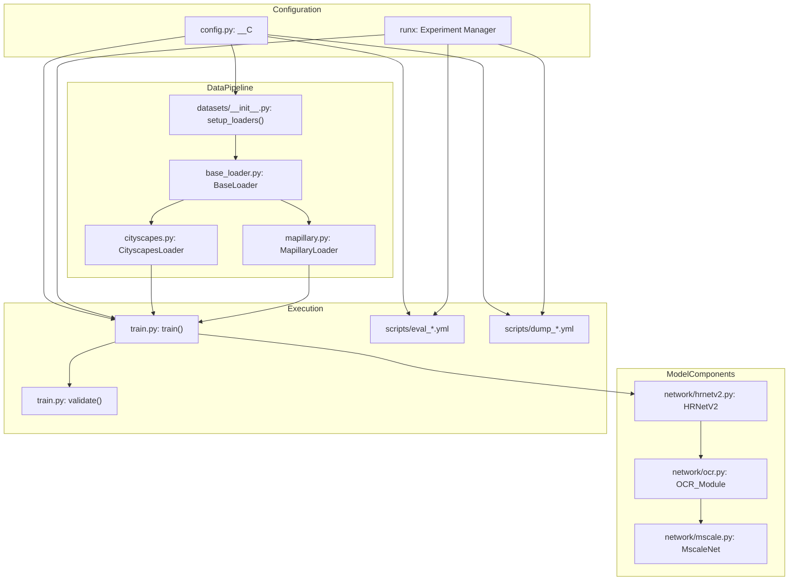
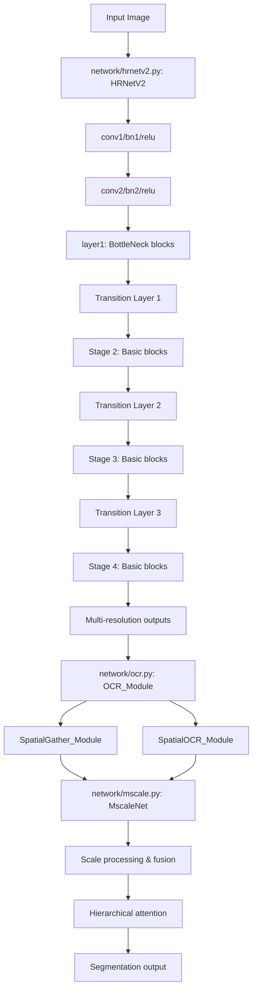
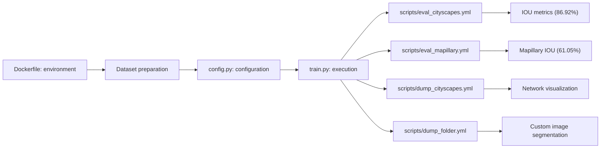

<!-- source: DeepWiki mcp.deepwiki.com · repo NVIDIA/semantic-segmentation · page 1 Overview · fetched 2026-10-26 -->

# Overview

Relevant source files

The following files were used as context for generating this wiki page:

- [README.md](README.md)

This document provides an introduction to the NVIDIA Semantic Segmentation repository, which implements the "Hierarchical Multi-Scale Attention for Semantic Segmentation" approach. For environment setup instructions, see [Installation and Environment Setup](#2.1). For information on preparing datasets, see [Dataset Preparation](#2.2).

## Purpose

The NVIDIA Semantic Segmentation repository provides a PyTorch implementation of semantic segmentation using hierarchical multi-scale attention. Semantic segmentation is a computer vision task that assigns a class label to each pixel in an image, providing a detailed understanding of scene content. This repository offers tools for training, evaluating, and visualizing state-of-the-art semantic segmentation models primarily for autonomous driving applications.

Sources: [README.md:1-5]()

## Repository Architecture

The following diagram shows the key components of the semantic segmentation system and their relationships:

The system consists of four main components:

1. **Configuration system**: Centers around `config.py`, which defines global parameters for datasets, model architecture, and training settings.

2. **Data pipeline**: Uses a common `BaseLoader` interface with specialized implementations for each dataset, handling data loading and preprocessing.

3. **Model architecture**: Implements a multi-component neural network with HRNet backbone, OCR module, and multi-scale attention mechanisms.

4. **Execution scripts**: Provides tools for training (`train.py`), evaluation (via `runx` scripts), and visualization of results.

Sources: [README.md:46-50]()

## Model Architecture

The semantic segmentation model implemented in this repository uses the following architecture:

The architecture has three key components:

1. **HRNetV2 backbone**: Maintains high-resolution representations throughout the network, providing detailed spatial information critical for accurate segmentation.

2. **OCR (Object Context Representation)**: Enhances features with object-level context, improving segmentation at object boundaries and for small objects.

3. **Multi-scale attention**: Applies hierarchical attention mechanism across different scales, allowing the model to focus on relevant features at multiple resolutions.

Sources: [README.md:3]()

## Workflow

The typical usage workflow in this repository consists of:

The workflow follows these steps:

1. Set up the Docker environment using the provided Dockerfile
2. Prepare datasets according to instructions in [Dataset Preparation](#2.2)
3. Configure the system by updating parameters in `config.py`
4. Train models using `train.py` and the `runx` experiment manager
5. Evaluate models and generate performance metrics
6. Visualize segmentation results

Sources: [README.md:52-108]()

## Supported Datasets

The repository supports two primary datasets and custom image folders:

| Dataset | Loader Class | Config Variable | IoU Performance |
|---------|-------------|-----------------|----------------|
| Cityscapes | `CityscapesLoader` | `__C.DATASET.CITYSCAPES_DIR` | 86.92% |
| Mapillary | `MapillaryLoader` | `__C.DATASET.MAPILLARY_DIR` | 61.05% |
| Custom Images | N/A | N/A | N/A |

The repository also supports auto-labeled Cityscapes data accessible via `__C.DATASET.CITYSCAPES_CUSTOMCOARSE`.

Sources: [README.md:28-43](), [README.md:64-73]()

## Key Features

- **State-of-the-art performance**: Achieves 86.92% IoU on Cityscapes validation set
- **Multi-dataset support**: Compatible with Cityscapes and Mapillary datasets
- **Hierarchical multi-scale attention**: Novel approach improving segmentation accuracy
- **Experiment management**: Integrated with `runx` for experiment tracking
- **Class-uniform sampling**: Improves training on imbalanced datasets
- **Comprehensive evaluation tools**: Measures model performance and generates visualizations

For detailed instructions on training models, see [Training Process](#5.1).
For evaluation and visualization details, see [Evaluation and Visualization](#5.2).

Sources: [README.md:46-108]()

---

