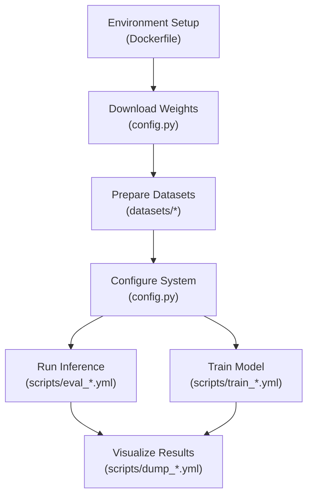
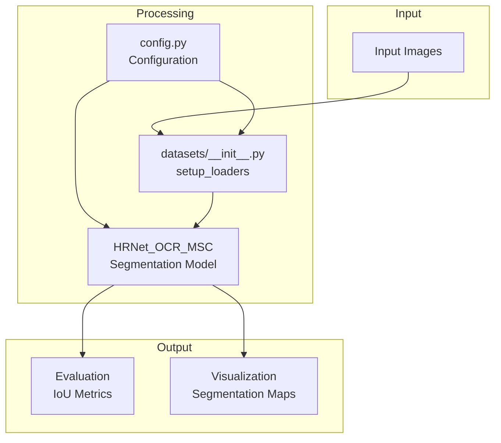
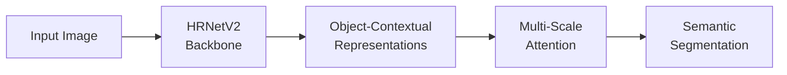

<!-- source: DeepWiki mcp.deepwiki.com · repo NVIDIA/semantic-segmentation · page 2 Getting Started · fetched 2026-10-26 -->

# Getting Started

<details>
<summary>Relevant source files</summary>

The following files were used as context for generating this wiki page:

- [Dockerfile](Dockerfile)
- [README.md](README.md)

</details>


This page guides you through the initial setup and basic operations of the NVIDIA Semantic Segmentation system. It provides the essential steps to get the system running and perform basic inference and training operations.

For detailed installation instructions, see [Installation and Environment Setup](#2.1). For comprehensive dataset preparation guidance, see [Dataset Preparation](#2.2).

## Environment Setup

The system requires Python 3.6 and PyTorch 1.3. You can set up the environment using Docker (recommended) or manual installation.

### Docker Setup (Recommended)

```bash
# Build the Docker image
docker build -t nvidia-semseg .

# Run a container with GPU support
docker run --gpus all -it --rm -v /path/to/data:/data nvidia-semseg
```

Sources: [Dockerfile:1-22]()

### Manual Installation

If not using Docker, install the required dependencies:
- PyTorch 1.3
- Various Python packages (runx, numpy, scikit-learn, etc.)
- Apex for mixed precision training

Sources: [Dockerfile:3-21](), [README.md:9-10]()

## System Workflow

The following diagram illustrates the basic workflow for using the semantic segmentation system:



Sources: [README.md:7-108]()

## Download Pretrained Weights

1. Create a directory for large assets:
   ```bash
   mkdir <large_asset_dir>
   ```

2. Update `__C.ASSETS_PATH` in `config.py` to point to this directory
3. Download pretrained weights from Google Drive and place them in `<large_asset_dir>/seg_weights`

Sources: [README.md:13-24]()

## Prepare Datasets

The system primarily supports Cityscapes and Mapillary datasets. Update `config.py` with the appropriate paths:

```python
# For Cityscapes
__C.DATASET.CITYSCAPES_DIR=<path_to_cityscapes>

# For Mapillary (optional)
__C.DATASET.MAPILLARY_DIR=<path_to_mapillary>

# For Cityscapes Autolabelled Images (optional)
__C.DATASET.CITYSCAPES_CUSTOMCOARSE=<path_to_autolabelled_cityscapes>
```

Sources: [README.md:26-43]()

## Running the System

The semantic segmentation system uses `runx` for experiment management. You can either use `runx` commands or call Python scripts directly.

### Available Scripts

| Script | Purpose | Expected Result |
|--------|---------|----------------|
| `scripts/eval_cityscapes.yml` | Run inference on Cityscapes | 86.92 IoU |
| `scripts/eval_mapillary.yml` | Run inference on Mapillary | 61.05 IoU |
| `scripts/dump_cityscapes.yml` | Generate visualizations for Cityscapes | Output images |
| `scripts/dump_folder.yml` | Run inference on custom images | Output images |
| `scripts/train_cityscapes.yml` | Train with Cityscapes fine data | 84.7 IoU |
| `scripts/train_cityscapes_sota.yml` | Train SOTA model | 86.8 IoU |

Sources: [README.md:46-108]()

### Running Inference

```bash
# Dry run (inspect command without executing)
python -m runx.runx scripts/eval_cityscapes.yml -i -n

# Actual run
python -m runx.runx scripts/eval_cityscapes.yml -i
```

Results will be saved in `./logs/eval_cityscapes/...`

Sources: [README.md:52-65]()

### Visualizing Results

```bash
# For Cityscapes validation set
python -m runx.runx scripts/dump_cityscapes.yml -i

# For custom images
python -m runx.runx scripts/dump_folder.yml -i
```

Sources: [README.md:75-87]()

### Training Models

```bash
# Standard training with HRNet+OCR+multi-scale attention
python -m runx.runx scripts/train_cityscapes.yml -i

# SOTA model training
python -m runx.runx scripts/train_cityscapes_sota.yml -i
```

Note: The first training run will build a centroid file for class-uniform sampling (takes ~10 minutes).

Sources: [README.md:93-108]()

## System Architecture

The following diagram shows the data flow through the semantic segmentation system:



Sources: System overview diagrams

## Model Architecture

The semantic segmentation model implements the Hierarchical Multi-Scale Attention approach:



Sources: [README.md:3](), System overview diagrams

## Next Steps

After completing the initial setup and running basic operations, you can explore:

- Detailed configuration options in [Configuration System](#3.1)
- In-depth understanding of the model in [Model Architecture](#3.3)
- Advanced training techniques in [Training Process](#5.1)
- Evaluation methods in [Evaluation and Visualization](#5.2)

---

