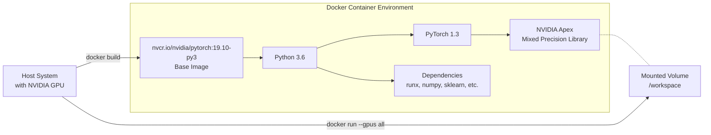
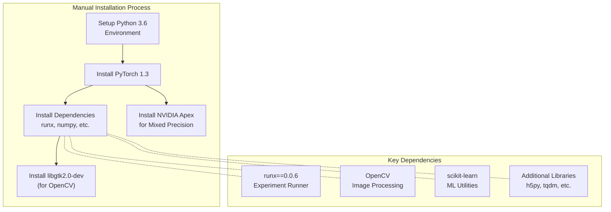
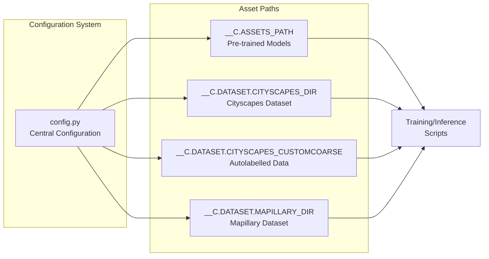
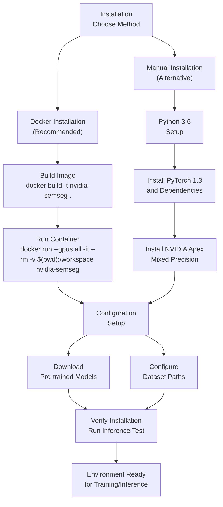

<!-- source: DeepWiki mcp.deepwiki.com · repo NVIDIA/semantic-segmentation · page 2.1 Installation and Environment Setup · fetched 2026-10-26 -->

# Installation and Environment Setup

<details>
<summary>Relevant source files</summary>

The following files were used as context for generating this wiki page:

- [Dockerfile](Dockerfile)
- [README.md](README.md)

</details>


This document provides comprehensive instructions for setting up the NVIDIA Semantic Segmentation environment, installing all required dependencies, and configuring the system for use. For information about preparing specific datasets after installation, see [Dataset Preparation](#2.2).

## System Requirements

Before beginning installation, ensure your system meets the following requirements:

- NVIDIA GPU with CUDA support
- Sufficient disk space for the codebase, datasets, and model weights
- Docker (recommended) or a compatible Python environment

## Docker Installation (Recommended)

The repository provides a Dockerfile that creates a containerized environment with all necessary dependencies pre-configured. This is the recommended installation method to ensure compatibility.

### Building the Docker Image

```bash
# Clone the repository
git clone https://github.com/NVIDIA/semantic-segmentation
cd semantic-segmentation

# Build the Docker image
docker build -t nvidia-semseg .
```

### Running the Docker Container

```bash
# Run the container with GPU support and mount the current directory
docker run --gpus all -it --rm -v $(pwd):/workspace nvidia-semseg
```



Sources: [Dockerfile:1-23](), [README.md:7-10]()

## Manual Installation (Alternative)

If you prefer not to use Docker, you can manually install the required dependencies:

### 1. Python Environment Setup

The system requires Python 3.6 and PyTorch 1.3.

```bash
# Create a virtual environment (optional but recommended)
python3 -m venv semantic-seg-env
source semantic-seg-env/bin/activate
```

### 2. Install Dependencies

```bash
# Install PyTorch 1.3 (command may vary based on your CUDA version)
pip install torch==1.3.0 torchvision==0.4.1

# Install required packages
pip install runx==0.0.6 numpy sklearn h5py jupyter scikit-image pillow piexif cffi tqdm dominate opencv-python nose ninja
```

### 3. Install NVIDIA Apex

Apex is required for mixed precision training and inference:

```bash
git clone https://github.com/NVIDIA/apex.git
cd apex
python setup.py install --cuda_ext --cpp_ext
```



Sources: [Dockerfile:3-18](), [README.md:9]()

## Downloading Pre-trained Models

The system uses pre-trained weights for inference and as initialization for training:

1. Create a directory for large assets outside the repository:
   ```bash
   mkdir <large_asset_dir>
   ```

2. Update the assets path in the configuration file:
   ```python
   # In config.py
   __C.ASSETS_PATH = "<large_asset_dir>"
   ```

3. Download pre-trained weights from Google Drive and place them in the assets directory:
   ```bash
   # After downloading, ensure weights are in:
   <large_asset_dir>/seg_weights/
   ```

Sources: [README.md:13-24]()

## Dataset Configuration

After installation, you'll need to configure the paths to your datasets:

### Cityscapes Dataset

If using Cityscapes, update the path in `config.py`:
```python
__C.DATASET.CITYSCAPES_DIR = "<path_to_cityscapes>"
```

### Cityscapes Autolabelled Images

For autolabelled data:
```python
__C.DATASET.CITYSCAPES_CUSTOMCOARSE = "<path_to_cityscapes_autolabelled>"
```

### Mapillary Dataset

If using Mapillary:
```python
__C.DATASET.MAPILLARY_DIR = "<path_to_mapillary>"
```



Sources: [README.md:25-43]()

## Verifying Installation

To verify your installation is working correctly, you can run a simple inference test on Cityscapes:

```bash
# Dry run (just prints the command without execution)
python -m runx.runx scripts/eval_cityscapes.yml -i -n

# Actual inference run
python -m runx.runx scripts/eval_cityscapes.yml -i
```

If successful, the system should report an IOU of approximately 86.92.

## Installation Structure Overview

The following diagram illustrates the complete installation and environment structure:



Sources: [Dockerfile:1-23](), [README.md:7-73]()

## Common Installation Issues

Here are solutions to common installation problems:

| Issue | Solution |
|-------|----------|
| Docker NVIDIA GPU access | Ensure the NVIDIA Container Toolkit is installed and `--gpus all` flag is used |
| Apex installation fails | Check CUDA compatibility; you may need to install specific CUDA/cuDNN versions |
| Out of memory during inference | Use 'O3' mode for amp (especially for Mapillary dataset) |
| Dataset path not found | Double-check the path in `config.py` and ensure dataset structure is correct |
| Pre-trained model not loading | Verify the model files are in `<large_asset_dir>/seg_weights/` |

Sources: [README.md:68-73]()

## Next Steps

After completing the installation and environment setup, proceed to:

1. [Dataset Preparation](#2.2) to download and structure your datasets
2. Training your first model using the instructions in [Training Process](#5.1)
3. Evaluating the model using [Evaluation and Visualization](#5.2)

---

