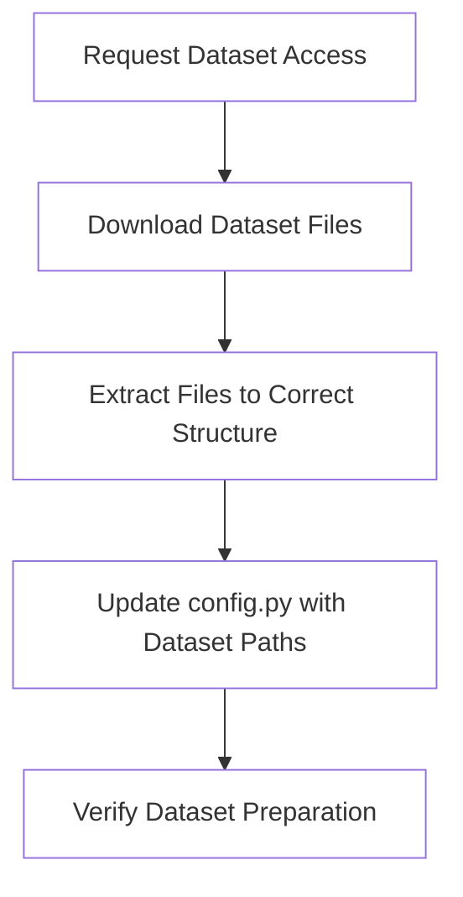
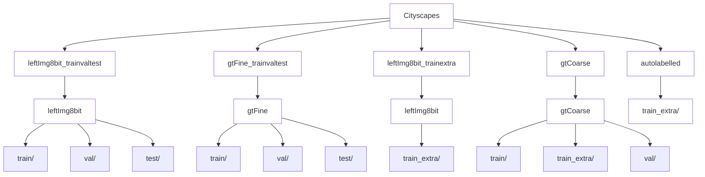
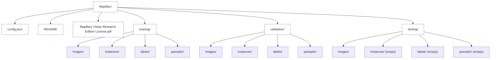
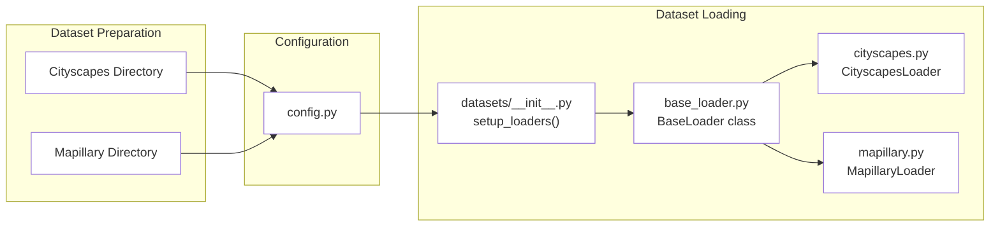

<!-- source: DeepWiki mcp.deepwiki.com · repo NVIDIA/semantic-segmentation · page 2.2 Dataset Preparation · fetched 2026-10-26 -->

# Dataset Preparation

<details>
<summary>Relevant source files</summary>

The following files were used as context for generating this wiki page:

- [PREPARE_DATASETS.md](PREPARE_DATASETS.md)
- [README.md](README.md)

</details>


This document explains how to download, prepare, and configure the datasets used in the NVIDIA semantic segmentation framework. The system primarily works with two datasets: Cityscapes and Mapillary Vistas. This page covers the acquisition of dataset files, necessary folder structures, and configuration steps to make the datasets ready for training and evaluation.

For information about using the datasets in training, see [Training Process](#5.1).

## Dataset Preparation Process Overview

The general process for preparing datasets involves:

1. Requesting access to the datasets from their respective providers
2. Downloading the dataset archive files
3. Extracting the files with the correct directory structure
4. Configuring the system to locate the datasets



Sources: [PREPARE_DATASETS.md:1-121](), [README.md:26-43]()

## Cityscapes Dataset

Cityscapes is a large-scale dataset containing high-resolution images with pixel-level annotations for urban street scenes. The semantic segmentation system uses Cityscapes for both training and evaluation.

### Downloading Cityscapes Dataset

1. Request access to the dataset from the [Cityscapes website](https://www.cityscapes-dataset.com/)
2. Download the following files:
   - `leftImg8bit_trainvaltest.zip` - Contains training, validation, and test images
   - `gtFine_trainvaltest.zip` - Contains fine annotations for training, validation, and test sets
   - `leftImg8bit_trainextra.zip` - Contains additional training images
   - `gtCoarse.zip` - Contains coarse annotations
   - `refinement_final_v0.zip` - Contains autolabelled data (only needed for SOTA training)

You can download these files manually from the website or use command-line tools as shown below:

```bash
# First, obtain login credentials by registering at the Cityscapes website
# Then use the following commands with your username and password

# Login to Cityscapes system
wget --keep-session-cookies --save-cookies=cookies.txt --post-data 'username=USERNAME&password=PASSWORD&submit=Login' https://www.cityscapes-dataset.com/login/

# Download the datasets (example for leftImg8bit_trainvaltest.zip)
wget -c -t 0 --load-cookies cookies.txt --content-disposition https://www.cityscapes-dataset.com/file-handling/?packageID=3
```

The packageIDs for the different files are:
- 1: gtFine_trainvaltest.zip (241MB)
- 2: gtCoarse.zip (1.3GB)
- 3: leftImg8bit_trainvaltest.zip (11GB)
- 4: leftImg8bit_trainextra.zip (44GB)

The autolabelled data can be downloaded from [Google Drive](https://drive.google.com/file/d/1DtPo-WP-hjaOwsbj6ZxTtOo_7R_4TKRG/view).

Sources: [PREPARE_DATASETS.md:41-70](), [README.md:33-38]()

### Cityscapes Folder Structure

After downloading, extract the files to create the following folder structure:



Each folder (like `train/`, `val/`, etc.) contains city-specific subfolders (e.g., `aachen/`, `bochum/`), which in turn contain the actual images and annotations.

Sources: [PREPARE_DATASETS.md:72-117]()

### Configuring Cityscapes

After extracting the files, update the `config.py` file to point to the Cityscapes directory:

```python
__C.DATASET.CITYSCAPES_DIR = '/path/to/Cityscapes'
```

If you are using the autolabelled data for SOTA training, also set:

```python
__C.DATASET.CITYSCAPES_CUSTOMCOARSE = '/path/to/Cityscapes'
```

Sources: [README.md:28-38]()

## Mapillary Vistas Dataset

Mapillary Vistas is a large-scale street-level image dataset with pixel-accurate and instance-specific human annotations for understanding street scenes.

### Downloading Mapillary Dataset

1. Request the research edition dataset from the [Mapillary website](https://www.mapillary.com/dataset/vistas/)
2. Download the `mapillary-vistas-dataset_public_v1.1.zip` file

Sources: [PREPARE_DATASETS.md:1-9]()

### Mapillary Folder Structure

Extract the ZIP file to create the following folder structure:



Note that the `instances/`, `labels/`, and `panoptic/` folders inside the `testing/` directory are empty.

Sources: [PREPARE_DATASETS.md:10-34]()

### Configuring Mapillary

After extracting the files, update the `config.py` file to point to the Mapillary directory:

```python
__C.DATASET.MAPILLARY_DIR = '/path/to/Mapillary'
```

Sources: [PREPARE_DATASETS.md:36-39](), [README.md:40-43]()

## Dataset Loading System Integration

The following diagram illustrates how the prepared datasets integrate with the semantic segmentation framework:



The prepared datasets are referenced in the configuration file (`config.py`), which is used by the dataset loaders to locate and load the data. The system uses a common base loader class that is extended by dataset-specific loaders for Cityscapes and Mapillary.

Sources: [README.md:26-43]()

## Verifying Dataset Preparation

When you first run a training script, the system will build a centroid file for the dataset, which is used for class-uniform sampling during training. This process takes about 10 minutes and indicates that the dataset is properly prepared and accessible.

```bash
# Example command to verify dataset preparation through training
python -m runx.runx scripts/train_cityscapes.yml -i -n
```

The `-n` flag performs a dry run, showing the command that would be executed without actually running it. This can help verify that the dataset paths are correctly configured.

Sources: [README.md:96-100]()

## Dataset Requirements Table

| Dataset | Required Files | Approximate Size | Configuration Variable |
|---------|----------------|------------------|------------------------|
| Cityscapes | leftImg8bit_trainvaltest.zip | 11GB | __C.DATASET.CITYSCAPES_DIR |
| Cityscapes | gtFine_trainvaltest.zip | 241MB | (same as above) |
| Cityscapes | leftImg8bit_trainextra.zip | 44GB | (same as above) |
| Cityscapes | gtCoarse.zip | 1.3GB | (same as above) |
| Cityscapes (SOTA) | refinement_final_v0.zip | 5GB | __C.DATASET.CITYSCAPES_CUSTOMCOARSE |
| Mapillary | mapillary-vistas-dataset_public_v1.1.zip | Varies | __C.DATASET.MAPILLARY_DIR |

Sources: [PREPARE_DATASETS.md:41-70](), [README.md:26-43]()

---

