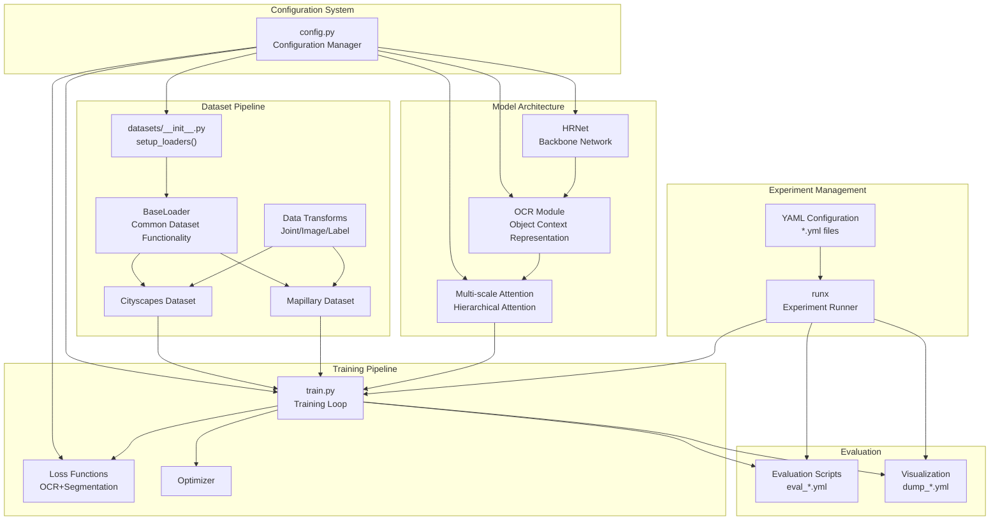
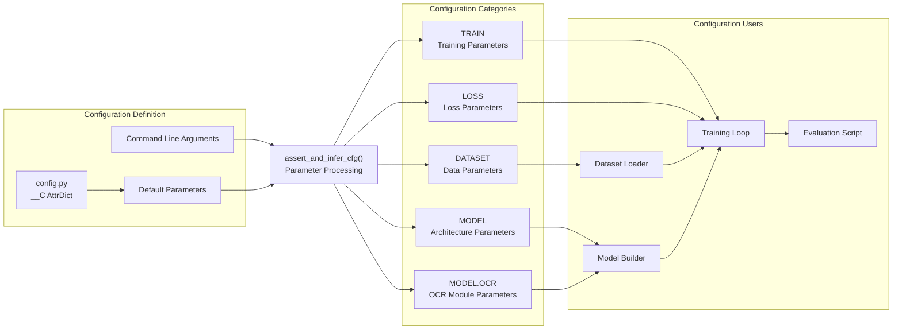
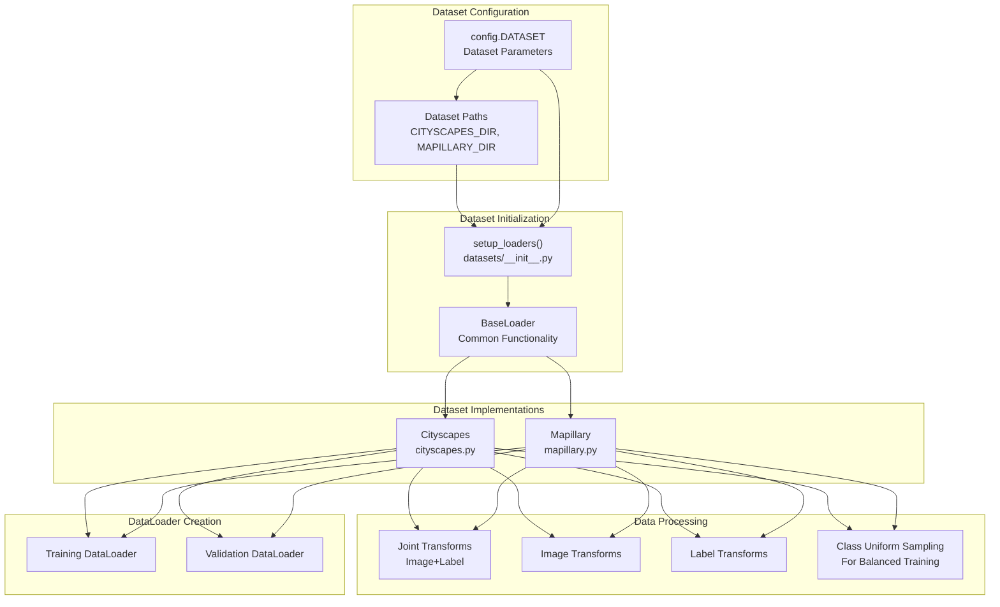
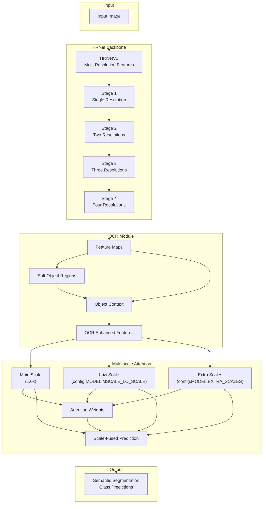
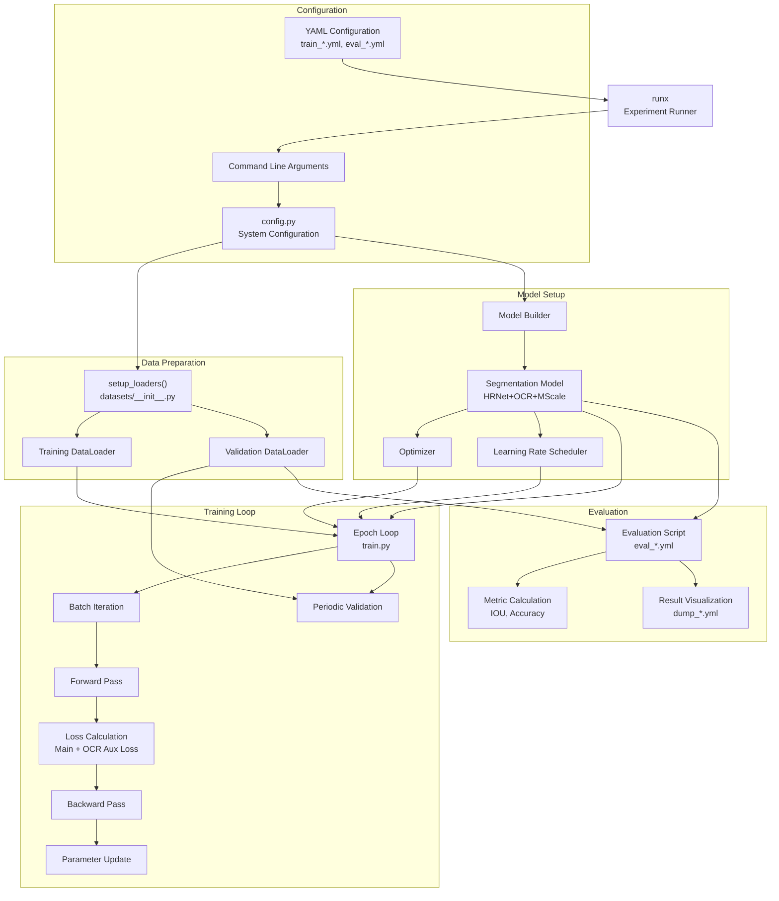
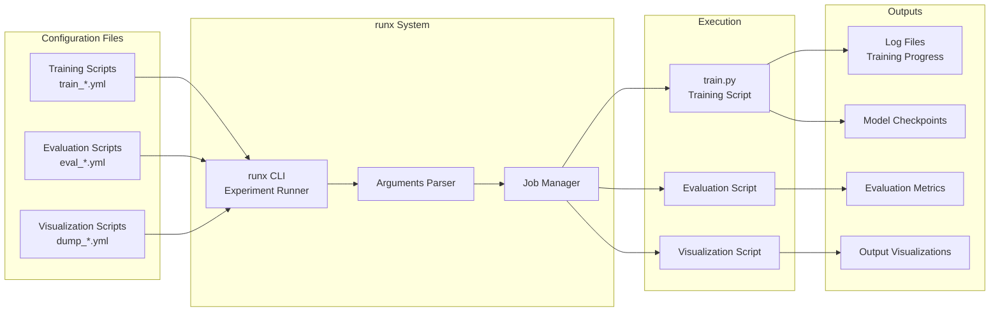
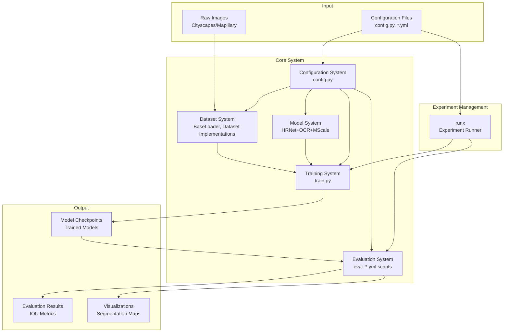

<!-- source: DeepWiki mcp.deepwiki.com · repo NVIDIA/semantic-segmentation · page 3 System Architecture · fetched 2026-10-26 -->

# System Architecture

Relevant source files

The following files were used as context for generating this wiki page:

- [README.md](README.md)
- [config.py](config.py)

This document provides a detailed overview of the system architecture for NVIDIA's semantic segmentation implementation. It covers the core components, their interactions, and the overall data flow through the system. For installation instructions, see [Installation and Environment Setup](#2.1), and for dataset preparation information, see [Dataset Preparation](#2.2).

## Overall Architecture

The semantic segmentation system implements the "Hierarchical Multi-Scale Attention for Semantic Segmentation" approach described in the repository's associated paper. The architecture consists of several key components that work together to enable efficient training and inference for semantic segmentation tasks.

Sources: [README.md:1-107](), [config.py:32-68]()

## Configuration System

The configuration system serves as the central manager for all parameters and settings in the semantic segmentation framework, allowing for consistent configuration across all components.

The configuration system is defined in `config.py` and uses an `AttrDict` class to create a hierarchical parameter structure. Key configuration categories include:

| Configuration Category | Purpose | Example Parameters |
|-----------------------|---------|-------------------|
| `DATASET` | Dataset paths and loading parameters | `CITYSCAPES_DIR`, `MAPILLARY_DIR`, `CLASS_UNIFORM_PCT` |
| `MODEL` | Model architecture configuration | `MSCALE`, `ALIGN_CORNERS`, `OCR` settings |
| `TRAIN` | Training process parameters | `FP16`, `RANDOM_BRIGHTNESS_SHIFT_VALUE` |
| `LOSS` | Loss function configuration | `OCR_ALPHA`, `OCR_AUX_RMI` |

The function `assert_and_infer_cfg()` processes command-line arguments to update the default configuration, ensuring consistency across the entire system.

Sources: [config.py:32-383]()

## Dataset Pipeline

The dataset pipeline manages the loading, processing, and batching of image data for training and evaluation.

The dataset pipeline consists of:

1. **Dataset Configuration**: Parameters in `config.py` define dataset paths and loading settings
2. **Dataset Initialization**: The `setup_loaders()` function in `datasets/__init__.py` creates appropriate dataset instances
3. **BaseLoader**: Provides common functionality for all dataset implementations
4. **Dataset Implementations**: Specific implementations for Cityscapes and Mapillary
5. **Data Processing**: Transforms for augmentation and normalization
6. **Class Uniform Sampling**: Ensures balanced class representation during training
7. **DataLoader Creation**: Batching and shuffling data for training and validation

The system supports multiple datasets with cross-validation splits, class-uniform sampling for handling imbalanced classes, and various data augmentation techniques.

Sources: [README.md:26-42](), [config.py:75-117]()

## Model Architecture

The model architecture implements the "Hierarchical Multi-Scale Attention for Semantic Segmentation" approach with three main components: HRNet backbone, OCR module, and multi-scale attention.

Key components of the model architecture include:

1. **HRNet Backbone**: Maintains high-resolution representations throughout the network, generating multi-scale feature maps.
   - Configured through parameters in `config.MODEL.OCR_EXTRA`
   - Uses a pre-trained HRNet model from `__C.MODEL.HRNET_CHECKPOINT`

2. **OCR (Object Context Representation)**: Enhances features with object context information.
   - Takes feature maps from HRNet as input
   - Generates soft object regions
   - Aggregates object context
   - Parameters controlled by `config.MODEL.OCR.MID_CHANNELS` and `config.MODEL.OCR.KEY_CHANNELS`

3. **Multi-scale Attention**: Fuses predictions from multiple scales using attention mechanisms.
   - Processes features at multiple scales (main, low, and extra scales)
   - Generates attention weights for each scale
   - Combines predictions using attention weights
   - Controlled by parameters like `config.MODEL.MSCALE_LO_SCALE` and `config.MODEL.EXTRA_SCALES`

The entire architecture is highly configurable through parameters in `config.py`, allowing for experimentation with different model configurations.

Sources: [README.md:3-3](), [config.py:119-190]()

## Training and Evaluation Pipeline

The training and evaluation pipeline manages the model training process, evaluation, and result visualization.

The training and evaluation pipeline consists of:

1. **Configuration**: Parameters from `config.py`, command-line arguments, and YAML configuration files
2. **Data Preparation**: Dataset loaders for training and validation
3. **Model Setup**: Initializing the segmentation model, optimizer, and learning rate scheduler
4. **Training Loop**: Iterating through epochs and batches, updating model parameters
   - Forward pass through the model
   - Loss calculation (main segmentation loss + OCR auxiliary loss)
   - Backward pass for gradient calculation
   - Parameter updates
   - Periodic validation

5. **Evaluation**: Assessing model performance and visualizing results
   - IOU (Intersection over Union) calculation
   - Visualization of segmentation outputs

The system uses the `runx` tool for experiment management, which provides a convenient way to configure and run training and evaluation jobs.

Sources: [README.md:46-108](), [config.py:204-383]()

## Experiment Management

The experiment management system uses `runx` to configure, run, and track experiments.

The experiment management system handles:

1. **Configuration Files**: YAML files for different experiment types
   - `train_*.yml`: Training configurations
   - `eval_*.yml`: Evaluation configurations 
   - `dump_*.yml`: Visualization configurations

2. **runx CLI**: Command-line interface for running experiments
   - Parses experiment configuration
   - Manages job execution
   - Example: `python -m runx.runx scripts/train_cityscapes.yml -i`

3. **Execution**: Running the appropriate scripts with the specified parameters
   - Training script (`train.py`)
   - Evaluation scripts
   - Visualization scripts

4. **Outputs**: Storing experiment results
   - Log files with training progress
   - Model checkpoints
   - Evaluation metrics
   - Output visualizations

This system enables efficient experimentation by simplifying the process of configuring and running different training and evaluation scenarios.

Sources: [README.md:46-108]()

## System Integration

This diagram shows how all components integrate to form the complete semantic segmentation system:

The complete system integrates all components through:

1. **Configuration Flow**: Configuration parameters from `config.py` and YAML files flow through to all components
2. **Data Flow**: Raw image data flows through the dataset pipeline to the training and evaluation systems
3. **Model Flow**: The model architecture receives processed data and produces segmentation outputs
4. **Result Flow**: Model outputs flow through evaluation to produce metrics and visualizations

This integration ensures all components work together efficiently to train and evaluate semantic segmentation models.

Sources: [README.md:1-108](), [config.py:1-383]()

---

