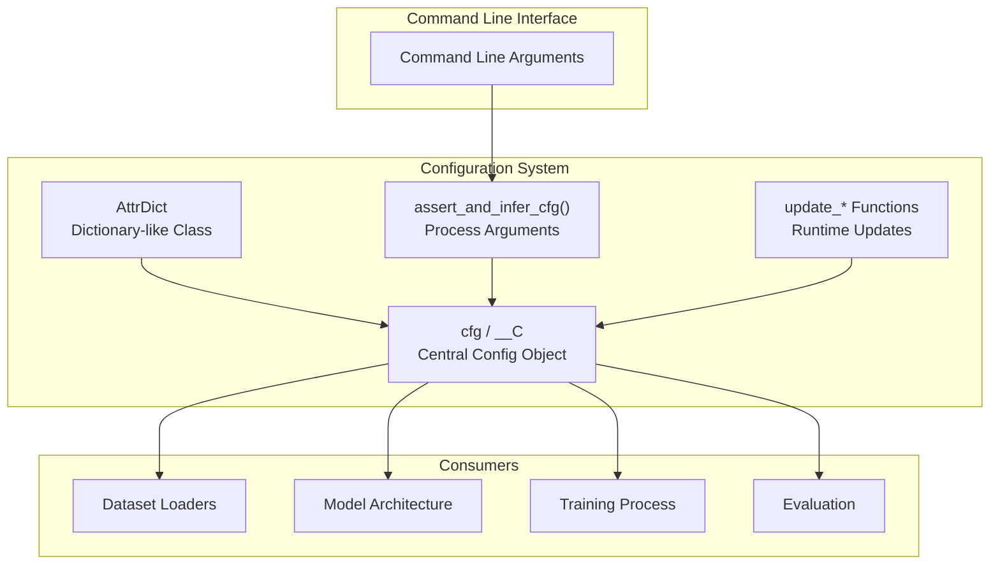
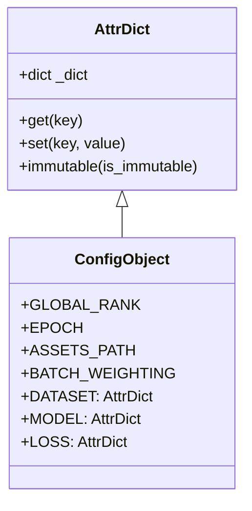
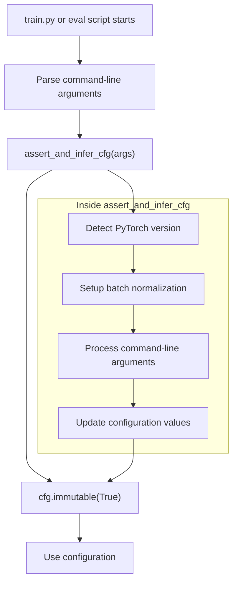
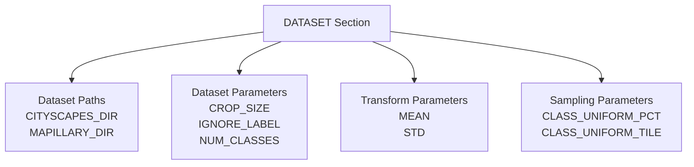
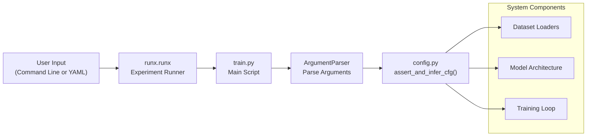

<!-- source: DeepWiki mcp.deepwiki.com · repo NVIDIA/semantic-segmentation · page 3.1 Configuration System · fetched 2026-10-26 -->

# Configuration System

<details>
<summary>Relevant source files</summary>

The following files were used as context for generating this wiki page:

- [README.md](README.md)
- [config.py](config.py)

</details>


## Purpose and Scope

The Configuration System is the central control mechanism that manages parameters for all aspects of the semantic segmentation system. It provides a flexible, hierarchical structure for defining default values and customizing behavior throughout the codebase. This document covers how the configuration system works, its key components, and how it integrates with other parts of the system.

For information about dataset-specific configuration, see [Dataset Loading Pipeline](#3.2).

## Overview

The configuration system uses a hierarchical, dictionary-like structure to organize parameters related to datasets, models, training procedures, and other components. It supports setting default values, updating configuration at runtime, and freezing the configuration to prevent accidental modifications.



Sources: [config.py:32-48](), [config.py:205-362]()

## Core Components

### AttrDict and Central Configuration Object

The system is built around a central configuration object, an instance of `AttrDict` called `__C` and aliased as `cfg`. This object provides dictionary-like access to parameters while allowing dot notation for easier access.



Sources: [config.py:43-48]()

### Configuration Sections

The configuration is organized into sections, each handling related parameters:

| Section | Purpose | Examples |
|---------|---------|----------|
| Global | General settings | `ASSETS_PATH`, `EPOCH`, `GLOBAL_RANK` |
| `DATASET` | Dataset-specific parameters | Paths, transformations, class weights |
| `MODEL` | Model architecture settings | Network type, batch norm settings, checkpoint paths |
| `LOSS` | Loss function settings | Weights, loss types |
| `OPTIONS` | Miscellaneous options | Test mode, initialization settings |

Sources: [config.py:49-190]()

## Configuration Process

### Default Configuration

The system defines sensible defaults for all parameters. Key defaults include:

1. Paths to datasets and pre-trained models
2. Model architecture parameters
3. Dataset handling settings

Example of default path configuration:
```python
__C.ASSETS_PATH = '/home/dcg-adlr-atao-data.cosmos277/assets'
__C.DATASET.CITYSCAPES_DIR = os.path.join(__C.ASSETS_PATH, 'data/Cityscapes')
```

Sources: [config.py:52-53](), [config.py:78-79]()

### Configuration Customization

The primary entry point for configuration customization is the `assert_and_infer_cfg` function, which processes command-line arguments and updates the configuration accordingly.



Sources: [config.py:205-362](), [README.md:47-108]()

### Runtime Updates

The configuration system provides functions to update certain parameters during runtime:

- `update_epoch(epoch)`: Updates the current epoch counter
- `update_dataset_cfg(num_classes, ignore_label)`: Updates dataset-specific configuration
- `update_dataset_inst(dataset_inst)`: Updates the dataset instance

These functions temporarily make the configuration mutable, update the values, and then make it immutable again.

Sources: [config.py:364-382]()

## Key Configuration Parameters

### Dataset Configuration



Sources: [config.py:76-116](), [README.md:25-43]()

### Model Configuration

Key model configuration includes:

1. Backbone network selection (e.g., HRNet)
2. Feature enhancement modules (OCR, Multi-scale attention)
3. Batch normalization settings
4. Checkpoint paths

Sources: [config.py:119-149](), [config.py:158-190]()

## Common Usage Patterns

### Setting Dataset Paths

As shown in the README, dataset paths are commonly set by updating the configuration:

```python
# Update paths in config.py or via command-line arguments
__C.DATASET.CITYSCAPES_DIR = <path_to_cityscapes>
__C.DATASET.MAPILLARY_DIR = <path_to_mapillary>
```

Sources: [README.md:28-43]()

### Command-line Configuration Flow

The system is designed to work with both direct Python calls and the `runx` experiment runner:

1. User provides arguments via command line or YAML configuration files
2. Arguments are processed in `assert_and_infer_cfg`
3. Configuration is frozen with `cfg.immutable(True)`
4. System components access configuration via the `cfg` object



Sources: [README.md:47-108](), [config.py:205-362]()

## Compatibility and Extensions

The configuration system is designed to be adaptive to different PyTorch versions and execution environments. It provides flexibility for extending with new parameters or modifying existing ones while maintaining backward compatibility.

Sources: [config.py:193-202]()

## Best Practices

1. **Asset Path Management**: Set `__C.ASSETS_PATH` to point to a directory where large files can be stored, outside the repository.

2. **Configuration Review**: Before running experiments, review the configuration in `config.py` to ensure paths and parameters are set correctly.

3. **Customization via Arguments**: Use command-line arguments or YAML files to customize configuration rather than directly modifying `config.py`.

4. **Use the Immutability Feature**: After initial setup, the configuration is made immutable to prevent accidental changes. This is a safety feature that should be respected.

Sources: [README.md:13-23](), [config.py:359-362]()

---

