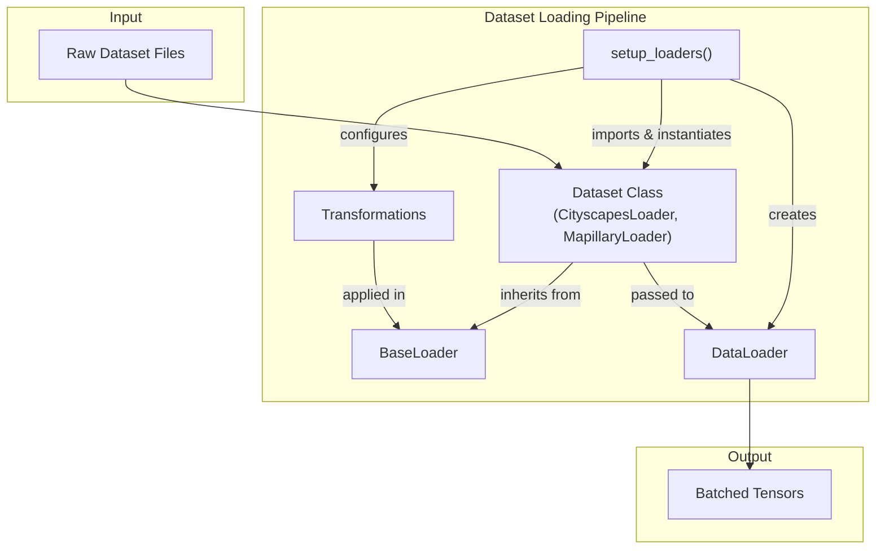
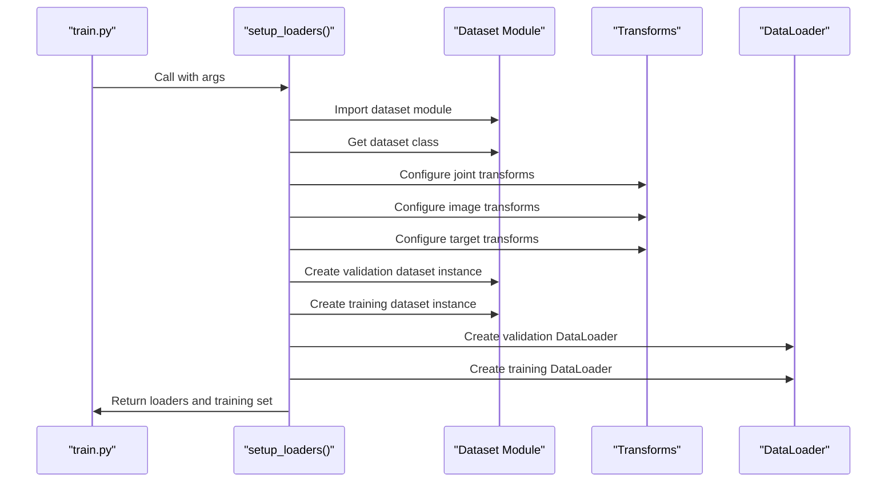
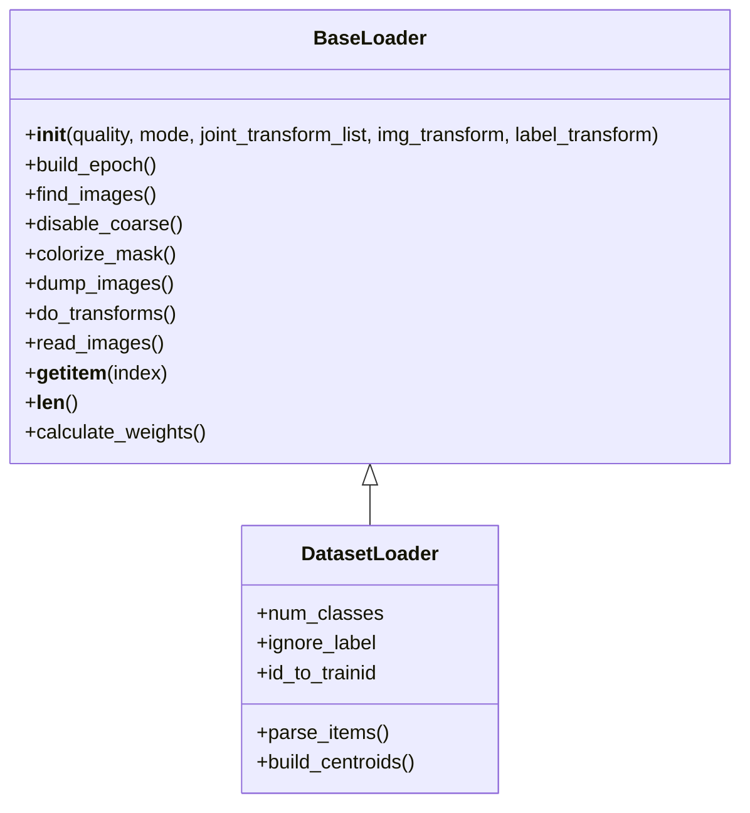
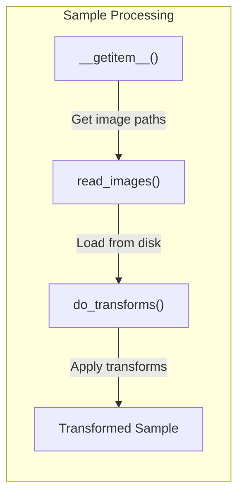
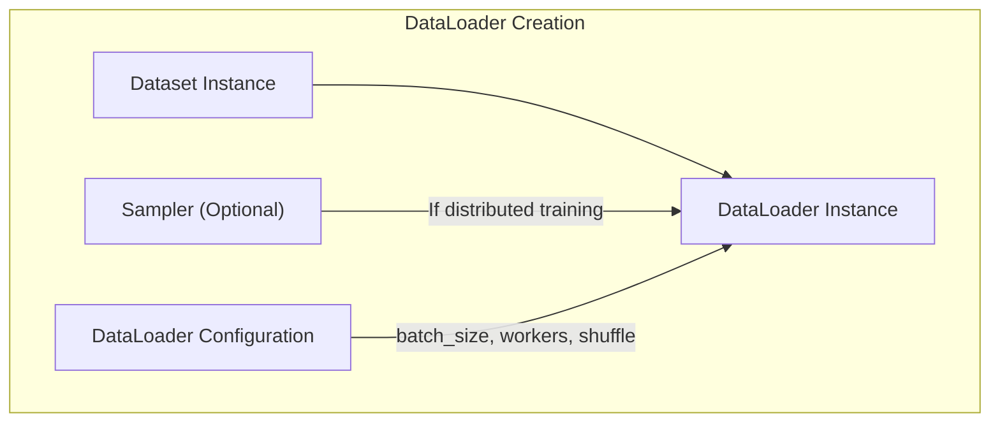
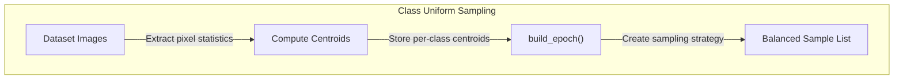

<!-- source: DeepWiki mcp.deepwiki.com · repo NVIDIA/semantic-segmentation · page 3.2 Dataset Loading Pipeline · fetched 2026-10-26 -->

# Dataset Loading Pipeline

<details>
<summary>Relevant source files</summary>

The following files were used as context for generating this wiki page:

- [datasets/__init__.py](datasets/__init__.py)
- [datasets/base_loader.py](datasets/base_loader.py)

</details>


## Introduction

This document describes the dataset loading pipeline in the NVIDIA semantic segmentation framework, which transforms raw image and mask data into batched tensors suitable for model training and evaluation. The pipeline handles dataset acquisition, transformations, augmentations, and batch creation. For information about preparing the raw datasets, see [Dataset Preparation](#2.2).

## Pipeline Overview

The dataset loading pipeline consists of several key components that work together to efficiently load and prepare data:



Sources: [datasets/__init__.py:45-199](), [datasets/base_loader.py:45-102]()

## Dataset Loading Setup

The central function that orchestrates the dataset loading process is `setup_loaders()` in `datasets/__init__.py`. This function:

1. Dynamically imports the specific dataset module based on the dataset name provided
2. Configures transformations and augmentations
3. Creates dataset instances for training and validation
4. Wraps datasets in PyTorch DataLoaders with appropriate sampling strategies



Sources: [datasets/__init__.py:45-72](), [datasets/__init__.py:149-199]()

## Dataset Transformations

The pipeline employs three types of transformations:

1. **Joint Transforms** - Applied to both image and mask simultaneously (e.g., resizing, cropping, flipping)
2. **Image Transforms** - Applied only to input images (e.g., color jitter, blur, normalization)
3. **Target Transforms** - Applied only to masks (e.g., conversion to tensor)

### Joint Transformations

Joint transforms ensure that both the image and its corresponding mask undergo the same spatial transformations to maintain alignment:

```
- RandomSizeAndCrop: Randomly crops the image and mask to the specified size
- RandomHorizontallyFlip: Randomly flips the image and mask horizontally
- RandAugment: Applies random augmentations (when enabled)
```

### Image Transformations

Image-specific transforms are applied only to the input images:

```
- ColorJitter: Adjusts brightness, contrast, saturation, and hue
- RandomBilateralBlur or RandomGaussianBlur: Applies blur effects
- ToTensor: Converts the image to a PyTorch tensor
- Normalize: Normalizes the image using mean and standard deviation
```

### Target Transformations

Target transforms are applied only to the segmentation masks:

```
- MaskToTensor: Converts the mask to a PyTorch tensor
- RelaxedBoundaryLossToTensor: Special transform for boundary-aware loss functions
```

Sources: [datasets/__init__.py:63-122](), [datasets/base_loader.py:120-150]()

## BaseLoader Class

The `BaseLoader` class is the foundation for all dataset loaders in the system. Dataset-specific loaders (like Cityscapes and Mapillary) inherit from this class, which provides common functionality:



Key methods of the `BaseLoader` class:

- **build_epoch()**: Prepares image lists for class-uniform sampling
- **find_images()**: Locates image and mask file pairs
- **do_transforms()**: Applies transformations to image and mask pairs
- **read_images()**: Loads images and masks from disk, converting labels if needed
- **__getitem__()**: Returns a transformed image-mask pair for a given index

Sources: [datasets/base_loader.py:45-236]()

## Sample Processing Flow

When a sample is requested from the dataset loader, it goes through the following processing steps:



Steps in detail:

1. `__getitem__()` is called with an index
2. Image and mask paths are retrieved, along with centroid information if using class-uniform sampling
3. `read_images()` loads the image and mask files and converts mask IDs to training IDs
4. Special processing (like thresholding for coarse labels) is applied if needed
5. `do_transforms()` applies the transformation pipeline to the image and mask
6. The transformed image, mask, image name, and scale factor are returned

Sources: [datasets/base_loader.py:189-229](), [datasets/base_loader.py:152-187]()

## DataLoader Creation

The final step in the pipeline is creating PyTorch DataLoader objects that efficiently batch samples and provide iteration functionality:



Key DataLoader parameters:

| Parameter | Training | Validation | Description |
|-----------|----------|------------|-------------|
| batch_size | args.bs_trn * ngpu | args.bs_val | Number of samples per batch |
| num_workers | args.num_workers | args.num_workers // 2 | Number of subprocesses for data loading |
| shuffle | True (if no sampler) | False | Whether to shuffle the dataset |
| drop_last | True | False | Whether to drop the last incomplete batch |
| sampler | DistributedSampler (if args.apex) | DistributedSampler (if args.apex) | Sample strategy for distributed training |

Sources: [datasets/__init__.py:161-197]()

## Class Uniform Sampling

For training with balanced class representation, the framework supports class-uniform sampling:



When enabled, this approach:

1. Analyzes images to find the centroids (center points) of semantic regions for each class
2. Creates a sampling strategy that balances the representation of different classes
3. Uses the `build_epoch()` method to reconstruct the sampling list for each training epoch
4. Ensures underrepresented classes are sampled more frequently

This functionality is particularly important for handling imbalanced datasets where certain classes (like "road" or "sky") may dominate while others (like "traffic light" or "bicycle") are rare.

Sources: [datasets/base_loader.py:62-71]()

## Dataset-Specific Loaders

The framework dynamically loads the appropriate dataset module based on the specified dataset name:

```python
mod = importlib.import_module('datasets.{}'.format(args.dataset))
dataset_cls = getattr(mod, 'Loader')
```

Dataset-specific loaders (like CityscapesLoader or MapillaryLoader) inherit from BaseLoader and add specialized functionality for:

- Converting dataset-specific IDs to training IDs
- Handling dataset-specific directory structures
- Managing dataset-specific quality levels (fine/coarse annotations)
- Implementing dataset-specific augmentation strategies

For more information about specific dataset handlers, see:
- [Cityscapes Dataset](#4.1)
- [Mapillary Dataset](#4.2)

Sources: [datasets/__init__.py:53-61]()

---

