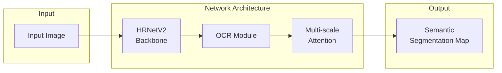
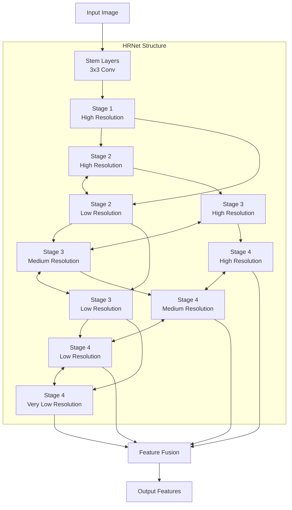
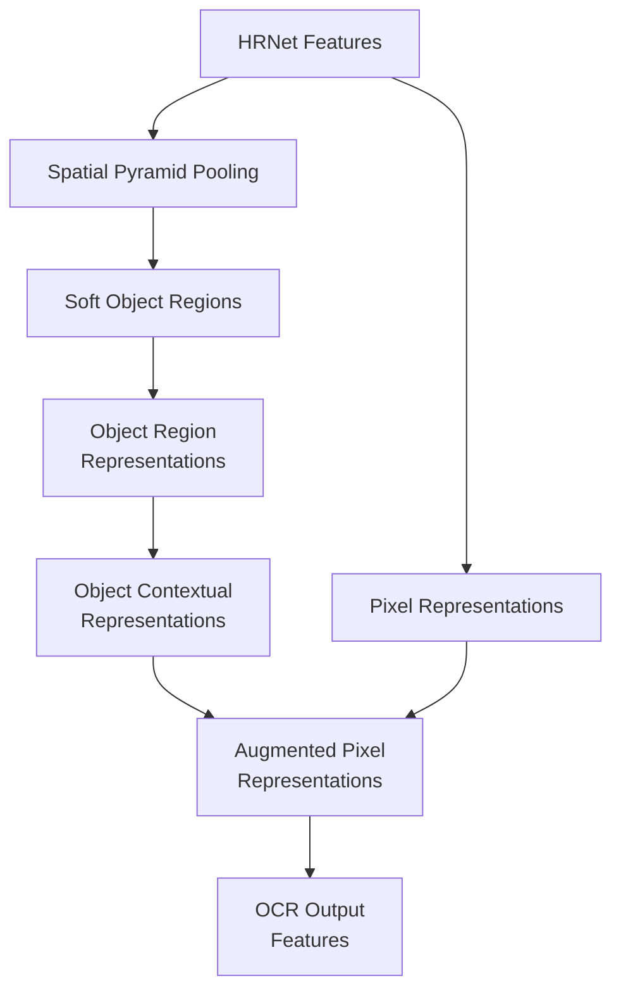
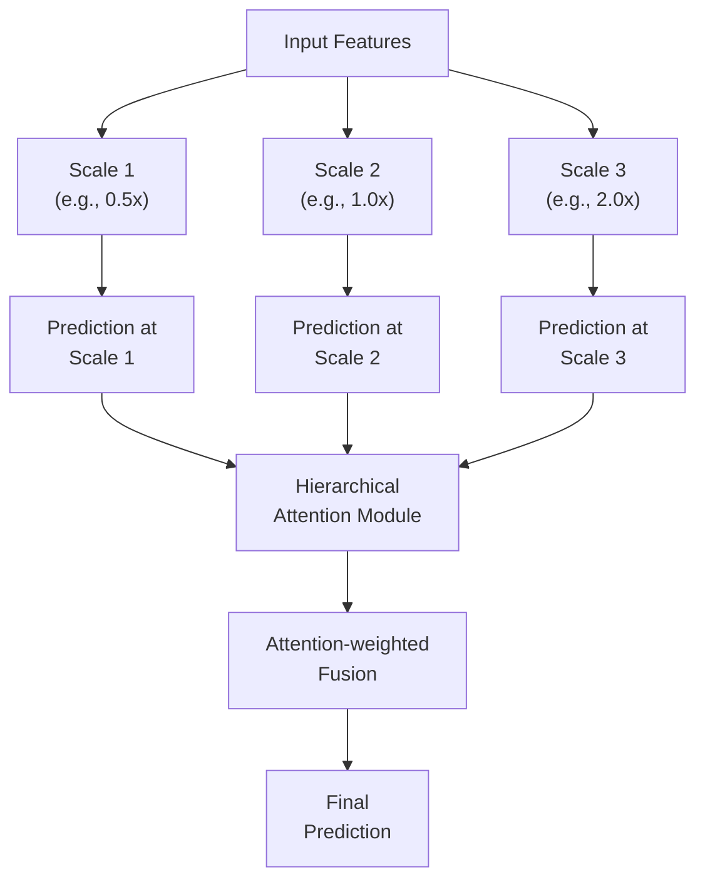
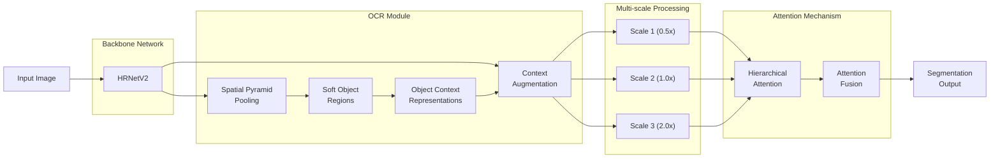

<!-- source: DeepWiki mcp.deepwiki.com · repo NVIDIA/semantic-segmentation · page 3.3 Model Architecture · fetched 2026-10-26 -->

# Model Architecture

<details>
<summary>Relevant source files</summary>

The following files were used as context for generating this wiki page:

- [README.md](README.md)

</details>


This document details the neural network architecture employed in NVIDIA's semantic segmentation system, which implements the "Hierarchical Multi-Scale Attention for Semantic Segmentation" approach described in the [paper](https://arxiv.org/abs/2005.10821). For information about training procedures, see [Training Process](#5.1), and for dataset handling, see [Dataset Loading Pipeline](#3.2).

## Architecture Overview

The semantic segmentation model consists of three primary components working together to achieve state-of-the-art performance:

1. **HRNet (High-Resolution Network)** - The backbone network that maintains high-resolution representations throughout
2. **OCR (Object-Contextual Representations)** - A module that augments features with object context
3. **Multi-scale Attention** - A hierarchical attention mechanism that focuses on features at different scales

### High-level Architecture Flow



Sources: README.md

## HRNet Backbone

HRNetV2 serves as the backbone network, providing strong feature representations by maintaining high-resolution throughout the entire network. Unlike traditional CNNs that recover resolution from downsampled features, HRNet preserves high-resolution representations and creates reliable high-resolution-to-low-resolution connections.

### HRNet Architecture



The key characteristic of HRNet is its parallel multi-resolution feature pathways and the repeated information exchange between resolutions, allowing the network to maintain both fine spatial details and strong semantic information.

Sources: README.md

## OCR Module (Object-Contextual Representations)

The OCR module enhances feature representations by incorporating object context information. It utilizes soft object regions to aggregate object-contextual representations and then augments the original pixel representations with these object-contextual features.

### OCR Module Structure



The OCR module works by:
1. Generating preliminary pixel-wise predictions using a spatial pyramid pooling layer
2. Forming soft object regions based on these predictions
3. Computing object region representations by aggregating pixel features
4. Creating object-contextual representations for each pixel
5. Augmenting the original pixel representations with the context information

Sources: README.md

## Hierarchical Multi-Scale Attention

The multi-scale attention mechanism is the key innovation in this architecture. It applies a hierarchical attention approach to effectively fuse predictions from different scales and boundary refinement.

### Multi-scale Attention Mechanism



The multi-scale attention:
1. Processes the input at multiple scales (typically 0.5x, 1.0x, and 2.0x)
2. Generates predictions for each scale
3. Uses a hierarchical attention mechanism to determine optimal weights for each scale at each pixel
4. Combines the predictions using the learned attention weights

This approach significantly improves boundary delineation and handles objects of varying sizes more effectively than traditional methods.

Sources: README.md

## Complete Architecture and Data Flow

The following diagram illustrates the complete data flow through the semantic segmentation architecture:



Sources: README.md

## Implementation and Configuration

The model architecture is configurable through the configuration system. Key configuration parameters include:

| Parameter | Description |
|-----------|-------------|
| MODEL.OCR | Enables/disables OCR module |
| MODEL.MSCALE | Enables/disables multi-scale attention |
| MODEL.BACKBONE | Backbone network configuration (HRNet) |
| DATASET | Dataset-specific configurations |
| TRAIN.SCALE | Scales used for multi-scale processing |

### Example Configuration and Usage

As shown in the README, the complete model with all components can be used for training on Cityscapes:

```bash
python -m runx.runx scripts/train_cityscapes.yml -i
```

The command trains a model using "HRNet + OCR + multi-scale attention" on the Cityscapes dataset, achieving up to 86.92 IoU on evaluation when using scales of 0.5, 1.0, and 2.0.

For inference, similar commands are used:

```bash
python -m runx.runx scripts/eval_cityscapes.yml -i
```

This evaluates the model on Cityscapes validation data using the full architecture.

Sources: README.md

## Memory Considerations

The full architecture with multi-scale attention requires significant GPU memory, especially for datasets like Mapillary. The README notes that evaluation on Mapillary requires 32GB of GPU memory and the use of 'O3' mode for automatic mixed precision (AMP) to avoid out-of-memory errors.

For systems with limited memory, the multi-scale attention component can be disabled, or the scales and crop size can be reduced at the cost of some accuracy.

Sources: README.md

---

