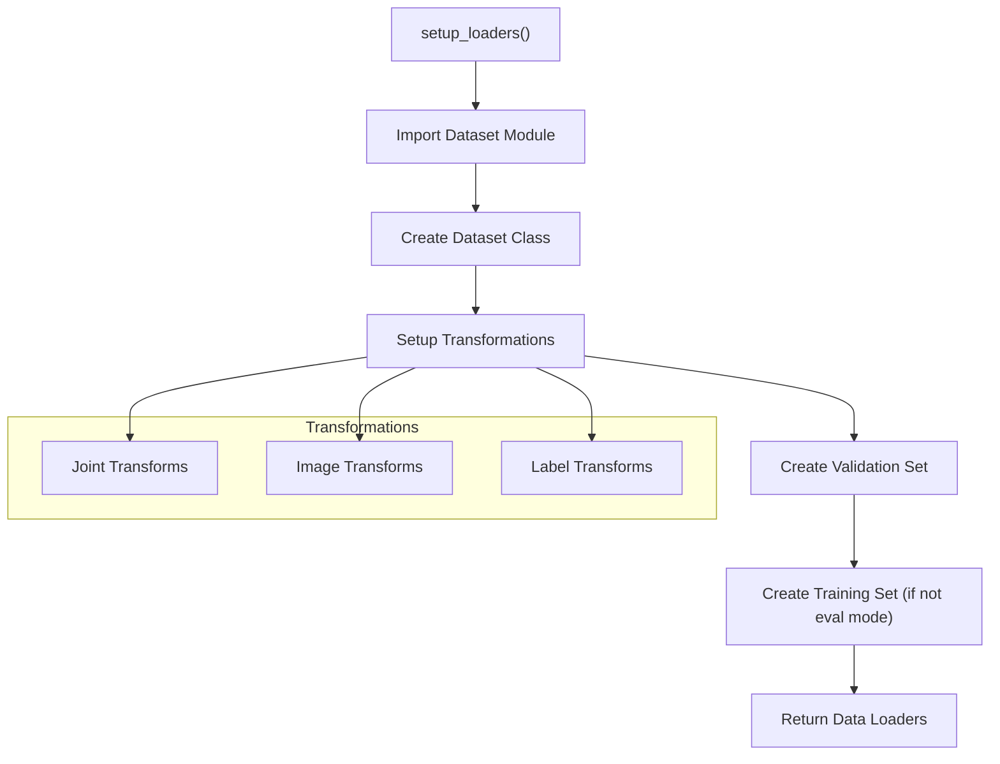
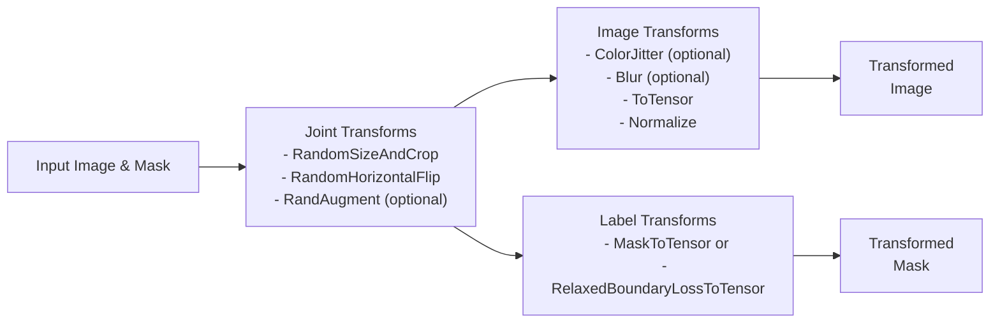
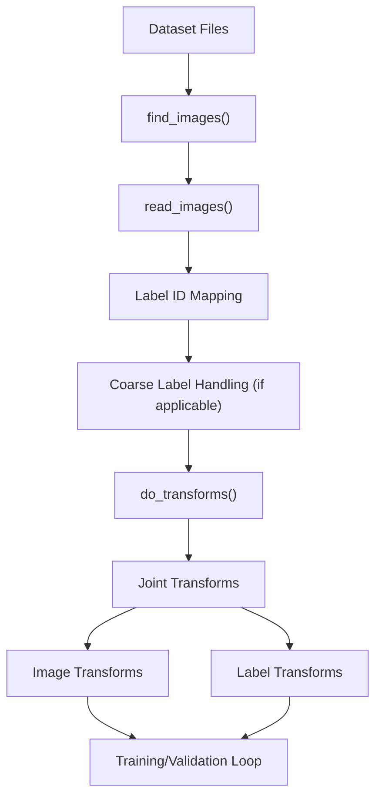
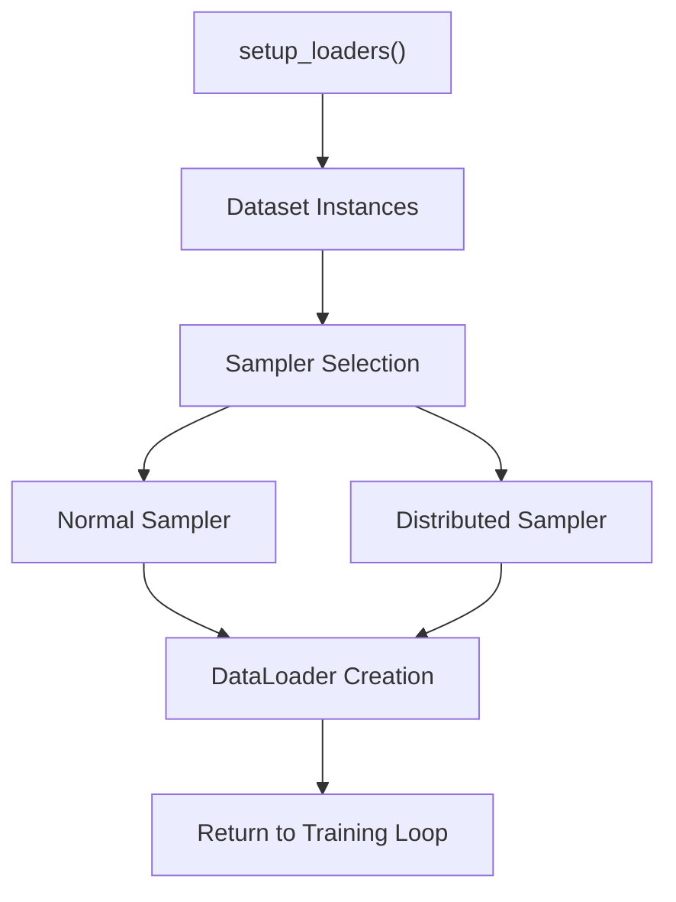

<!-- source: DeepWiki mcp.deepwiki.com · repo NVIDIA/semantic-segmentation · page 4 Dataset Handlers · fetched 2026-10-26 -->

# Dataset Handlers

<details>
<summary>Relevant source files</summary>

The following files were used as context for generating this wiki page:

- [datasets/__init__.py](datasets/__init__.py)
- [datasets/base_loader.py](datasets/base_loader.py)

</details>


This page provides an overview of the dataset handling system in the NVIDIA semantic segmentation repository. The dataset handlers are responsible for loading, preprocessing, and feeding image data into the semantic segmentation models. For information about specific dataset preparation steps, see [Dataset Preparation](#2.2).

## Dataset Handler Architecture

The dataset handling system follows a modular design with a base class that provides common functionality and specialized dataset loaders for specific datasets like Cityscapes and Mapillary.

```mermaid
classDiagram
    class "BaseLoader" {
        +__init__(quality, mode, joint_transform_list, img_transform, label_transform)
        +build_epoch()
        +find_images()
        +colorize_mask()
        +do_transforms()
        +read_images()
        +__getitem__()
        +__len__()
    }
    
    class "Dataset Loaders" {
        +setup_loaders()
    }
    
    class "CityscapesLoader" {
        +num_classes
        +ignore_label
        +trainid_to_name
        +class_uniform_pct
        +class_uniform_tile
    }
    
    class "MapillaryLoader" {
        +num_classes
        +ignore_label
        +trainid_to_name
        +class_uniform_pct
        +class_uniform_tile
    }
    
    "BaseLoader" <|-- "CityscapesLoader"
    "BaseLoader" <|-- "MapillaryLoader"
    "Dataset Loaders" --> "CityscapesLoader" : creates
    "Dataset Loaders" --> "MapillaryLoader" : creates
```

Sources: [datasets/base_loader.py:45-236](), [datasets/__init__.py:45-199]()

## Initialization and Setup

The dataset handling process begins with the `setup_loaders` function, which creates and configures the appropriate data loaders based on the specified dataset.



Sources: [datasets/__init__.py:45-199]()

### Creating Dataset Loaders

The `setup_loaders` function dynamically imports the specified dataset module and initializes dataset instances with appropriate transformations for both training and validation.

Key steps in the setup process:

1. Import the dataset module based on the dataset name provided
2. Set up transformations for images and masks
3. Create validation data loader
4. If not in evaluation mode, create training data loader
5. Return the data loaders and training set

The system supports distributed training through specialized samplers when using NVIDIA's Apex library for mixed precision training.

Sources: [datasets/__init__.py:45-199]()

## BaseLoader Class

The `BaseLoader` class provides foundational functionality for all dataset handlers in the system. It handles:

- Reading images and their corresponding masks
- Applying transformations to both images and masks
- Converting label IDs to training IDs
- Supporting class uniform sampling for balanced training
- Handling dataset-specific logic such as coarse label handling

### Key Methods

| Method | Purpose |
|--------|---------|
| `__init__` | Initializes the loader with transform lists and dataset settings |
| `find_images` | Static method to locate image and mask files |
| `read_images` | Reads image and mask files and applies ID mapping |
| `do_transforms` | Applies transformations to image and mask pairs |
| `build_epoch` | For class uniform sampling, rebuilds the dataset for each epoch |
| `colorize_mask` | Converts semantic segmentation masks to RGB for visualization |
| `__getitem__` | Returns transformed image-mask pairs for training |

Sources: [datasets/base_loader.py:45-236]()

## Transformation Pipeline

The system applies three types of transformations to prepare data for training:

1. **Joint Transforms**: Applied to both image and mask simultaneously (e.g., cropping, flipping)
2. **Image Transforms**: Applied only to the input image (e.g., color jittering, normalization)
3. **Label Transforms**: Applied only to the target mask (e.g., converting to tensor)



Sources: [datasets/__init__.py:63-122](), [datasets/base_loader.py:120-150]()

## Class Uniform Sampling

The dataset handlers support class uniform sampling, a technique to address class imbalance in semantic segmentation datasets by ensuring balanced representation of classes during training.

When enabled:
- The system computes centroids for each class in the dataset
- For each epoch, it builds a sampling plan that includes regions with underrepresented classes
- This ensures the model receives sufficient examples of rare classes during training

The `build_epoch` method in `BaseLoader` initializes this sampling strategy by computing which tiles from which images to sample from, ensuring uniform random sampling across classes.

Sources: [datasets/base_loader.py:62-71]()

## Dataset-Specific Features

The system currently supports several datasets, with specialized handlers for each:

### Cityscapes
- Supports both fine and coarse annotations
- Provides custom handling for coarse labels with probability maps
- Includes masking capabilities to focus training on specific regions

### Mapillary
- Supports different evaluation strategies
- Includes custom preprocessing for Mapillary's higher resolution images
- Provides special handling for evaluation preprocessing

Sources: [datasets/base_loader.py:152-225](), [datasets/__init__.py:124-136]()

## Data Processing Flow

The overall flow of data through the dataset handlers is as follows:



Sources: [datasets/base_loader.py:189-229]()

## Integration with Training System

The dataset handlers integrate with the training system through PyTorch's `DataLoader` class, which provides batching, shuffling, and multi-processing capabilities.

For distributed training, specialized samplers are used to ensure each GPU processes a distinct subset of the data with minimal overlap:



Sources: [datasets/__init__.py:161-197]()

## Summary

The dataset handlers in the NVIDIA semantic segmentation system provide a flexible and efficient mechanism for loading, preprocessing, and augmenting image data for semantic segmentation training and evaluation. The modular architecture, with a common base class and specialized dataset implementations, allows for easy extension to new datasets while maintaining consistent processing logic.

For detailed information about specific datasets, see [Cityscapes Dataset](#4.1) and [Mapillary Dataset](#4.2).

---

