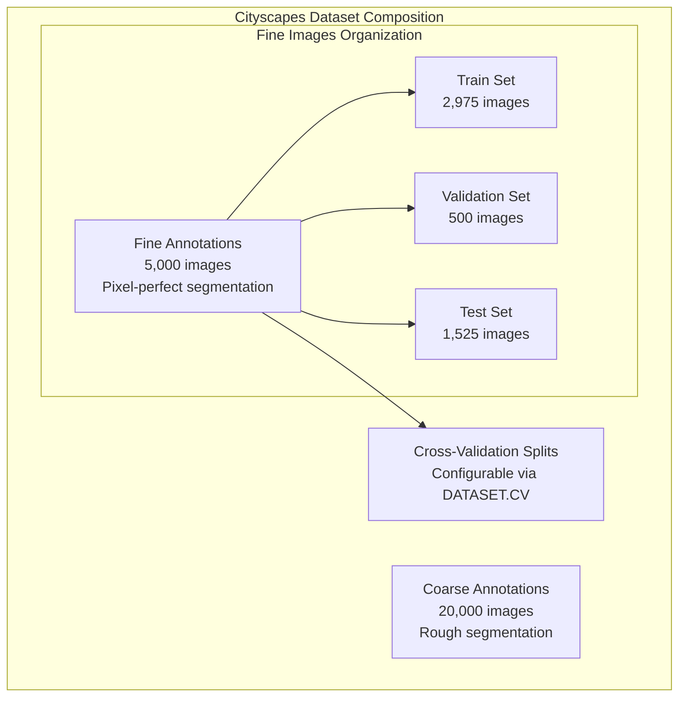
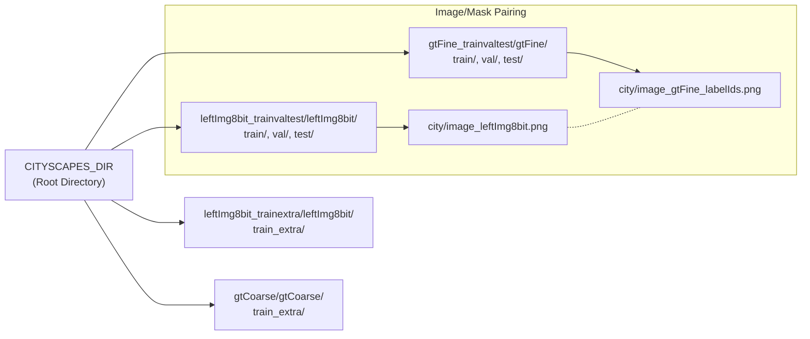
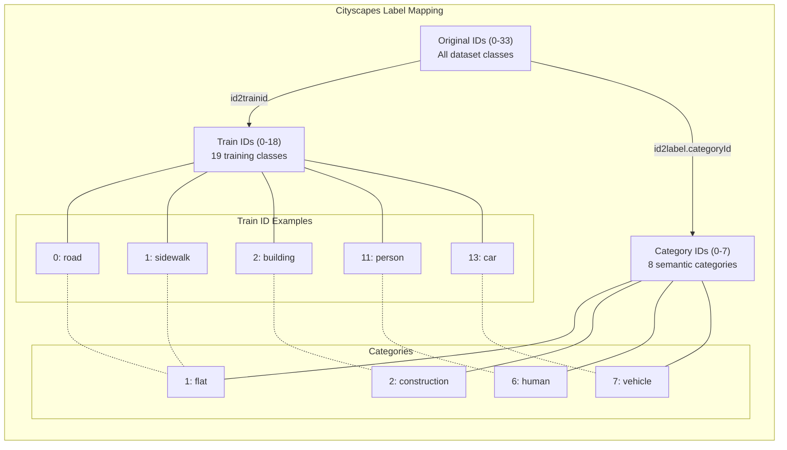
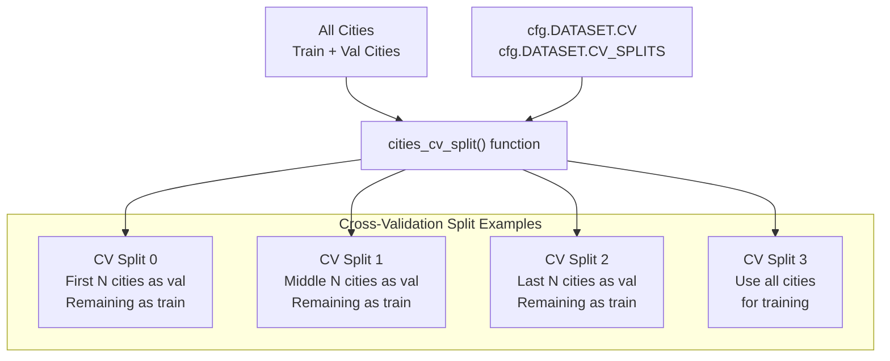
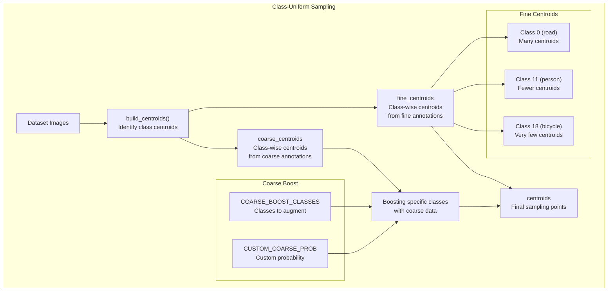
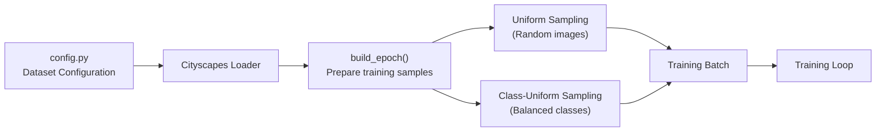

<!-- source: DeepWiki mcp.deepwiki.com · repo NVIDIA/semantic-segmentation · page 4.1 Cityscapes Dataset · fetched 2026-10-26 -->

# Cityscapes Dataset

Relevant source files

The following files were used as context for generating this wiki page:

- [datasets/cityscapes.py](datasets/cityscapes.py)
- [datasets/cityscapes_labels.py](datasets/cityscapes_labels.py)

## Purpose and Scope

This document details the implementation and usage of the Cityscapes dataset within the NVIDIA semantic segmentation framework. It covers the dataset structure, label mapping, cross-validation splitting, and class-uniform sampling mechanisms. For information about other supported datasets like Mapillary, see [Mapillary Dataset](#4.2).

## Dataset Overview

The Cityscapes dataset is a large-scale urban street scene dataset containing 5,000 fine-annotated images and 20,000 coarse-annotated images. In the NVIDIA semantic segmentation framework, it is implemented via the `Loader` class in `cityscapes.py`, which extends the `BaseLoader` class.

Sources: [datasets/cityscapes.py:41-89](), [datasets/cityscapes.py:105-167]()

## Directory Structure

The Cityscapes loader expects a specific directory structure to locate images and their corresponding segmentation masks. The root directory is specified via `cfg.DATASET.CITYSCAPES_DIR`.

Sources: [datasets/cityscapes.py:122-129](), [datasets/cityscapes.py:182-216]()

## Label System

Cityscapes uses a sophisticated label system with multiple ID spaces:

1. **Original IDs** (0-33): The raw IDs from the dataset
2. **Train IDs** (0-18): Reduced set used for actual training
3. **Category IDs** (0-7): Higher-level grouping of labels

The framework maps between these ID spaces using mappings defined in `cityscapes_labels.py`.

Sources: [datasets/cityscapes_labels.py:85-121](), [datasets/cityscapes_labels.py:131-149](), [datasets/cityscapes.py:123-124]()

## Cross-Validation System

The framework implements a configurable cross-validation system for Cityscapes. It divides cities (not individual images) into train/val splits to ensure all images from one city are either in training or validation, never split between them.

Sources: [datasets/cityscapes.py:41-89](), [datasets/cityscapes.py:133-135]()

## Class-Uniform Sampling

To address class imbalance, the framework implements class-uniform sampling. This technique identifies "centroids" for each class (points where that class appears) and ensures balanced sampling across classes.

Sources: [datasets/cityscapes.py:138-166]()

## Usage in the Framework

The Cityscapes dataset is integrated into the training pipeline through the `Loader` class that handles dataset preparation, cross-validation, and sampling.

| Configuration Option | Purpose | Default |
|----------------------|---------|---------|
| `DATASET.CITYSCAPES_DIR` | Root directory of Cityscapes dataset | (Required) |
| `DATASET.CV` | Cross-validation split to use (0-3) | 0 |
| `DATASET.CV_SPLITS` | Number of CV splits to create | 3 |
| `DATASET.CLASS_UNIFORM_PCT` | Percentage of samples to draw using class-uniform sampling | 0.5 |
| `DATASET.COARSE_BOOST_CLASSES` | List of class IDs to boost with coarse data | [] |
| `DATASET.CUSTOM_COARSE_PROB` | Custom probability for coarse data selection | `None` |

### Integration with Training Pipeline

The Cityscapes loader is initialized in the `setup_loaders` function and feeds data to the training process.

Sources: [datasets/cityscapes.py:111-167]()

## Special Features

### Coarse Data Handling

The framework can supplement training with coarse annotations, which is particularly useful for rare classes. The `coarse_boost_classes` configuration specifies which classes should be supplemented with additional samples from the coarse dataset.

### Custom Coarse Probability

The framework allows specifying a custom probability for selecting coarse data through the `DATASET.CUSTOM_COARSE_PROB` configuration, enabling fine-grained control over the data mixing process.

Sources: [datasets/cityscapes.py:145-165]()

### Disabling or Isolating Coarse Data

The loader provides methods to modify the usage of coarse data during training:
- `disable_coarse()`: Turns off using coarse images
- `only_coarse()`: Uses only coarse images for training

Sources: [datasets/cityscapes.py:169-180]()

---

