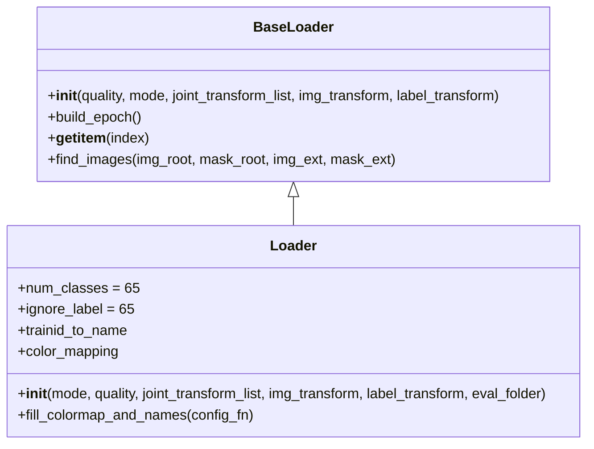
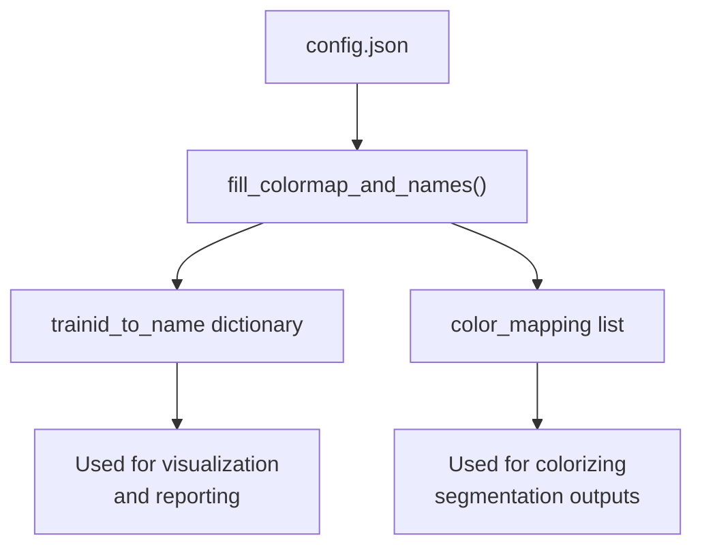
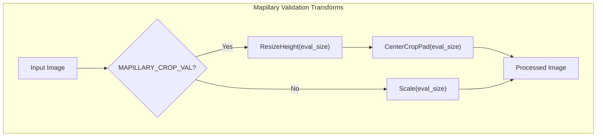
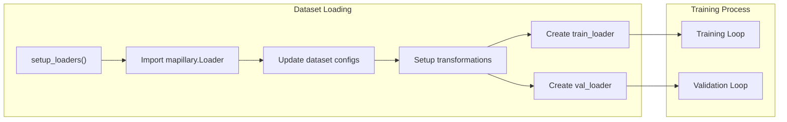

<!-- source: DeepWiki mcp.deepwiki.com · repo NVIDIA/semantic-segmentation · page 4.2 Mapillary Dataset · fetched 2026-10-26 -->

# Mapillary Dataset

<details>
<summary>Relevant source files</summary>

The following files were used as context for generating this wiki page:

- [datasets/__init__.py](datasets/__init__.py)
- [datasets/mapillary.py](datasets/mapillary.py)

</details>


This document details the Mapillary dataset integration in NVIDIA's semantic segmentation framework. It covers the implementation of the dataset loader, configuration settings, and how the dataset is processed during training and evaluation. For information about other supported datasets, see [Cityscapes Dataset](#4.1) or the general [Dataset Handlers](#4) overview.

## Overview

The Mapillary Vistas dataset is a large-scale street-level image dataset designed specifically for semantic segmentation tasks in urban environments. The NVIDIA semantic segmentation framework provides a specialized loader for this dataset that handles its unique characteristics and integrates it into the training and evaluation pipelines.

Key characteristics:
- 65 semantic classes
- High resolution street-level imagery
- Diverse geographic locations and capturing conditions
- Training, validation, and testing splits

Sources: [datasets/mapillary.py:43-46]()</file>

## Dataset Structure and Organization

The Mapillary dataset is expected to be organized in the following directory structure:

```
MAPILLARY_DIR/
├── config.json
├── training/
│   ├── images/
│   └── labels/
├── validation/
│   ├── images/
│   └── labels/
└── testing/
    ├── images/
    └── labels/
```

The dataset path is specified in the configuration as `cfg.DATASET.MAPILLARY_DIR`. Images are stored in JPG format, while labels are stored in PNG format.

The `config.json` file contains the class definitions including names and color mappings, which are read during initialization of the loader.

Sources: [datasets/mapillary.py:58-77]()</file>

## Dataset Loader Implementation

The Mapillary dataset is implemented through the `Loader` class in `mapillary.py`, which inherits from `BaseLoader`. Here's a diagram showing its structure and key components:



The Loader class provides:
- Class-level constants for the number of classes (65) and ignore label value (65)
- Methods for loading the dataset based on the specified mode ('train', 'val', 'test', or 'folder')
- Configuration parsing to extract class names and color mappings
- Integration with uniform sampling functionality

Sources: [datasets/mapillary.py:43-83]()</file>, [datasets/mapillary.py:85-106]()</file>

## Initialization and Configuration

When initializing the Mapillary dataset loader, the following steps occur:

1. The base loader is initialized with the specified transformations
2. The color mapping and class names are loaded from `config.json`
3. Images and labels are collected based on the specified mode
4. Centroids are built for uniform sampling if training mode is active

The color mapping and class names are parsed from the config file:



Sources: [datasets/mapillary.py:49-83]()</file>, [datasets/mapillary.py:85-106]()</file>

## Dataset Transforms and Processing

The Mapillary dataset applies specific transformations during training and evaluation phases. These are defined in the `setup_loaders` function in `datasets/__init__.py`.

### Validation Transforms

Special consideration is given to the Mapillary dataset during validation:



The default evaluation size is 2177 pixels, but this can be overridden by the `pre_size` parameter.

Sources: [datasets/__init__.py:124-136]()</file>

## Uniform Sampling Implementation

The Mapillary dataset loader incorporates class-uniform sampling to address class imbalance. This is implemented through the `centroids` system, which builds a data structure that allows for sampling images with a higher probability of containing under-represented classes.

During initialization, the loader calls:

```python
self.centroids = uniform.build_centroids(self.all_imgs,
                                        self.num_classes,
                                        self.train,
                                        cv=cfg.DATASET.CV)
```

This builds a mapping of class indices to lists of images containing those classes, which is then used during epoch construction to ensure balanced representation of all classes.

Sources: [datasets/mapillary.py:79-83]()</file>

## Integration with Training Pipeline

The Mapillary dataset integrates with the training pipeline through the `setup_loaders` function. When the dataset argument is set to 'mapillary', the framework:

1. Imports the Mapillary `Loader` class
2. Updates dataset configuration with the number of classes and ignore label
3. Sets up appropriate transformations
4. Creates data loaders for training and validation

The diagram below illustrates the dataset's integration into the training process:



Sources: [datasets/__init__.py:45-56]()</file>, [datasets/__init__.py:152-198]()</file>

## Usage Considerations

When using the Mapillary dataset with this framework, consider the following:

1. Ensure the dataset is organized according to the expected directory structure
2. The dataset path must be correctly set in the configuration
3. Due to the high resolution of Mapillary images, memory usage can be significant
4. When evaluating, consider whether to use cropping during validation by setting `cfg.DATASET.MAPILLARY_CROP_VAL`

By default, the framework expects the Mapillary dataset to contain the standard training, validation, and testing splits as provided by the dataset creators.

Sources: [datasets/mapillary.py:58-77]()</file>, [datasets/__init__.py:124-136]()</file>

---

