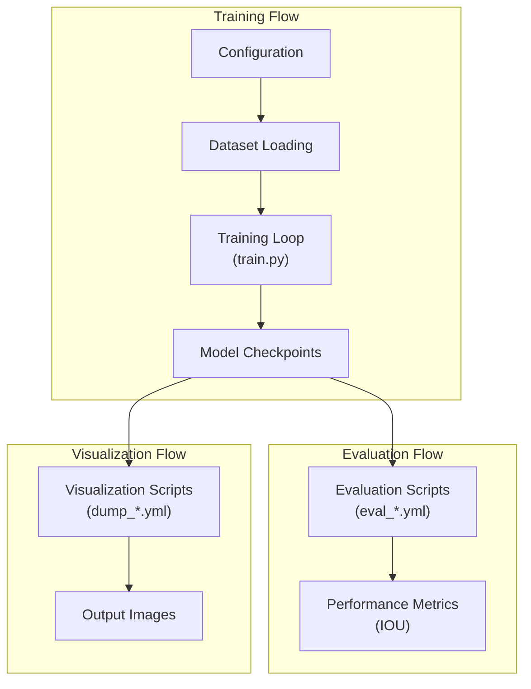
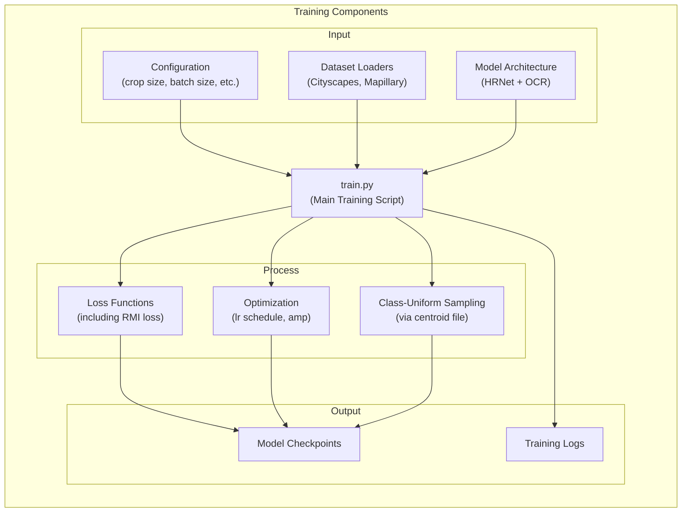
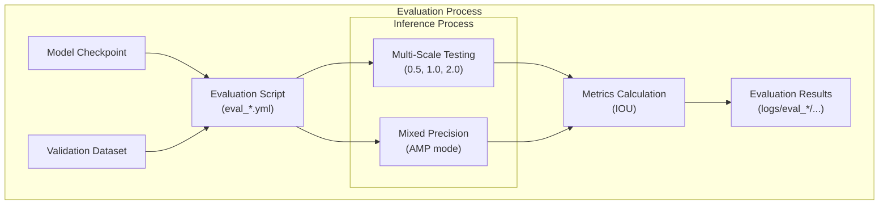
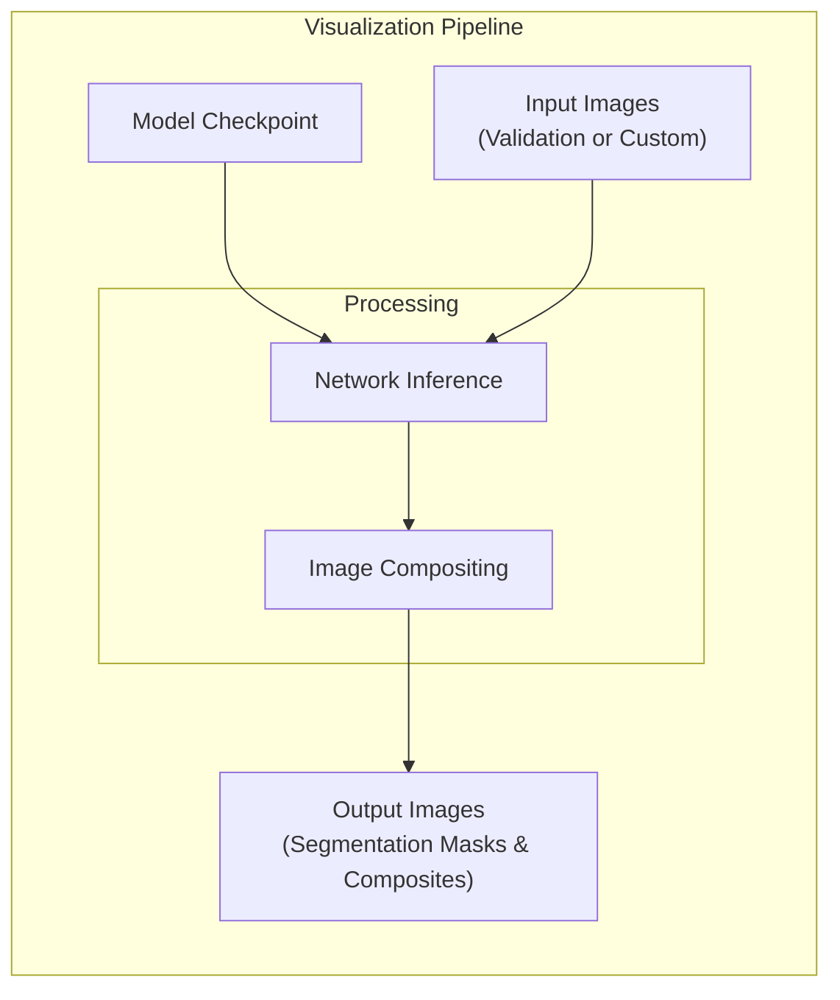
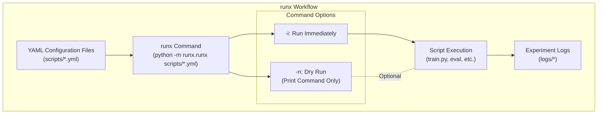

<!-- source: DeepWiki mcp.deepwiki.com · repo NVIDIA/semantic-segmentation · page 5 Training and Evaluation · fetched 2026-10-26 -->

# Training and Evaluation

<details>
<summary>Relevant source files</summary>

The following files were used as context for generating this wiki page:

- [README.md](README.md)

</details>


This document provides an overview of the training and evaluation processes in the NVIDIA semantic segmentation repository. It covers how to train models, evaluate their performance, visualize results, and manage experiments. For information about dataset preparation and handling, see [Dataset Handlers](#4), and for configuration details, see [Configuration System](#3.1).

## Overview

The semantic segmentation system provides a complete pipeline for training neural networks and evaluating their performance on semantic segmentation tasks. The system is designed to work with the HRNet backbone with OCR (Object Context Representation) and multi-scale attention features.



Sources: [README.md:93-108]()

## Training Process

The training process is executed through the main training script `train.py`. This script handles model initialization, dataset loading, training loop execution, and checkpoint saving.

### Training Commands

Training can be initiated using the `runx` tool with predefined YAML configuration files:

```bash
# Train on Cityscapes with HRNet + OCR + multi-scale attention
python -m runx.runx scripts/train_cityscapes.yml -i

# Train SOTA model on default train-val split
python -m runx.runx scripts/train_cityscapes_sota.yml -i
```

The first time you run training on a dataset, the system will build a centroid file (taking approximately 10 minutes) that enables class-uniform sampling during training.

### Key Training Components



Sources: [README.md:93-108]()

### Training Options

The training process can be customized with various parameters:

| Parameter | Description | Example Value |
|-----------|-------------|---------------|
| Crop Size | Size of image crops for training | 768×768 or 1024×1024 |
| Batch Size | Number of samples per batch | 8-16 depending on GPU memory |
| Learning Rate | Base learning rate | Typically 0.01 |
| Optimization | Optimizer configuration | SGD with momentum |
| AMP | Automatic Mixed Precision mode | O1 (default) or O3 (memory-efficient) |
| RMI Loss | Region Mutual Information loss | Can be enabled/disabled |

For SOTA training, users may need to adjust crop size or disable RMI loss if they encounter GPU memory limitations.

Sources: [README.md:93-108]()

## Evaluation Process

Evaluation is performed using predefined scripts that measure the model's performance on validation sets.

### Running Evaluation

Evaluation scripts can be executed using the `runx` tool:

```bash
# Evaluate on Cityscapes validation set
python -m runx.runx scripts/eval_cityscapes.yml -i

# Evaluate on Mapillary validation set
python -m runx.runx scripts/eval_mapillary.yml -i
```

### Evaluation Flow



Sources: [README.md:52-73]()

### Evaluation Performance

The repository includes pre-trained models with the following expected performance:

| Dataset | Expected IOU | Notes |
|---------|-------------|-------|
| Cityscapes | 86.92 | Evaluated with scales 0.5, 1.0, and 2.0 |
| Mapillary | 61.05 | Requires 32GB GPU with O3 AMP mode |

Training models from scratch should achieve:
- Standard Cityscapes training: 84.7 IOU
- SOTA Cityscapes training: 86.8 IOU

Results are stored in the logs directory, organized by evaluation script name.

Sources: [README.md:52-73](), [README.md:93-108]()

## Visualization

The system provides tools to visualize model predictions, enabling qualitative assessment of segmentation results.

### Visualization Commands

```bash
# Dump network output for Cityscapes validation set
python -m runx.runx scripts/dump_cityscapes.yml -i

# Run inference and visualize custom images
python -m runx.runx scripts/dump_folder.yml -i
```

### Visualization Process



Sources: [README.md:74-92]()

Visualization results include:
1. Network output (raw segmentation masks)
2. Composited images (original image with segmentation overlay)

For custom image folders, the system runs inference and generates visualizations similar to the example shown in the README.

## Experiment Management with runx

The repository uses the `runx` tool for experiment management, which helps automate experiment execution and tracking.

### Using runx



Sources: [README.md:46-50]()

### Key runx Features

1. **Configuration Management**: YAML files define experiment parameters
2. **Dry Run Mode**: Using `-n` flag to preview commands without execution
3. **Immediate Execution**: Using `-i` flag to run experiments
4. **Log Organization**: Results stored in structured log directories

The `runx` tool simplifies experiment management, particularly when running multiple experiments with different configurations. Users can also bypass `runx` and call scripts like `train.py` directly with appropriate arguments if preferred.

Sources: [README.md:46-50]()

## Performance Optimization

The system includes several optimizations to improve training efficiency and handle GPU memory constraints:

1. **Automatic Mixed Precision (AMP)**:
   - Default mode (O1) for most operations
   - Memory-efficient mode (O3) for large models/datasets like Mapillary

2. **Memory Management**:
   - Adjustable crop size to fit GPU memory constraints
   - Option to disable RMI loss to reduce memory usage

3. **Multi-scale Testing**:
   - Evaluation performed at multiple scales (0.5, 1.0, 2.0) for better results

Sources: [README.md:52-73](), [README.md:93-108]()

---

