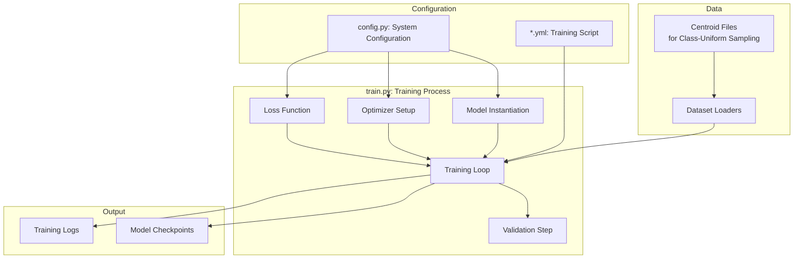
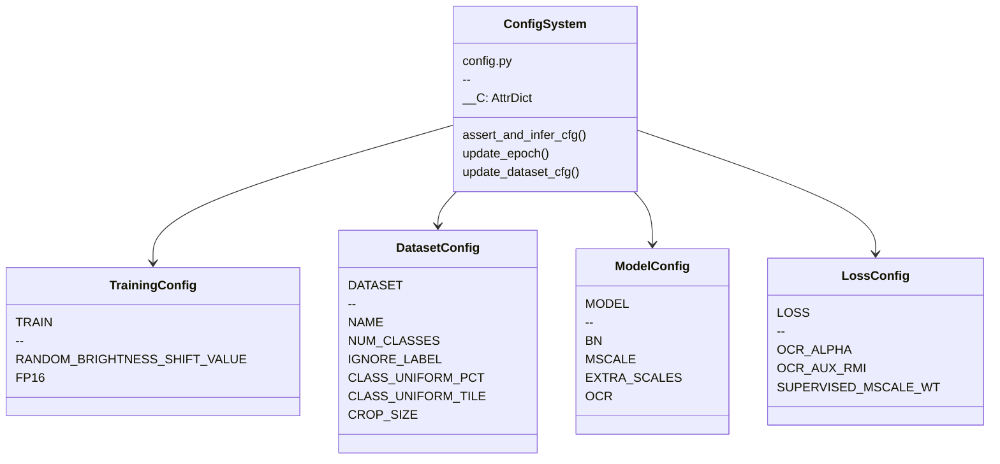
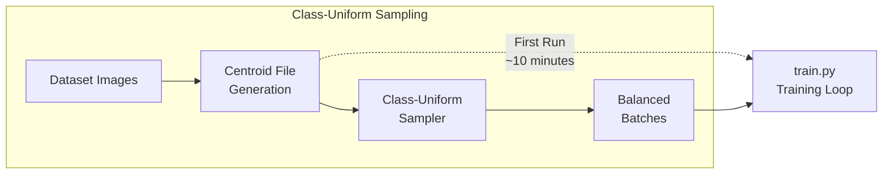
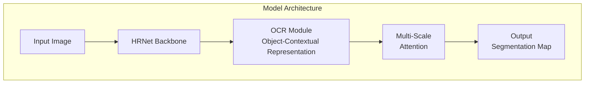
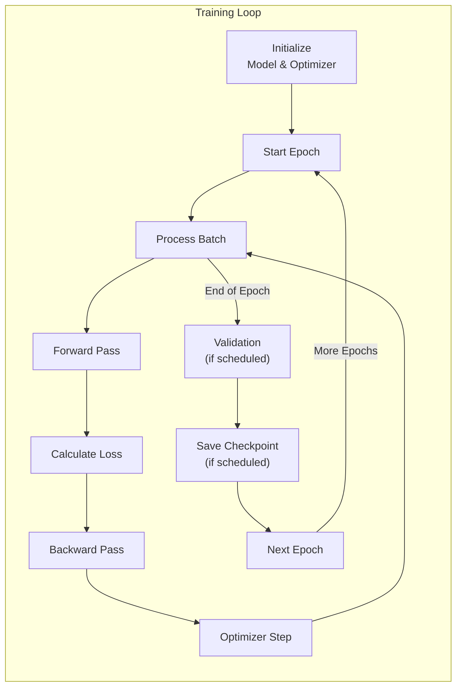

<!-- source: DeepWiki mcp.deepwiki.com · repo NVIDIA/semantic-segmentation · page 5.1 Training Process · fetched 2026-10-26 -->

# Training Process

<details>
<summary>Relevant source files</summary>

The following files were used as context for generating this wiki page:

- [README.md](README.md)
- [config.py](config.py)

</details>


This document explains how to train semantic segmentation models using the NVIDIA Semantic Segmentation framework. The training process involves configuring the model architecture, dataset, optimization parameters, and executing the training loop to produce a trained model. For information about evaluating trained models, see [Evaluation and Visualization](#5.2).

## Training Overview

The training process in this framework combines several key components to enable effective training of semantic segmentation models with advanced features like hierarchical multi-scale attention, object-contextual representations (OCR), and class-uniform sampling.



Sources: [README.md:93-108]()

## Command-line Interface

The training process can be invoked in two ways:

1. Using the `runx` tool (recommended for experiment management):
   ```bash
   python -m runx.runx scripts/train_cityscapes.yml -i
   ```

2. Directly calling the training script:
   ```bash
   python train.py <args...>
   ```

The `-i` flag in the runx command runs the training interactively. You can use `-n` flag for a dry run to inspect the command without executing it.

Sources: [README.md:46-49](), [README.md:93-98]()

## Training Configuration

The training process is highly configurable through both YAML configuration files and the configuration system in `config.py`.

### Configuration Structure



Sources: [config.py:71-108](), [config.py:150-157](), [config.py:119-138]()

### Key Training Parameters

| Parameter | Description | Default |
|-----------|-------------|---------|
| `TRAIN.FP16` | Enable mixed precision training | False |
| `DATASET.CLASS_UNIFORM_PCT` | Percentage of images sampled uniformly | 0.5 |
| `DATASET.CLASS_UNIFORM_TILE` | Tile size for uniform sampling | 1024 |
| `DATASET.CROP_SIZE` | Training crop size | '896' |
| `LOSS.OCR_ALPHA` | Weight for OCR auxiliary loss | 0.4 |
| `LOSS.OCR_AUX_RMI` | Use RMI for OCR auxiliary loss | False |
| `MODEL.MSCALE` | Enable multi-scale attention | False |

Sources: [config.py:71-73](), [config.py:102-103](), [config.py:150-156](), [config.py:268-271]()

## Dataset Preparation and Loading

Before training, datasets must be properly prepared and configured. The system primarily supports Cityscapes and Mapillary datasets.

### Dataset Configuration

Update the paths in `config.py` to point to your dataset locations:

```python
__C.DATASET.CITYSCAPES_DIR = <path_to_cityscapes>
__C.DATASET.MAPILLARY_DIR = <path_to_mapillary>
```

### Class-Uniform Sampling

The system uses class-uniform sampling to balance class distributions during training. This requires generating a centroid file during the first training run, which takes approximately 10 minutes. The centroid file contains information about the locations of each class in the dataset to enable better sampling.



Sources: [README.md:100-101](), [config.py:82-83](), [config.py:102-103]()

## Model Architecture Configuration

The system supports various model architectures, particularly focusing on HRNet with OCR (Object Contextual Representation) and multi-scale attention.

### Key Architecture Components



Sources: [README.md:95](), [config.py:122-137](), [config.py:158-190]()

### Architecture Configuration Options

| Option | Description | Configuration |
|--------|-------------|---------------|
| Multi-scale | Enable hierarchical multi-scale attention | `MODEL.MSCALE=True` |
| OCR | Object-Contextual Representations | `MODEL.OCR.MID_CHANNELS`, `MODEL.OCR.KEY_CHANNELS` |
| Scale factors | Configure extra scales for multi-scale training | `MODEL.EXTRA_SCALES='0.5,1.5'` |
| Three-scale mode | Use three scales instead of two | `MODEL.THREE_SCALE=True` |

Sources: [config.py:122-138](), [config.py:158-190](), [config.py:268-290]()

## Training Process Execution

The actual training process involves model initialization, optimizer setup, loss function configuration, and the training loop.

### Training Loop



Sources: [README.md:93-108]()

### Loss Functions

The system uses a combination of loss functions, including:

1. **Primary segmentation loss** - Cross-entropy or region mutual information loss
2. **OCR auxiliary loss** - Applied to the output of the OCR module
3. **Multi-scale supervision loss** - Optional direct supervision of multi-scale predictions

Loss weighting can be configured through `LOSS.OCR_ALPHA` and `LOSS.SUPERVISED_MSCALE_WT` parameters.

Sources: [config.py:150-156]()

## Advanced Training Features

### Mixed Precision Training

For faster training, especially on GPUs with Tensor Cores, the system supports mixed precision (FP16) training. Enable it using the `--fp16` flag or by setting `TRAIN.FP16=True` in the configuration.

Example:
```bash
python -m runx.runx scripts/train_cityscapes.yml -i --fp16
```

Sources: [config.py:72](), [config.py:303-304]()

### Multi-scale Training with Hierarchical Attention

The system's innovative hierarchical multi-scale attention mechanism enables effective learning across different scales. This is a key feature of the architecture described in the paper "Hierarchical Multi-Scale Attention for Semantic Segmentation."

Enable multi-scale training by using architectures that include 'mscale' in their name or by setting `MODEL.MSCALE=True`.

Sources: [README.md:3](), [config.py:122-137](), [config.py:268-271]()

### Batch Normalization Options

The system supports different batch normalization strategies:

1. **Regular BatchNorm** - Default mode
2. **Synchronized BatchNorm** - For multi-GPU training, implemented through NVIDIA Apex

Sources: [config.py:216-225]()

## Example Training Workflows

### Basic Cityscapes Training

Train a model on Cityscapes using HRNet + OCR + multi-scale attention:

```bash
python -m runx.runx scripts/train_cityscapes.yml -i
```

Expected outcome: A model with approximately 84.7 IOU.

Sources: [README.md:95-98](), [README.md:102]()

### State-of-the-Art Training

Train a model with the SOTA configuration:

```bash
python -m runx.runx scripts/train_cityscapes_sota.yml -i
```

Expected outcome: A model with approximately 86.8 IOU.

Note: You may need to lower the crop size or disable RMI loss if you encounter memory issues.

Sources: [README.md:104-108]()

## Important Files and Their Roles

| File | Purpose |
|------|---------|
| `train.py` | Main training script |
| `config.py` | Configuration system and default values |
| `scripts/train_cityscapes.yml` | Standard Cityscapes training configuration |
| `scripts/train_cityscapes_sota.yml` | SOTA training configuration |

Sources: [README.md:95-108]()

## Monitoring and Performance Tips

1. **Memory Usage**: For SOTA training, if you run out of memory, try:
   - Lowering the crop size
   - Turning off RMI loss
   - Using FP16 (mixed precision) training

2. **Training Progress**: Training logs and metrics are saved in the `logs` directory

3. **Class-Uniform Sampling**: The first training run will take extra time to build a centroid file (~10 minutes), which improves class balance in training samples

Sources: [README.md:100-101](), [README.md:108]()

---

