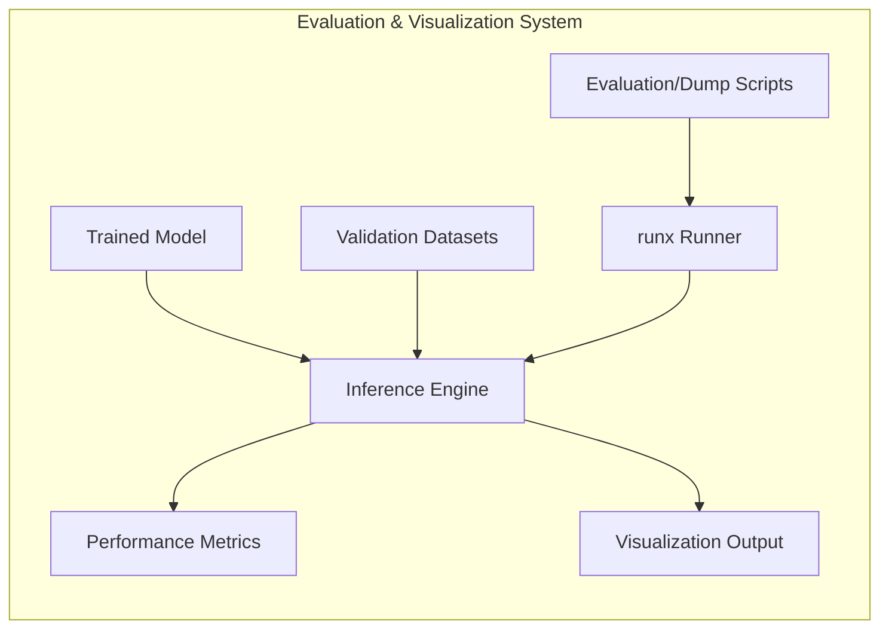
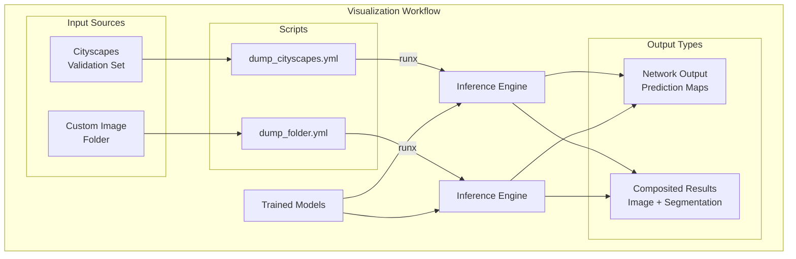

<!-- source: DeepWiki mcp.deepwiki.com · repo NVIDIA/semantic-segmentation · page 5.2 Evaluation and Visualization · fetched 2026-10-26 -->

# Evaluation and Visualization

<details>
<summary>Relevant source files</summary>

The following files were used as context for generating this wiki page:

- [README.md](README.md)

</details>


This document provides detailed instructions for evaluating trained semantic segmentation models and generating visualizations of their predictions. For information about the training process, see [Training Process](#5.1). For details on experiment management with runx, see [Experiment Management with runx](#5.3).

## Overview

The NVIDIA semantic segmentation framework provides comprehensive tools for:
1. Evaluating model performance on benchmark datasets like Cityscapes and Mapillary
2. Generating visual representations of segmentation predictions
3. Running inference on custom image folders

These features allow researchers and practitioners to quantitatively assess model performance and qualitatively inspect segmentation results.



Sources: [README.md:52-91]()

## Evaluation Process

The evaluation process involves running trained models on validation data and computing relevant metrics such as Intersection over Union (IoU).

### Evaluating on Cityscapes

To evaluate a trained model on the Cityscapes validation set:

```bash
python -m runx.runx scripts/eval_cityscapes.yml -i
```

This command:
1. Loads a pre-trained model specified in the evaluation script
2. Runs inference on the Cityscapes validation set at multiple scales (0.5, 1.0, 2.0)
3. Computes and reports the mean IoU (should be approximately 86.92%)
4. Stores evaluation results in the `./logs/eval_cityscapes/` directory

For a dry run that only displays the command without execution:
```bash
python -m runx.runx scripts/eval_cityscapes.yml -i -n
```

Sources: [README.md:52-65]()

### Evaluating on Mapillary

To evaluate a trained model on the Mapillary dataset:

```bash
python -m runx.runx scripts/eval_mapillary.yml -i
```

This evaluation:
1. Requires a GPU with 32GB memory
2. Uses 'O3' mode for automatic mixed precision (AMP) to avoid GPU memory issues
3. Should report an IoU of approximately 61.05%
4. Stores results in `./logs/eval_mapillary/`

Sources: [README.md:67-73]()

## Visualization Process

The framework provides two main options for visualization: generating predictions for benchmark datasets or running inference on custom images.



Sources: [README.md:75-91]()

### Visualizing Cityscapes Predictions

To generate and visualize predictions on the Cityscapes validation set:

```bash
python -m runx.runx scripts/dump_cityscapes.yml -i
```

This command:
1. Runs the model on Cityscapes validation images
2. Generates raw network outputs (prediction maps)
3. Creates composited images that overlay predictions on the original images
4. Saves these visualizations to the output directory specified in the script

Sources: [README.md:75-81]()

### Visualizing Predictions on Custom Images

To run inference and generate visualizations on a custom folder of images:

```bash
python -m runx.runx scripts/dump_folder.yml -i
```

This command:
1. Processes all images in the folder specified in the script
2. Generates semantic segmentation predictions for each image
3. Creates composited visualizations showing the segmentation overlay
4. Outputs these visualizations to the directory specified in the script

The resulting composited images display the original input with segmentation masks overlaid, making it easy to visually evaluate the model's performance.

Sources: [README.md:83-91]()

## Understanding Evaluation Results

Evaluation results are primarily reported using the Intersection over Union (IoU) metric, which measures the overlap between the predicted segmentation and ground truth.

### Evaluation Metrics

| Metric | Description | Typical Values |
|--------|-------------|----------------|
| Mean IoU | Average IoU across all classes | 80-87% (Cityscapes), 60-61% (Mapillary) |
| Per-Class IoU | IoU for individual semantic classes | Varies by class difficulty |
| Inference Time | Time required to process images | Depends on hardware and model |

### Result Interpretation

- Higher IoU values indicate better segmentation performance
- The state-of-the-art (SOTA) performance on Cityscapes with this framework should reach approximately 86.8% IoU
- Standard training configurations typically achieve around 84.7% IoU on Cityscapes

Sources: [README.md:65-73](), [README.md:102-108]()

## Configuration Options

The evaluation and visualization processes can be customized through the YAML configuration files:

- `scripts/eval_cityscapes.yml` - Cityscapes evaluation configuration
- `scripts/eval_mapillary.yml` - Mapillary evaluation configuration
- `scripts/dump_cityscapes.yml` - Cityscapes visualization configuration
- `scripts/dump_folder.yml` - Custom folder visualization configuration

These configuration files allow control over:
- Model checkpoint paths
- Evaluation scales and sampling strategies
- Output paths for results and visualizations
- Inference hardware configuration (e.g., automatic mixed precision settings)

Sources: [README.md:52-91]()

## Troubleshooting

When running evaluation or visualization, you may encounter the following issues:

1. **GPU Memory Errors**: For large models or high-resolution images:
   - Use automatic mixed precision (AMP) with 'O3' mode as in the Mapillary evaluation
   - Reduce the batch size or image resolution in the configuration
   
2. **Visualization Quality Issues**:
   - Ensure the model was trained properly
   - Try using different evaluation scales
   - Check that the input image format matches what the model expects

Sources: [README.md:67-73]()

---

