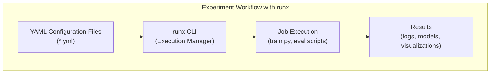
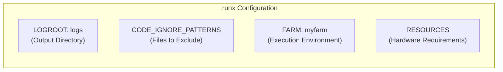
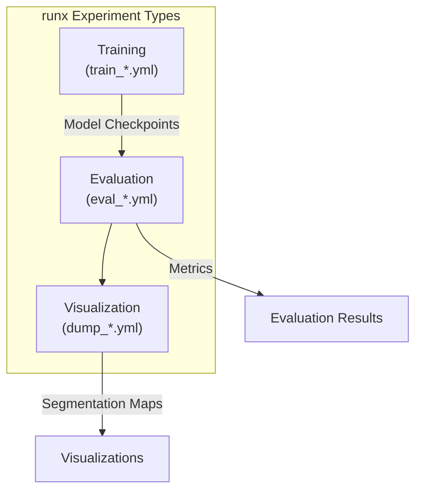
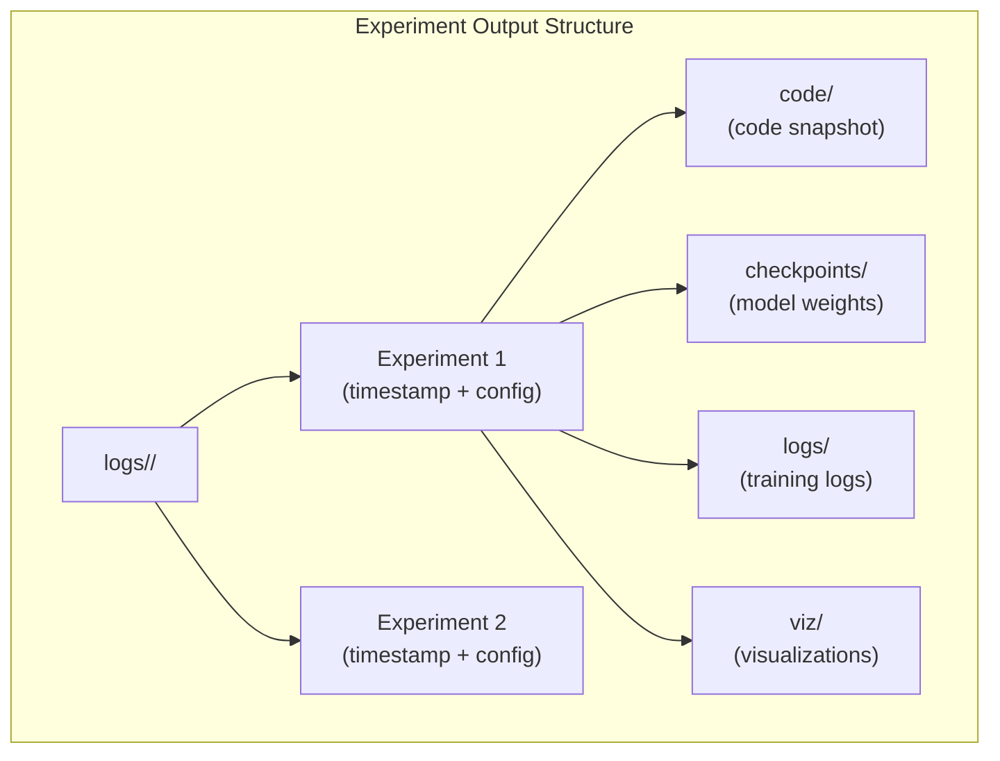
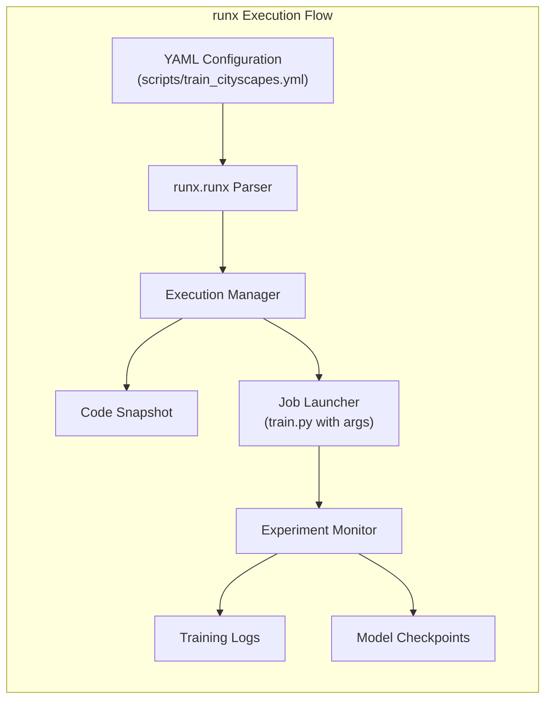

<!-- source: DeepWiki mcp.deepwiki.com · repo NVIDIA/semantic-segmentation · page 5.3 Experiment Management with runx · fetched 2026-10-26 -->

# Experiment Management with runx

<details>
<summary>Relevant source files</summary>

The following files were used as context for generating this wiki page:

- [.runx](.runx)
- [README.md](README.md)

</details>


## Purpose and Scope

This document explains how experiment management is handled in the semantic segmentation system using the runx tool. It covers configuring runx, running experiments, and tracking results. For information about the training process itself, see [Training Process](#5.1). For evaluation and visualization details, see [Evaluation and Visualization](#5.2).

## Introduction to runx

runx is a tool for automating experiment execution and result tracking in deep learning workflows. In this semantic segmentation system, runx orchestrates training, evaluation, and visualization tasks through simple YAML configuration files.



Sources: [README.md:47-49]()

## runx Configuration

runx is configured through the `.runx` file, which specifies logging directory structure, resource requirements, and execution parameters.

### Key Configuration Settings



The system's `.runx` file defines:
- Log directory for experiment outputs (`LOGROOT`)
- Patterns for files to ignore during code copying
- Compute resource requirements (GPUs, memory)
- Job submission commands for the target compute environment

Sources: [.runx:1-16]()

## runx Command Structure

Commands follow this general syntax:

```
python -m runx.runx scripts/<experiment_config>.yml [options]
```

Common options include:
- `-i`: Run in interactive mode
- `-n`: Dry run (print commands without executing)

Sources: [README.md:54-58]()

## Experiment Types and YAML Configurations

The system includes several pre-configured experiment types managed through YAML files:



Sources: [README.md:52-108]()

### Evaluation Workflows

runx manages evaluation on different datasets:

1. **Cityscapes Evaluation**:
   ```
   python -m runx.runx scripts/eval_cityscapes.yml -i
   ```
   Evaluates model performance on Cityscapes validation set using multiple scales (0.5, 1.0, 2.0)

2. **Mapillary Evaluation**:
   ```
   python -m runx.runx scripts/eval_mapillary.yml -i
   ```
   Evaluates on Mapillary validation set (requires 32GB GPU memory)

Sources: [README.md:52-73]()

### Visualization Workflows

runx can generate visualizations in two ways:

1. **Cityscapes Visualization**:
   ```
   python -m runx.runx scripts/dump_cityscapes.yml -i
   ```
   Generates network output and composited images for the Cityscapes validation set

2. **Custom Image Visualization**:
   ```
   python -m runx.runx scripts/dump_folder.yml -i
   ```
   Runs inference and visualization on a custom folder of images

Sources: [README.md:75-91]()

### Training Workflows

runx manages model training with different configurations:

1. **Standard Cityscapes Training**:
   ```
   python -m runx.runx scripts/train_cityscapes.yml -i
   ```
   Trains HRNet + OCR + multi-scale attention using fine data and mapillary-pretrained model

2. **SOTA Training**:
   ```
   python -m runx.runx scripts/train_cityscapes_sota.yml -i
   ```
   Trains state-of-the-art model on the default train-val split

Sources: [README.md:93-108]()

## runx Output and Log Management

All experiment outputs follow a consistent structure determined by the `.runx` configuration:



For each experiment, runx:
1. Creates a timestamped output directory
2. Captures a snapshot of the code state
3. Stores training logs and metrics
4. Saves model checkpoints and visualization outputs

Sources: [.runx:1-5](), [README.md:65-66](), [README.md:73]()

## From YAML to Execution: Workflow Diagram

This diagram shows how runx transforms YAML configuration into experiment execution:



Sources: [README.md:47-49](), [.runx:1-16]()

## Best Practices for runx

When using runx for experiment management:

1. Use `-n` flag to preview commands before execution
2. Organize related experiments by using consistent naming in YAML files
3. Adjust resource requirements in the `.runx` file for different experiment types
4. Review logs directory to compare results between experiment runs

Sources: [README.md:54-58](), [README.md:108]()

## Conclusion

runx streamlines the execution and tracking of semantic segmentation experiments in this system. It provides a consistent interface for training, evaluation, and visualization tasks while automating output organization and experiment logging.

For more information about the specific training procedures, see [Training Process](#5.1), and for details on evaluation metrics and visualization options, see [Evaluation and Visualization](#5.2).

---

