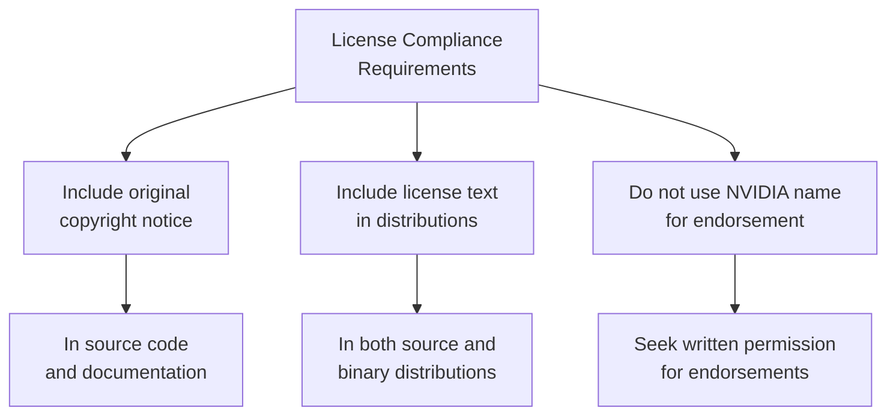
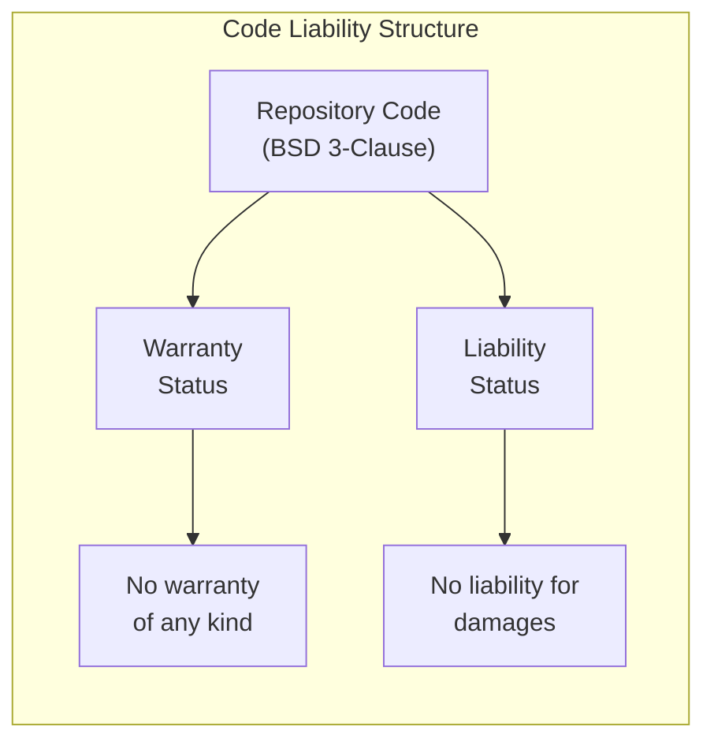
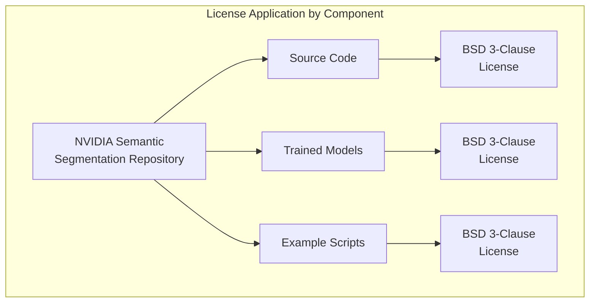

<!-- source: DeepWiki mcp.deepwiki.com · repo NVIDIA/semantic-segmentation · page 6 Legal Information · fetched 2026-10-26 -->

# Legal Information

Relevant source files

The following files were used as context for generating this wiki page:

- [LICENSE](LICENSE)

This page outlines the licensing and legal requirements for using the NVIDIA Semantic Segmentation repository. Understanding these legal aspects is essential for both academic and commercial use of the codebase and its outputs.

## Repository License

The NVIDIA Semantic Segmentation repository is licensed under the **BSD 3-Clause License**, a permissive open-source license that allows for both academic and commercial use with minimal restrictions.

### License Terms

The key provisions of the BSD 3-Clause License require:

1. Retention of copyright notice
2. Reproduction of license text in distributions
3. No use of NVIDIA's name for endorsement without permission

The full license text can be found in the repository's root directory.

Sources: [LICENSE:1-27]()

## Compliance Requirements

To comply with the repository's license when using or modifying this code, you must:

Sources: [LICENSE:6-15]()

## License Implications

### What You Can Do

The BSD 3-Clause License permits:

| Activity | Permitted | Conditions |
|----------|-----------|------------|
| Commercial use | ✓ | Include license and copyright notice |
| Modification | ✓ | Include license and copyright notice |
| Distribution | ✓ | Include license and copyright notice |
| Private use | ✓ | No conditions |
| Patent use | ✓ | No explicit patent grant |

### Disclaimer of Warranty

The software is provided "as is" without warranty of any kind. NVIDIA is not liable for any damages arising from the use of this software.

Sources: [LICENSE:17-27]()

## Dataset Licensing Considerations

While the repository code is BSD 3-Clause licensed, the datasets used with this codebase have their own licenses:

| Dataset | License Type | Notes |
|---------|-------------|-------|
| Cityscapes | Research and commercial license | Requires registration and acceptance of terms |
| Mapillary | Research and limited commercial use | Check current terms on Mapillary website |

**Important**: Users must separately obtain and comply with the licenses for these datasets.

For information about obtaining and preparing these datasets, see [Dataset Preparation](#2.2).

## License Application to Components

## Third-Party Dependencies

The repository relies on several third-party libraries and frameworks, each with its own licensing terms. Key dependencies include:

- PyTorch (BSD-style license)
- NumPy (BSD license)
- Other Python packages

When using this codebase, you must comply with the license terms of all dependencies in addition to the repository's own license.

## Citation Requirements

While not a legal requirement, if you use this code for academic work, please cite the appropriate publications:

- For the general architecture with OCR: "Object-Contextual Representations for Semantic Segmentation"
- For hierarchical multi-scale attention: "Hierarchical Multi-Scale Attention for Semantic Segmentation"

## Conclusion

The BSD 3-Clause License provides significant freedom to use, modify, and distribute this code. However, users should be aware of their obligations regarding copyright notices and the limitations on using NVIDIA's name for endorsement.

For questions about specific use cases or commercial applications, consult your legal counsel as this page does not constitute legal advice.

Sources: [LICENSE:1-27]()