# Page: Overview

# Overview

<details>
<summary>Relevant source files</summary>

The following files were used as context for generating this wiki page:

- [README.md](README.md)

</details>


This document provides an introduction to the NVIDIA Semantic Segmentation repository, which implements the "Hierarchical Multi-Scale Attention for Semantic Segmentation" approach. For environment setup instructions, see [Installation and Environment Setup](#2.1). For information on preparing datasets, see [Dataset Preparation](#2.2).

## Purpose

The NVIDIA Semantic Segmentation repository provides a PyTorch implementation of semantic segmentation using hierarchical multi-scale attention. Semantic segmentation is a computer vision task that assigns a class label to each pixel in an image, providing a detailed understanding of scene content. This repository offers tools for training, evaluating, and visualizing state-of-the-art semantic segmentation models primarily for autonomous driving applications.

Sources: [README.md:1-5]()

## Repository Architecture

The following diagram shows the key components of the semantic segmentation system and their relationships:

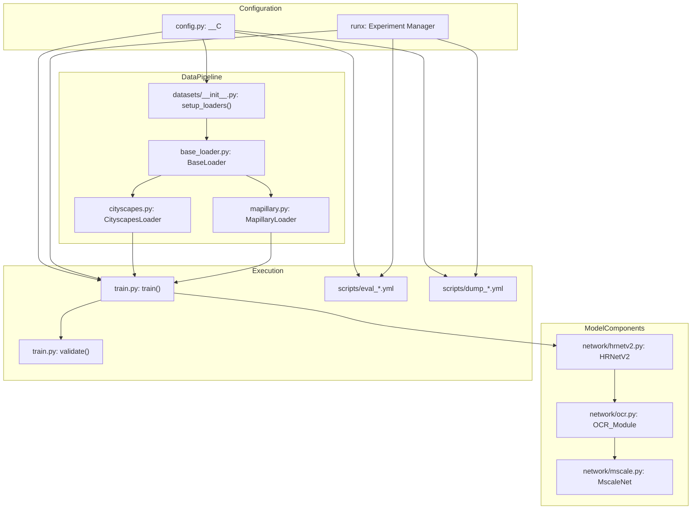

The system consists of four main components:

1. **Configuration system**: Centers around `config.py`, which defines global parameters for datasets, model architecture, and training settings.

2. **Data pipeline**: Uses a common `BaseLoader` interface with specialized implementations for each dataset, handling data loading and preprocessing.

3. **Model architecture**: Implements a multi-component neural network with HRNet backbone, OCR module, and multi-scale attention mechanisms.

4. **Execution scripts**: Provides tools for training (`train.py`), evaluation (via `runx` scripts), and visualization of results.

Sources: [README.md:46-50]()

## Model Architecture

The semantic segmentation model implemented in this repository uses the following architecture:

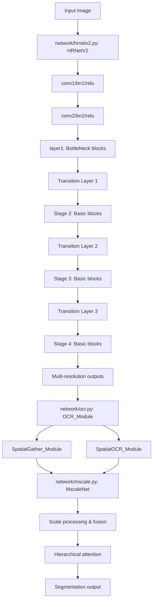

The architecture has three key components:

1. **HRNetV2 backbone**: Maintains high-resolution representations throughout the network, providing detailed spatial information critical for accurate segmentation.

2. **OCR (Object Context Representation)**: Enhances features with object-level context, improving segmentation at object boundaries and for small objects.

3. **Multi-scale attention**: Applies hierarchical attention mechanism across different scales, allowing the model to focus on relevant features at multiple resolutions.

Sources: [README.md:3]()

## Workflow

The typical usage workflow in this repository consists of:

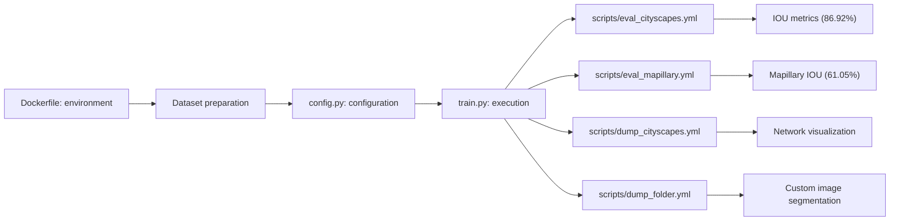

The workflow follows these steps:

1. Set up the Docker environment using the provided Dockerfile
2. Prepare datasets according to instructions in [Dataset Preparation](#2.2)
3. Configure the system by updating parameters in `config.py`
4. Train models using `train.py` and the `runx` experiment manager
5. Evaluate models and generate performance metrics
6. Visualize segmentation results

Sources: [README.md:52-108]()

## Supported Datasets

The repository supports two primary datasets and custom image folders:

| Dataset | Loader Class | Config Variable | IoU Performance |
|---------|-------------|-----------------|----------------|
| Cityscapes | `CityscapesLoader` | `__C.DATASET.CITYSCAPES_DIR` | 86.92% |
| Mapillary | `MapillaryLoader` | `__C.DATASET.MAPILLARY_DIR` | 61.05% |
| Custom Images | N/A | N/A | N/A |

The repository also supports auto-labeled Cityscapes data accessible via `__C.DATASET.CITYSCAPES_CUSTOMCOARSE`.

Sources: [README.md:28-43](), [README.md:64-73]()

## Key Features

- **State-of-the-art performance**: Achieves 86.92% IoU on Cityscapes validation set
- **Multi-dataset support**: Compatible with Cityscapes and Mapillary datasets
- **Hierarchical multi-scale attention**: Novel approach improving segmentation accuracy
- **Experiment management**: Integrated with `runx` for experiment tracking
- **Class-uniform sampling**: Improves training on imbalanced datasets
- **Comprehensive evaluation tools**: Measures model performance and generates visualizations

For detailed instructions on training models, see [Training Process](#5.1).
For evaluation and visualization details, see [Evaluation and Visualization](#5.2).

Sources: [README.md:46-108]()

---

# Page: Getting Started

# Getting Started

<details>
<summary>Relevant source files</summary>

The following files were used as context for generating this wiki page:

- [Dockerfile](Dockerfile)
- [README.md](README.md)

</details>


This page guides you through the initial setup and basic operations of the NVIDIA Semantic Segmentation system. It provides the essential steps to get the system running and perform basic inference and training operations.

For detailed installation instructions, see [Installation and Environment Setup](#2.1). For comprehensive dataset preparation guidance, see [Dataset Preparation](#2.2).

## Environment Setup

The system requires Python 3.6 and PyTorch 1.3. You can set up the environment using Docker (recommended) or manual installation.

### Docker Setup (Recommended)

```bash
# Build the Docker image
docker build -t nvidia-semseg .

# Run a container with GPU support
docker run --gpus all -it --rm -v /path/to/data:/data nvidia-semseg
```

Sources: [Dockerfile:1-22]()

### Manual Installation

If not using Docker, install the required dependencies:
- PyTorch 1.3
- Various Python packages (runx, numpy, scikit-learn, etc.)
- Apex for mixed precision training

Sources: [Dockerfile:3-21](), [README.md:9-10]()

## System Workflow

The following diagram illustrates the basic workflow for using the semantic segmentation system:

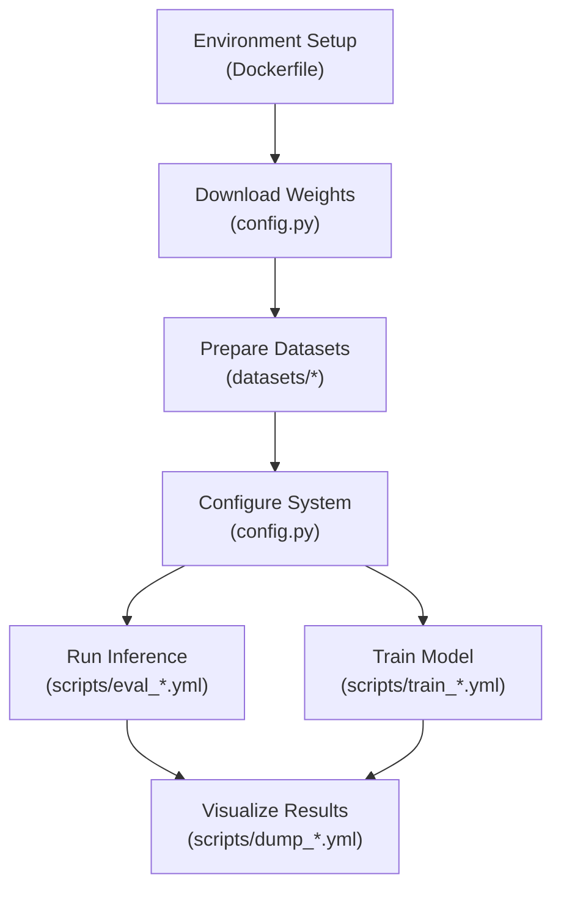

Sources: [README.md:7-108]()

## Download Pretrained Weights

1. Create a directory for large assets:
   ```bash
   mkdir <large_asset_dir>
   ```

2. Update `__C.ASSETS_PATH` in `config.py` to point to this directory
3. Download pretrained weights from Google Drive and place them in `<large_asset_dir>/seg_weights`

Sources: [README.md:13-24]()

## Prepare Datasets

The system primarily supports Cityscapes and Mapillary datasets. Update `config.py` with the appropriate paths:

```python
# For Cityscapes
__C.DATASET.CITYSCAPES_DIR=<path_to_cityscapes>

# For Mapillary (optional)
__C.DATASET.MAPILLARY_DIR=<path_to_mapillary>

# For Cityscapes Autolabelled Images (optional)
__C.DATASET.CITYSCAPES_CUSTOMCOARSE=<path_to_autolabelled_cityscapes>
```

Sources: [README.md:26-43]()

## Running the System

The semantic segmentation system uses `runx` for experiment management. You can either use `runx` commands or call Python scripts directly.

### Available Scripts

| Script | Purpose | Expected Result |
|--------|---------|----------------|
| `scripts/eval_cityscapes.yml` | Run inference on Cityscapes | 86.92 IoU |
| `scripts/eval_mapillary.yml` | Run inference on Mapillary | 61.05 IoU |
| `scripts/dump_cityscapes.yml` | Generate visualizations for Cityscapes | Output images |
| `scripts/dump_folder.yml` | Run inference on custom images | Output images |
| `scripts/train_cityscapes.yml` | Train with Cityscapes fine data | 84.7 IoU |
| `scripts/train_cityscapes_sota.yml` | Train SOTA model | 86.8 IoU |

Sources: [README.md:46-108]()

### Running Inference

```bash
# Dry run (inspect command without executing)
python -m runx.runx scripts/eval_cityscapes.yml -i -n

# Actual run
python -m runx.runx scripts/eval_cityscapes.yml -i
```

Results will be saved in `./logs/eval_cityscapes/...`

Sources: [README.md:52-65]()

### Visualizing Results

```bash
# For Cityscapes validation set
python -m runx.runx scripts/dump_cityscapes.yml -i

# For custom images
python -m runx.runx scripts/dump_folder.yml -i
```

Sources: [README.md:75-87]()

### Training Models

```bash
# Standard training with HRNet+OCR+multi-scale attention
python -m runx.runx scripts/train_cityscapes.yml -i

# SOTA model training
python -m runx.runx scripts/train_cityscapes_sota.yml -i
```

Note: The first training run will build a centroid file for class-uniform sampling (takes ~10 minutes).

Sources: [README.md:93-108]()

## System Architecture

The following diagram shows the data flow through the semantic segmentation system:

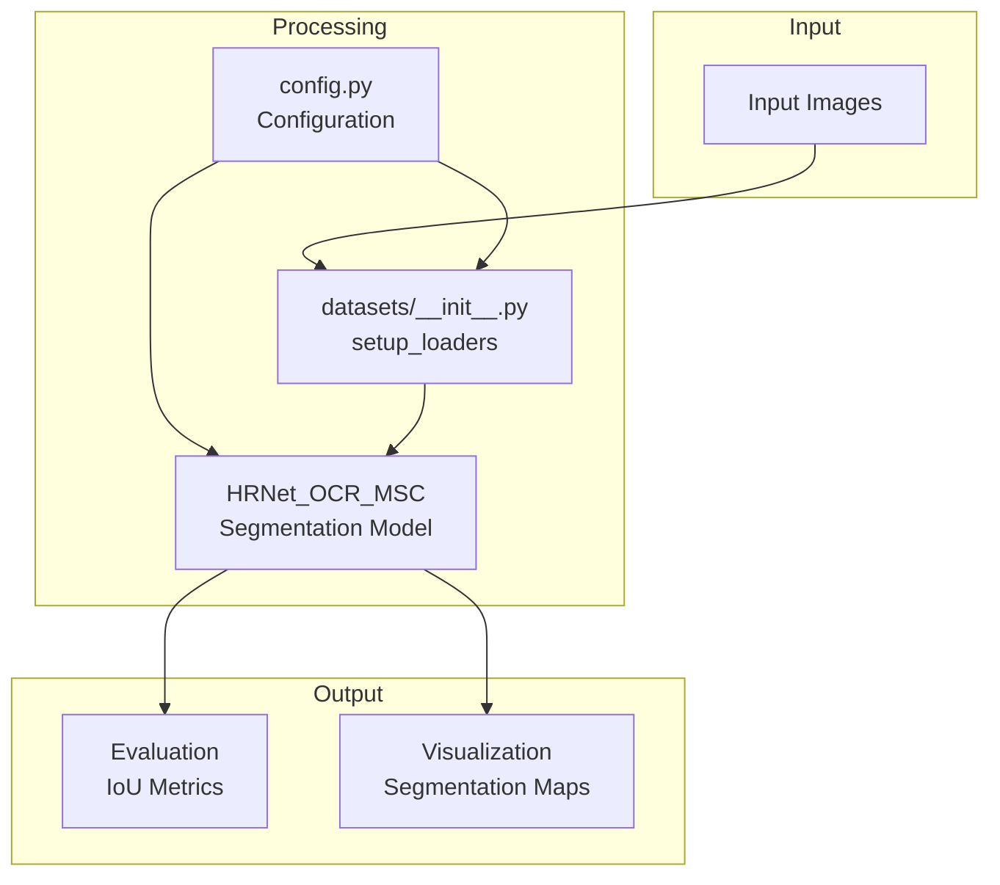

Sources: System overview diagrams

## Model Architecture

The semantic segmentation model implements the Hierarchical Multi-Scale Attention approach:

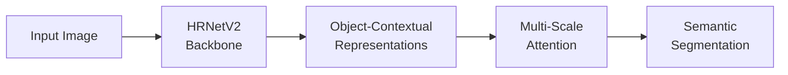

Sources: [README.md:3](), System overview diagrams

## Next Steps

After completing the initial setup and running basic operations, you can explore:

- Detailed configuration options in [Configuration System](#3.1)
- In-depth understanding of the model in [Model Architecture](#3.3)
- Advanced training techniques in [Training Process](#5.1)
- Evaluation methods in [Evaluation and Visualization](#5.2)

---

# Page: Installation and Environment Setup

# Installation and Environment Setup

<details>
<summary>Relevant source files</summary>

The following files were used as context for generating this wiki page:

- [Dockerfile](Dockerfile)
- [README.md](README.md)

</details>


This document provides comprehensive instructions for setting up the NVIDIA Semantic Segmentation environment, installing all required dependencies, and configuring the system for use. For information about preparing specific datasets after installation, see [Dataset Preparation](#2.2).

## System Requirements

Before beginning installation, ensure your system meets the following requirements:

- NVIDIA GPU with CUDA support
- Sufficient disk space for the codebase, datasets, and model weights
- Docker (recommended) or a compatible Python environment

## Docker Installation (Recommended)

The repository provides a Dockerfile that creates a containerized environment with all necessary dependencies pre-configured. This is the recommended installation method to ensure compatibility.

### Building the Docker Image

```bash
# Clone the repository
git clone https://github.com/NVIDIA/semantic-segmentation
cd semantic-segmentation

# Build the Docker image
docker build -t nvidia-semseg .
```

### Running the Docker Container

```bash
# Run the container with GPU support and mount the current directory
docker run --gpus all -it --rm -v $(pwd):/workspace nvidia-semseg
```

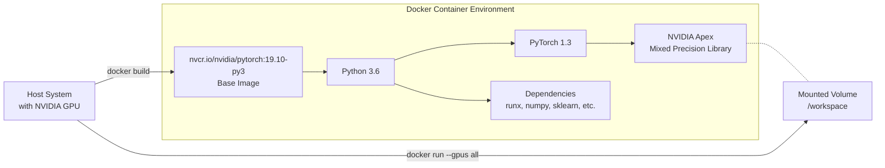

Sources: [Dockerfile:1-23](), [README.md:7-10]()

## Manual Installation (Alternative)

If you prefer not to use Docker, you can manually install the required dependencies:

### 1. Python Environment Setup

The system requires Python 3.6 and PyTorch 1.3.

```bash
# Create a virtual environment (optional but recommended)
python3 -m venv semantic-seg-env
source semantic-seg-env/bin/activate
```

### 2. Install Dependencies

```bash
# Install PyTorch 1.3 (command may vary based on your CUDA version)
pip install torch==1.3.0 torchvision==0.4.1

# Install required packages
pip install runx==0.0.6 numpy sklearn h5py jupyter scikit-image pillow piexif cffi tqdm dominate opencv-python nose ninja
```

### 3. Install NVIDIA Apex

Apex is required for mixed precision training and inference:

```bash
git clone https://github.com/NVIDIA/apex.git
cd apex
python setup.py install --cuda_ext --cpp_ext
```

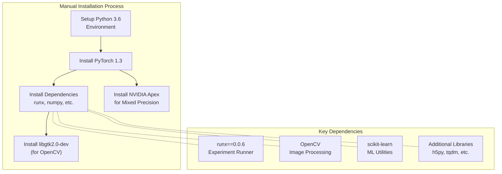

Sources: [Dockerfile:3-18](), [README.md:9]()

## Downloading Pre-trained Models

The system uses pre-trained weights for inference and as initialization for training:

1. Create a directory for large assets outside the repository:
   ```bash
   mkdir <large_asset_dir>
   ```

2. Update the assets path in the configuration file:
   ```python
   # In config.py
   __C.ASSETS_PATH = "<large_asset_dir>"
   ```

3. Download pre-trained weights from Google Drive and place them in the assets directory:
   ```bash
   # After downloading, ensure weights are in:
   <large_asset_dir>/seg_weights/
   ```

Sources: [README.md:13-24]()

## Dataset Configuration

After installation, you'll need to configure the paths to your datasets:

### Cityscapes Dataset

If using Cityscapes, update the path in `config.py`:
```python
__C.DATASET.CITYSCAPES_DIR = "<path_to_cityscapes>"
```

### Cityscapes Autolabelled Images

For autolabelled data:
```python
__C.DATASET.CITYSCAPES_CUSTOMCOARSE = "<path_to_cityscapes_autolabelled>"
```

### Mapillary Dataset

If using Mapillary:
```python
__C.DATASET.MAPILLARY_DIR = "<path_to_mapillary>"
```

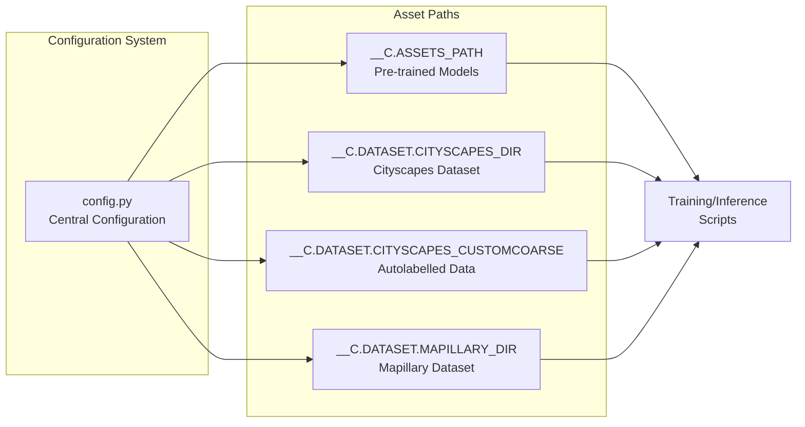

Sources: [README.md:25-43]()

## Verifying Installation

To verify your installation is working correctly, you can run a simple inference test on Cityscapes:

```bash
# Dry run (just prints the command without execution)
python -m runx.runx scripts/eval_cityscapes.yml -i -n

# Actual inference run
python -m runx.runx scripts/eval_cityscapes.yml -i
```

If successful, the system should report an IOU of approximately 86.92.

## Installation Structure Overview

The following diagram illustrates the complete installation and environment structure:

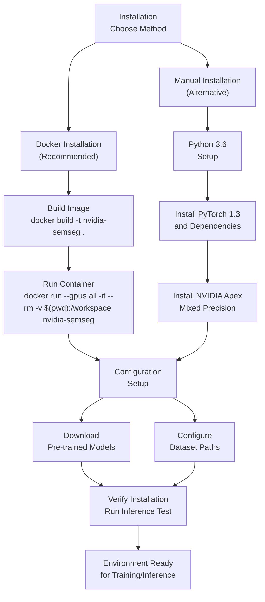

Sources: [Dockerfile:1-23](), [README.md:7-73]()

## Common Installation Issues

Here are solutions to common installation problems:

| Issue | Solution |
|-------|----------|
| Docker NVIDIA GPU access | Ensure the NVIDIA Container Toolkit is installed and `--gpus all` flag is used |
| Apex installation fails | Check CUDA compatibility; you may need to install specific CUDA/cuDNN versions |
| Out of memory during inference | Use 'O3' mode for amp (especially for Mapillary dataset) |
| Dataset path not found | Double-check the path in `config.py` and ensure dataset structure is correct |
| Pre-trained model not loading | Verify the model files are in `<large_asset_dir>/seg_weights/` |

Sources: [README.md:68-73]()

## Next Steps

After completing the installation and environment setup, proceed to:

1. [Dataset Preparation](#2.2) to download and structure your datasets
2. Training your first model using the instructions in [Training Process](#5.1)
3. Evaluating the model using [Evaluation and Visualization](#5.2)

---

# Page: Dataset Preparation

# Dataset Preparation

<details>
<summary>Relevant source files</summary>

The following files were used as context for generating this wiki page:

- [PREPARE_DATASETS.md](PREPARE_DATASETS.md)
- [README.md](README.md)

</details>


This document explains how to download, prepare, and configure the datasets used in the NVIDIA semantic segmentation framework. The system primarily works with two datasets: Cityscapes and Mapillary Vistas. This page covers the acquisition of dataset files, necessary folder structures, and configuration steps to make the datasets ready for training and evaluation.

For information about using the datasets in training, see [Training Process](#5.1).

## Dataset Preparation Process Overview

The general process for preparing datasets involves:

1. Requesting access to the datasets from their respective providers
2. Downloading the dataset archive files
3. Extracting the files with the correct directory structure
4. Configuring the system to locate the datasets

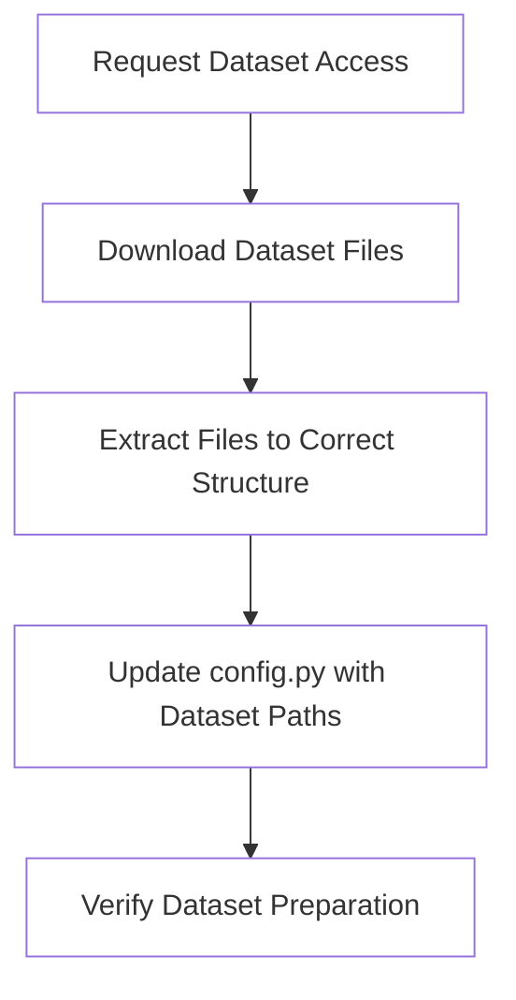

Sources: [PREPARE_DATASETS.md:1-121](), [README.md:26-43]()

## Cityscapes Dataset

Cityscapes is a large-scale dataset containing high-resolution images with pixel-level annotations for urban street scenes. The semantic segmentation system uses Cityscapes for both training and evaluation.

### Downloading Cityscapes Dataset

1. Request access to the dataset from the [Cityscapes website](https://www.cityscapes-dataset.com/)
2. Download the following files:
   - `leftImg8bit_trainvaltest.zip` - Contains training, validation, and test images
   - `gtFine_trainvaltest.zip` - Contains fine annotations for training, validation, and test sets
   - `leftImg8bit_trainextra.zip` - Contains additional training images
   - `gtCoarse.zip` - Contains coarse annotations
   - `refinement_final_v0.zip` - Contains autolabelled data (only needed for SOTA training)

You can download these files manually from the website or use command-line tools as shown below:

```bash
# First, obtain login credentials by registering at the Cityscapes website
# Then use the following commands with your username and password

# Login to Cityscapes system
wget --keep-session-cookies --save-cookies=cookies.txt --post-data 'username=USERNAME&password=PASSWORD&submit=Login' https://www.cityscapes-dataset.com/login/

# Download the datasets (example for leftImg8bit_trainvaltest.zip)
wget -c -t 0 --load-cookies cookies.txt --content-disposition https://www.cityscapes-dataset.com/file-handling/?packageID=3
```

The packageIDs for the different files are:
- 1: gtFine_trainvaltest.zip (241MB)
- 2: gtCoarse.zip (1.3GB)
- 3: leftImg8bit_trainvaltest.zip (11GB)
- 4: leftImg8bit_trainextra.zip (44GB)

The autolabelled data can be downloaded from [Google Drive](https://drive.google.com/file/d/1DtPo-WP-hjaOwsbj6ZxTtOo_7R_4TKRG/view).

Sources: [PREPARE_DATASETS.md:41-70](), [README.md:33-38]()

### Cityscapes Folder Structure

After downloading, extract the files to create the following folder structure:

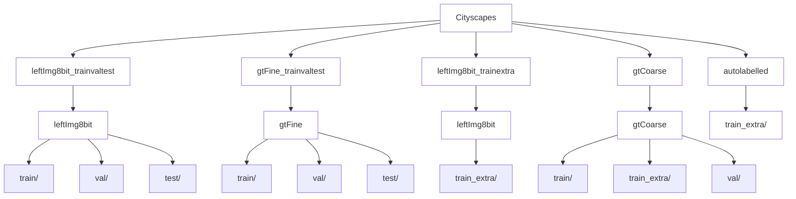

Each folder (like `train/`, `val/`, etc.) contains city-specific subfolders (e.g., `aachen/`, `bochum/`), which in turn contain the actual images and annotations.

Sources: [PREPARE_DATASETS.md:72-117]()

### Configuring Cityscapes

After extracting the files, update the `config.py` file to point to the Cityscapes directory:

```python
__C.DATASET.CITYSCAPES_DIR = '/path/to/Cityscapes'
```

If you are using the autolabelled data for SOTA training, also set:

```python
__C.DATASET.CITYSCAPES_CUSTOMCOARSE = '/path/to/Cityscapes'
```

Sources: [README.md:28-38]()

## Mapillary Vistas Dataset

Mapillary Vistas is a large-scale street-level image dataset with pixel-accurate and instance-specific human annotations for understanding street scenes.

### Downloading Mapillary Dataset

1. Request the research edition dataset from the [Mapillary website](https://www.mapillary.com/dataset/vistas/)
2. Download the `mapillary-vistas-dataset_public_v1.1.zip` file

Sources: [PREPARE_DATASETS.md:1-9]()

### Mapillary Folder Structure

Extract the ZIP file to create the following folder structure:

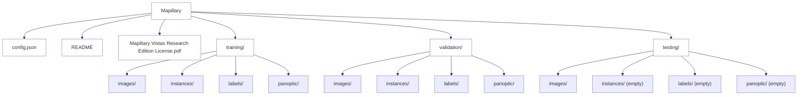

Note that the `instances/`, `labels/`, and `panoptic/` folders inside the `testing/` directory are empty.

Sources: [PREPARE_DATASETS.md:10-34]()

### Configuring Mapillary

After extracting the files, update the `config.py` file to point to the Mapillary directory:

```python
__C.DATASET.MAPILLARY_DIR = '/path/to/Mapillary'
```

Sources: [PREPARE_DATASETS.md:36-39](), [README.md:40-43]()

## Dataset Loading System Integration

The following diagram illustrates how the prepared datasets integrate with the semantic segmentation framework:

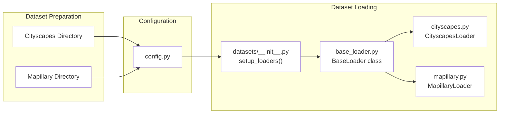

The prepared datasets are referenced in the configuration file (`config.py`), which is used by the dataset loaders to locate and load the data. The system uses a common base loader class that is extended by dataset-specific loaders for Cityscapes and Mapillary.

Sources: [README.md:26-43]()

## Verifying Dataset Preparation

When you first run a training script, the system will build a centroid file for the dataset, which is used for class-uniform sampling during training. This process takes about 10 minutes and indicates that the dataset is properly prepared and accessible.

```bash
# Example command to verify dataset preparation through training
python -m runx.runx scripts/train_cityscapes.yml -i -n
```

The `-n` flag performs a dry run, showing the command that would be executed without actually running it. This can help verify that the dataset paths are correctly configured.

Sources: [README.md:96-100]()

## Dataset Requirements Table

| Dataset | Required Files | Approximate Size | Configuration Variable |
|---------|----------------|------------------|------------------------|
| Cityscapes | leftImg8bit_trainvaltest.zip | 11GB | __C.DATASET.CITYSCAPES_DIR |
| Cityscapes | gtFine_trainvaltest.zip | 241MB | (same as above) |
| Cityscapes | leftImg8bit_trainextra.zip | 44GB | (same as above) |
| Cityscapes | gtCoarse.zip | 1.3GB | (same as above) |
| Cityscapes (SOTA) | refinement_final_v0.zip | 5GB | __C.DATASET.CITYSCAPES_CUSTOMCOARSE |
| Mapillary | mapillary-vistas-dataset_public_v1.1.zip | Varies | __C.DATASET.MAPILLARY_DIR |

Sources: [PREPARE_DATASETS.md:41-70](), [README.md:26-43]()

---

# Page: System Architecture

# System Architecture

<details>
<summary>Relevant source files</summary>

The following files were used as context for generating this wiki page:

- [README.md](README.md)
- [config.py](config.py)

</details>


This document provides a detailed overview of the system architecture for NVIDIA's semantic segmentation implementation. It covers the core components, their interactions, and the overall data flow through the system. For installation instructions, see [Installation and Environment Setup](#2.1), and for dataset preparation information, see [Dataset Preparation](#2.2).

## Overall Architecture

The semantic segmentation system implements the "Hierarchical Multi-Scale Attention for Semantic Segmentation" approach described in the repository's associated paper. The architecture consists of several key components that work together to enable efficient training and inference for semantic segmentation tasks.

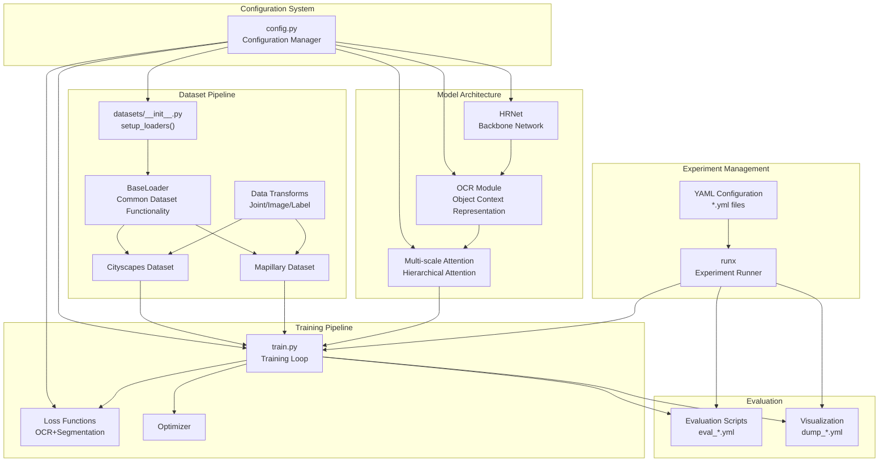

Sources: [README.md:1-107](), [config.py:32-68]()

## Configuration System

The configuration system serves as the central manager for all parameters and settings in the semantic segmentation framework, allowing for consistent configuration across all components.

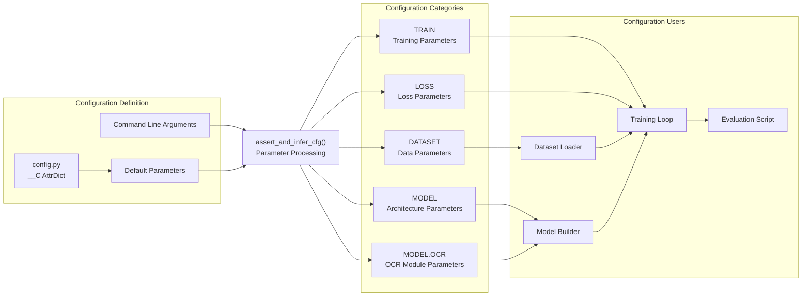

The configuration system is defined in `config.py` and uses an `AttrDict` class to create a hierarchical parameter structure. Key configuration categories include:

| Configuration Category | Purpose | Example Parameters |
|-----------------------|---------|-------------------|
| `DATASET` | Dataset paths and loading parameters | `CITYSCAPES_DIR`, `MAPILLARY_DIR`, `CLASS_UNIFORM_PCT` |
| `MODEL` | Model architecture configuration | `MSCALE`, `ALIGN_CORNERS`, `OCR` settings |
| `TRAIN` | Training process parameters | `FP16`, `RANDOM_BRIGHTNESS_SHIFT_VALUE` |
| `LOSS` | Loss function configuration | `OCR_ALPHA`, `OCR_AUX_RMI` |

The function `assert_and_infer_cfg()` processes command-line arguments to update the default configuration, ensuring consistency across the entire system.

Sources: [config.py:32-383]()

## Dataset Pipeline

The dataset pipeline manages the loading, processing, and batching of image data for training and evaluation.

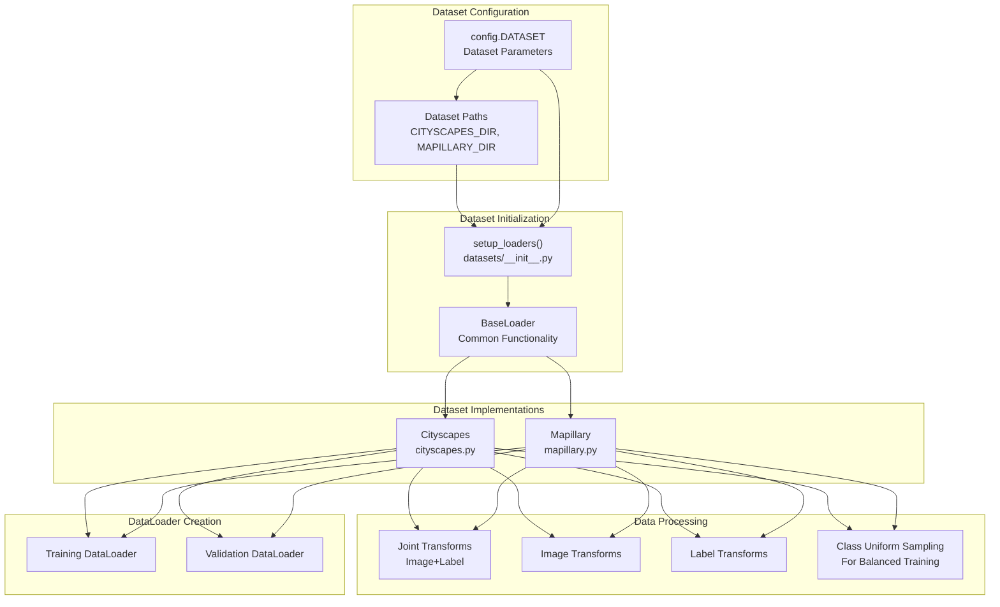

The dataset pipeline consists of:

1. **Dataset Configuration**: Parameters in `config.py` define dataset paths and loading settings
2. **Dataset Initialization**: The `setup_loaders()` function in `datasets/__init__.py` creates appropriate dataset instances
3. **BaseLoader**: Provides common functionality for all dataset implementations
4. **Dataset Implementations**: Specific implementations for Cityscapes and Mapillary
5. **Data Processing**: Transforms for augmentation and normalization
6. **Class Uniform Sampling**: Ensures balanced class representation during training
7. **DataLoader Creation**: Batching and shuffling data for training and validation

The system supports multiple datasets with cross-validation splits, class-uniform sampling for handling imbalanced classes, and various data augmentation techniques.

Sources: [README.md:26-42](), [config.py:75-117]()

## Model Architecture

The model architecture implements the "Hierarchical Multi-Scale Attention for Semantic Segmentation" approach with three main components: HRNet backbone, OCR module, and multi-scale attention.

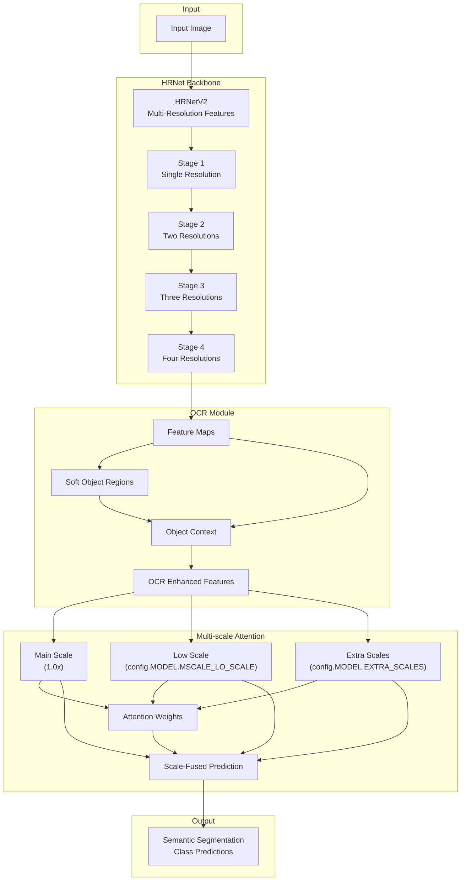

Key components of the model architecture include:

1. **HRNet Backbone**: Maintains high-resolution representations throughout the network, generating multi-scale feature maps.
   - Configured through parameters in `config.MODEL.OCR_EXTRA`
   - Uses a pre-trained HRNet model from `__C.MODEL.HRNET_CHECKPOINT`

2. **OCR (Object Context Representation)**: Enhances features with object context information.
   - Takes feature maps from HRNet as input
   - Generates soft object regions
   - Aggregates object context
   - Parameters controlled by `config.MODEL.OCR.MID_CHANNELS` and `config.MODEL.OCR.KEY_CHANNELS`

3. **Multi-scale Attention**: Fuses predictions from multiple scales using attention mechanisms.
   - Processes features at multiple scales (main, low, and extra scales)
   - Generates attention weights for each scale
   - Combines predictions using attention weights
   - Controlled by parameters like `config.MODEL.MSCALE_LO_SCALE` and `config.MODEL.EXTRA_SCALES`

The entire architecture is highly configurable through parameters in `config.py`, allowing for experimentation with different model configurations.

Sources: [README.md:3-3](), [config.py:119-190]()

## Training and Evaluation Pipeline

The training and evaluation pipeline manages the model training process, evaluation, and result visualization.

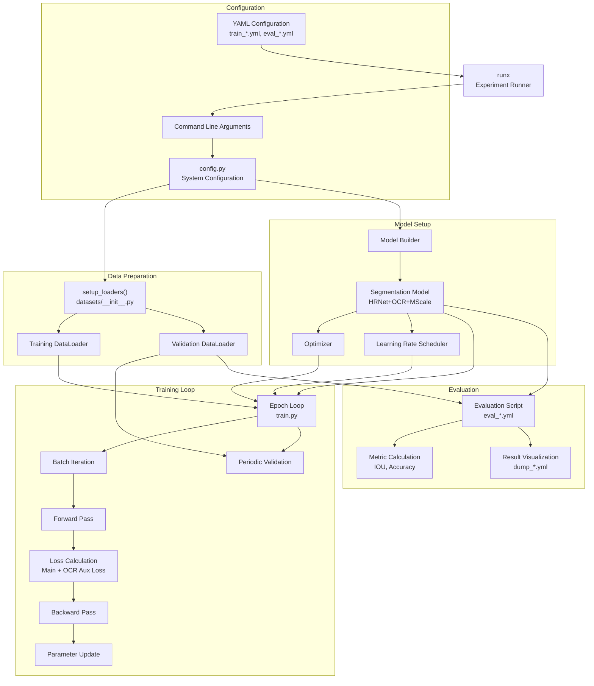

The training and evaluation pipeline consists of:

1. **Configuration**: Parameters from `config.py`, command-line arguments, and YAML configuration files
2. **Data Preparation**: Dataset loaders for training and validation
3. **Model Setup**: Initializing the segmentation model, optimizer, and learning rate scheduler
4. **Training Loop**: Iterating through epochs and batches, updating model parameters
   - Forward pass through the model
   - Loss calculation (main segmentation loss + OCR auxiliary loss)
   - Backward pass for gradient calculation
   - Parameter updates
   - Periodic validation

5. **Evaluation**: Assessing model performance and visualizing results
   - IOU (Intersection over Union) calculation
   - Visualization of segmentation outputs

The system uses the `runx` tool for experiment management, which provides a convenient way to configure and run training and evaluation jobs.

Sources: [README.md:46-108](), [config.py:204-383]()

## Experiment Management

The experiment management system uses `runx` to configure, run, and track experiments.

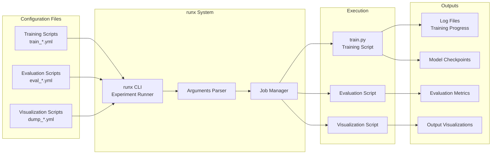

The experiment management system handles:

1. **Configuration Files**: YAML files for different experiment types
   - `train_*.yml`: Training configurations
   - `eval_*.yml`: Evaluation configurations 
   - `dump_*.yml`: Visualization configurations

2. **runx CLI**: Command-line interface for running experiments
   - Parses experiment configuration
   - Manages job execution
   - Example: `python -m runx.runx scripts/train_cityscapes.yml -i`

3. **Execution**: Running the appropriate scripts with the specified parameters
   - Training script (`train.py`)
   - Evaluation scripts
   - Visualization scripts

4. **Outputs**: Storing experiment results
   - Log files with training progress
   - Model checkpoints
   - Evaluation metrics
   - Output visualizations

This system enables efficient experimentation by simplifying the process of configuring and running different training and evaluation scenarios.

Sources: [README.md:46-108]()

## System Integration

This diagram shows how all components integrate to form the complete semantic segmentation system:

```mermaid
flowchart TD
    subgraph "Input"
        raw_data["Raw Images<br>Cityscapes/Mapillary"]
        config_files["Configuration Files<br>config.py, *.yml"]
    end

    subgraph "Core System"
        config_system["Configuration System<br>config.py"]
        dataset_system["Dataset System<br>BaseLoader, Dataset Implementations"]
        model_system["Model System<br>HRNet+OCR+MScale"]
        training_system["Training System<br>train.py"]
        eval_system["Evaluation System<br>eval_*.yml scripts"]
    end

    subgraph "Experiment Management"
        runx_system["runx<br>Experiment Runner"]
    end

    subgraph "Output"
        checkpoints["Model Checkpoints<br>Trained Models"]
        eval_results["Evaluation Results<br>IOU Metrics"]
        visualizations["Visualizations<br>Segmentation Maps"]
    end

    raw_data --> dataset_system
    config_files --> config_system
    config_files --> runx_system
    
    config_system --> dataset_system
    config_system --> model_system
    config_system --> training_system
    config_system --> eval_system
    
    dataset_system --> training_system
    model_system --> training_system
    
    runx_system --> training_system
    runx_system --> eval_system
    
    training_system --> checkpoints
    eval_system --> eval_results
    eval_system --> visualizations
    
    checkpoints --> eval_system
```

The complete system integrates all components through:

1. **Configuration Flow**: Configuration parameters from `config.py` and YAML files flow through to all components
2. **Data Flow**: Raw image data flows through the dataset pipeline to the training and evaluation systems
3. **Model Flow**: The model architecture receives processed data and produces segmentation outputs
4. **Result Flow**: Model outputs flow through evaluation to produce metrics and visualizations

This integration ensures all components work together efficiently to train and evaluate semantic segmentation models.

Sources: [README.md:1-108](), [config.py:1-383]()

---

# Page: Configuration System

# Configuration System

<details>
<summary>Relevant source files</summary>

The following files were used as context for generating this wiki page:

- [README.md](README.md)
- [config.py](config.py)

</details>


## Purpose and Scope

The Configuration System is the central control mechanism that manages parameters for all aspects of the semantic segmentation system. It provides a flexible, hierarchical structure for defining default values and customizing behavior throughout the codebase. This document covers how the configuration system works, its key components, and how it integrates with other parts of the system.

For information about dataset-specific configuration, see [Dataset Loading Pipeline](#3.2).

## Overview

The configuration system uses a hierarchical, dictionary-like structure to organize parameters related to datasets, models, training procedures, and other components. It supports setting default values, updating configuration at runtime, and freezing the configuration to prevent accidental modifications.

```mermaid
flowchart TD
    subgraph "Configuration System"
        cfg["cfg / __C<br>Central Config Object"]
        attr["AttrDict<br>Dictionary-like Class"]
        assert_fn["assert_and_infer_cfg()<br>Process Arguments"]
        update_fn["update_* Functions<br>Runtime Updates"]
        
        attr --> cfg
        assert_fn --> cfg
        update_fn --> cfg
    end
    
    subgraph "Command Line Interface"
        args["Command Line Arguments"]
        args --> assert_fn
    end
    
    subgraph "Consumers"
        ds["Dataset Loaders"]
        model["Model Architecture"]
        train["Training Process"]
        eval["Evaluation"]
        
        cfg --> ds
        cfg --> model
        cfg --> train
        cfg --> eval
    end
```

Sources: [config.py:32-48](), [config.py:205-362]()

## Core Components

### AttrDict and Central Configuration Object

The system is built around a central configuration object, an instance of `AttrDict` called `__C` and aliased as `cfg`. This object provides dictionary-like access to parameters while allowing dot notation for easier access.

```mermaid
classDiagram
    class AttrDict {
        +dict _dict
        +get(key)
        +set(key, value)
        +immutable(is_immutable)
    }
    
    class ConfigObject {
        +GLOBAL_RANK
        +EPOCH
        +ASSETS_PATH
        +BATCH_WEIGHTING
        +DATASET: AttrDict
        +MODEL: AttrDict
        +LOSS: AttrDict
    }
    
    AttrDict <|-- ConfigObject
```

Sources: [config.py:43-48]()

### Configuration Sections

The configuration is organized into sections, each handling related parameters:

| Section | Purpose | Examples |
|---------|---------|----------|
| Global | General settings | `ASSETS_PATH`, `EPOCH`, `GLOBAL_RANK` |
| `DATASET` | Dataset-specific parameters | Paths, transformations, class weights |
| `MODEL` | Model architecture settings | Network type, batch norm settings, checkpoint paths |
| `LOSS` | Loss function settings | Weights, loss types |
| `OPTIONS` | Miscellaneous options | Test mode, initialization settings |

Sources: [config.py:49-190]()

## Configuration Process

### Default Configuration

The system defines sensible defaults for all parameters. Key defaults include:

1. Paths to datasets and pre-trained models
2. Model architecture parameters
3. Dataset handling settings

Example of default path configuration:
```python
__C.ASSETS_PATH = '/home/dcg-adlr-atao-data.cosmos277/assets'
__C.DATASET.CITYSCAPES_DIR = os.path.join(__C.ASSETS_PATH, 'data/Cityscapes')
```

Sources: [config.py:52-53](), [config.py:78-79]()

### Configuration Customization

The primary entry point for configuration customization is the `assert_and_infer_cfg` function, which processes command-line arguments and updates the configuration accordingly.

```mermaid
flowchart TD
    start["train.py or eval script starts"]
    args["Parse command-line arguments"]
    assert["assert_and_infer_cfg(args)"]
    immutable["cfg.immutable(True)"]
    use["Use configuration"]
    
    start --> args
    args --> assert
    assert --> immutable
    immutable --> use
    
    subgraph "Inside assert_and_infer_cfg"
        detect_torch["Detect PyTorch version"]
        setup_bn["Setup batch normalization"]
        process_args["Process command-line arguments"]
        update_cfg["Update configuration values"]
    end
    
    assert --> detect_torch
    detect_torch --> setup_bn
    setup_bn --> process_args
    process_args --> update_cfg
    update_cfg --> immutable
```

Sources: [config.py:205-362](), [README.md:47-108]()

### Runtime Updates

The configuration system provides functions to update certain parameters during runtime:

- `update_epoch(epoch)`: Updates the current epoch counter
- `update_dataset_cfg(num_classes, ignore_label)`: Updates dataset-specific configuration
- `update_dataset_inst(dataset_inst)`: Updates the dataset instance

These functions temporarily make the configuration mutable, update the values, and then make it immutable again.

Sources: [config.py:364-382]()

## Key Configuration Parameters

### Dataset Configuration

```mermaid
flowchart TD
    dataset["DATASET Section"]
    paths["Dataset Paths<br>CITYSCAPES_DIR<br>MAPILLARY_DIR"]
    params["Dataset Parameters<br>CROP_SIZE<br>IGNORE_LABEL<br>NUM_CLASSES"]
    transform["Transform Parameters<br>MEAN<br>STD"]
    sampling["Sampling Parameters<br>CLASS_UNIFORM_PCT<br>CLASS_UNIFORM_TILE"]
    
    dataset --> paths
    dataset --> params
    dataset --> transform
    dataset --> sampling
```

Sources: [config.py:76-116](), [README.md:25-43]()

### Model Configuration

Key model configuration includes:

1. Backbone network selection (e.g., HRNet)
2. Feature enhancement modules (OCR, Multi-scale attention)
3. Batch normalization settings
4. Checkpoint paths

Sources: [config.py:119-149](), [config.py:158-190]()

## Common Usage Patterns

### Setting Dataset Paths

As shown in the README, dataset paths are commonly set by updating the configuration:

```python
# Update paths in config.py or via command-line arguments
__C.DATASET.CITYSCAPES_DIR = <path_to_cityscapes>
__C.DATASET.MAPILLARY_DIR = <path_to_mapillary>
```

Sources: [README.md:28-43]()

### Command-line Configuration Flow

The system is designed to work with both direct Python calls and the `runx` experiment runner:

1. User provides arguments via command line or YAML configuration files
2. Arguments are processed in `assert_and_infer_cfg`
3. Configuration is frozen with `cfg.immutable(True)`
4. System components access configuration via the `cfg` object

```mermaid
flowchart LR
    user["User Input<br>(Command Line or YAML)"]
    runx["runx.runx<br>Experiment Runner"]
    train["train.py<br>Main Script"]
    args["ArgumentParser<br>Parse Arguments"]
    config["config.py<br>assert_and_infer_cfg()"]
    
    user --> runx
    runx --> train
    train --> args
    args --> config
    
    subgraph "System Components"
        datasets["Dataset Loaders"]
        model["Model Architecture"]
        train_loop["Training Loop"]
    end
    
    config --> datasets
    config --> model
    config --> train_loop
```

Sources: [README.md:47-108](), [config.py:205-362]()

## Compatibility and Extensions

The configuration system is designed to be adaptive to different PyTorch versions and execution environments. It provides flexibility for extending with new parameters or modifying existing ones while maintaining backward compatibility.

Sources: [config.py:193-202]()

## Best Practices

1. **Asset Path Management**: Set `__C.ASSETS_PATH` to point to a directory where large files can be stored, outside the repository.

2. **Configuration Review**: Before running experiments, review the configuration in `config.py` to ensure paths and parameters are set correctly.

3. **Customization via Arguments**: Use command-line arguments or YAML files to customize configuration rather than directly modifying `config.py`.

4. **Use the Immutability Feature**: After initial setup, the configuration is made immutable to prevent accidental changes. This is a safety feature that should be respected.

Sources: [README.md:13-23](), [config.py:359-362]()

---

# Page: Dataset Loading Pipeline

# Dataset Loading Pipeline

<details>
<summary>Relevant source files</summary>

The following files were used as context for generating this wiki page:

- [datasets/__init__.py](datasets/__init__.py)
- [datasets/base_loader.py](datasets/base_loader.py)

</details>


## Introduction

This document describes the dataset loading pipeline in the NVIDIA semantic segmentation framework, which transforms raw image and mask data into batched tensors suitable for model training and evaluation. The pipeline handles dataset acquisition, transformations, augmentations, and batch creation. For information about preparing the raw datasets, see [Dataset Preparation](#2.2).

## Pipeline Overview

The dataset loading pipeline consists of several key components that work together to efficiently load and prepare data:

```mermaid
flowchart TD
    subgraph "Dataset Loading Pipeline"
        A["setup_loaders()"]
        B["Dataset Class<br>(CityscapesLoader, MapillaryLoader)"]
        C["BaseLoader"]
        D["Transformations"]
        E["DataLoader"]
        
        A -->|"imports & instantiates"| B
        B -->|"inherits from"| C
        A -->|"configures"| D
        D -->|"applied in"| C
        A -->|"creates"| E
        B -->|"passed to"| E
    end
    
    subgraph "Input"
        raw["Raw Dataset Files"]
    end
    
    subgraph "Output"
        batches["Batched Tensors"]
    end
    
    raw --> B
    E --> batches
```

Sources: [datasets/__init__.py:45-199](), [datasets/base_loader.py:45-102]()

## Dataset Loading Setup

The central function that orchestrates the dataset loading process is `setup_loaders()` in `datasets/__init__.py`. This function:

1. Dynamically imports the specific dataset module based on the dataset name provided
2. Configures transformations and augmentations
3. Creates dataset instances for training and validation
4. Wraps datasets in PyTorch DataLoaders with appropriate sampling strategies

```mermaid
sequenceDiagram
    participant train as "train.py"
    participant setup as "setup_loaders()"
    participant dataset as "Dataset Module"
    participant transforms as "Transforms"
    participant dataloader as "DataLoader"
    
    train->>setup: Call with args
    setup->>dataset: Import dataset module
    setup->>dataset: Get dataset class
    setup->>transforms: Configure joint transforms
    setup->>transforms: Configure image transforms
    setup->>transforms: Configure target transforms
    setup->>dataset: Create validation dataset instance
    setup->>dataset: Create training dataset instance
    setup->>dataloader: Create validation DataLoader
    setup->>dataloader: Create training DataLoader
    setup->>train: Return loaders and training set
```

Sources: [datasets/__init__.py:45-72](), [datasets/__init__.py:149-199]()

## Dataset Transformations

The pipeline employs three types of transformations:

1. **Joint Transforms** - Applied to both image and mask simultaneously (e.g., resizing, cropping, flipping)
2. **Image Transforms** - Applied only to input images (e.g., color jitter, blur, normalization)
3. **Target Transforms** - Applied only to masks (e.g., conversion to tensor)

### Joint Transformations

Joint transforms ensure that both the image and its corresponding mask undergo the same spatial transformations to maintain alignment:

```
- RandomSizeAndCrop: Randomly crops the image and mask to the specified size
- RandomHorizontallyFlip: Randomly flips the image and mask horizontally
- RandAugment: Applies random augmentations (when enabled)
```

### Image Transformations

Image-specific transforms are applied only to the input images:

```
- ColorJitter: Adjusts brightness, contrast, saturation, and hue
- RandomBilateralBlur or RandomGaussianBlur: Applies blur effects
- ToTensor: Converts the image to a PyTorch tensor
- Normalize: Normalizes the image using mean and standard deviation
```

### Target Transformations

Target transforms are applied only to the segmentation masks:

```
- MaskToTensor: Converts the mask to a PyTorch tensor
- RelaxedBoundaryLossToTensor: Special transform for boundary-aware loss functions
```

Sources: [datasets/__init__.py:63-122](), [datasets/base_loader.py:120-150]()

## BaseLoader Class

The `BaseLoader` class is the foundation for all dataset loaders in the system. Dataset-specific loaders (like Cityscapes and Mapillary) inherit from this class, which provides common functionality:

```mermaid
classDiagram
    class BaseLoader {
        +__init__(quality, mode, joint_transform_list, img_transform, label_transform)
        +build_epoch()
        +find_images()
        +disable_coarse()
        +colorize_mask()
        +dump_images()
        +do_transforms()
        +read_images()
        +__getitem__(index)
        +__len__()
        +calculate_weights()
    }
    
    class DatasetLoader {
        +num_classes
        +ignore_label
        +id_to_trainid
        +parse_items()
        +build_centroids()
    }
    
    BaseLoader <|-- DatasetLoader
```

Key methods of the `BaseLoader` class:

- **build_epoch()**: Prepares image lists for class-uniform sampling
- **find_images()**: Locates image and mask file pairs
- **do_transforms()**: Applies transformations to image and mask pairs
- **read_images()**: Loads images and masks from disk, converting labels if needed
- **__getitem__()**: Returns a transformed image-mask pair for a given index

Sources: [datasets/base_loader.py:45-236]()

## Sample Processing Flow

When a sample is requested from the dataset loader, it goes through the following processing steps:

```mermaid
flowchart LR
    subgraph "Sample Processing"
        A["__getitem__()"]
        B["read_images()"]
        C["do_transforms()"]
        D["Transformed Sample"]
        
        A -->|"Get image paths"| B
        B -->|"Load from disk"| C
        C -->|"Apply transforms"| D
    end
```

Steps in detail:

1. `__getitem__()` is called with an index
2. Image and mask paths are retrieved, along with centroid information if using class-uniform sampling
3. `read_images()` loads the image and mask files and converts mask IDs to training IDs
4. Special processing (like thresholding for coarse labels) is applied if needed
5. `do_transforms()` applies the transformation pipeline to the image and mask
6. The transformed image, mask, image name, and scale factor are returned

Sources: [datasets/base_loader.py:189-229](), [datasets/base_loader.py:152-187]()

## DataLoader Creation

The final step in the pipeline is creating PyTorch DataLoader objects that efficiently batch samples and provide iteration functionality:

```mermaid
flowchart TD
    subgraph "DataLoader Creation"
        A["Dataset Instance"]
        B["Sampler (Optional)"]
        C["DataLoader Configuration"]
        D["DataLoader Instance"]
        
        A --> D
        B -->|"If distributed training"| D
        C -->|"batch_size, workers, shuffle"| D
    end
```

Key DataLoader parameters:

| Parameter | Training | Validation | Description |
|-----------|----------|------------|-------------|
| batch_size | args.bs_trn * ngpu | args.bs_val | Number of samples per batch |
| num_workers | args.num_workers | args.num_workers // 2 | Number of subprocesses for data loading |
| shuffle | True (if no sampler) | False | Whether to shuffle the dataset |
| drop_last | True | False | Whether to drop the last incomplete batch |
| sampler | DistributedSampler (if args.apex) | DistributedSampler (if args.apex) | Sample strategy for distributed training |

Sources: [datasets/__init__.py:161-197]()

## Class Uniform Sampling

For training with balanced class representation, the framework supports class-uniform sampling:

```mermaid
flowchart TD
    subgraph "Class Uniform Sampling"
        A["Dataset Images"]
        B["Compute Centroids"]
        C["build_epoch()"]
        D["Balanced Sample List"]
        
        A -->|"Extract pixel statistics"| B
        B -->|"Store per-class centroids"| C
        C -->|"Create sampling strategy"| D
    end
```

When enabled, this approach:

1. Analyzes images to find the centroids (center points) of semantic regions for each class
2. Creates a sampling strategy that balances the representation of different classes
3. Uses the `build_epoch()` method to reconstruct the sampling list for each training epoch
4. Ensures underrepresented classes are sampled more frequently

This functionality is particularly important for handling imbalanced datasets where certain classes (like "road" or "sky") may dominate while others (like "traffic light" or "bicycle") are rare.

Sources: [datasets/base_loader.py:62-71]()

## Dataset-Specific Loaders

The framework dynamically loads the appropriate dataset module based on the specified dataset name:

```python
mod = importlib.import_module('datasets.{}'.format(args.dataset))
dataset_cls = getattr(mod, 'Loader')
```

Dataset-specific loaders (like CityscapesLoader or MapillaryLoader) inherit from BaseLoader and add specialized functionality for:

- Converting dataset-specific IDs to training IDs
- Handling dataset-specific directory structures
- Managing dataset-specific quality levels (fine/coarse annotations)
- Implementing dataset-specific augmentation strategies

For more information about specific dataset handlers, see:
- [Cityscapes Dataset](#4.1)
- [Mapillary Dataset](#4.2)

Sources: [datasets/__init__.py:53-61]()

---

# Page: Model Architecture

# Model Architecture

<details>
<summary>Relevant source files</summary>

The following files were used as context for generating this wiki page:

- [README.md](README.md)

</details>


This document details the neural network architecture employed in NVIDIA's semantic segmentation system, which implements the "Hierarchical Multi-Scale Attention for Semantic Segmentation" approach described in the [paper](https://arxiv.org/abs/2005.10821). For information about training procedures, see [Training Process](#5.1), and for dataset handling, see [Dataset Loading Pipeline](#3.2).

## Architecture Overview

The semantic segmentation model consists of three primary components working together to achieve state-of-the-art performance:

1. **HRNet (High-Resolution Network)** - The backbone network that maintains high-resolution representations throughout
2. **OCR (Object-Contextual Representations)** - A module that augments features with object context
3. **Multi-scale Attention** - A hierarchical attention mechanism that focuses on features at different scales

### High-level Architecture Flow

```mermaid
flowchart LR
    subgraph Input
        img["Input Image"]
    end
    
    subgraph "Network Architecture"
        hrnet["HRNetV2\nBackbone"]
        ocr["OCR Module"]
        mscale["Multi-scale\nAttention"]
    end
    
    subgraph Output
        seg["Semantic\nSegmentation Map"]
    end
    
    img --> hrnet
    hrnet --> ocr
    ocr --> mscale
    mscale --> seg
```

Sources: README.md

## HRNet Backbone

HRNetV2 serves as the backbone network, providing strong feature representations by maintaining high-resolution throughout the entire network. Unlike traditional CNNs that recover resolution from downsampled features, HRNet preserves high-resolution representations and creates reliable high-resolution-to-low-resolution connections.

### HRNet Architecture

```mermaid
flowchart TD
    inp["Input Image"] --> stem["Stem Layers\n3x3 Conv"]
    
    subgraph "HRNet Structure"
        stem --> s1["Stage 1\nHigh Resolution"]
        
        s1 --> s2h["Stage 2\nHigh Resolution"]
        s1 --> s2l["Stage 2\nLow Resolution"]
        
        s2h <--> s2l
        
        s2h --> s3h["Stage 3\nHigh Resolution"]
        s2l --> s3m["Stage 3\nMedium Resolution"]
        s2l --> s3l["Stage 3\nLow Resolution"]
        
        s3h <--> s3m
        s3m <--> s3l
        
        s3h --> s4h["Stage 4\nHigh Resolution"]
        s3m --> s4m["Stage 4\nMedium Resolution"]
        s3l --> s4l["Stage 4\nLow Resolution"]
        s3l --> s4vl["Stage 4\nVery Low Resolution"]
        
        s4h <--> s4m
        s4m <--> s4l
        s4l <--> s4vl
    end
    
    s4h --> fuse["Feature Fusion"]
    s4m --> fuse
    s4l --> fuse
    s4vl --> fuse
    
    fuse --> out["Output Features"]
```

The key characteristic of HRNet is its parallel multi-resolution feature pathways and the repeated information exchange between resolutions, allowing the network to maintain both fine spatial details and strong semantic information.

Sources: README.md

## OCR Module (Object-Contextual Representations)

The OCR module enhances feature representations by incorporating object context information. It utilizes soft object regions to aggregate object-contextual representations and then augments the original pixel representations with these object-contextual features.

### OCR Module Structure

```mermaid
flowchart TD
    ftr["HRNet Features"] --> spp["Spatial Pyramid Pooling"]
    ftr --> pixel_rep["Pixel Representations"]
    
    spp --> soft_obj["Soft Object Regions"]
    
    soft_obj --> obj_region["Object Region\nRepresentations"]
    
    obj_region --> obj_ctx["Object Contextual\nRepresentations"]
    
    obj_ctx --> augment["Augmented Pixel\nRepresentations"]
    pixel_rep --> augment
    
    augment --> out["OCR Output\nFeatures"]
```

The OCR module works by:
1. Generating preliminary pixel-wise predictions using a spatial pyramid pooling layer
2. Forming soft object regions based on these predictions
3. Computing object region representations by aggregating pixel features
4. Creating object-contextual representations for each pixel
5. Augmenting the original pixel representations with the context information

Sources: README.md

## Hierarchical Multi-Scale Attention

The multi-scale attention mechanism is the key innovation in this architecture. It applies a hierarchical attention approach to effectively fuse predictions from different scales and boundary refinement.

### Multi-scale Attention Mechanism

```mermaid
flowchart TD
    inp["Input Features"] --> scale1["Scale 1\n(e.g., 0.5x)"]
    inp --> scale2["Scale 2\n(e.g., 1.0x)"]
    inp --> scale3["Scale 3\n(e.g., 2.0x)"]
    
    scale1 --> pred1["Prediction at\nScale 1"]
    scale2 --> pred2["Prediction at\nScale 2"]
    scale3 --> pred3["Prediction at\nScale 3"]
    
    pred1 --> attn["Hierarchical\nAttention Module"]
    pred2 --> attn
    pred3 --> attn
    
    attn --> fuse["Attention-weighted\nFusion"]
    
    fuse --> out["Final\nPrediction"]
```

The multi-scale attention:
1. Processes the input at multiple scales (typically 0.5x, 1.0x, and 2.0x)
2. Generates predictions for each scale
3. Uses a hierarchical attention mechanism to determine optimal weights for each scale at each pixel
4. Combines the predictions using the learned attention weights

This approach significantly improves boundary delineation and handles objects of varying sizes more effectively than traditional methods.

Sources: README.md

## Complete Architecture and Data Flow

The following diagram illustrates the complete data flow through the semantic segmentation architecture:

```mermaid
flowchart LR
    inp["Input Image"]
    
    subgraph "Backbone Network"
        hrnet["HRNetV2"]
    end
    
    subgraph "OCR Module"
        spp["Spatial Pyramid\nPooling"]
        soft["Soft Object\nRegions"]
        obj_ctx["Object Context\nRepresentations"]
        aug["Context\nAugmentation"]
    end
    
    subgraph "Multi-scale Processing"
        scale1["Scale 1 (0.5x)"]
        scale2["Scale 2 (1.0x)"]
        scale3["Scale 3 (2.0x)"]
    end
    
    subgraph "Attention Mechanism"
        attn["Hierarchical\nAttention"]
        fuse["Attention\nFusion"]
    end
    
    out["Segmentation\nOutput"]
    
    inp --> hrnet
    
    hrnet --> spp
    hrnet --> aug
    
    spp --> soft
    soft --> obj_ctx
    obj_ctx --> aug
    
    aug --> scale1
    aug --> scale2
    aug --> scale3
    
    scale1 --> attn
    scale2 --> attn
    scale3 --> attn
    
    attn --> fuse
    fuse --> out
```

Sources: README.md

## Implementation and Configuration

The model architecture is configurable through the configuration system. Key configuration parameters include:

| Parameter | Description |
|-----------|-------------|
| MODEL.OCR | Enables/disables OCR module |
| MODEL.MSCALE | Enables/disables multi-scale attention |
| MODEL.BACKBONE | Backbone network configuration (HRNet) |
| DATASET | Dataset-specific configurations |
| TRAIN.SCALE | Scales used for multi-scale processing |

### Example Configuration and Usage

As shown in the README, the complete model with all components can be used for training on Cityscapes:

```bash
python -m runx.runx scripts/train_cityscapes.yml -i
```

The command trains a model using "HRNet + OCR + multi-scale attention" on the Cityscapes dataset, achieving up to 86.92 IoU on evaluation when using scales of 0.5, 1.0, and 2.0.

For inference, similar commands are used:

```bash
python -m runx.runx scripts/eval_cityscapes.yml -i
```

This evaluates the model on Cityscapes validation data using the full architecture.

Sources: README.md

## Memory Considerations

The full architecture with multi-scale attention requires significant GPU memory, especially for datasets like Mapillary. The README notes that evaluation on Mapillary requires 32GB of GPU memory and the use of 'O3' mode for automatic mixed precision (AMP) to avoid out-of-memory errors.

For systems with limited memory, the multi-scale attention component can be disabled, or the scales and crop size can be reduced at the cost of some accuracy.

Sources: README.md

---

# Page: Dataset Handlers

# Dataset Handlers

<details>
<summary>Relevant source files</summary>

The following files were used as context for generating this wiki page:

- [datasets/__init__.py](datasets/__init__.py)
- [datasets/base_loader.py](datasets/base_loader.py)

</details>


This page provides an overview of the dataset handling system in the NVIDIA semantic segmentation repository. The dataset handlers are responsible for loading, preprocessing, and feeding image data into the semantic segmentation models. For information about specific dataset preparation steps, see [Dataset Preparation](#2.2).

## Dataset Handler Architecture

The dataset handling system follows a modular design with a base class that provides common functionality and specialized dataset loaders for specific datasets like Cityscapes and Mapillary.

```mermaid
classDiagram
    class "BaseLoader" {
        +__init__(quality, mode, joint_transform_list, img_transform, label_transform)
        +build_epoch()
        +find_images()
        +colorize_mask()
        +do_transforms()
        +read_images()
        +__getitem__()
        +__len__()
    }
    
    class "Dataset Loaders" {
        +setup_loaders()
    }
    
    class "CityscapesLoader" {
        +num_classes
        +ignore_label
        +trainid_to_name
        +class_uniform_pct
        +class_uniform_tile
    }
    
    class "MapillaryLoader" {
        +num_classes
        +ignore_label
        +trainid_to_name
        +class_uniform_pct
        +class_uniform_tile
    }
    
    "BaseLoader" <|-- "CityscapesLoader"
    "BaseLoader" <|-- "MapillaryLoader"
    "Dataset Loaders" --> "CityscapesLoader" : creates
    "Dataset Loaders" --> "MapillaryLoader" : creates
```

Sources: [datasets/base_loader.py:45-236](), [datasets/__init__.py:45-199]()

## Initialization and Setup

The dataset handling process begins with the `setup_loaders` function, which creates and configures the appropriate data loaders based on the specified dataset.

```mermaid
flowchart TD
    A["setup_loaders()"] --> B["Import Dataset Module"]
    B --> C["Create Dataset Class"]
    C --> D["Setup Transformations"]
    D --> E["Create Validation Set"]
    E --> F["Create Training Set (if not eval mode)"]
    F --> G["Return Data Loaders"]
    
    subgraph "Transformations"
        D1["Joint Transforms"] 
        D2["Image Transforms"]
        D3["Label Transforms"]
    end
    
    D --> D1
    D --> D2
    D --> D3
```

Sources: [datasets/__init__.py:45-199]()

### Creating Dataset Loaders

The `setup_loaders` function dynamically imports the specified dataset module and initializes dataset instances with appropriate transformations for both training and validation.

Key steps in the setup process:

1. Import the dataset module based on the dataset name provided
2. Set up transformations for images and masks
3. Create validation data loader
4. If not in evaluation mode, create training data loader
5. Return the data loaders and training set

The system supports distributed training through specialized samplers when using NVIDIA's Apex library for mixed precision training.

Sources: [datasets/__init__.py:45-199]()

## BaseLoader Class

The `BaseLoader` class provides foundational functionality for all dataset handlers in the system. It handles:

- Reading images and their corresponding masks
- Applying transformations to both images and masks
- Converting label IDs to training IDs
- Supporting class uniform sampling for balanced training
- Handling dataset-specific logic such as coarse label handling

### Key Methods

| Method | Purpose |
|--------|---------|
| `__init__` | Initializes the loader with transform lists and dataset settings |
| `find_images` | Static method to locate image and mask files |
| `read_images` | Reads image and mask files and applies ID mapping |
| `do_transforms` | Applies transformations to image and mask pairs |
| `build_epoch` | For class uniform sampling, rebuilds the dataset for each epoch |
| `colorize_mask` | Converts semantic segmentation masks to RGB for visualization |
| `__getitem__` | Returns transformed image-mask pairs for training |

Sources: [datasets/base_loader.py:45-236]()

## Transformation Pipeline

The system applies three types of transformations to prepare data for training:

1. **Joint Transforms**: Applied to both image and mask simultaneously (e.g., cropping, flipping)
2. **Image Transforms**: Applied only to the input image (e.g., color jittering, normalization)
3. **Label Transforms**: Applied only to the target mask (e.g., converting to tensor)

```mermaid
flowchart LR
    Input["Input Image & Mask"] --> JointTransforms["Joint Transforms
    - RandomSizeAndCrop
    - RandomHorizontalFlip
    - RandAugment (optional)"]
    
    JointTransforms --> ImgTransforms["Image Transforms
    - ColorJitter (optional)
    - Blur (optional)
    - ToTensor
    - Normalize"]
    
    JointTransforms --> LabelTransforms["Label Transforms
    - MaskToTensor or
    - RelaxedBoundaryLossToTensor"]
    
    ImgTransforms --> Output["Transformed
    Image"]
    
    LabelTransforms --> OutputMask["Transformed
    Mask"]
```

Sources: [datasets/__init__.py:63-122](), [datasets/base_loader.py:120-150]()

## Class Uniform Sampling

The dataset handlers support class uniform sampling, a technique to address class imbalance in semantic segmentation datasets by ensuring balanced representation of classes during training.

When enabled:
- The system computes centroids for each class in the dataset
- For each epoch, it builds a sampling plan that includes regions with underrepresented classes
- This ensures the model receives sufficient examples of rare classes during training

The `build_epoch` method in `BaseLoader` initializes this sampling strategy by computing which tiles from which images to sample from, ensuring uniform random sampling across classes.

Sources: [datasets/base_loader.py:62-71]()

## Dataset-Specific Features

The system currently supports several datasets, with specialized handlers for each:

### Cityscapes
- Supports both fine and coarse annotations
- Provides custom handling for coarse labels with probability maps
- Includes masking capabilities to focus training on specific regions

### Mapillary
- Supports different evaluation strategies
- Includes custom preprocessing for Mapillary's higher resolution images
- Provides special handling for evaluation preprocessing

Sources: [datasets/base_loader.py:152-225](), [datasets/__init__.py:124-136]()

## Data Processing Flow

The overall flow of data through the dataset handlers is as follows:

```mermaid
flowchart TD
    A["Dataset Files"] --> B["find_images()"]
    B --> C["read_images()"]
    C --> D["Label ID Mapping"]
    D --> E["Coarse Label Handling (if applicable)"]
    E --> F["do_transforms()"]
    F --> G["Joint Transforms"]
    G --> H1["Image Transforms"]
    G --> H2["Label Transforms"]
    H1 --> I["Training/Validation Loop"]
    H2 --> I
```

Sources: [datasets/base_loader.py:189-229]()

## Integration with Training System

The dataset handlers integrate with the training system through PyTorch's `DataLoader` class, which provides batching, shuffling, and multi-processing capabilities.

For distributed training, specialized samplers are used to ensure each GPU processes a distinct subset of the data with minimal overlap:

```mermaid
flowchart TD
    A["setup_loaders()"] --> B["Dataset Instances"]
    B --> C["Sampler Selection"]
    C --> D["Normal Sampler"] 
    C --> E["Distributed Sampler"]
    D --> F["DataLoader Creation"]
    E --> F
    F --> G["Return to Training Loop"]
```

Sources: [datasets/__init__.py:161-197]()

## Summary

The dataset handlers in the NVIDIA semantic segmentation system provide a flexible and efficient mechanism for loading, preprocessing, and augmenting image data for semantic segmentation training and evaluation. The modular architecture, with a common base class and specialized dataset implementations, allows for easy extension to new datasets while maintaining consistent processing logic.

For detailed information about specific datasets, see [Cityscapes Dataset](#4.1) and [Mapillary Dataset](#4.2).

---

# Page: Cityscapes Dataset

# Cityscapes Dataset

<details>
<summary>Relevant source files</summary>

The following files were used as context for generating this wiki page:

- [datasets/cityscapes.py](datasets/cityscapes.py)
- [datasets/cityscapes_labels.py](datasets/cityscapes_labels.py)

</details>


## Purpose and Scope

This document details the implementation and usage of the Cityscapes dataset within the NVIDIA semantic segmentation framework. It covers the dataset structure, label mapping, cross-validation splitting, and class-uniform sampling mechanisms. For information about other supported datasets like Mapillary, see [Mapillary Dataset](#4.2).

## Dataset Overview

The Cityscapes dataset is a large-scale urban street scene dataset containing 5,000 fine-annotated images and 20,000 coarse-annotated images. In the NVIDIA semantic segmentation framework, it is implemented via the `Loader` class in `cityscapes.py`, which extends the `BaseLoader` class.

```mermaid
flowchart TB
    subgraph "Cityscapes Dataset Composition"
        fine["Fine Annotations<br>5,000 images<br>Pixel-perfect segmentation"]
        coarse["Coarse Annotations<br>20,000 images<br>Rough segmentation"]
        
        subgraph "Fine Images Organization"
            fine_train["Train Set<br>2,975 images"]
            fine_val["Validation Set<br>500 images"]  
            fine_test["Test Set<br>1,525 images"]
            
            fine --> fine_train
            fine --> fine_val
            fine --> fine_test
        end
        
        fine --> cv["Cross-Validation Splits<br>Configurable via DATASET.CV"]
    end
```

Sources: [datasets/cityscapes.py:41-89](), [datasets/cityscapes.py:105-167]()

## Directory Structure

The Cityscapes loader expects a specific directory structure to locate images and their corresponding segmentation masks. The root directory is specified via `cfg.DATASET.CITYSCAPES_DIR`.

```mermaid
flowchart LR
    root["CITYSCAPES_DIR<br>(Root Directory)"]
    
    root --> fine_img["leftImg8bit_trainvaltest/leftImg8bit/<br>train/, val/, test/"]
    root --> fine_gt["gtFine_trainvaltest/gtFine/<br>train/, val/, test/"]
    root --> coarse_img["leftImg8bit_trainextra/leftImg8bit/<br>train_extra/"]
    root --> coarse_gt["gtCoarse/gtCoarse/<br>train_extra/"]
    
    subgraph "Image/Mask Pairing"
        fine_img --> img["city/image_leftImg8bit.png"]
        fine_gt --> mask["city/image_gtFine_labelIds.png"]
        
        img -.- mask
    end
```

Sources: [datasets/cityscapes.py:122-129](), [datasets/cityscapes.py:182-216]()

## Label System

Cityscapes uses a sophisticated label system with multiple ID spaces:

1. **Original IDs** (0-33): The raw IDs from the dataset
2. **Train IDs** (0-18): Reduced set used for actual training
3. **Category IDs** (0-7): Higher-level grouping of labels

The framework maps between these ID spaces using mappings defined in `cityscapes_labels.py`.

```mermaid
flowchart LR
    subgraph "Cityscapes Label Mapping"
        id["Original IDs (0-33)<br>All dataset classes"]
        trainid["Train IDs (0-18)<br>19 training classes"]
        catid["Category IDs (0-7)<br>8 semantic categories"]
        
        id -- "id2trainid" --> trainid
        id -- "id2label.categoryId" --> catid
        
        subgraph "Train ID Examples"
            tid0["0: road"]
            tid1["1: sidewalk"]
            tid2["2: building"]
            tid11["11: person"]
            tid13["13: car"]
        end
        
        subgraph "Categories"
            cat1["1: flat"]
            cat2["2: construction"]
            cat6["6: human"]
            cat7["7: vehicle"]
        end
        
        trainid --- tid0
        trainid --- tid1
        trainid --- tid2
        trainid --- tid11
        trainid --- tid13
        
        catid --- cat1
        catid --- cat2
        catid --- cat6
        catid --- cat7
        
        tid0 -.- cat1
        tid1 -.- cat1
        tid2 -.- cat2
        tid11 -.- cat6
        tid13 -.- cat7
    end
```

Sources: [datasets/cityscapes_labels.py:85-121](), [datasets/cityscapes_labels.py:131-149](), [datasets/cityscapes.py:123-124]()

## Cross-Validation System

The framework implements a configurable cross-validation system for Cityscapes. It divides cities (not individual images) into train/val splits to ensure all images from one city are either in training or validation, never split between them.

```mermaid
flowchart TB
    cities["All Cities<br>Train + Val Cities"]
    
    cities --> cv_logic["cities_cv_split() function"]
    
    subgraph "Cross-Validation Split Examples"
        cv0["CV Split 0<br>First N cities as val<br>Remaining as train"]
        cv1["CV Split 1<br>Middle N cities as val<br>Remaining as train"]
        cv2["CV Split 2<br>Last N cities as val<br>Remaining as train"]
        cv3["CV Split 3<br>Use all cities<br>for training"]
    end
    
    cv_logic --> cv0
    cv_logic --> cv1
    cv_logic --> cv2
    cv_logic --> cv3
    
    config["cfg.DATASET.CV<br>cfg.DATASET.CV_SPLITS"]
    config --> cv_logic
```

Sources: [datasets/cityscapes.py:41-89](), [datasets/cityscapes.py:133-135]()

## Class-Uniform Sampling

To address class imbalance, the framework implements class-uniform sampling. This technique identifies "centroids" for each class (points where that class appears) and ensures balanced sampling across classes.

```mermaid
flowchart TB
    subgraph "Class-Uniform Sampling"
        images["Dataset Images"]
        images --> centroids["build_centroids()<br>Identify class centroids"]
        
        subgraph "Fine Centroids"
            road["Class 0 (road)<br>Many centroids"]
            person["Class 11 (person)<br>Fewer centroids"]
            bike["Class 18 (bicycle)<br>Very few centroids"]
        end
        
        centroids --> fine["fine_centroids<br>Class-wise centroids<br>from fine annotations"]
        centroids --> coarse["coarse_centroids<br>Class-wise centroids<br>from coarse annotations"]
        
        fine --> road
        fine --> person
        fine --> bike
        
        subgraph "Coarse Boost"
            boost["COARSE_BOOST_CLASSES<br>Classes to augment"]
            boost_p["CUSTOM_COARSE_PROB<br>Custom probability"]
        end
        
        fine --> merged["centroids<br>Final sampling points"]
        coarse --> boosting["Boosting specific classes<br>with coarse data"]
        boosting --> merged
        boost --> boosting
        boost_p --> boosting
    end
```

Sources: [datasets/cityscapes.py:138-166]()

## Usage in the Framework

The Cityscapes dataset is integrated into the training pipeline through the `Loader` class that handles dataset preparation, cross-validation, and sampling.

| Configuration Option | Purpose | Default |
|----------------------|---------|---------|
| `DATASET.CITYSCAPES_DIR` | Root directory of Cityscapes dataset | (Required) |
| `DATASET.CV` | Cross-validation split to use (0-3) | 0 |
| `DATASET.CV_SPLITS` | Number of CV splits to create | 3 |
| `DATASET.CLASS_UNIFORM_PCT` | Percentage of samples to draw using class-uniform sampling | 0.5 |
| `DATASET.COARSE_BOOST_CLASSES` | List of class IDs to boost with coarse data | [] |
| `DATASET.CUSTOM_COARSE_PROB` | Custom probability for coarse data selection | `None` |

### Integration with Training Pipeline

The Cityscapes loader is initialized in the `setup_loaders` function and feeds data to the training process.

```mermaid
flowchart LR
    config["config.py<br>Dataset Configuration"]
    
    config --> cs_loader["Cityscapes Loader"]
    
    cs_loader --> epoch_builder["build_epoch()<br>Prepare training samples"]
    
    epoch_builder --> uniform["Uniform Sampling<br>(Random images)"]
    epoch_builder --> class_uniform["Class-Uniform Sampling<br>(Balanced classes)"]
    
    uniform --> batch["Training Batch"]
    class_uniform --> batch
    
    batch --> training["Training Loop"]
```

Sources: [datasets/cityscapes.py:111-167]()

## Special Features

### Coarse Data Handling

The framework can supplement training with coarse annotations, which is particularly useful for rare classes. The `coarse_boost_classes` configuration specifies which classes should be supplemented with additional samples from the coarse dataset.

### Custom Coarse Probability

The framework allows specifying a custom probability for selecting coarse data through the `DATASET.CUSTOM_COARSE_PROB` configuration, enabling fine-grained control over the data mixing process.

Sources: [datasets/cityscapes.py:145-165]()

### Disabling or Isolating Coarse Data

The loader provides methods to modify the usage of coarse data during training:
- `disable_coarse()`: Turns off using coarse images
- `only_coarse()`: Uses only coarse images for training

Sources: [datasets/cityscapes.py:169-180]()

---

# Page: Mapillary Dataset

# Mapillary Dataset

<details>
<summary>Relevant source files</summary>

The following files were used as context for generating this wiki page:

- [datasets/__init__.py](datasets/__init__.py)
- [datasets/mapillary.py](datasets/mapillary.py)

</details>


This document details the Mapillary dataset integration in NVIDIA's semantic segmentation framework. It covers the implementation of the dataset loader, configuration settings, and how the dataset is processed during training and evaluation. For information about other supported datasets, see [Cityscapes Dataset](#4.1) or the general [Dataset Handlers](#4) overview.

## Overview

The Mapillary Vistas dataset is a large-scale street-level image dataset designed specifically for semantic segmentation tasks in urban environments. The NVIDIA semantic segmentation framework provides a specialized loader for this dataset that handles its unique characteristics and integrates it into the training and evaluation pipelines.

Key characteristics:
- 65 semantic classes
- High resolution street-level imagery
- Diverse geographic locations and capturing conditions
- Training, validation, and testing splits

Sources: [datasets/mapillary.py:43-46]()</file>

## Dataset Structure and Organization

The Mapillary dataset is expected to be organized in the following directory structure:

```
MAPILLARY_DIR/
├── config.json
├── training/
│   ├── images/
│   └── labels/
├── validation/
│   ├── images/
│   └── labels/
└── testing/
    ├── images/
    └── labels/
```

The dataset path is specified in the configuration as `cfg.DATASET.MAPILLARY_DIR`. Images are stored in JPG format, while labels are stored in PNG format.

The `config.json` file contains the class definitions including names and color mappings, which are read during initialization of the loader.

Sources: [datasets/mapillary.py:58-77]()</file>

## Dataset Loader Implementation

The Mapillary dataset is implemented through the `Loader` class in `mapillary.py`, which inherits from `BaseLoader`. Here's a diagram showing its structure and key components:

```mermaid
classDiagram
    class BaseLoader {
        +__init__(quality, mode, joint_transform_list, img_transform, label_transform)
        +build_epoch()
        +__getitem__(index)
        +find_images(img_root, mask_root, img_ext, mask_ext)
    }
    
    class Loader {
        +num_classes = 65
        +ignore_label = 65
        +trainid_to_name
        +color_mapping
        +__init__(mode, quality, joint_transform_list, img_transform, label_transform, eval_folder)
        +fill_colormap_and_names(config_fn)
    }
    
    BaseLoader <|-- Loader
```

The Loader class provides:
- Class-level constants for the number of classes (65) and ignore label value (65)
- Methods for loading the dataset based on the specified mode ('train', 'val', 'test', or 'folder')
- Configuration parsing to extract class names and color mappings
- Integration with uniform sampling functionality

Sources: [datasets/mapillary.py:43-83]()</file>, [datasets/mapillary.py:85-106]()</file>

## Initialization and Configuration

When initializing the Mapillary dataset loader, the following steps occur:

1. The base loader is initialized with the specified transformations
2. The color mapping and class names are loaded from `config.json`
3. Images and labels are collected based on the specified mode
4. Centroids are built for uniform sampling if training mode is active

The color mapping and class names are parsed from the config file:

```mermaid
flowchart TD
    A["config.json"] --> B["fill_colormap_and_names()"]
    B --> C["trainid_to_name dictionary"]
    B --> D["color_mapping list"]
    C --> E["Used for visualization\nand reporting"]
    D --> F["Used for colorizing\nsegmentation outputs"]
```

Sources: [datasets/mapillary.py:49-83]()</file>, [datasets/mapillary.py:85-106]()</file>

## Dataset Transforms and Processing

The Mapillary dataset applies specific transformations during training and evaluation phases. These are defined in the `setup_loaders` function in `datasets/__init__.py`.

### Validation Transforms

Special consideration is given to the Mapillary dataset during validation:

```mermaid
flowchart TD
    subgraph "Mapillary Validation Transforms"
        A["Input Image"] --> B{"MAPILLARY_CROP_VAL?"}
        B -->|"Yes"| C["ResizeHeight(eval_size)"]
        B -->|"No"| D["Scale(eval_size)"]
        C --> E["CenterCropPad(eval_size)"]
        E --> F["Processed Image"]
        D --> F
    end
```

The default evaluation size is 2177 pixels, but this can be overridden by the `pre_size` parameter.

Sources: [datasets/__init__.py:124-136]()</file>

## Uniform Sampling Implementation

The Mapillary dataset loader incorporates class-uniform sampling to address class imbalance. This is implemented through the `centroids` system, which builds a data structure that allows for sampling images with a higher probability of containing under-represented classes.

During initialization, the loader calls:

```python
self.centroids = uniform.build_centroids(self.all_imgs,
                                        self.num_classes,
                                        self.train,
                                        cv=cfg.DATASET.CV)
```

This builds a mapping of class indices to lists of images containing those classes, which is then used during epoch construction to ensure balanced representation of all classes.

Sources: [datasets/mapillary.py:79-83]()</file>

## Integration with Training Pipeline

The Mapillary dataset integrates with the training pipeline through the `setup_loaders` function. When the dataset argument is set to 'mapillary', the framework:

1. Imports the Mapillary `Loader` class
2. Updates dataset configuration with the number of classes and ignore label
3. Sets up appropriate transformations
4. Creates data loaders for training and validation

The diagram below illustrates the dataset's integration into the training process:

```mermaid
flowchart LR
    subgraph "Dataset Loading"
        A["setup_loaders()"] --> B["Import mapillary.Loader"]
        B --> C["Update dataset configs"]
        C --> D["Setup transformations"]
        D --> E["Create train_loader"]
        D --> F["Create val_loader"]
    end
    
    subgraph "Training Process"
        E --> G["Training Loop"]
        F --> H["Validation Loop"]
    end
```

Sources: [datasets/__init__.py:45-56]()</file>, [datasets/__init__.py:152-198]()</file>

## Usage Considerations

When using the Mapillary dataset with this framework, consider the following:

1. Ensure the dataset is organized according to the expected directory structure
2. The dataset path must be correctly set in the configuration
3. Due to the high resolution of Mapillary images, memory usage can be significant
4. When evaluating, consider whether to use cropping during validation by setting `cfg.DATASET.MAPILLARY_CROP_VAL`

By default, the framework expects the Mapillary dataset to contain the standard training, validation, and testing splits as provided by the dataset creators.

Sources: [datasets/mapillary.py:58-77]()</file>, [datasets/__init__.py:124-136]()</file>

---

# Page: Training and Evaluation

# Training and Evaluation

<details>
<summary>Relevant source files</summary>

The following files were used as context for generating this wiki page:

- [README.md](README.md)

</details>


This document provides an overview of the training and evaluation processes in the NVIDIA semantic segmentation repository. It covers how to train models, evaluate their performance, visualize results, and manage experiments. For information about dataset preparation and handling, see [Dataset Handlers](#4), and for configuration details, see [Configuration System](#3.1).

## Overview

The semantic segmentation system provides a complete pipeline for training neural networks and evaluating their performance on semantic segmentation tasks. The system is designed to work with the HRNet backbone with OCR (Object Context Representation) and multi-scale attention features.

```mermaid
flowchart TD
    subgraph "Training Flow"
        config["Configuration"]
        dataset["Dataset Loading"]
        train["Training Loop<br>(train.py)"]
        checkpoint["Model Checkpoints"]
    end
    
    subgraph "Evaluation Flow"
        eval["Evaluation Scripts<br>(eval_*.yml)"]
        metrics["Performance Metrics<br>(IOU)"]
    end
    
    subgraph "Visualization Flow"
        dump["Visualization Scripts<br>(dump_*.yml)"]
        images["Output Images"]
    end
    
    config --> dataset
    dataset --> train
    train --> checkpoint
    checkpoint --> eval
    eval --> metrics
    checkpoint --> dump
    dump --> images
```

Sources: [README.md:93-108]()

## Training Process

The training process is executed through the main training script `train.py`. This script handles model initialization, dataset loading, training loop execution, and checkpoint saving.

### Training Commands

Training can be initiated using the `runx` tool with predefined YAML configuration files:

```bash
# Train on Cityscapes with HRNet + OCR + multi-scale attention
python -m runx.runx scripts/train_cityscapes.yml -i

# Train SOTA model on default train-val split
python -m runx.runx scripts/train_cityscapes_sota.yml -i
```

The first time you run training on a dataset, the system will build a centroid file (taking approximately 10 minutes) that enables class-uniform sampling during training.

### Key Training Components

```mermaid
flowchart LR
    subgraph "Training Components"
        direction TB
        trainpy["train.py<br>(Main Training Script)"]
        
        subgraph "Input"
            config["Configuration<br>(crop size, batch size, etc.)"]
            dataset["Dataset Loaders<br>(Cityscapes, Mapillary)"]
            model["Model Architecture<br>(HRNet + OCR)"]
        end
        
        subgraph "Process"
            loss["Loss Functions<br>(including RMI loss)"]
            optimization["Optimization<br>(lr schedule, amp)"]
            sampling["Class-Uniform Sampling<br>(via centroid file)"]
        end
        
        subgraph "Output"
            checkpoints["Model Checkpoints"]
            logs["Training Logs"]
        end
    end
    
    config --> trainpy
    dataset --> trainpy
    model --> trainpy
    
    trainpy --> loss
    trainpy --> optimization
    trainpy --> sampling
    
    loss --> checkpoints
    optimization --> checkpoints
    sampling --> checkpoints
    
    trainpy --> logs
```

Sources: [README.md:93-108]()

### Training Options

The training process can be customized with various parameters:

| Parameter | Description | Example Value |
|-----------|-------------|---------------|
| Crop Size | Size of image crops for training | 768×768 or 1024×1024 |
| Batch Size | Number of samples per batch | 8-16 depending on GPU memory |
| Learning Rate | Base learning rate | Typically 0.01 |
| Optimization | Optimizer configuration | SGD with momentum |
| AMP | Automatic Mixed Precision mode | O1 (default) or O3 (memory-efficient) |
| RMI Loss | Region Mutual Information loss | Can be enabled/disabled |

For SOTA training, users may need to adjust crop size or disable RMI loss if they encounter GPU memory limitations.

Sources: [README.md:93-108]()

## Evaluation Process

Evaluation is performed using predefined scripts that measure the model's performance on validation sets.

### Running Evaluation

Evaluation scripts can be executed using the `runx` tool:

```bash
# Evaluate on Cityscapes validation set
python -m runx.runx scripts/eval_cityscapes.yml -i

# Evaluate on Mapillary validation set
python -m runx.runx scripts/eval_mapillary.yml -i
```

### Evaluation Flow

```mermaid
flowchart TD
    subgraph "Evaluation Process"
        modelckpt["Model Checkpoint"]
        evalscript["Evaluation Script<br>(eval_*.yml)"]
        dataset["Validation Dataset"]
        
        subgraph "Inference Process"
            scales["Multi-Scale Testing<br>(0.5, 1.0, 2.0)"]
            amp["Mixed Precision<br>(AMP mode)"]
        end
        
        metrics["Metrics Calculation<br>(IOU)"]
        results["Evaluation Results<br>(logs/eval_*/...)"]
    end
    
    modelckpt --> evalscript
    dataset --> evalscript
    evalscript --> scales
    evalscript --> amp
    scales --> metrics
    amp --> metrics
    metrics --> results
```

Sources: [README.md:52-73]()

### Evaluation Performance

The repository includes pre-trained models with the following expected performance:

| Dataset | Expected IOU | Notes |
|---------|-------------|-------|
| Cityscapes | 86.92 | Evaluated with scales 0.5, 1.0, and 2.0 |
| Mapillary | 61.05 | Requires 32GB GPU with O3 AMP mode |

Training models from scratch should achieve:
- Standard Cityscapes training: 84.7 IOU
- SOTA Cityscapes training: 86.8 IOU

Results are stored in the logs directory, organized by evaluation script name.

Sources: [README.md:52-73](), [README.md:93-108]()

## Visualization

The system provides tools to visualize model predictions, enabling qualitative assessment of segmentation results.

### Visualization Commands

```bash
# Dump network output for Cityscapes validation set
python -m runx.runx scripts/dump_cityscapes.yml -i

# Run inference and visualize custom images
python -m runx.runx scripts/dump_folder.yml -i
```

### Visualization Process

```mermaid
flowchart LR
    subgraph "Visualization Pipeline"
        modelckpt["Model Checkpoint"]
        images["Input Images<br>(Validation or Custom)"]
        
        subgraph "Processing"
            inference["Network Inference"]
            compositing["Image Compositing"]
        end
        
        output["Output Images<br>(Segmentation Masks & Composites)"]
    end
    
    modelckpt --> inference
    images --> inference
    inference --> compositing
    compositing --> output
```

Sources: [README.md:74-92]()

Visualization results include:
1. Network output (raw segmentation masks)
2. Composited images (original image with segmentation overlay)

For custom image folders, the system runs inference and generates visualizations similar to the example shown in the README.

## Experiment Management with runx

The repository uses the `runx` tool for experiment management, which helps automate experiment execution and tracking.

### Using runx

```mermaid
flowchart TD
    subgraph "runx Workflow"
        config["YAML Configuration Files<br>(scripts/*.yml)"]
        cmd["runx Command<br>(python -m runx.runx scripts/*.yml)"]
        
        subgraph "Command Options"
            i["-i: Run Immediately"]
            n["-n: Dry Run<br>(Print Command Only)"]
        end
        
        execution["Script Execution<br>(train.py, eval, etc.)"]
        logs["Experiment Logs<br>(logs/*)"]
    end
    
    config --> cmd
    cmd --> i
    cmd --> n
    i --> execution
    n -.- |Optional| execution
    execution --> logs
```

Sources: [README.md:46-50]()

### Key runx Features

1. **Configuration Management**: YAML files define experiment parameters
2. **Dry Run Mode**: Using `-n` flag to preview commands without execution
3. **Immediate Execution**: Using `-i` flag to run experiments
4. **Log Organization**: Results stored in structured log directories

The `runx` tool simplifies experiment management, particularly when running multiple experiments with different configurations. Users can also bypass `runx` and call scripts like `train.py` directly with appropriate arguments if preferred.

Sources: [README.md:46-50]()

## Performance Optimization

The system includes several optimizations to improve training efficiency and handle GPU memory constraints:

1. **Automatic Mixed Precision (AMP)**:
   - Default mode (O1) for most operations
   - Memory-efficient mode (O3) for large models/datasets like Mapillary

2. **Memory Management**:
   - Adjustable crop size to fit GPU memory constraints
   - Option to disable RMI loss to reduce memory usage

3. **Multi-scale Testing**:
   - Evaluation performed at multiple scales (0.5, 1.0, 2.0) for better results

Sources: [README.md:52-73](), [README.md:93-108]()

---

# Page: Training Process

# Training Process

<details>
<summary>Relevant source files</summary>

The following files were used as context for generating this wiki page:

- [README.md](README.md)
- [config.py](config.py)

</details>


This document explains how to train semantic segmentation models using the NVIDIA Semantic Segmentation framework. The training process involves configuring the model architecture, dataset, optimization parameters, and executing the training loop to produce a trained model. For information about evaluating trained models, see [Evaluation and Visualization](#5.2).

## Training Overview

The training process in this framework combines several key components to enable effective training of semantic segmentation models with advanced features like hierarchical multi-scale attention, object-contextual representations (OCR), and class-uniform sampling.

```mermaid
flowchart TD
    subgraph Configuration
        config["config.py: System Configuration"]
        train_yml["*.yml: Training Script"]
    end

    subgraph Data
        dataset["Dataset Loaders"]
        centroid["Centroid Files<br>for Class-Uniform Sampling"]
    end

    subgraph Training["train.py: Training Process"]
        model["Model Instantiation"]
        optimizer["Optimizer Setup"]
        criterion["Loss Function"]
        training_loop["Training Loop"]
        validation["Validation Step"]
    end

    subgraph Output
        ckpt["Model Checkpoints"]
        logs["Training Logs"]
    end
    
    config --> model
    config --> optimizer
    config --> criterion
    train_yml --> training_loop
    
    dataset --> training_loop
    centroid --> dataset
    
    model --> training_loop
    optimizer --> training_loop
    criterion --> training_loop
    
    training_loop --> validation
    training_loop --> ckpt
    training_loop --> logs
```

Sources: [README.md:93-108]()

## Command-line Interface

The training process can be invoked in two ways:

1. Using the `runx` tool (recommended for experiment management):
   ```bash
   python -m runx.runx scripts/train_cityscapes.yml -i
   ```

2. Directly calling the training script:
   ```bash
   python train.py <args...>
   ```

The `-i` flag in the runx command runs the training interactively. You can use `-n` flag for a dry run to inspect the command without executing it.

Sources: [README.md:46-49](), [README.md:93-98]()

## Training Configuration

The training process is highly configurable through both YAML configuration files and the configuration system in `config.py`.

### Configuration Structure

```mermaid
classDiagram
    class ConfigSystem {
        config.py
        --
        __C: AttrDict
        assert_and_infer_cfg()
        update_epoch()
        update_dataset_cfg()
    }
    
    class TrainingConfig {
        TRAIN
        --
        RANDOM_BRIGHTNESS_SHIFT_VALUE
        FP16
    }
    
    class DatasetConfig {
        DATASET
        --
        NAME
        NUM_CLASSES
        IGNORE_LABEL
        CLASS_UNIFORM_PCT
        CLASS_UNIFORM_TILE
        CROP_SIZE
    }
    
    class ModelConfig {
        MODEL
        --
        BN
        MSCALE
        EXTRA_SCALES
        OCR
    }
    
    class LossConfig {
        LOSS
        --
        OCR_ALPHA
        OCR_AUX_RMI
        SUPERVISED_MSCALE_WT
    }
    
    ConfigSystem --> TrainingConfig
    ConfigSystem --> DatasetConfig
    ConfigSystem --> ModelConfig
    ConfigSystem --> LossConfig
```

Sources: [config.py:71-108](), [config.py:150-157](), [config.py:119-138]()

### Key Training Parameters

| Parameter | Description | Default |
|-----------|-------------|---------|
| `TRAIN.FP16` | Enable mixed precision training | False |
| `DATASET.CLASS_UNIFORM_PCT` | Percentage of images sampled uniformly | 0.5 |
| `DATASET.CLASS_UNIFORM_TILE` | Tile size for uniform sampling | 1024 |
| `DATASET.CROP_SIZE` | Training crop size | '896' |
| `LOSS.OCR_ALPHA` | Weight for OCR auxiliary loss | 0.4 |
| `LOSS.OCR_AUX_RMI` | Use RMI for OCR auxiliary loss | False |
| `MODEL.MSCALE` | Enable multi-scale attention | False |

Sources: [config.py:71-73](), [config.py:102-103](), [config.py:150-156](), [config.py:268-271]()

## Dataset Preparation and Loading

Before training, datasets must be properly prepared and configured. The system primarily supports Cityscapes and Mapillary datasets.

### Dataset Configuration

Update the paths in `config.py` to point to your dataset locations:

```python
__C.DATASET.CITYSCAPES_DIR = <path_to_cityscapes>
__C.DATASET.MAPILLARY_DIR = <path_to_mapillary>
```

### Class-Uniform Sampling

The system uses class-uniform sampling to balance class distributions during training. This requires generating a centroid file during the first training run, which takes approximately 10 minutes. The centroid file contains information about the locations of each class in the dataset to enable better sampling.

```mermaid
flowchart LR
    subgraph "Class-Uniform Sampling"
        direction TB
        dataset["Dataset Images"]
        centroid["Centroid File<br>Generation"]
        sampler["Class-Uniform<br>Sampler"]
        balanced["Balanced<br>Batches"]
        
        dataset --> centroid
        centroid --> sampler
        sampler --> balanced
    end
    
    train["train.py<br>Training Loop"]
    
    centroid -. "First Run<br>~10 minutes" .-> train
    balanced --> train
```

Sources: [README.md:100-101](), [config.py:82-83](), [config.py:102-103]()

## Model Architecture Configuration

The system supports various model architectures, particularly focusing on HRNet with OCR (Object Contextual Representation) and multi-scale attention.

### Key Architecture Components

```mermaid
flowchart TD
    subgraph "Model Architecture"
        input["Input Image"]
        backbone["HRNet Backbone"]
        ocr["OCR Module<br>Object-Contextual Representation"]
        mscale["Multi-Scale<br>Attention"]
        output["Output<br>Segmentation Map"]
        
        input --> backbone
        backbone --> ocr
        ocr --> mscale
        mscale --> output
    end
```

Sources: [README.md:95](), [config.py:122-137](), [config.py:158-190]()

### Architecture Configuration Options

| Option | Description | Configuration |
|--------|-------------|---------------|
| Multi-scale | Enable hierarchical multi-scale attention | `MODEL.MSCALE=True` |
| OCR | Object-Contextual Representations | `MODEL.OCR.MID_CHANNELS`, `MODEL.OCR.KEY_CHANNELS` |
| Scale factors | Configure extra scales for multi-scale training | `MODEL.EXTRA_SCALES='0.5,1.5'` |
| Three-scale mode | Use three scales instead of two | `MODEL.THREE_SCALE=True` |

Sources: [config.py:122-138](), [config.py:158-190](), [config.py:268-290]()

## Training Process Execution

The actual training process involves model initialization, optimizer setup, loss function configuration, and the training loop.

### Training Loop

```mermaid
flowchart TD
    subgraph "Training Loop"
        direction TB
        init["Initialize<br>Model & Optimizer"]
        epoch["Start Epoch"]
        batch["Process Batch"]
        forward["Forward Pass"]
        loss["Calculate Loss"]
        backward["Backward Pass"]
        optim["Optimizer Step"]
        val["Validation<br>(if scheduled)"]
        save["Save Checkpoint<br>(if scheduled)"]
        next["Next Epoch"]
        
        init --> epoch
        epoch --> batch
        batch --> forward
        forward --> loss
        loss --> backward
        backward --> optim
        optim --> batch
        
        batch -- "End of Epoch" --> val
        val --> save
        save --> next
        next -- "More Epochs" --> epoch
    end
```

Sources: [README.md:93-108]()

### Loss Functions

The system uses a combination of loss functions, including:

1. **Primary segmentation loss** - Cross-entropy or region mutual information loss
2. **OCR auxiliary loss** - Applied to the output of the OCR module
3. **Multi-scale supervision loss** - Optional direct supervision of multi-scale predictions

Loss weighting can be configured through `LOSS.OCR_ALPHA` and `LOSS.SUPERVISED_MSCALE_WT` parameters.

Sources: [config.py:150-156]()

## Advanced Training Features

### Mixed Precision Training

For faster training, especially on GPUs with Tensor Cores, the system supports mixed precision (FP16) training. Enable it using the `--fp16` flag or by setting `TRAIN.FP16=True` in the configuration.

Example:
```bash
python -m runx.runx scripts/train_cityscapes.yml -i --fp16
```

Sources: [config.py:72](), [config.py:303-304]()

### Multi-scale Training with Hierarchical Attention

The system's innovative hierarchical multi-scale attention mechanism enables effective learning across different scales. This is a key feature of the architecture described in the paper "Hierarchical Multi-Scale Attention for Semantic Segmentation."

Enable multi-scale training by using architectures that include 'mscale' in their name or by setting `MODEL.MSCALE=True`.

Sources: [README.md:3](), [config.py:122-137](), [config.py:268-271]()

### Batch Normalization Options

The system supports different batch normalization strategies:

1. **Regular BatchNorm** - Default mode
2. **Synchronized BatchNorm** - For multi-GPU training, implemented through NVIDIA Apex

Sources: [config.py:216-225]()

## Example Training Workflows

### Basic Cityscapes Training

Train a model on Cityscapes using HRNet + OCR + multi-scale attention:

```bash
python -m runx.runx scripts/train_cityscapes.yml -i
```

Expected outcome: A model with approximately 84.7 IOU.

Sources: [README.md:95-98](), [README.md:102]()

### State-of-the-Art Training

Train a model with the SOTA configuration:

```bash
python -m runx.runx scripts/train_cityscapes_sota.yml -i
```

Expected outcome: A model with approximately 86.8 IOU.

Note: You may need to lower the crop size or disable RMI loss if you encounter memory issues.

Sources: [README.md:104-108]()

## Important Files and Their Roles

| File | Purpose |
|------|---------|
| `train.py` | Main training script |
| `config.py` | Configuration system and default values |
| `scripts/train_cityscapes.yml` | Standard Cityscapes training configuration |
| `scripts/train_cityscapes_sota.yml` | SOTA training configuration |

Sources: [README.md:95-108]()

## Monitoring and Performance Tips

1. **Memory Usage**: For SOTA training, if you run out of memory, try:
   - Lowering the crop size
   - Turning off RMI loss
   - Using FP16 (mixed precision) training

2. **Training Progress**: Training logs and metrics are saved in the `logs` directory

3. **Class-Uniform Sampling**: The first training run will take extra time to build a centroid file (~10 minutes), which improves class balance in training samples

Sources: [README.md:100-101](), [README.md:108]()

---

# Page: Evaluation and Visualization

# Evaluation and Visualization

<details>
<summary>Relevant source files</summary>

The following files were used as context for generating this wiki page:

- [README.md](README.md)

</details>


This document provides detailed instructions for evaluating trained semantic segmentation models and generating visualizations of their predictions. For information about the training process, see [Training Process](#5.1). For details on experiment management with runx, see [Experiment Management with runx](#5.3).

## Overview

The NVIDIA semantic segmentation framework provides comprehensive tools for:
1. Evaluating model performance on benchmark datasets like Cityscapes and Mapillary
2. Generating visual representations of segmentation predictions
3. Running inference on custom image folders

These features allow researchers and practitioners to quantitatively assess model performance and qualitatively inspect segmentation results.

```mermaid
flowchart LR
    subgraph "Evaluation & Visualization System"
        model["Trained Model"]
        datasets["Validation Datasets"]
        scripts["Evaluation/Dump Scripts"]
        runx["runx Runner"]
        
        model --> inference["Inference Engine"]
        datasets --> inference
        scripts --> runx
        runx --> inference
        
        inference --> metrics["Performance Metrics"]
        inference --> visuals["Visualization Output"]
    end
```

Sources: [README.md:52-91]()

## Evaluation Process

The evaluation process involves running trained models on validation data and computing relevant metrics such as Intersection over Union (IoU).

### Evaluating on Cityscapes

To evaluate a trained model on the Cityscapes validation set:

```bash
python -m runx.runx scripts/eval_cityscapes.yml -i
```

This command:
1. Loads a pre-trained model specified in the evaluation script
2. Runs inference on the Cityscapes validation set at multiple scales (0.5, 1.0, 2.0)
3. Computes and reports the mean IoU (should be approximately 86.92%)
4. Stores evaluation results in the `./logs/eval_cityscapes/` directory

For a dry run that only displays the command without execution:
```bash
python -m runx.runx scripts/eval_cityscapes.yml -i -n
```

Sources: [README.md:52-65]()

### Evaluating on Mapillary

To evaluate a trained model on the Mapillary dataset:

```bash
python -m runx.runx scripts/eval_mapillary.yml -i
```

This evaluation:
1. Requires a GPU with 32GB memory
2. Uses 'O3' mode for automatic mixed precision (AMP) to avoid GPU memory issues
3. Should report an IoU of approximately 61.05%
4. Stores results in `./logs/eval_mapillary/`

Sources: [README.md:67-73]()

## Visualization Process

The framework provides two main options for visualization: generating predictions for benchmark datasets or running inference on custom images.

```mermaid
flowchart TD
    subgraph "Visualization Workflow"
        models["Trained Models"] 
        
        subgraph "Input Sources"
            cityscapes["Cityscapes<br>Validation Set"]
            custom["Custom Image<br>Folder"]
        end
        
        subgraph "Scripts"
            dump_cityscapes["dump_cityscapes.yml"]
            dump_folder["dump_folder.yml"]
        end
        
        subgraph "Output Types"
            network_out["Network Output<br>Prediction Maps"]
            composite["Composited Results<br>Image + Segmentation"]
        end
        
        cityscapes --> dump_cityscapes
        custom --> dump_folder
        
        dump_cityscapes --> |"runx"| inference_city["Inference Engine"]
        dump_folder --> |"runx"| inference_custom["Inference Engine"]
        
        models --> inference_city
        models --> inference_custom
        
        inference_city --> network_out
        inference_city --> composite
        inference_custom --> network_out
        inference_custom --> composite
    end
```

Sources: [README.md:75-91]()

### Visualizing Cityscapes Predictions

To generate and visualize predictions on the Cityscapes validation set:

```bash
python -m runx.runx scripts/dump_cityscapes.yml -i
```

This command:
1. Runs the model on Cityscapes validation images
2. Generates raw network outputs (prediction maps)
3. Creates composited images that overlay predictions on the original images
4. Saves these visualizations to the output directory specified in the script

Sources: [README.md:75-81]()

### Visualizing Predictions on Custom Images

To run inference and generate visualizations on a custom folder of images:

```bash
python -m runx.runx scripts/dump_folder.yml -i
```

This command:
1. Processes all images in the folder specified in the script
2. Generates semantic segmentation predictions for each image
3. Creates composited visualizations showing the segmentation overlay
4. Outputs these visualizations to the directory specified in the script

The resulting composited images display the original input with segmentation masks overlaid, making it easy to visually evaluate the model's performance.

Sources: [README.md:83-91]()

## Understanding Evaluation Results

Evaluation results are primarily reported using the Intersection over Union (IoU) metric, which measures the overlap between the predicted segmentation and ground truth.

### Evaluation Metrics

| Metric | Description | Typical Values |
|--------|-------------|----------------|
| Mean IoU | Average IoU across all classes | 80-87% (Cityscapes), 60-61% (Mapillary) |
| Per-Class IoU | IoU for individual semantic classes | Varies by class difficulty |
| Inference Time | Time required to process images | Depends on hardware and model |

### Result Interpretation

- Higher IoU values indicate better segmentation performance
- The state-of-the-art (SOTA) performance on Cityscapes with this framework should reach approximately 86.8% IoU
- Standard training configurations typically achieve around 84.7% IoU on Cityscapes

Sources: [README.md:65-73](), [README.md:102-108]()

## Configuration Options

The evaluation and visualization processes can be customized through the YAML configuration files:

- `scripts/eval_cityscapes.yml` - Cityscapes evaluation configuration
- `scripts/eval_mapillary.yml` - Mapillary evaluation configuration
- `scripts/dump_cityscapes.yml` - Cityscapes visualization configuration
- `scripts/dump_folder.yml` - Custom folder visualization configuration

These configuration files allow control over:
- Model checkpoint paths
- Evaluation scales and sampling strategies
- Output paths for results and visualizations
- Inference hardware configuration (e.g., automatic mixed precision settings)

Sources: [README.md:52-91]()

## Troubleshooting

When running evaluation or visualization, you may encounter the following issues:

1. **GPU Memory Errors**: For large models or high-resolution images:
   - Use automatic mixed precision (AMP) with 'O3' mode as in the Mapillary evaluation
   - Reduce the batch size or image resolution in the configuration
   
2. **Visualization Quality Issues**:
   - Ensure the model was trained properly
   - Try using different evaluation scales
   - Check that the input image format matches what the model expects

Sources: [README.md:67-73]()

---

# Page: Experiment Management with runx

# Experiment Management with runx

<details>
<summary>Relevant source files</summary>

The following files were used as context for generating this wiki page:

- [.runx](.runx)
- [README.md](README.md)

</details>


## Purpose and Scope

This document explains how experiment management is handled in the semantic segmentation system using the runx tool. It covers configuring runx, running experiments, and tracking results. For information about the training process itself, see [Training Process](#5.1). For evaluation and visualization details, see [Evaluation and Visualization](#5.2).

## Introduction to runx

runx is a tool for automating experiment execution and result tracking in deep learning workflows. In this semantic segmentation system, runx orchestrates training, evaluation, and visualization tasks through simple YAML configuration files.

```mermaid
flowchart TB
    subgraph "Experiment Workflow with runx"
        yaml["YAML Configuration Files<br>(*.yml)"] --> runx["runx CLI<br>(Execution Manager)"]
        runx --> jobs["Job Execution<br>(train.py, eval scripts)"]
        jobs --> results["Results<br>(logs, models, visualizations)"]
    end
```

Sources: [README.md:47-49]()

## runx Configuration

runx is configured through the `.runx` file, which specifies logging directory structure, resource requirements, and execution parameters.

### Key Configuration Settings

```mermaid
flowchart LR
    subgraph ".runx Configuration"
        logroot["LOGROOT: logs<br>(Output Directory)"]
        ignore["CODE_IGNORE_PATTERNS<br>(Files to Exclude)"]
        farm["FARM: myfarm<br>(Execution Environment)"]
        resources["RESOURCES<br>(Hardware Requirements)"]
    end
```

The system's `.runx` file defines:
- Log directory for experiment outputs (`LOGROOT`)
- Patterns for files to ignore during code copying
- Compute resource requirements (GPUs, memory)
- Job submission commands for the target compute environment

Sources: [.runx:1-16]()

## runx Command Structure

Commands follow this general syntax:

```
python -m runx.runx scripts/<experiment_config>.yml [options]
```

Common options include:
- `-i`: Run in interactive mode
- `-n`: Dry run (print commands without executing)

Sources: [README.md:54-58]()

## Experiment Types and YAML Configurations

The system includes several pre-configured experiment types managed through YAML files:

```mermaid
flowchart TD
    subgraph "runx Experiment Types"
        train["Training<br>(train_*.yml)"]
        eval["Evaluation<br>(eval_*.yml)"]
        dump["Visualization<br>(dump_*.yml)"]
    end
    
    train --> |"Model Checkpoints"| eval
    eval --> |"Metrics"| results["Evaluation Results"]
    eval --> dump
    dump --> |"Segmentation Maps"| vis["Visualizations"]
```

Sources: [README.md:52-108]()

### Evaluation Workflows

runx manages evaluation on different datasets:

1. **Cityscapes Evaluation**:
   ```
   python -m runx.runx scripts/eval_cityscapes.yml -i
   ```
   Evaluates model performance on Cityscapes validation set using multiple scales (0.5, 1.0, 2.0)

2. **Mapillary Evaluation**:
   ```
   python -m runx.runx scripts/eval_mapillary.yml -i
   ```
   Evaluates on Mapillary validation set (requires 32GB GPU memory)

Sources: [README.md:52-73]()

### Visualization Workflows

runx can generate visualizations in two ways:

1. **Cityscapes Visualization**:
   ```
   python -m runx.runx scripts/dump_cityscapes.yml -i
   ```
   Generates network output and composited images for the Cityscapes validation set

2. **Custom Image Visualization**:
   ```
   python -m runx.runx scripts/dump_folder.yml -i
   ```
   Runs inference and visualization on a custom folder of images

Sources: [README.md:75-91]()

### Training Workflows

runx manages model training with different configurations:

1. **Standard Cityscapes Training**:
   ```
   python -m runx.runx scripts/train_cityscapes.yml -i
   ```
   Trains HRNet + OCR + multi-scale attention using fine data and mapillary-pretrained model

2. **SOTA Training**:
   ```
   python -m runx.runx scripts/train_cityscapes_sota.yml -i
   ```
   Trains state-of-the-art model on the default train-val split

Sources: [README.md:93-108]()

## runx Output and Log Management

All experiment outputs follow a consistent structure determined by the `.runx` configuration:

```mermaid
flowchart TB
    subgraph "Experiment Output Structure"
        logroot["logs/<experiment_name>/"] --> exp1["Experiment 1<br>(timestamp + config)"]
        logroot --> exp2["Experiment 2<br>(timestamp + config)"]
        exp1 --> code["code/<br>(code snapshot)"]
        exp1 --> checkpoints["checkpoints/<br>(model weights)"]
        exp1 --> log["logs/<br>(training logs)"]
        exp1 --> viz["viz/<br>(visualizations)"]
    end
```

For each experiment, runx:
1. Creates a timestamped output directory
2. Captures a snapshot of the code state
3. Stores training logs and metrics
4. Saves model checkpoints and visualization outputs

Sources: [.runx:1-5](), [README.md:65-66](), [README.md:73]()

## From YAML to Execution: Workflow Diagram

This diagram shows how runx transforms YAML configuration into experiment execution:

```mermaid
flowchart LR
    subgraph "runx Execution Flow"
        yaml["YAML Configuration<br>(scripts/train_cityscapes.yml)"] --> parser["runx.runx Parser"]
        parser --> executor["Execution Manager"]
        executor --> snapshot["Code Snapshot"]
        executor --> launcher["Job Launcher<br>(train.py with args)"]
        launcher --> monitor["Experiment Monitor"]
        monitor --> logs["Training Logs"]
        monitor --> checkpoints["Model Checkpoints"]
    end
```

Sources: [README.md:47-49](), [.runx:1-16]()

## Best Practices for runx

When using runx for experiment management:

1. Use `-n` flag to preview commands before execution
2. Organize related experiments by using consistent naming in YAML files
3. Adjust resource requirements in the `.runx` file for different experiment types
4. Review logs directory to compare results between experiment runs

Sources: [README.md:54-58](), [README.md:108]()

## Conclusion

runx streamlines the execution and tracking of semantic segmentation experiments in this system. It provides a consistent interface for training, evaluation, and visualization tasks while automating output organization and experiment logging.

For more information about the specific training procedures, see [Training Process](#5.1), and for details on evaluation metrics and visualization options, see [Evaluation and Visualization](#5.2).

---

# Page: Legal Information

# Legal Information

<details>
<summary>Relevant source files</summary>

The following files were used as context for generating this wiki page:

- [LICENSE](LICENSE)

</details>


This page outlines the licensing and legal requirements for using the NVIDIA Semantic Segmentation repository. Understanding these legal aspects is essential for both academic and commercial use of the codebase and its outputs.

## Repository License

The NVIDIA Semantic Segmentation repository is licensed under the **BSD 3-Clause License**, a permissive open-source license that allows for both academic and commercial use with minimal restrictions.

### License Terms

The key provisions of the BSD 3-Clause License require:

1. Retention of copyright notice
2. Reproduction of license text in distributions
3. No use of NVIDIA's name for endorsement without permission

The full license text can be found in the repository's root directory.

Sources: [LICENSE:1-27]()

## Compliance Requirements

To comply with the repository's license when using or modifying this code, you must:

```mermaid
flowchart TD
    A["License Compliance<br>Requirements"]
    A --> B["Include original<br>copyright notice"]
    A --> C["Include license text<br>in distributions"]
    A --> D["Do not use NVIDIA name<br>for endorsement"]
    
    B --> E["In source code<br>and documentation"]
    C --> F["In both source and<br>binary distributions"]
    D --> G["Seek written permission<br>for endorsements"]
```

Sources: [LICENSE:6-15]()

## License Implications

### What You Can Do

The BSD 3-Clause License permits:

| Activity | Permitted | Conditions |
|----------|-----------|------------|
| Commercial use | ✓ | Include license and copyright notice |
| Modification | ✓ | Include license and copyright notice |
| Distribution | ✓ | Include license and copyright notice |
| Private use | ✓ | No conditions |
| Patent use | ✓ | No explicit patent grant |

### Disclaimer of Warranty

The software is provided "as is" without warranty of any kind. NVIDIA is not liable for any damages arising from the use of this software.

```mermaid
flowchart LR
    subgraph "Code Liability Structure"
        A["Repository Code<br>(BSD 3-Clause)"]
        B["Warranty<br>Status"]
        C["Liability<br>Status"]
        
        A --> B
        A --> C
        
        B --> D["No warranty<br>of any kind"]
        C --> E["No liability for<br>damages"]
    end
```

Sources: [LICENSE:17-27]()

## Dataset Licensing Considerations

While the repository code is BSD 3-Clause licensed, the datasets used with this codebase have their own licenses:

| Dataset | License Type | Notes |
|---------|-------------|-------|
| Cityscapes | Research and commercial license | Requires registration and acceptance of terms |
| Mapillary | Research and limited commercial use | Check current terms on Mapillary website |

**Important**: Users must separately obtain and comply with the licenses for these datasets.

For information about obtaining and preparing these datasets, see [Dataset Preparation](#2.2).

## License Application to Components

```mermaid
flowchart TD
    subgraph "License Application by Component"
        root["NVIDIA Semantic<br>Segmentation Repository"]
        code["Source Code"]
        models["Trained Models"]
        examples["Example Scripts"]
        
        root --> code
        root --> models
        root --> examples
        
        code --> codeL["BSD 3-Clause<br>License"]
        models --> modelsL["BSD 3-Clause<br>License"]
        examples --> examplesL["BSD 3-Clause<br>License"]
    end
```

## Third-Party Dependencies

The repository relies on several third-party libraries and frameworks, each with its own licensing terms. Key dependencies include:

- PyTorch (BSD-style license)
- NumPy (BSD license)
- Other Python packages

When using this codebase, you must comply with the license terms of all dependencies in addition to the repository's own license.

## Citation Requirements

While not a legal requirement, if you use this code for academic work, please cite the appropriate publications:

- For the general architecture with OCR: "Object-Contextual Representations for Semantic Segmentation"
- For hierarchical multi-scale attention: "Hierarchical Multi-Scale Attention for Semantic Segmentation"

## Conclusion

The BSD 3-Clause License provides significant freedom to use, modify, and distribute this code. However, users should be aware of their obligations regarding copyright notices and the limitations on using NVIDIA's name for endorsement.

For questions about specific use cases or commercial applications, consult your legal counsel as this page does not constitute legal advice.

Sources: [LICENSE:1-27]()